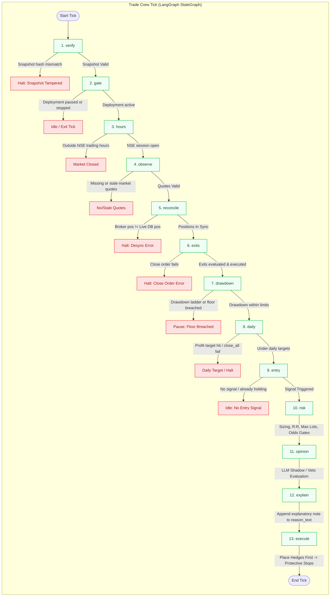
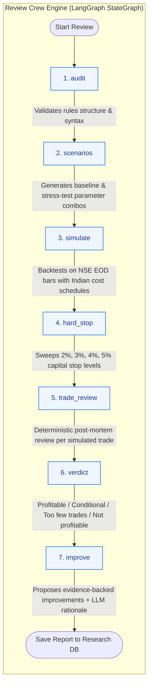
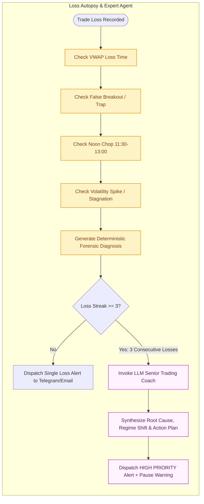
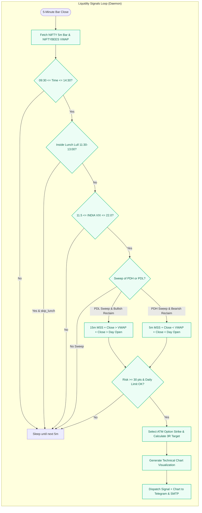
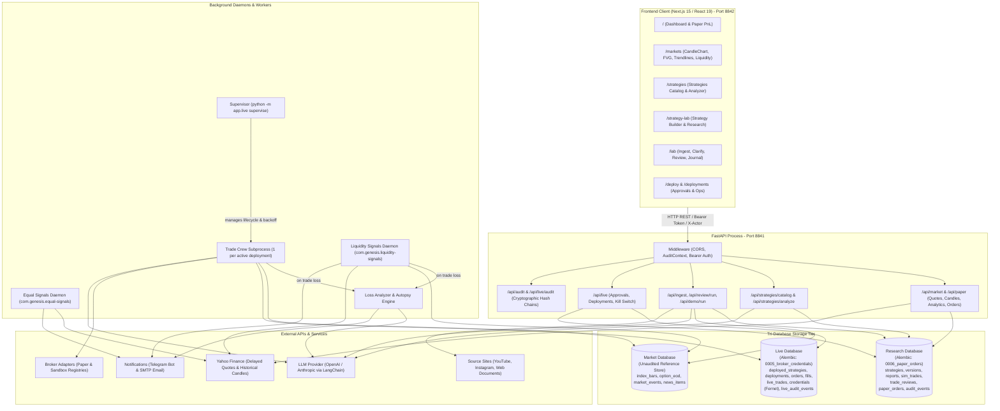

# Genesis: Current System Architecture & Agent Flows Specification

*Source of truth: Active repository code (`backend/app/`, `frontend/src/`, `backend/deploy/`, `backend/scripts/`)*  
*Last updated: 2026-10-22*

---

## 1. System Overview & Core Agents Matrix

The Genesis platform has evolved from a basic backtest-and-review engine into a multi-agent quantitative trading ecosystem comprising:

| Component / Agent | Implementation File(s) | Architecture / Tech | Role & Execution Context |
| :--- | :--- | :--- | :--- |
| **Trade Crew** | `backend/app/agents/trade_crew/graph.py` | LangGraph StateGraph | Live & paper trading decision loop. Runs as an isolated worker subprocess per active deployment. Rules in code decide; LLM only has optional shadow/veto authority. |
| **Review Crew** | `backend/app/agents/review_crew/graph.py` | LangGraph StateGraph | Deterministic multi-scenario backtesting, stress testing, capital hard-stop sweep, per-trade post-mortem review, and improvement proposal generation. |
| **Loss Analyzer Agent** | `backend/app/loss_analyzer.py` | Deterministic Autopsy + LLM Expert | Automated forensic analysis for losing trades (VWAP loss, false breakout traps, noon chop, volatility spikes). Triggers LLM expert interventions on 3-loss streaks. |
| **Strategy Analyzer Agent**| `backend/app/strategies/analyzer.py` | Multi-Pillar Institutional Auditor | 5-pillar institutional strategy audit (Edge, Risk-Reward, Feasibility, Capital Floor, Execution Risk) and catalog evaluation for `/strategies`. |
| **Liquidity Signals Daemon** | `backend/app/liquidity_signals.py` | Background Daemon (`launchd`/`systemd`) | Real-time 5m/15m NIFTY liquidity sweep detection (PDH/PDL raid, 15m MSS, VWAP reclaim, lunch-lull filter, ATM option strike picker, and alert delivery). |
| **Equal Signals Daemon** | `backend/app/equal_signals.py` | Background Daemon (`launchd`/`systemd`) | Real-time detection of Equal Highs (EQH) and Equal Lows (EQL) liquidity pool sweeps. |
| **Market Structure Engine**| `backend/app/market/chart_analytics.py` | Non-repainting Analytics Engine | Mathematically verified swing points (`HH`, `HL`, `LH`, `LL`, `EQH`, `EQL`), Market Structure Break (`BOS`), Change of Character (`CHoCH`), Dynamic Trendlines, and FVG zones. |
| **Supervisor** | `backend/app/live/supervisor.py` | Process Controller | Supervises all active Trade Crew deployments, restarts crashes with exponential backoff (5s to 5m), monitors capital floor pauses. |
| **FastAPI Backend** | `backend/app/main.py`, `backend/app/api/` | FastAPI / Pydantic v2 | Port 8841. Exposes endpoints for Ingest, Review, Strategies & Analyzer, Market Analytics, Paper Trading, and Live Control Plane. |
| **Next.js Frontend** | `frontend/src/` | Next.js 15, React 19, Tailwind CSS | Port 8842 (or 3000). Features `/`, `/markets`, `/strategies`, `/strategy-lab`, `/lab`, `/deploy`, `/deployments`. |

---

## 2. Agent Flow Diagrams

### A. Trade Crew Agent Tick Flow (`backend/app/agents/trade_crew/graph.py`)

Each tick executes the state graph sequentially. The tick stops early if any guard or gate triggers.



---

### B. Review Crew Agent Flow (`backend/app/agents/review_crew/graph.py`)

Invoked via `POST /api/review/run` inside the Strategy Lab.



---

### C. Loss Forensic Autopsy & Consecutive Loss Expert Agent (`backend/app/loss_analyzer.py`)

Runs whenever a trade incurs a loss, and escalates to an LLM Senior Risk Partner on consecutive losing streaks.



---

### D. Real-Time Liquidity Sweep Daemon Flow (`backend/app/liquidity_signals.py`)

Runs every 5 minutes during the market session via macOS `launchd` / `systemd`.



---

## 3. High-Level System Architecture Diagram



---

## 4. Market Structure & Chart Analytics Architecture

The engine in `backend/app/market/chart_analytics.py` powers the interactive chart in `/markets`:

```mermaid
flowchart LR
    Bars[Raw 5m / 15m OHLCV Bars] --> SwingDetect[Swing High / Low Detection (2L/2R)]
    SwingDetect --> Classify[Classification: HH, HL, LH, LL, EQH, EQL]
    
    Classify --> BOS[BOS & CHoCH Event Detection]
    Classify --> Trendlines[Ascending Support & Descending Resistance Lines]
    Bars --> FVG[Fair Value Gap (FVG) Detection]
    Bars --> OB[Order Block Identification]
    Bars --> VWAP[Robust Session VWAP (ETF Proxy)]
    
    BOS & Trendlines & FVG & OB & VWAP --> Aggregator[enrich_chart_payload]
    Aggregator --> APIOut[FastAPI /api/market/candles Response]
    APIOut --> FrontendChart[CandleChart.tsx + TradingDecisionDashboard.tsx]
```

---

## 5. Security, Auditability, and Invariants

1. **Deterministic Execution**:
   - Trading decisions (entries, sizing, exits, trailing stops) are computed strictly in deterministic Python code.
   - The LLM cannot place, modify, or close trades. It has optional *Shadow* (observation) or *Veto* (skip/reduce approved entry) capabilities only.
2. **Cryptographic Provenance**:
   - When a strategy is approved for deployment, its exact `content_sha256` and `rules_sha256` are frozen into `deployed_strategies`.
   - The Trade Crew verifies these hashes on every single tick; any tampering or discrepancy immediately halts trading.
3. **Dual Append-Only Hash Chains**:
   - Every mutation in the Research DB writes to `audit_events`.
   - Every mutation in the Live DB writes to `live_audit_events`.
   - Each audit event includes `hash = sha256(prev_hash + canonical_json_payload)`, allowing mathematical proof of tamper resistance via `GET /api/audit/verify` and `GET /api/live/audit/verify`.
