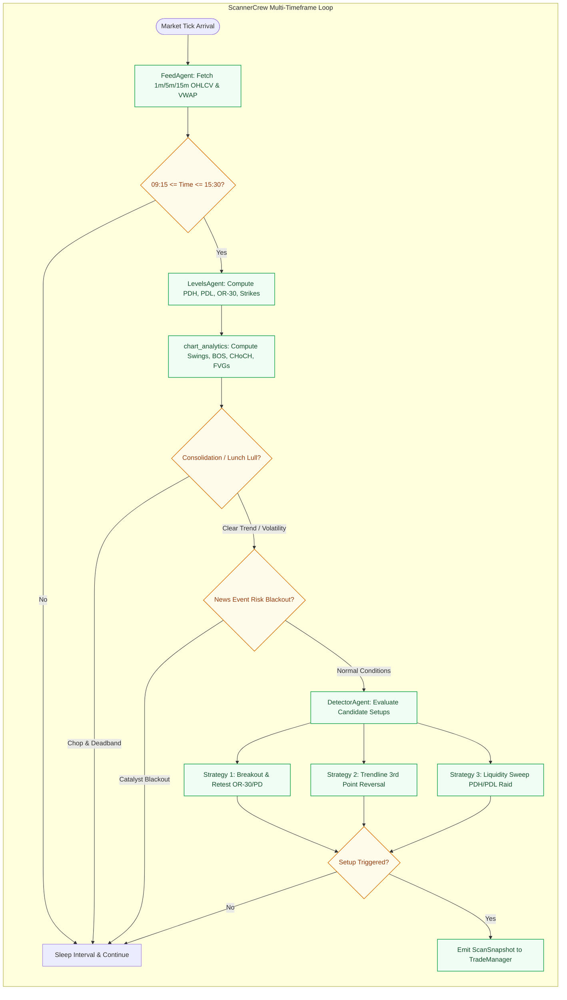
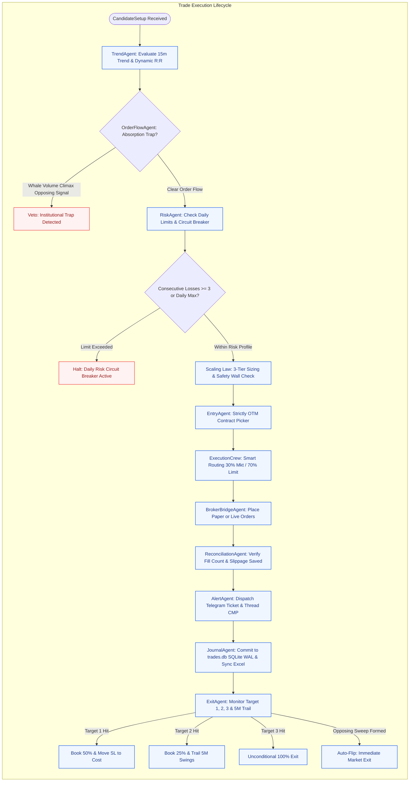
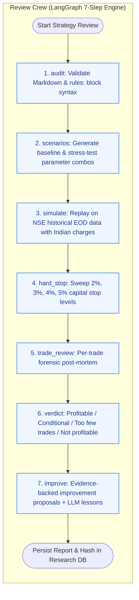
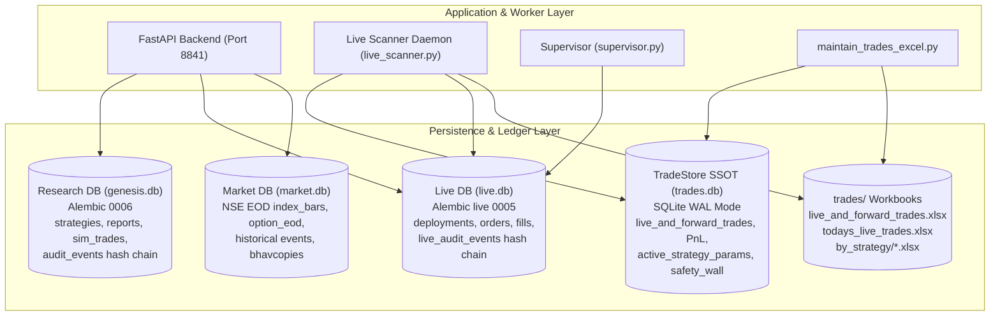

# Genesis: System Architecture & Autonomous Agent Flows Specification

*Source of truth: Active repository code (`backend/app/`, `frontend/src/`, `scripts/`, `trades/`)*  
*Last updated: 2026-10-30*

---

## 1. System Overview & Core Autonomous Crews Matrix

Genesis is an institutional quantitative trading, strategy research, and automated execution platform engineered for the Indian equity derivatives markets (NSE NIFTY and BANKNIFTY index options). 

The platform is organized around **5 Autonomous Specialized Crews** operating continuously across the trading day, accompanied by a deterministic **Review Crew**, a research **Strategy Lab**, and an immutable multi-tier persistence tier.

| Crew / Component | Core Manager & Agents | Implementation Files | Execution Window | Role & Responsibilities |
| :--- | :--- | :--- | :--- | :--- |
| **1. PreMarketCrew** | `PreMarketManager` - `GapAgent` - `GammaAgent` - `EventRiskAgent` | `backend/app/trading/pre_market_crew/` | 08:30 – 09:14 IST | Ingests GIFT NIFTY vs PDC gap bias, computes Call/Put dealer gamma walls, calculates Max Pain & PCR, checks macro event blackouts (RBI MPC, CPI, FED), formats `trades/pre_market_plan.json`, and dispatches the 09:05 IST Battleplan to Telegram. |
| **2. ScannerCrew** | `ScannerManager` - `FeedAgent` - `LevelsAgent` - `ConsolidationAgent` - `NewsAgent` - `DetectorAgent` | `backend/app/trading/scanner_crew/` | 09:15 – 15:30 IST (1m, 2m, 5m, 15m) | Multi-timeframe delta polling & ETF VWAP proxy, dynamic level projection (PDH, PDL, PDC, OR-30, round strikes), compression box & ATR deadband filtering (Lunch Lull 11:30-13:00), macro sentiment screening, and pattern detection across Breakout & Retest, Liquidity Sweep, and Trendline Reversal. Emits real-time `ScanSnapshot`. |
| **3. TradeCrew** | `TradeManager` - `TrendAgent` - `RiskAgent` - `OrderFlowAgent` - `EntryAgent` - `ExitAgent` - `AlertAgent` - `JournalAgent` | `backend/app/trading/crew/` | Live Market Hours (Continuous) | Evaluates macro trend slopes and dynamic R:R targets (+1.8R to +4.5R), enforces daily loss circuit breakers and the 50% Capital Safety Wall, checks whale volume absorption traps, triggers micro-wick entries with strictly OTM option strikes, manages Target 1/2/3 partial book & trail, dispatches Telegram tickets, and commits ACID transactions to the `trades.db` SQLite SSOT. |
| **4. ExecutionCrew** | `ExecutionManager` - `SmartRoutingAgent` - `BrokerBridgeAgent` - `ReconciliationAgent` | `backend/app/trading/execution_crew/` | Order Dispatch & Fills | Splits orders into 30% market fill + 70% limit-chasing tranches to minimize slippage, bridges to live broker APIs or zero-slippage paper emulator, and performs real-time zero-drift position reconciliation between broker account and local database. |
| **5. PostMarketCrew** | `PostMarketManager` - `AutopsyAgent` - `ParameterAgent` - `SafetyWallAgent` - `CodeQualityAgent` - `BriefingAgent` | `backend/app/trading/post_market_crew/` | 15:31+ IST Daily | Reconstructs the day's intraday tape, audits execution against hypothetical perfection, flags missed trades, runs walk-forward parameter sweeps, locks 50% of net profits into the permanent Capital Safety Wall, checks system logs & latency bottlenecks, writes `reports/daily_audit_YYYY-MM-DD.md`, and dispatches the Executive Digest to Telegram. |
| **Review Crew** | LangGraph StateGraph | `backend/app/agents/review_crew/` | On-Demand (Lab) | 7-step deterministic backtest & forward-test engine with Indian cost models (STT, exchange fees, GST, SEBI, stamp duty, slippage), hard-stop capital sweeps (2-5%), trade-by-trade post-mortems, and evidence-backed improvement proposals. |
| **Strategy Analyzer** | `InstitutionalStrategyAnalyzer` | `backend/app/strategies/analyzer.py` | On-Demand (API) | Evaluates strategies against the 5 Institutional Pillars (Edge, Risk-Reward, Feasibility, Capital Floor, Execution Risk) and generates catalog scorecards. |
| **Loss Forensic Agent**| `LossAnalyzer` | `backend/app/loss_analyzer.py` | Event-Triggered | Automated autopsy on any losing trade; escalates to an LLM Senior Trading Partner upon encountering 3 consecutive losses. |
| **Market Analytics** | `chart_analytics.py` | `backend/app/market/chart_analytics.py` | Real-Time / API | Computes non-repainting swing pivots (HH, HL, LH, LL, EQH, EQL), Market Structure Break (`BOS`), Change of Character (`CHoCH`), Fair Value Gaps (`FVG`), and Dynamic Trendlines. |
| **Supervisor Daemon**| `Supervisor` | `backend/app/live/supervisor.py` | Background Daemon | Manages worker subprocesses for active deployments with exponential backoff crash recovery (5s to 5m) and capital floor monitoring. |

---

## 2. End-to-End Daily Operational Lifecycle

```mermaid
flowchart TD
    subgraph PreSession["Phase 1: Pre-Market Preparation (08:30 - 09:14 IST)"]
        direction TB
        P0[08:30 IST: PreMarketManager Wakes] --> P1[GapAgent: Ingest GIFT NIFTY & PDC]
        P1 --> P2[GammaAgent: Option Chain Call/Put Walls & Max Pain]
        P2 --> P3[EventRiskAgent: Calendar & High-Impact Catalysts]
        P3 --> P4[Compile trades/pre_market_plan.json]
        P4 --> P5[09:05 IST: Dispatch Morning Battleplan to Telegram]
    end

    subgraph LiveSession["Phase 2: Live Scanning & Execution (09:15 - 15:30 IST)"]
        direction TB
        L0[09:15 IST: Live Scanner Daemon Active] --> L1[FeedAgent: Multi-Timeframe Delta Polling 1m, 5m, 15m]
        L1 --> L2[LevelsAgent: Map PDH, PDL, OR-30 & Psychological Strikes]
        L2 --> L3[ConsolidationAgent & NewsAgent: Lunch Lull & Event Blackout Filter]
        L3 --> L4[DetectorAgent: Multi-Strategy Pattern Recognition]
        
        L4 -->|CandidateSetup| L5{TradeManager Evaluation}
        L5 --> L6[TrendAgent: Macro Regime & Dynamic R:R]
        L6 --> L7[RiskAgent: 3-Tier Sizing & Safety Wall Check]
        L7 --> L8[OrderFlowAgent: Whale Volume Absorption Trap Veto]
        
        L8 -->|Approved Decision| L9[ExecutionCrew: Smart Routing Tranches & Broker Bridge]
        L9 --> L10[AlertAgent: Dispatch Telegram Ticket & CMP Threads]
        L10 --> L11[JournalAgent: ACID Commit to trades.db SQLite WAL & Excel Sync]
        
        L11 --> L12[ExitAgent: Target 1 / 2 / 3 Execution & 5M Trail]
    end

    subgraph PostSession["Phase 3: Post-Market Forensic Audit (15:31+ IST)"]
        direction TB
        A0[15:31 IST: PostMarketManager Wakes] --> A1[AutopsyAgent: Tape Reconstruction & Exit Audit]
        A1 --> A2[ParameterAgent: Walk-Forward R:R Optimization]
        A2 --> A3[SafetyWallAgent: Lock 50% Realized Profit into Capital Reserve]
        A3 --> A4[CodeQualityAgent: Latency & Memory Audit]
        A4 --> A5[BriefingAgent: Generate reports/daily_audit_*.md]
        A5 --> A6[Dispatch Daily Executive Digest to Telegram]
        A6 --> A7[Persist daily_risk_config.json for Tomorrow]
    end

    PreSession --> LiveSession
    LiveSession --> PostSession

    classDef pre fill:#eff6ff,stroke:#3b82f6,stroke-width:1.5px,color:#1e3a8a;
    classDef live fill:#f0fdf4,stroke:#22c55e,stroke-width:1.5px,color:#14532d;
    classDef post fill:#fff1f2,stroke:#f43f5e,stroke-width:1.5px,color:#9f1239;
    class P0,P1,P2,P3,P4,P5 pre;
    class L0,L1,L2,L3,L4,L5,L6,L7,L8,L9,L10,L11,L12 live;
    class A0,A1,A2,A3,A4,A5,A6,A7 post;
```

---

## 3. Detailed Agent Flow Diagrams

### A. Live Scanner & Multi-Timeframe Pattern Detection Loop

The daemon (`scripts/live_scanner.py`) executes continuously across configured timeframes (default: `1m, 5m, 15m`).

---

### B. Trade Crew Decision & Execution Lifecycle

When `TradeManager` receives an actionable candidate setup, it coordinates sizing, validation, and order routing:

---

### C. Review Crew Research Engine (LangGraph StateGraph)

Invoked via the Strategy Lab (`POST /api/review/run`) to backtest and forward-test strategies with Indian options charges.

---

## 4. Quantitative Risk & Sizing Architecture

### A. The 3-Tier Execution Framework
Genesis eliminates static lot sizing in favor of a mathematically rigorous 3-Tier sizing model configured in `trades/daily_risk_config.json`:

1. **Tier 1: Standard Momentum (3 Lots 1-OTM)**
   - Contract: Strictly 1 strike Out-of-the-Money (50 to 100 points away from spot).
   - Lot Size: 3 lots (195 index shares).
   - Purpose: Captures high delta expansion during verified momentum breaks while minimizing theta decay.
2. **Tier 2: Super-Trend Expansion (4 Lots 2-OTM)**
   - Contract: 2 strikes Out-of-the-Money.
   - Lot Size: 4 lots (260 index shares).
   - Purpose: Deployed during multi-timeframe aligned institutional trends; delivers convex gamma upside.
3. **Tier 3: Scalp / Counter-Trend Mode (2 Lots ATM)**
   - Contract: At-the-Money (highest delta sensitivity).
   - Lot Size: 2 lots (130 index shares).
   - Purpose: Fast absorption trades with tight 20-30 pt spot invalidation.

### B. Institutional 50% Capital Safety Wall
To prevent give-back of trading profits, Genesis enforces the **Capital Safety Wall**:

$$\text{Safety Wall Reserve} = 0.50 \times \max(0, \text{Cumulative Net Realized Profits})$$
$$\text{Tradeable Risk Capital} = \text{Base Capital} + 0.50 \times \text{Cumulative Net Realized Profits}$$

- 50% of all accumulated profits are permanently locked into the capital floor.
- Drawdowns are calculated strictly against the tradeable surplus. If the floor is touched, trading is automatically halted.

---

## 5. Storage Tier & Single Source of Truth (SSOT)

### Invariants & Non-Repudiation
1. **Zero LLM Trade Authority**: Trading entries and exits are strictly executed by deterministic algorithms in code. The LLM has zero authority to open, modify, or close a trade.
2. **Cryptographic Provenance**: Every approved deployment freezes `content_sha256` and `rules_sha256`. The execution engine validates these hashes on every tick.
3. **Dual Cryptographic Hash Chains**: Every state mutation produces a record in `audit_events` or `live_audit_events` with `hash = sha256(prev_hash + canonical_json_payload)`, verifiable via `GET /api/audit/verify`.
