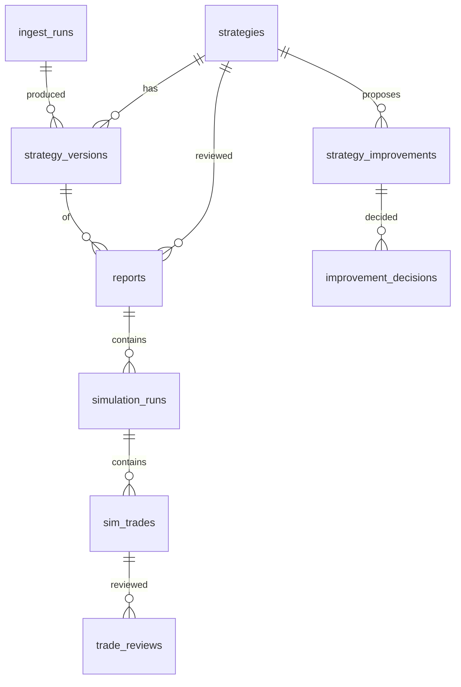
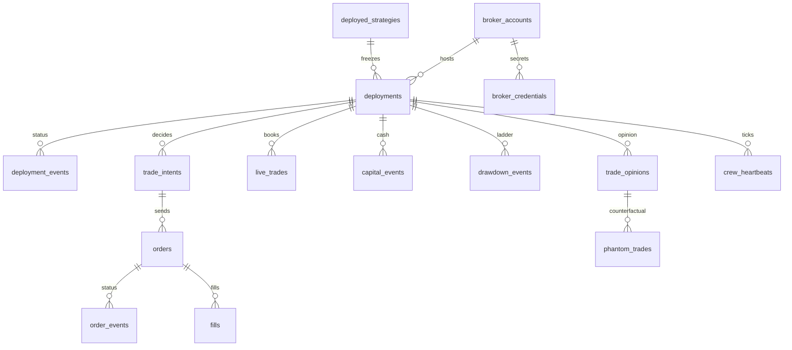

# Current Database Architecture

Schema of Trading Strategy Lab as created by the current ORM and migrations. No live database was opened. Where a comment in an older migration describes tables that `0004_split_live` drops, the head revision is the applied schema.

Analysis date: 2026-10-08.

There are three databases. They do not share foreign keys.

| Database | URL setting | Default | Schema source | Bookkeeping |
| --- | --- | --- | --- | --- |
| Research | `DATABASE_URL` | `sqlite:///data/genesis.db` | Alembic `backend/alembic`, head `0005_sim_v3` | `alembic_version` |
| Live | `LIVE_DATABASE_URL` | `sqlite:///data/genesis_live.db` | Alembic `backend/alembic_live`, head `0005_broker_credentials` | `alembic_version` in that file |
| Market | `MARKET_DATABASE_URL` | `sqlite:///data/market_eod.db` | `MarketBase.metadata.create_all` in `backend/app/market/store.py` | None |

---

## 1. Current database technology

| Item | Fact |
| --- | --- |
| Default platform | SQLite. WAL mode, foreign keys on, writes use `BEGIN IMMEDIATE` (see `backend/app/db/session.py`). |
| Also accepted | PostgreSQL through SQLAlchemy URL `postgresql+psycopg://...`. `psycopg` is not declared in `backend/pyproject.toml`. |
| ORM | SQLAlchemy 2. Research models use `Base`. Live models use `LiveBase`. Market models use `MarketBase`. |
| Primary keys | UUID strings (`String(36)`, Python `uuid4`) or integer `autoincrement`. Not `gen_random_uuid()`. |
| Money | `Numeric(18, 4)` via `Money` in `backend/app/db/types.py`. |
| Timestamps | `UTCDateTime`. PostgreSQL stores `timestamptz`. SQLite stores naive UTC and the type decorator restores UTC on read. |
| JSON | SQLAlchemy `JSON`. |
| Migrations | Two Alembic configs in `backend/alembic.ini`: default env, and `[live]` (`uv run alembic -n live`). |
| Market migrations | None. Tables appear on first open. |

### Research revision chain

`0001_core_sim` → `0002_live_schema` → `0003_journal` → `0004_split_live` → `0005_sim_v3`.

`0002_live_schema` created live tables inside the research database. `0004_split_live` drops them. It aborts if any of those tables still has rows. After head, live tables exist only in the live database.

### Live revision chain

`0001_live` → `0002_opinions` → `0003_drawdown` → `0004_partial_trades` → `0005_broker_credentials`.

### Technology classification

| Technology | Status | Evidence |
| --- | --- | --- |
| SQLite | Default for all three databases | `backend/app/config.py` defaults |
| PostgreSQL | Supported for research and live URLs | README and settings. Not the default |
| Market SQLite | Active, replaceable | Importers rewrite reference data. Reports store a fingerprint instead of auditing this file |
| pgvector, Redis, Neo4j | Not used | No extension and no client |

---

## 2. Current tables

Class:

- **CORE** — written by a current product path.
- **AUDIT** — hash-chained append-only log.
- **VIEW** — not a table.

`strategies` is **NoDelete**: updates are allowed, deletes are not. Every other research and live table below is **AppendOnly**. Market tables are ordinary tables.

### Research (`Base`)

| Table | ORM | Created | Later changes | Class | Role |
| --- | --- | --- | --- | --- | --- |
| `strategies` | `Strategy` | `0001` | — | CORE | Strategy identity. `current_version` and `archived_at` are updated |
| `ingest_runs` | `IngestRun` | `0001` | — | CORE | One extract attempt |
| `strategy_versions` | `StrategyVersion` | `0001` | — | CORE | Immutable Markdown snapshot |
| `reports` | `Report` | `0001` | — | CORE | One Review Crew result |
| `simulation_runs` | `SimulationRun` | `0001` | `0005` adds data-source and equity columns | CORE | One scenario window |
| `sim_trades` | `SimTrade` | `0001` | `0005` adds legs, expiry, exit date | CORE | One simulated trade |
| `audit_events` | `AuditEvent` | `0001` | — | AUDIT | Research hash chain |
| `trade_reviews` | `TradeReview` | `0003` | `0004` restricts to `trade_kind = 'sim'` | CORE | Reviews of simulated trades |
| `strategy_improvements` | `StrategyImprovement` | `0003` | — | CORE | Proposed change with evidence |
| `improvement_decisions` | `ImprovementDecision` | `0003` | — | CORE | Accept, reject, or apply |
| `trade_journal` | — | `0003`, rebuilt in `0004` | — | VIEW | Sim trades joined for `GET /api/journal` |

### Live (`LiveBase`)

All created in `alembic_live`, not in the research head.

| Table | ORM | Creating revision | Later revisions | Class | Role |
| --- | --- | --- | --- | --- | --- |
| `deployed_strategies` | `DeployedStrategy` | `0001_live` | — | CORE | Frozen approved strategy |
| `broker_accounts` | `BrokerAccount` | `0001_live` | — | CORE | Paper or live account |
| `deployments` | `Deployment` | `0001_live` | — | CORE | One approval of a frozen strategy on an account |
| `deployment_events` | `DeploymentEvent` | `0001_live` | — | CORE | approved, started, paused, stopped, halted, and later notices |
| `trade_intents` | `TradeIntent` | `0001_live` | — | CORE | Entry, exit, or protect decision |
| `orders` | `Order` | `0001_live` | — | CORE | One broker order |
| `order_events` | `OrderEvent` | `0001_live` | — | CORE | Status and fill progress |
| `fills` | `Fill` | `0001_live` | — | CORE | One fill |
| `live_trades` | `LiveTrade` | `0001_live` | `0004` adds `partial` | CORE | Closed or partially closed trade |
| `broker_charges` | `BrokerCharge` | `0001_live` | — | CORE | Broker-reported charges |
| `position_snapshots` | `PositionSnapshot` | `0001_live` | `0003` adds `deployment_id` | CORE | Mark-to-market snapshot |
| `live_trade_reviews` | `LiveTradeReview` | `0001_live` | — | CORE | Reviews of live trades |
| `live_audit_events` | `LiveAuditEvent` | `0001_live` | — | AUDIT | Live hash chain |
| `trade_opinions` | `TradeOpinion` | `0002_opinions` | — | CORE | LLM take / reduce / skip |
| `phantom_trades` | `PhantomTrade` | `0002_opinions` | — | CORE | Lots the veto removed |
| `capital_events` | `CapitalEvent` | `0003_drawdown` | — | CORE | Deposit or withdrawal |
| `drawdown_events` | `DrawdownEvent` | `0003_drawdown` | — | CORE | Ladder level change |
| `broker_credentials` | `BrokerCredential` | `0005_broker_credentials` | — | CORE | Encrypted credential field |
| `crew_heartbeats` | `CrewHeartbeat` | `0005_broker_credentials` | — | CORE | One row per tick |

### Market (`MarketBase`)

| Table | ORM | Role |
| --- | --- | --- |
| `index_bars` | `IndexBar` | Underlying OHLC, India VIX, IV rank |
| `option_eod` | `OptionEod` | One option contract close |
| `import_files` | `ImportFile` | SHA-256 of a file already imported |
| `market_events` | `MarketEvent` | Calendar event |
| `news_items` | `NewsItem` | Headline |

---

## 3. Column-level analysis

Conventions:

- `str36` is `String(36)`. `strN` is `String(N)`. `text` is `Text`. `int` is `Integer`. `bool` is `Boolean`. `float` is `Float`. `json` is `JSON`. `money` is `Numeric(18, 4)`. `ts` is `UTCDateTime`.
- Nullability follows the ORM. Columns without `nullable=True` are not null, except where a server default is noted.
- Foreign keys use the naming convention `fk_<table>_<column>_<referred table>`. `ON DELETE` is not set, so PostgreSQL uses NO ACTION. SQLite foreign-key enforcement is turned on for the audited databases.
- Check constraints are named `ck_<table>_<name>`.

### `strategies`

Updates: `current_version`, `archived_at`. Deletes: blocked.

| Column | Type | Null | Notes |
| --- | --- | --- | --- |
| `id` | str36 | no | PK, Python UUID |
| `name` | str200 | no | |
| `current_version` | int | no | Updated when a version is added |
| `created_at` | ts | no | |
| `archived_at` | ts | yes | Set by archive. The row stays |

### `ingest_runs`

| Column | Type | Null | Notes |
| --- | --- | --- | --- |
| `id` | str36 | no | PK |
| `source_type` | str32 | no | youtube, instagram, document, notebooklm, markdown |
| `source_url` | text | yes | |
| `source_text` | text | yes | |
| `source_sha256` | str64 | yes | |
| `hints` | text | yes | |
| `extractor` | str32 | yes | llm, fixture, or passthrough |
| `model` | str100 | yes | |
| `raw_output` | text | yes | |
| `status` | str16 | no | |
| `error` | text | yes | |
| `actor` | str128 | no | |
| `request_id` | str64 | yes | |
| `started_at` | ts | no | |
| `finished_at` | ts | no | |

### `strategy_versions`

Unique `(strategy_id, version)`.

| Column | Type | Null | Notes |
| --- | --- | --- | --- |
| `id` | int | no | PK, autoincrement |
| `strategy_id` | str36 | no | FK `strategies.id`, indexed |
| `version` | int | no | |
| `markdown` | text | no | |
| `content_sha256` | str64 | no | |
| `frontmatter` | json | no | Includes `rules` when present |
| `entry_rules` | json | no | List of strings |
| `exit_rules` | json | no | |
| `gaps` | json | no | |
| `ingest_run_id` | str36 | yes | FK `ingest_runs.id` |
| `created_by` | str128 | no | |
| `created_at` | ts | no | |

### `reports`

Index `ix_reports_strategy_started` on `(strategy_id, started_at)`.

| Column | Type | Null | Notes |
| --- | --- | --- | --- |
| `id` | str36 | no | PK |
| `strategy_id` | str36 | no | FK `strategies.id` |
| `strategy_version_id` | int | no | FK `strategy_versions.id` |
| `status` | str16 | no | |
| `verdict_label` | str32 | yes | |
| `scenarios_tested` | int | yes | |
| `scenarios_passing` | int | yes | |
| `inputs` | json | no | Provenance snapshot |
| `payload` | json | yes | Includes `hard_stop_sweep` |
| `payload_sha256` | str64 | yes | |
| `error` | text | yes | |
| `actor` | str128 | no | |
| `request_id` | str64 | yes | |
| `started_at` | ts | no | |
| `finished_at` | ts | no | |

### `simulation_runs`

Unique `(report_id, scenario_index, mode)`.

| Column | Type | Null | Notes |
| --- | --- | --- | --- |
| `id` | int | no | PK |
| `report_id` | str36 | no | FK `reports.id`, indexed |
| `scenario_index` | int | no | |
| `scenario` | json | no | |
| `mode` | str16 | no | backtest or forward |
| `window_start` | str10 | yes | |
| `window_end` | str10 | yes | |
| `bars_in_window` | int | no | |
| `trade_count` | int | no | |
| `gross_pnl` | money | no | |
| `total_costs` | money | no | |
| `net_pnl` | money | no | |
| `win_rate` | float | no | |
| `max_drawdown` | money | no | |
| `pass_net` | bool | no | |
| `trades_sha256` | str64 | no | |
| `data_source` | str32 | yes | Added in `0005`. Null on older rows |
| `equity_curve` | json | yes | `0005` |
| `max_drawdown_mtm` | money | yes | `0005` |
| `max_drawdown_days` | int | yes | `0005` |
| `by_year` | json | yes | `0005` |
| `skipped` | json | yes | `0005` |

### `sim_trades`

Unique `(simulation_run_id, seq)`. Index `ix_sim_trades_report_date` on `(report_id, trade_date)`.

| Column | Type | Null | Notes |
| --- | --- | --- | --- |
| `id` | int | no | PK |
| `simulation_run_id` | int | no | FK `simulation_runs.id` |
| `report_id` | str36 | no | FK `reports.id` |
| `strategy_version_id` | int | no | FK `strategy_versions.id` |
| `seq` | int | no | |
| `trade_date` | str10 | no | |
| `entry_rule` | text | no | |
| `entry_conditions` | json | no | |
| `reason_text` | text | no | |
| `edge` | float | no | |
| `market_snapshot` | json | no | |
| `lots` | int | no | |
| `credit` | money | no | |
| `max_loss` | money | no | |
| `notional` | money | no | |
| `orders` | int | no | |
| `cost_breakdown` | json | no | |
| `exit_rule` | text | no | |
| `exit_reason` | str64 | no | |
| `holding_bars` | int | no | |
| `target_pnl` | money | no | |
| `stop_loss_pnl` | money | no | |
| `risk_reward` | float | no | |
| `gross` | money | no | |
| `costs` | money | no | |
| `net` | money | no | |
| `pnl_vs_target` | money | no | |
| `cost_ratio` | float | yes | |
| `outcome_label` | str16 | no | win, loss, or scratch |
| `equity_after` | money | no | |
| `drawdown_after` | money | no | |
| `legs` | json | yes | `0005` |
| `expiry` | str10 | yes | `0005` |
| `exit_date` | str10 | yes | `0005` |

### `trade_reviews`

Check `sim_trade_only`: `trade_kind = 'sim' AND sim_trade_id IS NOT NULL`.

| Column | Type | Null | Notes |
| --- | --- | --- | --- |
| `id` | int | no | PK |
| `trade_kind` | str8 | no | Must be `sim` |
| `sim_trade_id` | int | yes | FK `sim_trades.id`, indexed. Check requires it |
| `reviewer_type` | str16 | no | `agent` or human |
| `reviewer` | str128 | no | |
| `rules_version` | str16 | yes | |
| `followed_plan` | bool | yes | |
| `process_verdict` | str48 | yes | |
| `what_went_well` | text | yes | |
| `what_went_wrong` | text | yes | |
| `mistake_tags` | json | no | |
| `lesson` | text | yes | |
| `improvement_suggestion` | text | yes | |
| `suggested_rule_change` | json | yes | |
| `confidence` | float | yes | |
| `supersedes_review_id` | int | yes | FK `trade_reviews.id` |
| `created_at` | ts | no | |

### `strategy_improvements`

| Column | Type | Null | Notes |
| --- | --- | --- | --- |
| `id` | int | no | PK |
| `strategy_id` | str36 | no | FK `strategies.id`, indexed |
| `from_version_id` | int | no | FK `strategy_versions.id` |
| `origin` | str16 | no | |
| `report_id` | str36 | yes | FK `reports.id` |
| `title` | str200 | no | |
| `rationale` | text | no | |
| `proposed_change` | json | no | |
| `evidence` | json | no | |
| `expected_impact` | text | yes | |
| `proposed_by` | str128 | no | |
| `created_at` | ts | no | |

### `improvement_decisions`

| Column | Type | Null | Notes |
| --- | --- | --- | --- |
| `id` | int | no | PK |
| `improvement_id` | int | no | FK `strategy_improvements.id`, indexed |
| `decision` | str16 | no | accepted, rejected, or applied |
| `note` | text | yes | |
| `resulting_version_id` | int | yes | FK `strategy_versions.id`. Set when applied |
| `decided_by` | str128 | no | |
| `created_at` | ts | no | |

### `audit_events` and `live_audit_events`

Same columns. Unique `prev_hash` and unique `hash`. Index on `(entity_type, entity_id)` (`ix_audit_events_entity`, `ix_live_audit_events_entity`).

| Column | Type | Null | Notes |
| --- | --- | --- | --- |
| `id` | int | no | PK |
| `occurred_at` | ts | no | |
| `actor` | str128 | no | |
| `request_id` | str64 | yes | |
| `action` | str64 | no | |
| `entity_type` | str64 | no | |
| `entity_id` | str64 | no | |
| `details` | json | no | |
| `prev_hash` | str64 | no | |
| `hash` | str64 | no | |

### `deployed_strategies`

No foreign key to the research database. `strategy_id` and `strategy_version_id` are copies.

| Column | Type | Null | Notes |
| --- | --- | --- | --- |
| `id` | str36 | no | PK |
| `strategy_id` | str36 | no | Indexed copy |
| `strategy_version_id` | int | no | Copy |
| `version` | int | no | |
| `name` | str200 | no | |
| `markdown` | text | no | Frozen text |
| `content_sha256` | str64 | no | |
| `rules` | json | no | Frozen rules |
| `rules_sha256` | str64 | no | |
| `report_id` | str36 | yes | Copy |
| `verdict_label` | str32 | yes | |
| `approved_by` | str128 | no | |
| `approved_at` | ts | no | |

### `broker_accounts`

| Column | Type | Null | Notes |
| --- | --- | --- | --- |
| `id` | str36 | no | PK |
| `broker` | str32 | no | `paper` or `sandbox` in this tree |
| `account_ref_masked` | str64 | no | |
| `mode` | str16 | no | paper or live |
| `default_algo_id` | str64 | yes | |
| `created_at` | ts | no | |

### `deployments`

| Column | Type | Null | Notes |
| --- | --- | --- | --- |
| `id` | str36 | no | PK |
| `deployed_strategy_id` | str36 | no | FK `deployed_strategies.id`, indexed |
| `strategy_id` | str36 | no | Indexed copy |
| `strategy_version_id` | int | no | Copy |
| `broker_account_id` | str36 | no | FK `broker_accounts.id` |
| `mode` | str16 | no | |
| `sebi_algo_id` | str64 | yes | |
| `risk_limits` | json | no | Capital, lots, drawdown, policy |
| `approved_by` | str128 | yes | |
| `created_at` | ts | no | |

### `deployment_events`

| Column | Type | Null | Notes |
| --- | --- | --- | --- |
| `id` | int | no | PK |
| `deployment_id` | str36 | no | FK `deployments.id`, indexed |
| `event` | str32 | no | Latest event is the deployment state |
| `reason` | text | yes | |
| `actor` | str128 | no | |
| `created_at` | ts | no | |

### `trade_intents`

| Column | Type | Null | Notes |
| --- | --- | --- | --- |
| `id` | str36 | no | PK |
| `deployment_id` | str36 | no | FK `deployments.id`, indexed |
| `deployed_strategy_id` | str36 | no | FK `deployed_strategies.id` |
| `strategy_version_id` | int | no | |
| `action` | str16 | no | |
| `legs` | json | no | |
| `entry_rule` | text | yes | |
| `entry_conditions` | json | no | |
| `reason_text` | text | no | |
| `market_snapshot` | json | no | |
| `thesis_ref` | str128 | yes | |
| `target_pnl` | money | yes | |
| `stop_loss_pnl` | money | yes | |
| `max_loss` | money | yes | |
| `risk_reward` | float | yes | |
| `confidence` | float | yes | |
| `risk_checks` | json | no | |
| `decided_by` | str128 | no | |
| `model` | str100 | yes | Set when an LLM note was attached |
| `approval` | str16 | no | auto, blocked, or vetoed |
| `approved_by` | str128 | yes | |
| `decided_at` | ts | no | |

### `orders`

`client_order_id` is unique.

| Column | Type | Null | Notes |
| --- | --- | --- | --- |
| `id` | str36 | no | PK |
| `trade_intent_id` | str36 | no | FK `trade_intents.id`, indexed |
| `client_order_id` | str64 | no | Unique |
| `broker_order_id` | str64 | yes | |
| `exchange_order_id` | str64 | yes | |
| `sebi_algo_id` | str64 | yes | |
| `exchange` | str16 | no | |
| `tradingsymbol` | str64 | no | |
| `expiry` | str10 | yes | |
| `strike` | money | yes | |
| `option_type` | str4 | yes | |
| `side` | str4 | no | |
| `quantity` | int | no | |
| `order_type` | str16 | no | |
| `product` | str16 | no | |
| `limit_price` | money | yes | |
| `trigger_price` | money | yes | Stop-limit trigger |
| `placed_at` | ts | no | |

### `order_events`

| Column | Type | Null | Notes |
| --- | --- | --- | --- |
| `id` | int | no | PK |
| `order_id` | str36 | no | FK `orders.id`, indexed |
| `status` | str32 | no | |
| `filled_qty` | int | no | Default 0 |
| `pending_qty` | int | no | Default 0 |
| `avg_price` | money | yes | |
| `message` | text | yes | |
| `raw` | json | no | |
| `event_at` | ts | no | |
| `received_at` | ts | no | |

### `fills`

Unique `(order_id, broker_trade_id)`.

| Column | Type | Null | Notes |
| --- | --- | --- | --- |
| `id` | int | no | PK |
| `order_id` | str36 | no | FK `orders.id`, indexed |
| `broker_trade_id` | str64 | no | |
| `quantity` | int | no | |
| `price` | money | no | |
| `est_cost_breakdown` | json | no | |
| `filled_at` | ts | no | |

### `live_trades`

| Column | Type | Null | Notes |
| --- | --- | --- | --- |
| `id` | str36 | no | PK |
| `deployment_id` | str36 | no | FK `deployments.id`, indexed |
| `deployed_strategy_id` | str36 | no | FK `deployed_strategies.id` |
| `open_intent_id` | str36 | no | FK `trade_intents.id` |
| `close_intent_id` | str36 | yes | FK `trade_intents.id` |
| `strategy_version_id` | int | no | |
| `legs` | json | no | |
| `opened_at` | ts | no | |
| `closed_at` | ts | no | |
| `holding_minutes` | int | no | |
| `exit_rule` | text | yes | |
| `exit_reason` | str64 | no | Includes `kill_switch` and `broker_stop` |
| `gross` | money | no | |
| `est_costs` | money | no | |
| `actual_costs` | money | yes | |
| `net` | money | no | |
| `slippage_vs_expected` | money | yes | |
| `pnl_vs_target` | money | yes | |
| `max_adverse_excursion` | money | yes | |
| `max_favorable_excursion` | money | yes | |
| `outcome_label` | str16 | no | |
| `partial` | bool | no | `0004`. Server default false |

### `broker_charges`

| Column | Type | Null | Notes |
| --- | --- | --- | --- |
| `id` | int | no | PK |
| `broker_account_id` | str36 | no | FK `broker_accounts.id`, indexed |
| `trade_date` | str10 | no | |
| `order_id` | str36 | yes | FK `orders.id` |
| `source` | str32 | no | |
| `breakdown` | json | no | |
| `total` | money | no | |
| `raw` | json | no | |

### `position_snapshots`

`deployment_id` has no foreign key. The model comment says SQLite cannot add that key without rebuilding the append-only triggers.

| Column | Type | Null | Notes |
| --- | --- | --- | --- |
| `id` | int | no | PK |
| `broker_account_id` | str36 | no | FK `broker_accounts.id`, indexed |
| `deployment_id` | str36 | yes | Indexed. No FK |
| `taken_at` | ts | no | |
| `positions` | json | no | |
| `mtm` | money | no | |

### `capital_events`

| Column | Type | Null | Notes |
| --- | --- | --- | --- |
| `id` | int | no | PK |
| `deployment_id` | str36 | no | FK `deployments.id`, indexed |
| `kind` | str16 | no | deposit or withdrawal |
| `amount_inr` | money | no | Always positive |
| `note` | text | yes | |
| `actor` | str128 | no | |
| `created_at` | ts | no | |

### `drawdown_events`

| Column | Type | Null | Notes |
| --- | --- | --- | --- |
| `id` | int | no | PK |
| `deployment_id` | str36 | no | FK `deployments.id`, indexed |
| `level` | int | no | 0 is normal |
| `action` | str24 | no | normal, warn, reduce_size, stop_new_entries, pause |
| `at_pct` | float | yes | |
| `drawdown_pct` | float | no | |
| `drawdown_inr` | money | no | |
| `equity` | money | no | |
| `peak` | money | no | |
| `detail` | text | yes | |
| `created_at` | ts | no | |

### `live_trade_reviews`

| Column | Type | Null | Notes |
| --- | --- | --- | --- |
| `id` | int | no | PK |
| `live_trade_id` | str36 | no | FK `live_trades.id`, indexed |
| `reviewer_type` | str16 | no | |
| `reviewer` | str128 | no | `llm:<model>` for an agent lesson |
| `followed_plan` | bool | yes | |
| `process_verdict` | str48 | yes | |
| `what_went_well` | text | yes | |
| `what_went_wrong` | text | yes | |
| `mistake_tags` | json | no | |
| `lesson` | text | yes | |
| `improvement_suggestion` | text | yes | |
| `suggested_rule_change` | json | yes | |
| `confidence` | float | yes | |
| `supersedes_review_id` | int | yes | FK `live_trade_reviews.id` |
| `created_at` | ts | no | |

### `trade_opinions`

| Column | Type | Null | Notes |
| --- | --- | --- | --- |
| `id` | str36 | no | PK |
| `deployment_id` | str36 | no | FK `deployments.id`, indexed |
| `trade_intent_id` | str36 | yes | FK `trade_intents.id`, indexed |
| `mode` | str16 | no | shadow or veto |
| `status` | str16 | no | ok or error |
| `decision` | str8 | yes | take, reduce, or skip |
| `lots` | int | yes | |
| `rules_lots` | int | no | |
| `final_lots` | int | no | |
| `applied` | bool | no | True only when the opinion changed the order |
| `reasons` | json | no | |
| `risk_flags` | json | no | |
| `confidence` | float | yes | |
| `model` | str100 | yes | |
| `prompt_sha256` | str64 | no | |
| `context` | json | no | |
| `lesson_review_ids` | json | no | |
| `error` | text | yes | |
| `latency_ms` | int | yes | |
| `created_at` | ts | no | |

### `phantom_trades`

`trade_intent_id` is unique.

| Column | Type | Null | Notes |
| --- | --- | --- | --- |
| `id` | str36 | no | PK |
| `deployment_id` | str36 | no | FK `deployments.id`, indexed |
| `trade_intent_id` | str36 | no | FK `trade_intents.id`, unique |
| `trade_opinion_id` | str36 | no | FK `trade_opinions.id` |
| `kind` | str16 | no | vetoed or reduced |
| `lots` | int | no | |
| `legs` | json | no | |
| `opened_at` | ts | no | |
| `closed_at` | ts | no | |
| `exit_reason` | str64 | no | |
| `gross` | money | no | |
| `est_costs` | money | no | |
| `net` | money | no | |
| `created_at` | ts | no | |

### `broker_credentials`

| Column | Type | Null | Notes |
| --- | --- | --- | --- |
| `id` | int | no | PK |
| `broker_account_id` | str36 | no | FK `broker_accounts.id`, indexed |
| `field` | str64 | no | |
| `ciphertext` | text | yes | Fernet. Null when revoked |
| `fingerprint` | str16 | yes | 12-character sha256 prefix in API responses |
| `revoked` | bool | no | Server default false |
| `created_by` | str128 | no | |
| `created_at` | ts | no | Latest row per field wins |

### `crew_heartbeats`

| Column | Type | Null | Notes |
| --- | --- | --- | --- |
| `id` | int | no | PK |
| `deployment_id` | str36 | no | FK `deployments.id`, indexed |
| `at` | ts | no | |
| `feed` | str16 | no | replay or broker |
| `outcome` | str32 | yes | |
| `pid` | int | yes | |

### Market columns

`index_bars` PK `(underlying, date)`. Columns: `close`, `vix`, `iv_rank`, `open`, `high`, `low` (all float, null allowed except the key).

`option_eod` PK `(underlying, date, expiry, strike, option_type)`. Other columns: `close`, `settle`, `volume` (int, default 0), `open_interest`, `lot_size`, `underlying_price`.

`import_files` PK `sha256` str64. Columns: `name` str300, `kind` str32, `rows` int, `first_date`, `last_date`, `imported_at`.

`market_events` unique `(date, kind, title)`. Columns: `id`, `date` (indexed), `kind`, `title`, `underlying`, `source`.

`news_items`: `id`, `source`, `title`, `url` (unique, str1000), `published_at` (indexed), `fetched_at`, `symbol`.

---

## 4. Relationships

Research, from child to parent:

- `strategy_versions.strategy_id` → `strategies`
- `strategy_versions.ingest_run_id` → `ingest_runs`
- `reports.strategy_id` → `strategies`
- `reports.strategy_version_id` → `strategy_versions`
- `simulation_runs.report_id` → `reports`
- `sim_trades.simulation_run_id` → `simulation_runs`
- `sim_trades.report_id` → `reports`
- `sim_trades.strategy_version_id` → `strategy_versions`
- `trade_reviews.sim_trade_id` → `sim_trades`
- `trade_reviews.supersedes_review_id` → `trade_reviews`
- `strategy_improvements.strategy_id` → `strategies`
- `strategy_improvements.from_version_id` → `strategy_versions`
- `strategy_improvements.report_id` → `reports`
- `improvement_decisions.improvement_id` → `strategy_improvements`
- `improvement_decisions.resulting_version_id` → `strategy_versions`

Live, from child to parent:

- `deployments.deployed_strategy_id` → `deployed_strategies`
- `deployments.broker_account_id` → `broker_accounts`
- `deployment_events.deployment_id` → `deployments`
- `trade_intents.deployment_id` → `deployments`
- `trade_intents.deployed_strategy_id` → `deployed_strategies`
- `orders.trade_intent_id` → `trade_intents`
- `order_events.order_id` → `orders`
- `fills.order_id` → `orders`
- `live_trades.deployment_id` → `deployments`
- `live_trades.deployed_strategy_id` → `deployed_strategies`
- `live_trades.open_intent_id` and `close_intent_id` → `trade_intents`
- `broker_charges.broker_account_id` → `broker_accounts`
- `broker_charges.order_id` → `orders`
- `position_snapshots.broker_account_id` → `broker_accounts`
- `capital_events.deployment_id` → `deployments`
- `drawdown_events.deployment_id` → `deployments`
- `live_trade_reviews.live_trade_id` → `live_trades`
- `live_trade_reviews.supersedes_review_id` → `live_trade_reviews`
- `trade_opinions.deployment_id` → `deployments`
- `trade_opinions.trade_intent_id` → `trade_intents`
- `phantom_trades` → `deployments`, `trade_intents`, `trade_opinions`
- `broker_credentials.broker_account_id` → `broker_accounts`
- `crew_heartbeats.deployment_id` → `deployments`
- `live_audit_events` has no foreign keys

`position_snapshots.deployment_id` and every `strategy_id` / `strategy_version_id` / `report_id` column on a live table are strings with no foreign key.

Market tables have no foreign keys.

---

## 5. Identifiers that cross databases

| Value | Written in research | Copied into live |
| --- | --- | --- |
| `strategies.id` | PK | `deployed_strategies.strategy_id`, `deployments.strategy_id` |
| `strategy_versions.id` | PK | `deployed_strategies.strategy_version_id`, `deployments.strategy_version_id`, intents and live trades |
| `reports.id` | PK | `deployed_strategies.report_id` |
| Content hash | `strategy_versions.content_sha256` | `deployed_strategies.content_sha256` |
| Rules hash | Inside version frontmatter; recomputed at approval | `deployed_strategies.rules_sha256` |

The Trade Crew recomputes both hashes from the frozen row and halts on a mismatch.

---

## 6. Data lifecycle

- Inserts are the normal write. Append-only tables reject ORM `UPDATE` and `DELETE` and the matching SQL through triggers installed by each migration (`backend/app/db/triggers.py`).
- `strategies` allows update and rejects delete. Archive sets `archived_at`.
- A correction to a review is a new row with `supersedes_review_id`.
- An applied improvement inserts `improvement_decisions` and a new `strategy_versions` row. It does not edit the old version.
- Credential rotation inserts a new `broker_credentials` row. Revocation inserts a row with `revoked` true and no ciphertext.
- Market rows may be updated. `import_files.sha256` skips a file that was already imported.
- `trade_journal` is a view over simulated trades. Live trades are read from the live database by `JournalStore` and merged in Python.

---

## 7. Database boundaries

| Data | Where it lives |
| --- | --- |
| Strategy text and review history | Research |
| Orders, fills, positions, credentials | Live |
| NSE closes, events, headlines | Market |
| Original video or HTML bytes | Not stored. Extracted text is on `ingest_runs.source_text` |
| Sandbox working state | JSON files under `SANDBOX_STATE_DIR`, not a table |
| API tokens | `API_TOKENS` hashes in the environment, not a table |

---

## 8. Mermaid ER diagram

---

## 9. Source evidence

| Claim | File |
| --- | --- |
| Research models | `backend/app/db/models/core.py`, `sim.py`, `journal.py` |
| Live models | `backend/app/db/models/live.py` |
| Market models | `backend/app/market/models.py` |
| Append-only and no-delete | `backend/app/db/base.py`, `guards.py`, `triggers.py` |
| Research head | `backend/alembic/versions/0005_sim_v3.py` |
| Live split | `backend/alembic/versions/0004_split_live.py` |
| Live head | `backend/alembic_live/versions/0005_broker_credentials.py` |
| Money and timestamps | `backend/app/db/types.py` |
| View | `backend/alembic/versions/0004_split_live.py` (`SIM_JOURNAL_VIEW`) |
