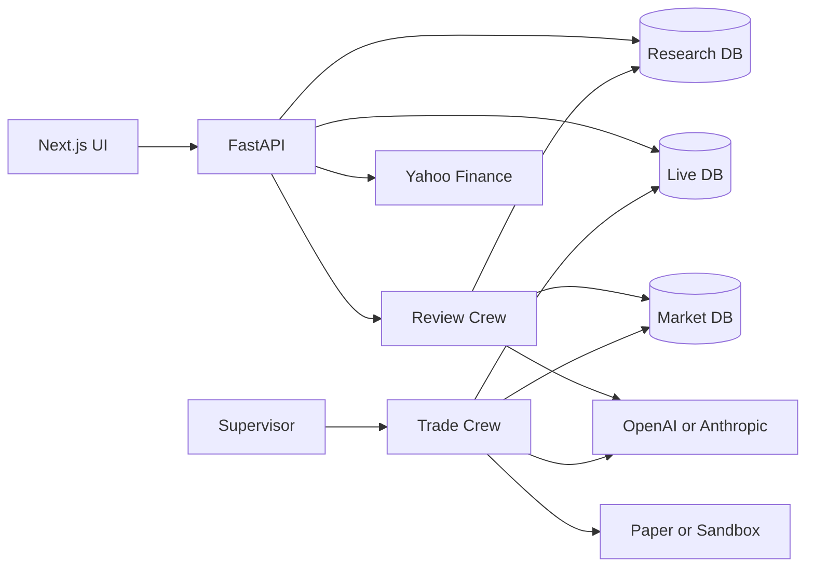
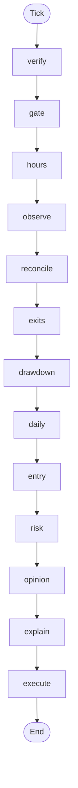

# Current System Architecture Analysis

Factual specification of Trading Strategy Lab as implemented in this repository. This document is the input for architecture and runtime-flow diagrams.

**Source of truth:** `frontend/src`, `backend/app`, Alembic revisions under `backend/alembic` and `backend/alembic_live`, `backend/pyproject.toml`, `frontend/package.json`, and `.env.example`.

**Not used as source of truth:** `vendor/TradingAgents` (reference only; nothing under `backend/app` imports it). `.env` is gitignored and was not read. No secrets are included.

**Not queried:** no live database was opened. Schema claims are in [CURRENT_DATABASE_ARCHITECTURE.md](CURRENT_DATABASE_ARCHITECTURE.md).

Analysis date: 2026-10-10.

---

## 1. Current system components

### 1. Frontend

| Field | Value |
| --- | --- |
| Name | Next.js UI |
| Responsibility | Dashboard (index quotes, paper positions and orders), markets (candle charts, manual paper orders), lab (ingest, clarify, review, trades), deploy (policy, backtest, approval), deployments (start, pause, stop, flatten, equity, odds, floor) |
| Technology | Next.js 15.5.27, React 19.1.0, Tailwind CSS 4, `lightweight-charts` 5 |
| Main files | `frontend/src/app/layout.tsx`, `frontend/src/app/page.tsx`, `frontend/src/app/markets/page.tsx`, `frontend/src/app/lab/page.tsx`, `frontend/src/app/deploy/page.tsx`, `frontend/src/app/deployments/page.tsx`, `frontend/src/lib/api.ts`, `frontend/src/lib/market.ts`, `frontend/src/lib/policy.ts`, `frontend/src/components/*` |
| Sync/async | Browser `fetch` |
| Invoked by | User browser |
| Invokes | FastAPI at `NEXT_PUBLIC_API_URL` (default `http://127.0.0.1:8841`) |
| External deps | None. Market data reaches the browser through FastAPI |
| Storage | `localStorage` keys `tsl.actor` and `tsl.token` only |

Routes: `/`, `/markets`, `/lab`, `/deploy`, `/deployments`. There is no login page. A Bearer token is optional until the API requires one.

### 2. Backend API

| Field | Value |
| --- | --- |
| Name | FastAPI application |
| Responsibility | HTTP API for ingest, review, journal, audit, live trading, market quotes, and manual paper orders |
| Technology | FastAPI, Uvicorn, Pydantic v2 |
| Main files | `backend/app/main.py`, `backend/app/api/routes.py`, `backend/app/api/journal.py`, `backend/app/api/audit.py`, `backend/app/api/live.py`, `backend/app/api/market.py`, `backend/app/api/common.py` |
| Sync/async | Synchronous route handlers. Review and approval backtests run inside the request |
| Invoked by | The UI and operators (`GET /api/health`) |
| Invokes | Stores and crews listed below |
| Database | Request-scoped SQLAlchemy sessions for the research database and, on `/api/live`, the live database |

Middleware order in `backend/app/main.py` (Starlette runs the last-added middleware first, so CORS is the outer wrapper):

1. `CORSMiddleware` — origins from `CORS_ORIGINS`. `*` is refused at startup when `API_TOKENS` is non-empty.
2. `AuditContextMiddleware` — accepts or generates `X-Request-ID` and reads `X-Actor`.

There is no rate limit, idempotency key, or HTTPS redirect middleware.

### 3. Ingest and extract

| Field | Value |
| --- | --- |
| Name | Strategy ingest |
| Responsibility | Fetch source text and extract a strategy Markdown document |
| Technology | `youtube-transcript-api`, `httpx`, BeautifulSoup with the `lxml` parser, LangChain chat models |
| Main files | `backend/app/ingest/youtube.py`, `instagram.py`, `doc.py`, `store.py`, `backend/app/extract/extractor.py`, `backend/app/strategies/clarify.py` |
| Invoked by | `POST /api/ingest/extract`, `POST /api/ingest/clarify`, and `POST /api/demo/run` |
| External deps | YouTube, Instagram, or the document URL when those source types are used. OpenAI or Anthropic when `LLM_PROVIDER`'s key is set |
| Database | `ingest_runs`, then `strategies` and `strategy_versions` |

`document` URLs that return a PDF are rejected. The demo fixture is `backend/fixtures/notebooklm_notes.txt`.

### 4. Review Crew

| Field | Value |
| --- | --- |
| Name | Review Crew |
| Responsibility | Audit, scenario simulation, hard-stop sweep, per-trade reviews, verdict, improvement proposals |
| Technology | LangGraph `StateGraph` |
| Main files | `backend/app/agents/review_crew/graph.py`, `reviewer.py`, `hard_stop.py`, `improver.py`, `backend/app/engine/sim.py`, `backend/app/engine/costs.py` |
| Invoked by | `POST /api/review/run` and the demo path |
| Database | `reports`, `simulation_runs`, `sim_trades`, `trade_reviews`, `strategy_improvements` |

Node order: `audit` → `scenarios` → `simulate` → `hard_stop` → `trade_review` → `verdict` → `improve`.

### 5. Trade Crew

| Field | Value |
| --- | --- |
| Name | Trade Crew |
| Responsibility | One deployment's decision loop. Rules in code decide. The LLM cannot open or close a trade |
| Technology | LangGraph `StateGraph`, run as its own process |
| Main files | `backend/app/agents/trade_crew/graph.py`, `runner.py`, `__main__.py`, `opinion.py`, `lessons.py`, `legs.py` |
| Invoked by | `python -m app.agents.trade_crew` or the supervisor |
| Database | Live tables only, plus read-only use of the market database |

Node order, stopping early when a node sets `stop`: `verify` → `gate` → `hours` → `observe` → `reconcile` → `exits` → `drawdown` → `daily` → `entry` → `risk` → `opinion` → `explain` → `execute`.

### 6. Live control plane

| Field | Value |
| --- | --- |
| Name | Approvals, supervisor, kill switch |
| Responsibility | Freeze a strategy version, start and stop deployments, restart crashed crews, flatten |
| Main files | `backend/app/live/approvals.py`, `gates.py`, `supervisor.py`, `kill_switch.py`, `store.py`, `equity.py`, `drawdown.py`, `money.py`, `odds.py`, `policy_backtest.py`, `veto.py`, `opinion_eval.py` |
| Invoked by | `/api/live/*` and `python -m app.live` |
| Database | Live database. Approval also writes `strategy.approved_for_live` on the research audit log |

### 7. Brokers

| Field | Value |
| --- | --- |
| Name | Broker registry |
| Responsibility | Resolve an account to an adapter |
| Main files | `backend/app/brokers/registry.py`, `base.py`, `paper.py`, `sandbox.py`, `credentials.py`, `backend/app/trading/orders.py` |
| Registered adapters | `paper` (no quotes, replay feed only), `sandbox` (quotes; `live` mode only when `SANDBOX_ALLOW_LIVE=true`) |
| Not registered | Zerodha, Upstox, Dhan, Angel One, or any other exchange broker |

### 8. Market data

| Field | Value |
| --- | --- |
| Name | Market reference store |
| Responsibility | NSE end-of-day bars, option closes, events, headlines |
| Main files | `backend/app/market/models.py`, `store.py`, `nse.py`, `feed.py`, `calendar.py`, `news.py`, `hours.py`, `historical.py`, `source.py` |
| Writers | `backend/scripts/import_nse_eod.py`, `import_events.py`, `fetch_news.py` |
| Database | `MARKET_DATABASE_URL` (default `sqlite:///data/market_eod.db`). Not audited. Created with `create_all`, not Alembic |

### 9. Markets and manual paper orders

| Field | Value |
| --- | --- |
| Name | Market screen backend |
| Responsibility | Delayed quotes and candles for indices, NSE stocks, and global commodity futures. Manual paper orders with Indian charges, and positions netted from those orders |
| Main files | `backend/app/api/market.py`, `backend/app/paper.py` |
| Invoked by | `/`, `/markets` |
| External deps | Yahoo Finance's unofficial chart API over `httpx`. Delayed, no MCX data, can change without notice |
| Database | `paper_orders` in the research database (append-only). Quotes and candles are not stored |

Paper orders are separate from the Trade Crew and from `orders` in the live database. Commodities are view-only. Stocks trade as shares (`EQ`) only. Index orders are `FUT`, `CE`, or `PE` and need a lot size from `LOT_SIZES`. Charges use the cost profile with slippage 0; futures and delivery equity use fixed FY2025-26 rates in `backend/app/paper.py`. Positions mark shares and futures at the latest quote, with index spot as the futures proxy. Options are not marked.

### 10. LLM

| Field | Value |
| --- | --- |
| Name | Chat model factory |
| Responsibility | Build the OpenAI or Anthropic chat client selected by `LLM_PROVIDER` |
| Main files | `backend/app/llm.py` |
| Call sites | Extractor, improvement rationale, trade opinion, post-trade lesson, optional `--explain` note |
| Not a call site | Order placement, exits, and risk checks |

`LLM_TRADE_OPINION` is `off`, `shadow`, or `veto`. Veto is also enabled per deployment and can only skip or reduce lots. Live accounts stay refused unless `LLM_VETO_LIVE_ALLOWED=true`.

### 11. Auth

| Field | Value |
| --- | --- |
| Name | Static API tokens |
| Responsibility | Optional Bearer auth. The token name becomes the audit actor |
| Main files | `backend/app/auth/__init__.py`, `backend/app/auth/__main__.py`, `backend/app/api/common.py` |
| Storage of tokens | SHA-256 hashes in `API_TOKENS`. The token itself is printed once by `python -m app.auth new-token` |
| When `API_TOKENS` is empty | Research and paper mutating routes accept `X-Actor`. Credential routes, live account creation, live approval, live start, live veto, live capital events, and `stop` with `flatten` still return 403 |

There is no user table and no OAuth login.

### 12. Alerts

| Field | Value |
| --- | --- |
| Name | Alert dispatcher |
| Main file | `backend/app/alerts.py` |
| Channels | Telegram (`httpx`) and SMTP (`smtplib`). Either channel is skipped when its settings are empty |
| Failure behaviour | Logged. Delivery failure does not block trading |

---

## 2. Frontend architecture

The root layout in `frontend/src/app/layout.tsx` renders five links: Dashboard (`/`), Markets (`/markets`), Strategy Lab (`/lab`), Deploy (`/deploy`), Deployments (`/deployments`).

`frontend/src/lib/api.ts` sends `Authorization: Bearer` when `tsl.token` is set, and `X-Actor` when `tsl.actor` is set. HTTP 401 and 403 become `AuthError`.

| Page | What it calls |
| --- | --- |
| `/` | Index quotes, paper positions and orders. An exit link opens `/markets` with the closing order pre-filled |
| `/markets` | Quotes, candles with previous-day and pivot levels (`CandleChart`), paper order placement, positions and orders |
| `/lab` | Ingest, clarifying questions and re-extract, demo, review run, strategy and report reads, trade list |
| `/deploy` | Broker list and accounts, credential save, approval preview, rules-only versus policy backtest, approval. Form covers sizing, compounding, booking, time and event exits, daily target, VIX sizing, withdrawal, odds gate, drawdown ladder, and capital floor |
| `/deployments` | List, start, pause, stop, stop-and-flatten, equity, positions, capital events, drawdown, money (floor and withdrawal), odds |

---

## 3. API architecture

Routers are mounted with no extra prefix beyond the one on each router.

| Router | Prefix | File |
| --- | --- | --- |
| Lab | `/api` | `backend/app/api/routes.py` |
| Journal | `/api` | `backend/app/api/journal.py` |
| Research audit | `/api/audit` | `backend/app/api/audit.py` |
| Live | `/api/live` | `backend/app/api/live.py` |
| Market and paper | `/api` | `backend/app/api/market.py` |

Lab and journal routes include `GET /api/health`, `POST /api/ingest/extract`, `POST /api/ingest/clarify`, `GET /api/ingest-runs/{id}`, `POST /api/review/run`, `POST /api/demo/run`, strategy and report reads, `POST /api/strategies/{id}/archive`, trade CSV, `GET /api/journal`, trade reviews, and improvement decisions.

Live routes include brokers, broker accounts, credentials, approval preview, approval backtest, approval, deployment start/pause/stop, capital events, llm-veto, equity, positions, orders, live trades, opinions, phantom trades, and the live audit chain. The live read routes return 503 until `alembic -n live upgrade head` has been applied.

Market and paper routes are `GET /api/market/quotes` (up to 40 symbols), `GET /api/market/candles` (`1m`, `5m`, `15m`, `60m`, `1d`), `POST /api/paper/orders`, `GET /api/paper/orders`, and `GET /api/paper/positions`. Quotes and candles return 400 for an unknown symbol, and candles return 502 when Yahoo is unreachable.

OpenAPI is the FastAPI default at `/docs`. There is no separate contract file.

---

## 4. Ingest pipeline

1. `POST /api/ingest/extract` receives `source_type` plus a URL or text.
2. YouTube and Instagram fetchers, or the HTML fetcher, produce text. `markdown` and `notebooklm` use the supplied text.
3. `extract_strategy` calls the chat model when a key is configured. Otherwise the demo path can use the fixture extractor.
4. `IngestRunStore` inserts `ingest_runs` (extractor, model, raw output, status).
5. A successful extract parses Markdown into a `StrategyDocument` and inserts `strategies` plus `strategy_versions`.
6. The response, and `GET /api/strategies/{id}`, include `questions` from `clarifying_questions`. Required questions cover a missing underlying, structure, entry, stop, target, max lots, or a rule error. Optional ones cover event blackouts, a VIX range, daily entry and loss limits, and each Gap.
7. `POST /api/ingest/clarify` turns the author's answers into hints, appends them to the original run's hints, re-extracts from the stored source, and saves a new strategy version. It returns 400 when the version was not ingested from a source, when no LLM key is set, or when no answer was given.

The extractor emits a `rules:` block and does not invent thresholds. Unexpressed rules go into Gaps.

---

## 5. Review pipeline

1. `POST /api/review/run` loads a strategy version or raw Markdown.
2. `run_review_crew` invokes the compiled graph.
3. `simulate` uses `open_market_source`. Imported NSE data is preferred. The bundled sample is the fallback and is recorded as `data_source`.
4. The report row stores `inputs` from `backend/app/provenance.py` and the JSON payload, including `hard_stop_sweep`.
5. Simulation runs and `sim_trades` are inserted. Reviews and improvements are inserted in the same research transaction path as the report store.

The hard-stop sweep does not change `verdict_label`.

`verdict_label` is one of `Not executable`, `Profitable` (every scenario passes net checks), `Conditional` (some pass), `Too few trades` (none pass and every scenario is below `VERDICT_MIN_BACKTEST_TRADES` or `VERDICT_MIN_FORWARD_TRADES`), or `Not profitable`. The verdict also counts scenarios that lose money before costs and scenarios with too few trades, and the narrative names both.

---

## 6. Market data and simulation

Backtests walk the strategy's rules once per session on end-of-day closes. Positions carry across days. Expired legs settle at intrinsic value. Charges use the cost profile and, when the trade date is known, `STT_SCHEDULE` and `EXCHANGE_TXN_SCHEDULE`.

IV rank uses history only up to the decision day (`IV_RANK_LOOKBACK_DAYS`, minimum history `IV_RANK_MIN_HISTORY`).

Entry blackouts read `market_events`. If a blackout rule is set and no calendar is imported, entries are blocked.

News headlines are stored with `published_at` and `fetched_at`. Callers that build LLM context keep headlines published at or before the decision time.

The Trade Crew broker feed builds quotes from the adapter, with previous-day high and low and VIX history from this database. Lot size and freeze quantity prefer the broker instrument list.

---

## 7. LLM architecture

`chat_model` in `backend/app/llm.py` constructs `ChatAnthropic` or `ChatOpenAI` from `LLM_PROVIDER`. Temperature is 0. The unused provider is not constructed.

| Use | Can change an order |
| --- | --- |
| Strategy extraction | No. It writes Markdown that a person can edit |
| Improvement rationale | No. It appends text to a proposal |
| `LLM_TRADE_OPINION=shadow` | No. The opinion is stored |
| `LLM_TRADE_OPINION=veto` after per-deployment enablement | Skip or fewer lots only, and only on an entry the rules already approved |
| `TRADE_CREW_EXPLAIN` or `--explain` | No. A note is appended to `reason_text` after the decision |

There is no embedding model and no vector store.

---

## 8. Evaluation

| Mechanism | Where it is stored | What it decides |
| --- | --- | --- |
| Scenario verdict | `reports.verdict_label` | Whether the fixed scenarios passed net checks. Not the `rules:` replay |
| Hard-stop sweep | `reports.payload` | A recommended capital stop, also proposed as an improvement |
| Deterministic trade review | `trade_reviews` | Process verdict and mistake tags. `rules_version` is `REVIEW_RULES_VERSION` |
| Human review | `trade_reviews` or `live_trade_reviews` | A later row may set `supersedes_review_id` |
| Opinion evaluation | Computed by `GET /api/live/opinions/evaluation` | No verdict until `OPINION_EVAL_MIN_SAMPLES` skip or reduce opinions have closed |
| Rules backtest at approval | Not stored as a report row; returned by the backtest endpoint | Rules only versus rules plus policy and ladder |

---

## 9. Authentication and authorization

`API_TOKENS` is a comma-separated list of `name:sha256(token)`. A valid Bearer token sets the actor and ignores `X-Actor`. An invalid token is 401.

`X-Actor` is not authenticated. The backend README states that the API should sit behind auth before it is exposed.

Credential ciphertext uses Fernet (`cryptography`) and `BROKER_CREDENTIALS_KEY`. API responses and audit details store a fingerprint, not the secret.

---

## 10. Data and storage architecture

Three SQLite files by default, all relative to `backend/` when the URL is `sqlite:///data/...`. Any of the audited databases can be PostgreSQL (`postgresql+psycopg://...`). The driver is not in `backend/pyproject.toml`; Postgres needs `psycopg` installed separately.

| Database | Setting | Migrations | Audit |
| --- | --- | --- | --- |
| Research | `DATABASE_URL` | `backend/alembic`, head `0006_paper_orders` | Hash-chained `audit_events` |
| Live | `LIVE_DATABASE_URL` | `backend/alembic_live`, head `0005_broker_credentials` | Hash-chained `live_audit_events` |
| Market | `MARKET_DATABASE_URL` | None (`create_all`) | None. Reports store a fingerprint of imported inputs |

`strategies` can be updated and cannot be deleted. Every other research and live table is append-only in the ORM and in database triggers. The market tables can be updated; importers are written to be re-run.

Sandbox state files live under `SANDBOX_STATE_DIR` (default `DATA_DIR/sandbox`). Crew logs go to `DATA_DIR/logs/crew-<deployment>.log`.

---

## 11. Observability

| Signal | Implementation |
| --- | --- |
| Research audit chain | `audit_events.hash = sha256(prev_hash + canonical JSON)` |
| Live audit chain | `live_audit_events`, same construction |
| Request id | `X-Request-ID` echoed by `AuditContextMiddleware` |
| Crew liveness | `crew_heartbeats`. `crew_running` is false when the latest heartbeat is older than `HEARTBEAT_MAX_AGE_S` |
| Alerts | `backend/app/alerts.py` |
| Langfuse | Named in `.env.example` only. No import and no client in `backend/app` |

Logging is the standard library. There is no metrics endpoint and no trace exporter.

---

## 12. Deployment architecture

The API process does not tick the Trade Crew. Operators run either one `python -m app.agents.trade_crew` per deployment or `python -m app.live supervise`.

The supervisor starts one subprocess per `started` deployment, restarts crashes with backoff from 5 seconds to 5 minutes, and does not restart a crew that exits because a replay feed ran out. It also resumes a deployment paused by its capital floor when `resume_after_days` has elapsed.

Process templates: `backend/deploy/com.genesis.supervisor.plist` (launchd) and `backend/deploy/genesis-supervisor.service` (systemd). There is no Dockerfile and no compose file in this repository.

Local ports used by the root README: API `8841`, UI `8842`. `npm run dev` with no port uses Next.js's default of 3000, which does not match `CORS_ORIGINS` in `.env.example`.

---

## 13. Present, absent, and reference-only

| Item | Status | Evidence |
| --- | --- | --- |
| Review Crew | Present | `backend/app/agents/review_crew/graph.py` |
| Trade Crew | Present | `backend/app/agents/trade_crew/graph.py` |
| Paper broker | Present | `backend/app/brokers/paper.py` |
| Manual paper orders | Present | `backend/app/api/market.py`, `backend/app/paper.py` |
| Real-time or MCX market data | Absent | Quotes come from Yahoo, delayed. Commodities are global futures in USD |
| Sandbox broker | Present | `backend/app/brokers/sandbox.py` |
| Exchange broker adapter | Absent | `registry.py` registers only `paper` and `sandbox` |
| TradingAgents package at runtime | Absent | No import from `vendor/` under `backend/app` |
| Langfuse | Absent | Settings keys exist only in `.env.example` |
| Vector database, embeddings, RAG | Absent | No embedding client and no vector column |
| User accounts | Absent | No `users` table. Actors are strings |
| PDF ingest | Absent | `fetch_document_text` raises on PDF content types |

---

## 14. Current end-to-end flows

### Lab

Browser → `POST /api/ingest/extract` or `POST /api/demo/run` → ingest row and strategy version → optional `POST /api/ingest/clarify` → new ingest row and strategy version → `POST /api/review/run` → Review Crew → report, simulations, trades, reviews, improvements → `GET /api/journal`.

### Approve and paper-trade

Browser → `POST /api/live/approvals/backtest` (optional) → `POST /api/live/approvals` → `deployed_strategies` and `deployments` in the live database, plus a research audit event → `POST /api/live/deployments/{id}/start` → supervisor or a manual crew process → ticks → intents, orders, fills, live trades, heartbeats.

### Manual paper trade

Browser on `/markets` → `GET /api/market/candles` → FastAPI → Yahoo → `POST /api/paper/orders` → `paper_orders` row with charges, plus a `paper.order_placed` audit event → `GET /api/paper/positions` → positions netted from orders and marked at the latest quote.

### Kill switch

`POST /api/live/deployments/{id}/stop` writes the stop first, then cancels working orders. Protective stops stay unless `flatten` is true. Flatten requires a token, closes open positions, and then cancels the remaining stops.

---

## 15. Architecture connection matrix

| From | To | How |
| --- | --- | --- |
| Browser | FastAPI | HTTP JSON |
| FastAPI | Research database | SQLAlchemy session `get_db` |
| FastAPI live routes | Live database | `get_live_db` |
| Review Crew | Market database | `open_market_source` |
| Trade Crew | Live database | `LiveStore` |
| Trade Crew | Market database | Previous range, VIX history, holidays |
| Trade Crew | Broker adapter | `BrokerAdapter` / `QuoteSource` from the registry |
| Supervisor | Trade Crew | Subprocess |
| FastAPI market routes | Yahoo Finance | HTTPS via `httpx`, per request, not cached |
| Alerts | Telegram or SMTP | HTTP or SMTP, only when configured |
| LLM factory | OpenAI or Anthropic | HTTPS via LangChain clients |

---

## 16. Diagram input

Any node from `verify` through `entry` can stop the tick before the later nodes run. `risk` always continues into `opinion`, `explain`, and `execute`.

---

## 17. Evidence index

| Claim | File |
| --- | --- |
| App wiring and CORS refusal | `backend/app/main.py` |
| Review graph nodes | `backend/app/agents/review_crew/graph.py` |
| Trade graph nodes | `backend/app/agents/trade_crew/graph.py` |
| Broker names | `backend/app/brokers/registry.py` |
| Settings | `backend/app/config.py`, `.env.example` |
| Research head revision | `backend/alembic/versions/0006_paper_orders.py` |
| Market and paper routes | `backend/app/api/market.py`, `backend/app/paper.py` |
| Clarifying questions | `backend/app/strategies/clarify.py` |
| Live head revision | `backend/alembic_live/versions/0005_broker_credentials.py` |
| Market `create_all` | `backend/app/market/store.py` |
| UI routes | `frontend/src/app/layout.tsx` |
| Token and actor storage | `frontend/src/lib/api.ts` |

## Configuration precedence

Pydantic defaults in `Settings` apply when a variable is unset. A copied `.env.example` overrides several of those defaults:

| Variable | `Settings` default | `.env.example` |
| --- | --- | --- |
| `DEFAULT_CAPITAL_INR` | 500000 | 50000 |
| `DEFAULT_MAX_LOTS` | 2 | 1 |
| `PORTFOLIO_MAX_OPEN_POSITIONS` | 3 | 2 |
| `PORTFOLIO_MAX_DAILY_LOSS_INR` | 10000 | 3000 |
| `MAX_ENTRIES_PER_DAY` | 0 | 1 |
| `MAX_CONSECUTIVE_LOSSES` | 0 | 3 |
| `LOSS_COOLDOWN_DAYS` | 0 | 3 |
| `MAX_LOSS_PCT_OF_CAPITAL` | 0 | 100 |

`MAX_CONSECUTIVE_LOSSES` and `LOSS_COOLDOWN_DAYS` must both be set or both be 0. Strategy frontmatter overrides cost and size defaults. Common risk keys from the environment still apply, and the stricter of the environment value and the strategy value wins.

`LANGFUSE_SECRET_KEY`, `LANGFUSE_PUBLIC_KEY`, and `LANGFUSE_BASE_URL` are in `.env.example` and are not read by `Settings`.
