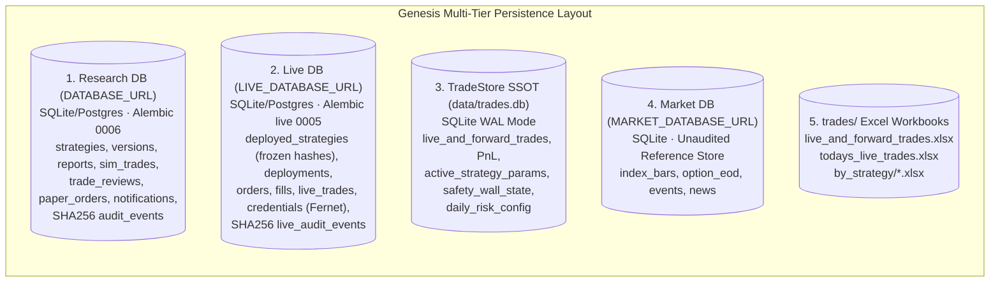

# Current System Architecture Analysis

Factual specification of the Genesis Institutional Trading & Strategy Intelligence Platform as implemented in this repository. This document serves as the technical specification for architecture, runtime flows, and diagram models.

**Source of truth:** `frontend/src`, `backend/app`, `backend/alembic`, `backend/alembic_live`, `backend/pyproject.toml`, `frontend/package.json`, `scripts/`, `trades/`, and `.env.example`.

*Analysis & System Specification Date: 2026-10-30.*

---

## 1. Current System Components

### 1. Frontend Client

| Field | Value |
| :--- | :--- |
| Name | Next.js UI |
| Responsibility | Executive Dashboard (index quotes, paper positions, live PnL), Markets (interactive candle charts, non-repainting BOS/CHoCH swings, FVG imbalances, dynamic trendlines, option chain, manual paper orders), Strategies (catalog and 5-Pillar Strategy Analyzer), Strategy Lab (`/strategy-lab` interactive research), Lab (`/lab` ingest, clarify, review crew, simulated trades), Forward-Tested (`/forward-tested` trade journal), Deploy (`/deploy` policy, backtest, approval), Deployments (`/deployments` pause, stop, token-gated kill switch flatten), and Login (`/login`) |
| Technology | Next.js 15, React 19, Tailwind CSS 4, `lightweight-charts` |
| Main files | `frontend/src/app/layout.tsx`, `page.tsx`, `markets/page.tsx`, `strategies/page.tsx`, `strategy-lab/page.tsx`, `lab/page.tsx`, `forward-tested/page.tsx`, `deploy/page.tsx`, `deployments/page.tsx`, `login/page.tsx`, `lib/api.ts`, `lib/market.ts`, `lib/policy.ts` |
| Sync/async | Browser `fetch` over HTTP REST |
| Invoked by | Operator / User web browser |
| Invokes | FastAPI at `NEXT_PUBLIC_API_URL` (default `http://127.0.0.1:8841`) |
| Storage | `localStorage` keys `tsl.actor` and `tsl.token` |

### 2. Backend API Process

| Field | Value |
| :--- | :--- |
| Name | FastAPI application |
| Responsibility | HTTP REST API for market quotes & candles, chart structure analytics, option chain, paper orders, strategy ingestion & gap clarification, Review Crew executions, live approvals, deployment lifecycles, cryptographic audit chains, notifications, and auth |
| Technology | FastAPI, Uvicorn, Pydantic v2, SQLAlchemy |
| Main files | `backend/app/main.py`, `backend/app/api/routes.py`, `journal.py`, `audit.py`, `live.py`, `market.py`, `notifications.py`, `auth.py`, `common.py` |
| Invoked by | Next.js Frontend and platform automation scripts (`GET /api/health`) |
| Middleware order | `CORSMiddleware` → `AuditContextMiddleware` (`X-Request-ID`, `X-Actor`) → `RequestLoggingMiddleware` (rotating subsystem logger) |

### 3. Ingest and Extraction Engine

| Field | Value |
| :--- | :--- |
| Name | Strategy Ingest & Extraction |
| Responsibility | Fetch source content from URLs/text and extract executable Markdown strategy documents with `rules:` blocks |
| Technology | `youtube-transcript-api`, `httpx`, BeautifulSoup with `lxml`, LangChain chat models |
| Main files | `backend/app/ingest/youtube.py`, `instagram.py`, `doc.py`, `store.py`, `backend/app/extract/extractor.py`, `backend/app/strategies/clarify.py` |
| Invoked by | `POST /api/ingest/extract`, `POST /api/ingest/clarify`, `POST /api/demo/run` |
| External deps | YouTube, Instagram, web documents. OpenAI or Anthropic when API keys are configured |
| Storage | `ingest_runs`, `strategies`, and `strategy_versions` in Research DB |

### 4. Review Crew (LangGraph Research Engine)

| Field | Value |
| :--- | :--- |
| Name | Review Crew |
| Responsibility | Deterministic multi-scenario backtesting, stress testing, capital hard-stop sweeps (2-5%), per-trade forensic reviews, verdict synthesis, and improvement proposals with Indian options cost schedules |
| Technology | LangGraph `StateGraph` |
| Main files | `backend/app/agents/review_crew/graph.py`, `reviewer.py`, `hard_stop.py`, `improver.py`, `backend/app/engine/sim.py`, `backend/app/engine/costs.py` |
| Invoked by | `POST /api/review/run` and Strategy Lab |
| Node order | `audit` → `scenarios` → `simulate` → `hard_stop` → `trade_review` → `verdict` → `improve` |
| Storage | `reports`, `simulation_runs`, `sim_trades`, `trade_reviews`, `strategy_improvements` |

### 5. The 5 Autonomous Trading Crews (`backend/app/trading/`)

The live trading architecture is decoupled into 5 specialized autonomous crews managed by `scripts/live_scanner.py` and `scripts/genesis.sh`:

1. **PreMarketCrew (`backend/app/trading/pre_market_crew/`)**:
   - `PreMarketManager`: Runs daily from 08:30 to 09:14 IST.
   - `GapAgent`: Assesses GIFT NIFTY vs Previous Day Close (PDC) gap bias and opening trap odds.
   - `GammaAgent`: Analyzes option chain Call/Put walls, PCR, and dealer pinning Max Pain.
   - `EventRiskAgent`: Checks macro economic calendar (RBI MPC, CPI, FED) for event blackout restrictions.
   - Outputs `trades/pre_market_plan.json` and dispatches the 09:05 IST Battleplan to Telegram.

2. **ScannerCrew (`backend/app/trading/scanner_crew/`)**:
   - `ScannerManager`: Runs continuously during market hours (09:15 - 15:30 IST).
   - `FeedAgent`: Delta-only multi-timeframe polling (1m, 2m, 5m, 15m, 30m) with ETF session VWAP proxy.
   - `LevelsAgent`: Pins dynamic PDH, PDL, PDC, Opening Range (OR-30: 09:15-09:45), and psychological strike levels.
   - `ConsolidationAgent`: Midday compression box & ATR deadband detector (Lunch Lull 11:30-13:00 filter).
   - `NewsAgent`: Evaluates live news sentiment and macro catalyst risks.
   - `DetectorAgent`: Multi-strategy pattern scanner for Breakout & Retest, Liquidity Sweep (PDH/PDL raid), and Trendline Reversal.
   - Emits real-time `ScanSnapshot` and verified `CandidateSetup` objects.

3. **TradeCrew (`backend/app/trading/crew/`)**:
   - `TradeManager`: Master live trade orchestrator.
   - `TrendAgent`: Calculates macro trend slope and aligns dynamic R:R targets (+1.8R to +4.5R).
   - `RiskAgent`: Enforces daily loss limits, consecutive loss circuit breakers, and 50% Capital Safety Wall.
   - `OrderFlowAgent`: Detects institutional whale volume spikes and absorption traps to issue pre-entry vetoes.
   - `EntryAgent`: Executes micro-wick entries with strictly OTM option strikes (1-OTM standard, 2-OTM super-trend).
   - `ExitAgent`: Unconditional Target 3 full close, 5M structural trailing stop, and opposing sweep auto-flip.
   - `AlertAgent`: Dispatches live Telegram trade tickets and threaded CMP heartbeat updates.
   - `JournalAgent`: Manages active trade cache and commits atomic ACID records to `trades.db` SQLite SSOT.

4. **ExecutionCrew (`backend/app/trading/execution_crew/`)**:
   - `ExecutionManager`: Coordinates order routing and broker bridges.
   - `SmartRoutingAgent`: Tranche order execution (30% market fill + 70% limit chase) to minimize slippage.
   - `BrokerBridgeAgent`: Pluggable adapter bridge for Paper and Live broker execution.
   - `ReconciliationAgent`: Zero-drift position reconciliation ensuring database state matches broker holdings.

5. **PostMarketCrew (`backend/app/trading/post_market_crew/`)**:
   - `PostMarketManager`: Dispatched automatically at 15:31 IST daily.
   - `AutopsyAgent`: Reconstructs the day's intraday tape, audits exit efficiency, and logs missed setups.
   - `ParameterAgent`: Executes walk-forward edge testing and parameter tuning for tomorrow's session.
   - `SafetyWallAgent`: Sweeps net realized profits and locks 50% permanently into the protected Capital Floor.
   - `CodeQualityAgent`: Audits application logs, system warnings, and latency bottlenecks.
   - `BriefingAgent`: Writes `reports/daily_audit_YYYY-MM-DD.md` and dispatches the Executive Digest to Telegram.

### 6. TradeStore SSOT & Excel Synchronization (`backend/app/db/trade_store.py`)

- High-performance SQLite database (`data/trades.db`) operating in WAL (Write-Ahead Logging) mode.
- Provides atomic transactions for concurrent multi-process access (Scanner, FastAPI, Exporter).
- `scripts/maintain_trades_excel.py` automatically synchronizes the SQLite store with institutional Excel workbooks in `trades/`:
  - `trades/live_and_forward_trades.xlsx`: Master executive dashboard and live trade ledger.
  - `trades/todays_live_trades.xlsx`: Isolated intraday session trade ledger.
  - `trades/by_strategy/*.xlsx`: Strategy-specific workbooks.

### 7. Non-Repainting Market Structure Engine (`backend/app/market/chart_analytics.py`)

- Computes non-repainting pivot highs and lows using rolling 2-left / 2-right bar verification.
- Identifies Market Structure Breaks (`BOS`) and Changes of Character (`CHoCH`).
- Maps Equal Highs (`EQH`), Equal Lows (`EQL`), and Fair Value Gaps (`FVG`).
- Calculates dynamic ascending support and descending resistance trendlines.

### 8. Platform Management CLI (`scripts/genesis.sh`)

Unified bash control script managing background services:
- `./scripts/genesis.sh start`: Starts Backend (8841), Frontend (3000), and Live Scanner Daemon.
- `./scripts/genesis.sh stop`: Gracefully terminates all background services.
- `./scripts/genesis.sh restart`: Clean restart of all services.
- `./scripts/genesis.sh status`: Detailed PID health and HTTP status check.
- `./scripts/genesis.sh logs [backend|frontend|scanner]`: Tails process logs in real-time.

---

## 2. Multi-Tier Persistence Architecture

---

## 3. Present vs Absent Implementation Status

| Feature / Capability | Status | Implementation Evidence |
| :--- | :--- | :--- |
| **5 Autonomous Trading Crews** | Present | `backend/app/trading/{pre_market_crew, scanner_crew, crew, execution_crew, post_market_crew}/` |
| **Multi-Timeframe Live Scanner** | Present | `scripts/live_scanner.py`, `scripts/genesis.sh` |
| **TradeStore SQLite SSOT (WAL)** | Present | `backend/app/db/trade_store.py`, `data/trades.db` |
| **Excel Synchronizer** | Present | `scripts/maintain_trades_excel.py`, `trades/` |
| **3-Tier Sizing & 50% Safety Wall**| Present | `backend/app/trading/scaling_law.py`, `trades/daily_risk_config.json` |
| **Market Structure Engine (BOS/FVG)**| Present | `backend/app/market/chart_analytics.py`, `frontend/src/components/CandleChart.tsx` |
| **Strategy Lab & Ingest Engine** | Present | `backend/app/ingest/`, `backend/app/extract/`, `frontend/src/app/lab/` |
| **Deterministic Review Crew** | Present | `backend/app/agents/review_crew/graph.py` |
| **Telegram & Email Dispatch** | Present | `backend/app/alerts.py`, `backend/app/trading/crew/alert_agent.py` |
| **Paper & Sandbox Brokers** | Present | `backend/app/brokers/paper.py`, `backend/app/brokers/sandbox.py` |
| **Dual Cryptographic Hash Chains** | Present | `backend/app/audit/`, `backend/app/live/audit.py` |
| **LLM Trade Execution Authority** | **Absent (By Design)** | Order paths are strictly deterministic in Python code; LLMs have zero trade initiation capability |
| **Exchange Broker Adapters** | Open Extension | Plug into `BrokerBridgeAgent` / `backend/app/brokers/` |

---

## 4. Visual Diagrams Reference

- [System Architecture](diagrams/architecture.svg)
- [5 Autonomous Crews Ecosystem](diagrams/crew-architecture.svg)
- [Live Scanner & Execution Flow](diagrams/live-scanner-flow.svg)
- [Review Crew & Trade Crew Workflow](diagrams/workflow.svg)
- [Database Schema Layout](diagrams/database.svg)
