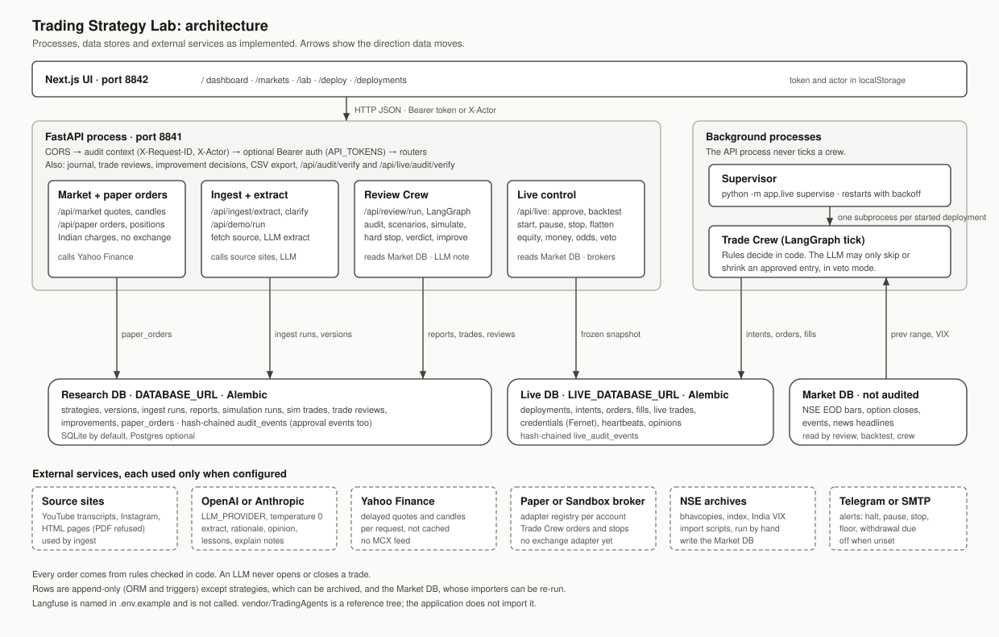
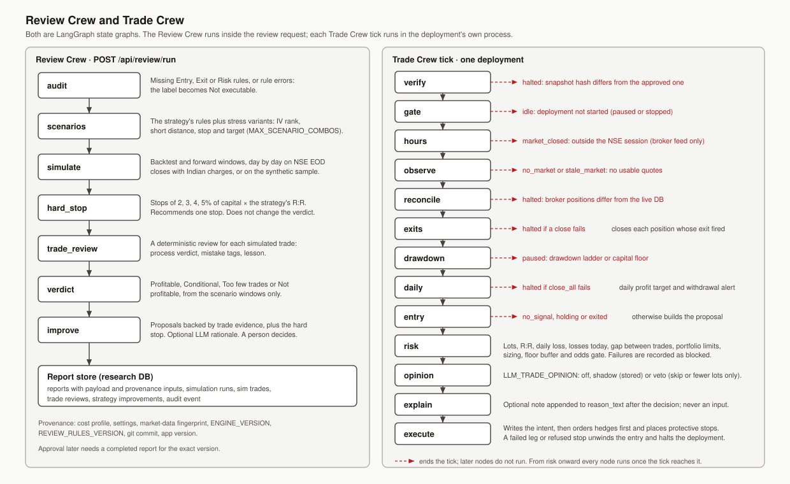
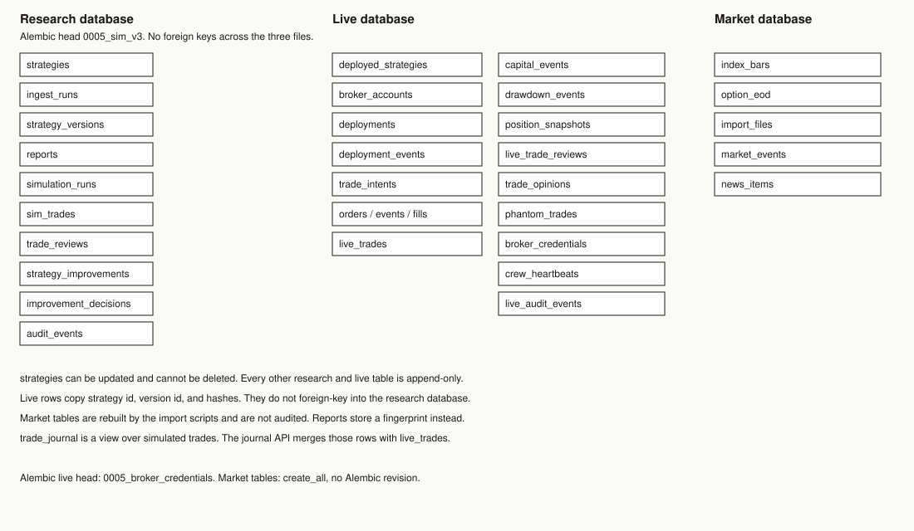

# Trading Strategy Lab

Functional specification, implementation, deployment, and testing

Final project report | Version 1.0 | 8 October 2026

## Executive summary

Trading Strategy Lab turns a strategy write-up into a versioned Markdown document, reviews it with Indian options charges, and trades only a frozen copy of a version a person has approved. The Review Crew runs inside the API. The Trade Crew runs as a separate process. Paper and Sandbox are the broker adapters in this repository. No exchange broker ships here.

Three databases keep the records. The research database stores strategies, reports, simulated trades, reviews, and a hash-chained audit log. The live database stores approvals, orders, fills, credentials, and its own audit log. The market database stores NSE end-of-day prices, events, and headlines, and it is not audited.

An LLM may extract a strategy, explain a proposal, or comment on an entry the rules already approved. It does not open or close a trade. A veto, when explicitly enabled, can only skip or shrink that entry.

This report states the behaviour the current code implements. It does not add service-level percentages the repository does not measure.

## Report navigation

| Section | Content |
| --- | --- |
| 1–3 | Problem, functional specification, security and API contracts |
| 4–7 | Architecture, implementation, workflows, simulation and orders |
| 8–10 | Database, data lifecycle, review and evaluation |
| 11–12 | Deployment configuration and runbook |
| 13–14 | Tests and the checks the code enforces |
| 15 | Limitations and source register |

## 1 Problem statement and objectives

### Business problem

A retail options idea usually arrives as a video, a caption, a note, or Markdown. Rewriting it into rules, costing the trades, and then placing orders that still match the reviewed text is a manual process. The write-up and the orders can diverge, and a later edit can erase the version that was approved.

### Proposed solution

The lab ingests the source, stores each strategy version, and runs a Review Crew over backtest and forward windows. Approval copies one version into the live database with its content hash and rules hash. A Trade Crew ticks that frozen copy. If the hashes no longer match, the deployment halts.

### Stakeholders

| Stakeholder | Need | What the system stores |
| --- | --- | --- |
| Strategy author | Turn a source into rules | `ingest_runs`, `strategy_versions`, Gaps |
| Reviewer | See net results after costs | `reports`, `sim_trades`, `trade_reviews` |
| Operator | Approve one version and watch it | `deployed_strategies`, deployments, heartbeats |
| Risk owner | Cap loss, drawdown, and size | Frozen `risk_limits`, drawdown and capital events |

### Objectives and boundaries

The objectives are an auditable version history, a costed review, and orders that come from the approved rules. The scenario verdict is not evidence that the strategy's own `rules:` block made money. That replay is the approval backtest. Live trading still needs a registered live-capable broker. Paper and Sandbox are the adapters in this tree. Sandbox live mode exists only when `SANDBOX_ALLOW_LIVE=true`, and it does not send orders to an exchange.

## 2 Functional specification

| ID | Function | Required behaviour |
| --- | --- | --- |
| FR01 | Ingest | Accept youtube, instagram, document (HTML), notebooklm, or markdown. Reject PDF URLs. |
| FR02 | Extract | Produce Markdown with a `rules:` block. Unexpressed rules go into Gaps. Do not invent thresholds. |
| FR03 | Review | Run audit, scenarios, simulation, hard-stop sweep, per-trade review, verdict, and improvements. |
| FR04 | Journal | List simulated and live trades with entry reason, target, net, and outcome. |
| FR05 | Improvements | Record accepted, rejected, or applied. Applied saves a new strategy version. |
| FR06 | Archive | Soft-delete a strategy. The row stays. |
| FR07 | Approve | Freeze one version onto a broker account. Refuse when rules fail, Gaps remain, or the hash confirmation does not match. |
| FR08 | Trade | Tick only while the deployment is started. Rules in code decide entries and exits. |
| FR09 | Kill switch | Stop first, then cancel working orders. Flatten, which closes positions, requires an API token. |
| FR10 | Audit | Append a hash-chained event for research writes and for live writes. Expose a verify route for each chain. |

The lab page is `/`. Deploy is `/deploy`. Deployments is `/deployments`.

## 3 Security and interface contracts

### Authentication

`API_TOKENS` holds `name:sha256(token)` pairs. A valid Bearer token sets the audit actor and ignores `X-Actor`. An invalid token is 401. When `API_TOKENS` is empty, research and paper mutating routes accept `X-Actor`, which is not authenticated.

These actions return 403 until a token exists, even if `API_TOKENS` is empty: broker credentials, creating a live account, live approval, live start, live veto, live capital events, and stop with flatten.

`CORS_ORIGINS=*` is refused at startup when any token is configured.

Broker secrets are Fernet ciphertext under `BROKER_CREDENTIALS_KEY`. API responses and audit details store a fingerprint, not the value.

### Principal API contracts

| Method and path | Contract |
| --- | --- |
| GET /api/health | Liveness. |
| POST /api/ingest/extract | Extract a strategy and store the ingest run. |
| POST /api/review/run | Run the Review Crew and store the report. |
| POST /api/demo/run | Run the bundled fixture. |
| GET /api/journal | Merge simulated and live trades. |
| GET /api/audit/verify | Recompute the research hash chain. |
| GET /api/live/approvals/preview | Rules, hash, blockers, verdict. |
| POST /api/live/approvals/backtest | Rules only versus rules with policy and ladder. |
| POST /api/live/approvals | Freeze the version and create the deployment. |
| POST /api/live/deployments/{id}/start | Start from approved or paused. |
| POST /api/live/deployments/{id}/stop | Kill switch. `flatten: true` closes positions. |
| GET /api/live/audit/verify | Recompute the live hash chain. |

Live reads return 503 until `alembic -n live upgrade head` has been applied. The full route list is in `backend/README.md`.

## 4 System architecture

The browser talks only to FastAPI. The Review Crew runs in that process. The Trade Crew does not. A supervisor starts one crew subprocess per started deployment.

Research, live, and market data are three databases. Approval copies the strategy text and hashes into the live database. It does not foreign-key back to research.

`vendor/TradingAgents` is not imported. Langfuse keys in `.env.example` are not read.

## 5 Implementation design

| Technology | Role |
| --- | --- |
| FastAPI and Uvicorn | HTTP API and OpenAPI |
| Pydantic and pydantic-settings | Requests and `Settings` |
| SQLAlchemy 2 and Alembic | Research and live schemas. Market tables use `create_all` |
| LangGraph | Review Crew and Trade Crew graphs |
| LangChain OpenAI or Anthropic | The one provider selected by `LLM_PROVIDER` |
| HTTPX, Beautiful Soup, lxml | HTML ingest |
| youtube-transcript-api | YouTube transcripts |
| cryptography | Fernet for broker credentials |
| Next.js 15, React 19, Tailwind 4 | Lab, deploy, and deployments pages |
| pytest | Backend tests. No test calls a real LLM or a real broker |

There is no vector store, no Auth0, and no separate metrics service.

## 6 Workflows

Review order is fixed: audit, scenarios, simulate, hard-stop sweep, trade review, verdict, improve. The sweep can propose a capital stop. It does not set `verdict_label`.

A Trade Crew tick verifies the frozen hashes, checks that the deployment is started, checks market hours on the broker feed, observes, reconciles, exits, applies drawdown and the capital floor, then considers an entry. Once an entry is reached, risk, opinion, explain, and execute all run. Opinion changes lots only in veto mode, and only downward.

## 7 Simulation and orders

Backtests walk the strategy rules on end-of-day closes. Charges use the cost profile and, when the trade date is known, the STT and exchange schedules. Without imported NSE data, the bundled sample is used and the report says so.

Orders go through `backend/app/trading/orders.py` for paper and live. Hedges are sent before short legs. An unfilled order is cancelled and re-priced within `MAX_SLIPPAGE_BPS`. A failed entry unwinds filled legs and halts. With protective stops enabled, each filled short leg gets a broker stop-limit wider than the strategy stop.

## 8 Database diagram

Research head is Alembic `0005_sim_v3`. Live head is `0005_broker_credentials`. The market database has no Alembic revision. Column definitions are in `CURRENT_DATABASE_ARCHITECTURE.md`.

## 9 Data model and lifecycle

| Table group | Purpose |
| --- | --- |
| strategies, strategy_versions, ingest_runs | Identity, immutable text, extract record |
| reports, simulation_runs, sim_trades | One review and its trades |
| trade_reviews, strategy_improvements, improvement_decisions | Reviews and human decisions |
| audit_events | Research hash chain |
| deployed_strategies, deployments, deployment_events | Frozen approval and status |
| trade_intents, orders, order_events, fills, live_trades | Decisions and broker activity |
| capital_events, drawdown_events, position_snapshots | Money, ladder, marks |
| trade_opinions, phantom_trades, live_trade_reviews | LLM comments and lessons |
| broker_credentials, crew_heartbeats, live_audit_events | Secrets, liveness, live audit |
| index_bars, option_eod, import_files, market_events, news_items | Reference data |

`strategies` can be updated and cannot be deleted. Every other research and live table rejects update and delete in the ORM and with database triggers. A review correction is a new row. Credential rotation is a new row. Market rows may be updated. Importers skip a file whose sha256 is already in `import_files`.

## 10 Review and evaluation

| Check | What it decides | Where it is stored |
| --- | --- | --- |
| Scenario verdict | Whether the fixed windows passed after costs | `reports.verdict_label` |
| Hard-stop sweep | A recommended capital stop | `reports.payload` |
| Trade review | Process verdict and mistake tags | `trade_reviews` |
| Approval backtest | Rules only versus rules with policy and ladder | Returned by the API. Not a report row |
| Opinion evaluation | Rules versus following the opinion, after enough samples | Computed by `GET /api/live/opinions/evaluation` |

There is no RAGAS score and no latency SLO in this repository. `OPINION_EVAL_MIN_SAMPLES` defaults to 30 before an opinion comparison is treated as having enough closed samples.

## 11 Deployment design and configuration

| Piece | How it runs |
| --- | --- |
| API | `uvicorn app.main:app` on port 8841 |
| UI | `npm run dev -- -p 8842` |
| Trade Crew | `python -m app.agents.trade_crew` or `python -m app.live supervise` |
| Supervisor service | `backend/deploy/com.genesis.supervisor.plist` or `genesis-supervisor.service` |

There is no Dockerfile and no compose file. PostgreSQL is supported for the research and live URLs. The `psycopg` driver is not declared in `backend/pyproject.toml`.

Unset variables use the defaults in `Settings`. A copied `.env.example` overrides capital, lots, portfolio caps, and the common risk rules. The table is in `CURRENT_SYSTEM_ARCHITECTURE_ANALYSIS.md`. Strategy frontmatter overrides cost and size. For common risk keys, the stricter of the environment value and the strategy value wins.

## 12 Deployment and operations runbook

1. Copy `.env.example` to `.env`. Set `LLM_PROVIDER` and one API key only if extract or opinions should call a model. The demo fixture runs without a key.
2. From `backend/`, run `uv sync`, `uv run alembic upgrade head`, and `uv run alembic -n live upgrade head`.
3. Start the API on port 8841 and the UI on port 8842.
4. Import NSE data, events, and holidays before relying on backtests or blackouts. Without them, simulations use the sample and a blackout rule blocks entries.
5. Create a paper account, preview the rules, confirm `rules_sha256`, and approve. Then start the deployment and run the supervisor or one crew process.
6. For live mode, set `API_TOKENS`, `BROKER_CREDENTIALS_KEY`, `LIVE_TRADING_ENABLED`, and a live-capable adapter. This repository does not include that adapter. Sandbox can exercise the gates when `SANDBOX_ALLOW_LIVE=true`.

Halt, missed heartbeats, floor pauses, and a kill switch that fails to cancel or flatten send alerts when Telegram or SMTP is configured. A failed alert is logged and does not block trading.

## 13 Functional and integration test plan

The automated suite is `uv run pytest` in `backend/`. Tests migrate temporary SQLite files, so the append-only triggers run. They do not call a real LLM, a real broker, or the network.

| Area | What the tests cover |
| --- | --- |
| Research schema | Versioning, immutability, audit chain, journal, import |
| Review | Rules, costs, hard-stop sweep, improvements |
| Trade Crew | Entry, exits, blocked intents, tampered snapshots, kill switch |
| Money | Drawdown ladder, capital floor, withdrawal, odds gate, policy |
| Live plumbing | Sandbox orders, margin, protective stops, credentials, auth, supervisor |

A release check is: migrations apply, `GET /api/health` returns, the demo run writes a report, audit verify passes, and a paper approval is refused when Gaps are present. The demo strategy omits `short_distance` and cannot be approved.

## 14 Checks the code enforces

| Check | Gate |
| --- | --- |
| Audit | Both verify routes recompute the hash chain and report the first broken row |
| Money | Amounts are `Numeric(18, 4)` |
| Approval | Parsed rules, empty Gaps, matching `confirm_rules_sha256`, a completed report, actor or token, matching account mode, no other active deployment of that strategy in that mode |
| Live approval | `LIVE_TRADING_ENABLED`, registered live broker, credentials, structure on `LIVE_ALLOWED_STRUCTURES`, and `LIVE_MIN_PAPER_DAYS` when set |
| Crew | Hash mismatch, position mismatch, or a failed order halts the deployment |
| Secrets | Credential routes never return the stored value |

These are code gates. They are not measured latency or accuracy percentages.

## 15 Limitations and source register

### Limitations

- No Zerodha, Upstox, Dhan, or Angel One adapter is registered.
- Report verdicts do not replay the strategy `rules:` block. The approval backtest does.
- Protective stops are per short leg and wider than the strategy stop. A gap can pass the limit.
- SQLite allows one writer. Several crews on SQLite will contend. PostgreSQL is the documented alternative.
- The credential key sits on the same host as the database.
- Reconciliation halts on any manual trade in the account.
- Daily broker login is manual.
- Langfuse is not integrated.
- PDF ingest is rejected.

### Source register

| Source | Use in this report |
| --- | --- |
| DocumentsAndDiagrams/Readme.md | Problem statement and goals |
| CURRENT_SYSTEM_ARCHITECTURE_ANALYSIS.md | Components, API, configuration precedence |
| CURRENT_DATABASE_ARCHITECTURE.md | Tables, revisions, relationships |
| DATABASE_TABLE_REFERENCE.md | Writers and readers |
| LIBRARIES_AND_DEPENDENCIES.md | Libraries and unused declarations |
| backend/README.md | Operator procedures and live gates |
| diagrams/architecture.svg | Section 4 |
| diagrams/workflow.svg | Section 6 |
| diagrams/database.svg | Section 8 |

Analysis date: 8 October 2026. Schema claims come from the ORM and the Alembic heads. No live database was opened to produce this report.
