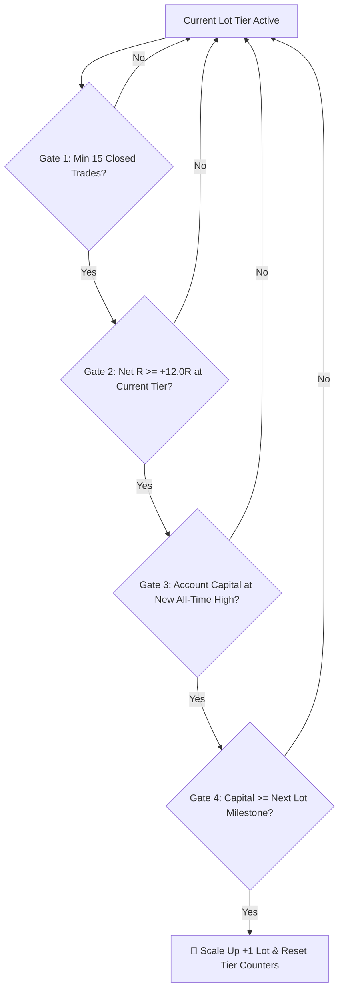

# Institutional Scale-Up Law, Safety Wall, & 10-Lot Roadmap

This specification defines the institutional money management framework, capital preservation rules ("Safety Wall"), and automated lot sizing progression implemented in [`backend/app/trading/scaling_law.py`](file:///Users/skoust/Documents/MyProjects/genesis/backend/app/trading/scaling_law.py) for the Genesis Trade Agent and Live Scanner.

---

## 1. Executive Summary & Sizing Policy

All entries, stops, levels, and targets are computed strictly on **NIFTY 50 Spot (`^NSEI`)**. Weekly NIFTY index options (65 qty / lot) serve solely as the execution vehicle.

### Baseline Capital Sizing:
- **₹50,000 Seed Capital:** Starts at **Tier 2 (2 Lots / 130 Qty)**. Risk per trade = ~₹2,275 (4.55% of capital).
- **₹100,000 Seed Capital:** Starts at **Tier 4 (4 Lots / 260 Qty)**. Risk per trade = ~₹4,550 (4.55% of capital).

---

## 2. Inviolable "Safety Wall" Architecture

> **Rule:** Risk capital and the Safety Wall are strictly decoupled. The Safety Wall is funded **100% by booked profits** and can **never be risked or drawn down**.

1. **50% Profit Ratchet:** Whenever a trade is closed at a profit, **50% of the net profit** is transferred into the locked **Safety Wall Reserve**.
2. **One-Way Floor:** If a loss occurs, the loss is deducted *only* from the active trading capital. The Safety Wall balance is mathematically inviolable.
3. **Compound Growth:** The remaining 50% of profit remains in active capital to fund tier scale-up milestones.

```
Total Equity = Active Trading Capital + Locked Safety Wall
Risk Per Trade <= 4.5% of Active Trading Capital
```

---

## 3. The 4-Gate Scale-Up Law

An automated scale-up (+1 Lot) is **strictly forbidden** until **all 4 gates** are simultaneously satisfied:



1. **Gate 1 (Statistical Sample Depth):** Minimum **15 closed trades** executed at the current lot tier. No scaling up on a short lucky streak.
2. **Gate 2 (Edge Verification):** Accumulated net performance at the current tier must reach **>= +12.0R**.
3. **Gate 3 (High-Water Mark Proof):** Account capital must be at a **fresh All-Time High (ATH)**.
4. **Gate 4 (Capital Milestone):** Total account capital must meet or exceed the institutional capital milestone for the next lot tier.

Upon scaling up, the tier trade count and tier R counter reset to zero for the new tier.

---

## 4. Emergency Downshift Trapdoor & Circuit Breaker

### A. The Downshift Trapdoor (-4.0R)
If an account encounters a drawdown of **<= -4.0R** within the current tier:
- Sizing is **immediately reduced by 1 lot** (down to minimum 1 lot).
- This protects the account from cascading drawdowns during hostile regime shifts.

### B. Daily Intraday Circuit Breakers
If either of the following conditions is hit during an intraday session:
1. **2 consecutive losing trades** in the session.
2. Cumulative daily loss reaches **<= -2.0R**.
- The Trade Agent enters **LOCKDOWN MODE** for the remainder of the trading day. No new orders are permitted until 09:15 IST the next morning.

---

## 5. Milestone Progression to 10 Lots (650 Qty)

| Tier | Lots | Total Qty | Minimum Capital Required | Average 1R Risk (₹) | Risk % of Capital | Standard Win (+2.2R) (₹) | Monthly Run-Rate (+9.5R) (₹) |
| :---: | :---: | :---: | :---: | :---: | :---: | :---: | :---: |
| **Tier 1** | 1 Lot | 65 | ₹25,000 | ₹1,137.50 | 4.55% | ₹2,502.50 | ₹10,806 |
| **Tier 2** | 2 Lots | 130 | **₹50,000** | ₹2,275.00 | 4.55% | ₹5,005.00 | ₹21,612 |
| **Tier 3** | 3 Lots | 195 | ₹75,000 | ₹3,412.50 | 4.55% | ₹7,507.50 | ₹32,418 |
| **Tier 4** | 4 Lots | 260 | **₹100,000** | ₹4,550.00 | 4.55% | ₹10,010.00 | ₹43,225 |
| **Tier 5** | 5 Lots | 325 | ₹140,000 | ₹5,687.50 | 4.06% | ₹12,512.50 | ₹54,031 |
| **Tier 6** | 6 Lots | 390 | ₹185,000 | ₹6,825.00 | 3.69% | ₹15,015.00 | ₹64,837 |
| **Tier 7** | 7 Lots | 455 | ₹230,000 | ₹7,962.50 | 3.46% | ₹17,517.50 | ₹75,644 |
| **Tier 8** | 8 Lots | 520 | ₹275,000 | ₹9,100.00 | 3.31% | ₹20,020.00 | ₹86,450 |
| **Tier 9** | 9 Lots | 585 | ₹315,000 | ₹10,237.50 | 3.25% | ₹22,522.50 | ₹97,256 |
| **Tier 10** | **10 Lots** | **650** | **₹350,000** | **₹11,375.00** | **3.25%** | **₹25,025.00** | **₹1,08,062+** |

---

## 6. Timeline: When Can We Afford 10 Lots?

### Scenario B: Starting at ₹100,000 (4 Lots)
- **Starting Sizing:** 4 Lots (260 Qty).
- **Target Capital:** ₹3,50,000 (+₹2,50,000 net profit).
- **Projected Time Horizon:** **3.5 to 4 Months (approx. 75–85 trading sessions)**.
- **Milestones:**
  - *Month 1:* 4 Lots -> Reach ₹1,43,000 -> Unlock Tier 5.
  - *Month 2:* 5 & 6 Lots -> Reach ₹2,05,000 -> Unlock Tier 7.
  - *Month 3:* 7 & 8 Lots -> Reach ₹2,85,000 -> Unlock Tier 9.
  - *Month 3.5 - 4:* **Unlock 10 Lots at ₹3,50,000**.
- **At 10 Lots:**
  - Capital: ₹3,50,000 (Safety Wall: ~₹1,25,000 locked).
  - Margin per trade: ~₹91,000 (leaves ₹2,59,000 free cash buffer).
  - Monthly net return: **₹1,08,000+ per month** (exceeds ₹1 Lakh/month goal).

### Scenario A: Starting at ₹50,000 (2 Lots)
- **Starting Sizing:** 2 Lots (130 Qty).
- **Target Capital:** ₹3,50,000 (+₹3,00,000 net profit).
- **Projected Time Horizon:** **5.5 to 6 Months (approx. 115–125 trading sessions)**.
- Reaches ₹1 Lakh/month run-rate around Month 4–5 as it crosses Tier 8.

---

## 7. Trade Agent Code Integration

The Trade Agent imports and executes this policy directly via:
```python
from app.trading.scaling_law import (
    initialize_tier_state,
    record_trade,
    evaluate_scaling,
    check_daily_circuit_breaker,
    calculate_10_lots_roadmap,
)
```

- Live scanner checks `check_daily_circuit_breaker()` before issuing new alerts.
- Live order manager verifies `evaluate_scaling()` and assigns authorized lots to each `TradeIntent`.
- Master Excel journals log `Safety Wall Locked (₹)` and `Active Risk Capital (₹)`.
