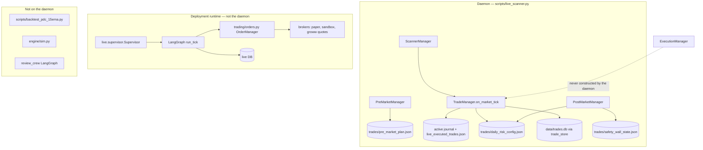

# 01 — Current architecture audit

Evidence labels: **VERIFIED** (this reading of source), **PARTIAL** (seen, not every branch), **UNVERIFIED** (not opened).

Genesis is three trading runtimes that do not share a ledger, plus a research script for the benchmark strategy.

## What runs

| Runtime | Entry | What it decides | Evidence |
|---|---|---|---|
| Scanner daemon | `scripts/live_scanner.py` `main` | Paper journal of index signals. `is_paper_trading=True`. No `ExecutionManager`. | VERIFIED, lines 197–212 and 334–347 |
| Deployment crew | `app.live.supervisor.Supervisor.command` spawns `python -m app.agents.trade_crew` | LangGraph tick: verify, gate, hours, observe, reconcile, exits, drawdown, daily, entry, risk, opinion, explain, execute | VERIFIED, `supervisor.py` 73–76, `graph.py` 1400–1432 |
| Strategy review | `app.api.routes` calls `run_review_crew` | Audit, scenarios, simulate, hard stop, trade review, verdict, improve | VERIFIED, `review_crew/graph.py` 198–218 |
| PDC V0 research | `backend/scripts/backtest_pdc_15ema.py` | Standalone backtest. Not imported by the daemon | VERIFIED, no daemon import |

CrewAI is absent. A repository search for `crewai` and `CrewAI` returned no matches. **VERIFIED.**

`vendor/TradingAgents/` is a third-party LangGraph stack (analysts, portfolio manager, vendor router). The daemon does not import it. **PARTIAL:** identified by graph and path; not line-audited.

## Daemon session

`scripts/live_scanner.py`:

1. Once, before the loop, if the pre-market lock is absent: `ScannerManager.produce_scan_snapshot(timeframes=["1d"])`, then `PreMarketManager.run_pre_market_setup`. Gift Nifty is not passed. Lines 240–249.
2. Loop. Outside 09:15–15:30 local `datetime.now()` (not Kolkata): at or after 15:31, `PostMarketManager.run_daily_review` with an **empty** frame and hardcoded PDH 23150 / PDL 22950. Lines 159–165, 276–285.
3. Inside hours: Yahoo 5m via `FeedAgent`, Groww chain via `GrowwQuotes._page("NIFTY")` (quotes, not orders), `produce_scan_snapshot`, then `TradeManager.on_market_tick`. Lines 65–79, 295–347.
4. Banner claims five crews including `ExecutionCrew`. The process never constructs `ExecutionManager`. Lines 187–190. **VERIFIED.**

`is_market_hours` uses naive `datetime.now()`. The session date passed into the tick uses `Asia/Kolkata`. They match only when the host zone is Kolkata. **VERIFIED**, lines 159–165 and 342.

## TradeManager tick

`TradeManager.on_market_tick` (`backend/app/trading/crew/manager.py` 161–954) is the scanner orchestrator. It is one function, not a crew runtime.

Order inside one tick:

1. `JournalAgent.load_active_trades`. Failure returns `JOURNAL_UNREADABLE` and does not call `begin_session`. Lines 179–191.
2. `RiskAgent.begin_session`. The boolean is ignored. Line 192.
3. `GammaAgent.evaluate_option_chain`. Lines 200–202.
4. For each open trade: opposing sweep probe, `HoldingAgent.evaluate_holding`, then either a synthetic full close or `ExitAgent.evaluate_exit`. Lines 216–311.
5. Full close: `JournalAgent.record_exit`, then `RiskAgent.record_trade_outcome` even when `record_exit` returns `None`, then the id is deleted from the in-memory book. Lines 356–382.
6. New entries only when the book is empty, or exactly one trade has `be_locked`. Lines 450–456. That is not “no second same-direction position.”
7. Gates: session block, circuit breaker, 09:15–09:30 blackout, lunch lull, no new orders at or after 14:30, India VIX band 11.5–22, stale bar, `walls_live`, consolidation squeeze. Lines 459–587.
8. Scanner candidates, else waterfall, else internal sweep if `candidate_setups is None`. Lines 592–840.
9. `RiskAgent.evaluate_order`, then `JournalAgent.record_entry`. No broker call. Lines 735–898.

`ExitAgent` is constructed with cutoff `"15:10"`. The class docstring says 15:15. Lines 149–150 of `manager.py`; `exit_agent.py` 11 and 51.

## Two decision systems

| Question | Scanner daemon | LangGraph deployment crew |
|---|---|---|
| Strategy | Detector sweeps, trendline, equal highs/lows, waterfall, sniper | Whatever `StrategyDocument` the deployment stored |
| Risk | `RiskAgent` JSON file | `graph.py` `_risk` / `_daily` / drawdown ladder, live DB |
| Orders | Journal + Telegram | `OrderManager` behind `live_blockers` |
| Live default | Paper journal | `LIVE_TRADING_ENABLED` default false, `config.py` 112 |

They do not call each other. **VERIFIED** by entry-point search: `TradeManager(` is the daemon and scripts; `run_tick(` is the supervisor, the trade-crew runner, and tests.

## Data owners

| Store | Writer | Role today |
|---|---|---|
| `trades/.active_trades_{date}.json` | `JournalAgent` | Open book for the daemon |
| `trades/live_executed_trades.json` | `JournalAgent.record_exit` | Closed rows. Corrupt file is replaced with a new list. Lines 189–205 |
| `trades/daily_risk_config.json` | `RiskAgent.save_config` and, once a premium method exists, `SafetyWallAgent.process_daily_pnl` | Counters, reserve, `effective_capital` |
| `trades/safety_wall_state.json` | `SafetyWallAgent._save_state` | Second reserve number |
| `data/trades.db` `live_and_forward_trades` | `trade_store.upsert_trade` | Copy. Reads Excel-shaped keys, coerces missing premium to 0. Lines 135–149. Comment calls it SSOT; the daemon treats JSON as the book |
| Live SQLAlchemy DB | `LiveStore` | Deployment orders and positions. Different process |
| `trades/pre_market_plan.json` | `PreMarketManager._save_plan` | Morning note. The tick does not read it back as a gate |
| `trades/active_strategy_params.json` | Not written by `ParameterAgent.append_proposals` | Read at daemon startup for `otm_steps` and stop buffer. Lines 219–229 of `live_scanner.py` |

`app.db.trade_store` creates `data/` at import (`trade_store.py` 18–20). That is a side effect of importing the module. This audit did not import it.

## Market input

| Input | Implementation | Quality |
|---|---|---|
| Index bars | `FeedAgent.fetch_timeframe_candles` → Yahoo chart `^NSEI` | Cache of 3 seconds. No schema validation beyond dropping null OHLC. `feed_agent.py` 32–55 |
| Option chain | `GrowwQuotes` page, contracts only | Missing chain: `GammaAgent` invents walls ±250 and OI 50,000,000 / 52,500,000, with `walls_live=False`. `gamma_agent.py` 89–97 |
| Max pain | `round(spot/50)*50` | Not a max-pain calculation. Lines 59 and 83 |
| Gift Nifty | `GapAgent.evaluate_gap` argument | Daemon does not pass a price. Agent substitutes `pdc + sentiment * 25`. `gap_agent.py` 47–49, `live_scanner.py` 245 |
| News | `NewsAgent` keyword score | Heuristic. Not a calibrated weight |
| VIX | Tick may call `get_quote("^INDIAVIX")` | Missing VIX blocks new entries. `manager.py` 535–540 |
| Forming bar | `_drop_forming` drops a 5m bar that has not closed | Look-ahead control exists for the daemon’s 5m frame. `live_scanner.py` 82–95 |

## Scores

Weights sum to 100. Overall = 3.50.

| Category | Score | Weight | Evidence | Main weakness |
|---|---:|---:|---|---|
| Agent architecture | 4 | 6 | 24 agent classes under `backend/app/trading`; one 1,000-line manager | Shared dicts, duplicate Gamma and premium-method sets, no contracts |
| Crew architecture | 3 | 4 | Managers, not CrewAI | Banner lists an execution crew the process does not build |
| Orchestration | 4 | 8 | Daemon loop + LangGraph tick | Two orchestrators, ignored `begin_session` result |
| Strategy isolation | 2 | 8 | PDC script vs `TradeManager` | Benchmark is not the live card, and the script already drifts from the stated V0 rules |
| Intelligence | 2 | 4 | Keyword news, PCR bins, thesis dataclass | No recency module. Missing chain becomes invented OI |
| Risk management | 4 | 10 | Point cap, loss count, R breaker, VIX, walls | Loss count uses R and a ₹500 stand-in, then a win clears it |
| Financial integrity | 2 | 12 | `risk_agent.py` 123–146, `safety_wall_agent.py` 78–149 | Reserve and loss count contradict the Sprint 2 invariants |
| Execution safety | 6 | 10 | Live bridge returns `REJECTED` / `UNSENT`. Daemon has no execution manager | A second order path exists. Simulated fills and a fake slippage counter sit on the unwired manager |
| Data architecture | 3 | 6 | JSON book, SQLite copy, live DB | Three books, non-atomic JSON replace, null coerced to 0 |
| Observability | 4 | 4 | Logs and Telegram | No correlation id. Post-market review runs on an empty frame |
| Fault tolerance | 3 | 8 | Active journal fail-closed | Unreadable risk file is later overwritten. Failed exit still updates risk |
| Testing | 4 | 8 | Broad `backend/tests` | Sprint 2 rows are unwritten. This audit did not run pytest |
| Security | 5 | 4 | `LIVE_TRADING_ENABLED` defaults false. `live_blockers` names that flag | Tokens in env. Not a full auth review |
| Scalability | 3 | 4 | One host, 10s poll, Yahoo | No cross-process lock on the risk file |
| Maintainability | 3 | 4 | Repeated crews, vendor tree, 1,000-line tick | A change to money touches a function that also sizes and locks |

Weighted sum of score × weight = 350. Divided by 100 = **3.5**.

## Architectural implication

Keep the daemon managers. Fix money inside `RiskAgent` and stop `SafetyWallAgent` from being a second writer. Leave the LangGraph deployment graph on its own ledger until one rule card is shared. Do not add CrewAI. Do not point the daemon at `ExecutionManager` in this migration. Isolate PDC V0 from `HoldingAgent`.
