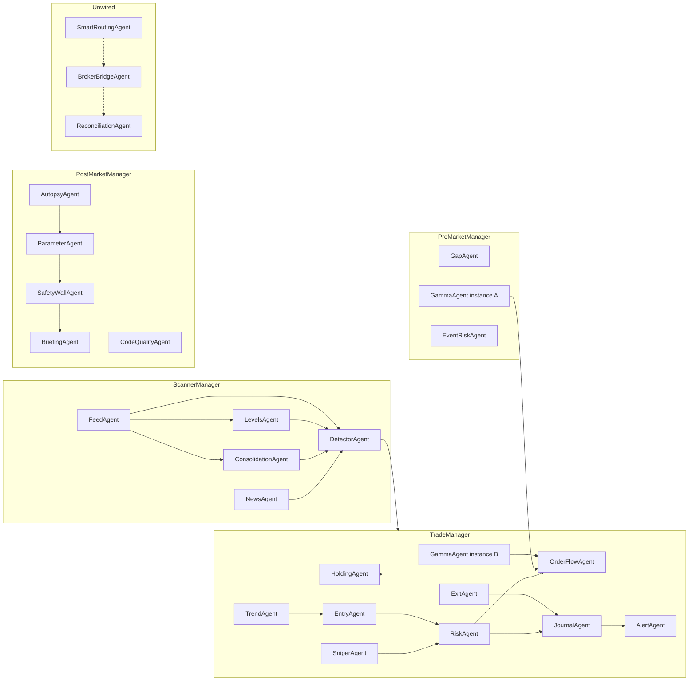
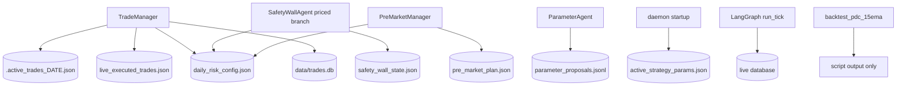

# 04 — Agent dependency graph

Solid arrows are calls verified in source. The execution trio is dashed because the daemon never constructs it. LangGraph is a separate graph.

The trade box is the manager. Agents do not call the manager. The manager calls them. The diagram shows data direction.

## Call edges that matter

| From | To | Where | Effect |
|---|---|---|---|
| `live_scanner.main` | `ScannerManager`, `TradeManager`, `PreMarketManager`, `PostMarketManager` | `live_scanner.py` 198–212, 245, 302, 334, 280 | The only production composition |
| `TradeManager` | `RiskAgent.begin_session` | `manager.py` 192 | Return value discarded |
| `TradeManager` | `HoldingAgent` then maybe `ExitAgent` | 263–311 | Holding can force a full close the exit rules did not compute |
| `TradeManager` | `JournalAgent.record_exit` then `RiskAgent.record_trade_outcome` | 357–371 | Outcome runs even when the journal returns `None` |
| `TradeManager` | `RiskAgent.evaluate_order` then `JournalAgent.record_entry` | 735–891 | Journal is the “fill” |
| `RiskAgent.evaluate_order` | `OrderFlowAgent.evaluate_sizing_cap` | `risk_agent.py` 249–254 | Can veto. Frozen lots ignore the cap’s lot number (L265–266) |
| `GammaAgent` | `OrderFlowAgent.extract_option_oi_walls` | `gamma_agent.py` 51–53 | Only for ce/pe shaped rows |
| `PostMarketManager` | `SafetyWallAgent.process_daily_pnl` | `post_market_manager.py` 115 | Latent writer of the same risk file |
| `Supervisor` | `app.agents.trade_crew` | `supervisor.py` 73–76 | Does not import `TradeManager` |
| `OrderManager` | broker adapter | `trading/orders.py`, deployment graph `_execute` | Behind `LIVE_TRADING_ENABLED` |

## State edges

`PreMarketManager` reads the risk file. It does not write it. `SafetyWallAgent` writes it only in the priced branch. Both statements are **VERIFIED**.

## Cycles

No package cycle is required for the daemon to boot. The in-tick cycle is `HoldingAgent` `FLIP_AND_REVERSE` inserting a setup that the entry section of the same function can journal (`manager.py` 297–300). That can open a reversal without a new poll.

`RiskAgent` and `SafetyWallAgent` are a write cycle on one file if a premium method is ever added to both frozensets. Today both sets are empty, so the post-market write does not run. The cycle is latent. **VERIFIED.**

## Contracts that do not exist

Agent returns are dataclasses or dicts with no `request_id`, `correlation_id`, `data_timestamp`, or `error_code`. The tick’s action list is the only trace, and it is not persisted as an audit log. Telegram text is not a contract.

LLM output exists on the deployment opinion node and the review improver. `TradeManager`’s imports are the crew agents, `GammaAgent`, and `liquidity_signals` (`manager.py` 20–30). There is no LLM client in that file. **VERIFIED.**
