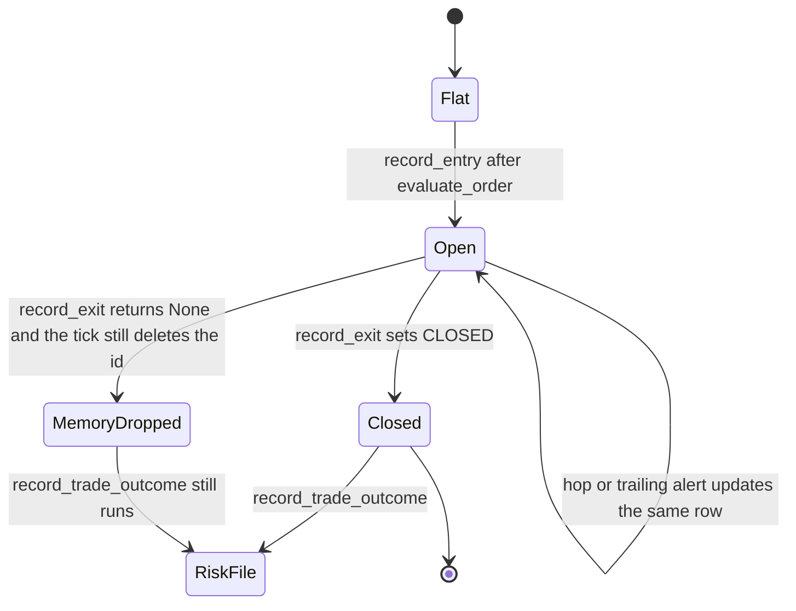
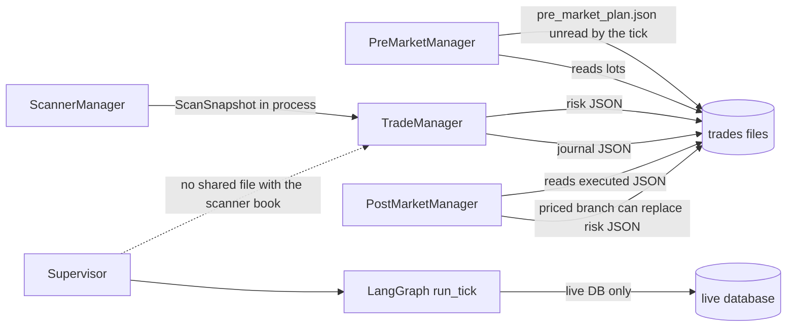
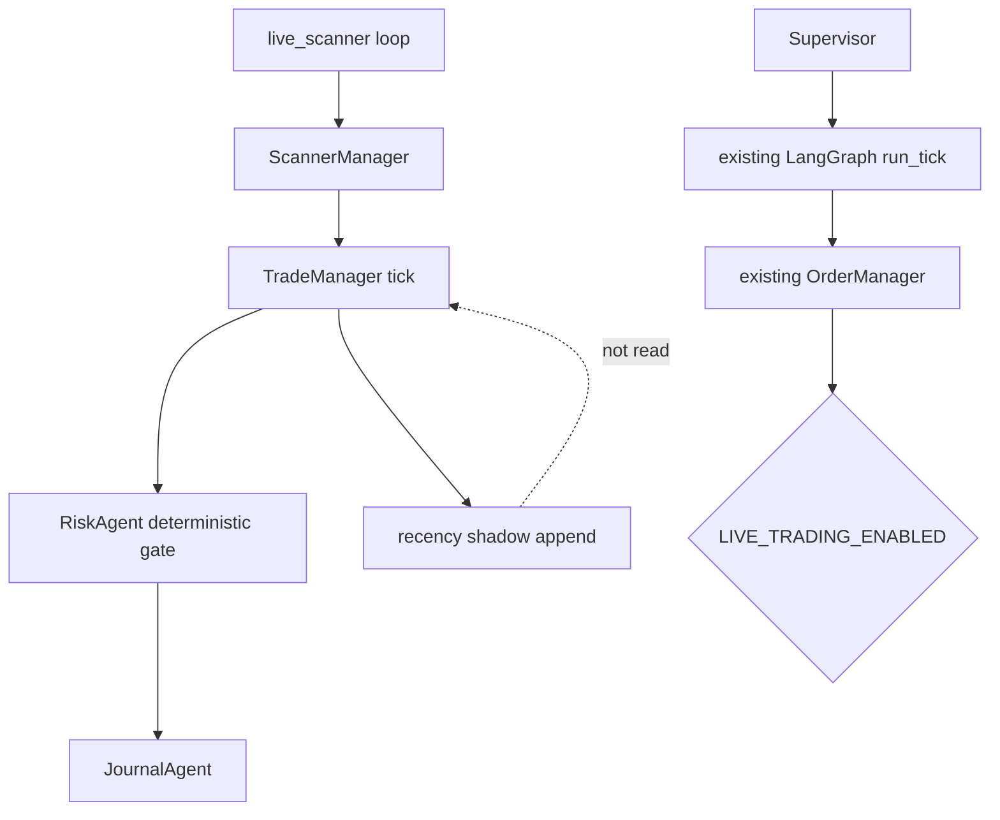

# 05 — Crew orchestration design

## What coordinates the day

| Phase | Owner today | Blocking | Failure |
|---|---|---|---|
| Pre-market | `PreMarketManager` once per lock | Blocking HTTP for Telegram, then the process continues | Logged. Lock not written. Next start retries. Plan is not a gate |
| Scan | `ScannerManager` each loop | Blocking Yahoo and Groww calls | Empty frame can still produce cmp 23000. Daemon loop catches exceptions |
| Strategy evaluation | `DetectorAgent` then `TradeManager` gates | Same process, same tick | Invalid candidates are skipped. Walls missing blocks new Nifty entries only |
| Decision | `TradeManager` after gates and `evaluate_order` | Blocking | Not approved means `continue`. No persisted decision record beyond the journal row |
| Risk | `RiskAgent` inside the tick | Blocking file write on session start and on every close | Unreadable file is not fail-closed after `begin_session` |
| Execution | Journal write and Telegram. Not a broker | Blocking disk | See financial assessment |
| Position monitor | Same tick, before new entries | Blocking | Holding can close a trade the exit agent did not choose |
| Post-market | `PostMarketManager` after hours | Blocking, once | Empty intraday frame. Hardcoded PDH/PDL |
| Trade review of a strategy document | `review_crew` via API | Request-scoped | Not the journal autopsy |
| Strategy research | `engine/sim.py`, `backtest_pdc_15ema.py`, other scripts | Offline | Not the daemon |

There is no master orchestrator object. `scripts/live_scanner.py` `main` is the master for the scanner product. `Supervisor` is the master for deployments. They do not communicate.

## Competing mechanisms

1. Daemon tick (`on_market_tick`).
2. LangGraph `run_tick` for deployments.
3. Unwired `ExecutionManager`.
4. Vendor TradingAgents graph, not on either Genesis entry point.

Crew-to-crew communication is a function argument (`ScanSnapshot`) or a file (`daily_risk_config.json`, `active_strategy_params.json`). There is no message bus.

## State transitions

Daemon trade states in the journal are whatever `record_entry` / `record_exit` write. `record_exit` always sets `status` to `CLOSED` (`journal_agent.py` L182). There is no `PARTIAL` status. Liquidity hops change lots in the active dict and do not append an execution (`manager.py` L313–344).

Deployment states live in the live database (`Order`, intents, deployment status). They are a different machine.

Risk states: `session_blocked`, `manual_lock`, `is_safety_wall_locked`, `daily_losses_count`, `daily_cumulative_r`. A win clears the count (`risk_agent.py` L135–136). That is the running transition. It is not the Sprint 2 transition.

## Failure, duplicates, recovery

| Event | What happens |
|---|---|
| Process kill mid-tick | Last successful JSON write remains. In-memory duplicate signatures are gone. Risk file may be a partial write: `save_config` uses `open(..., "w")` then `json.dump` (`risk_agent.py` L120–121). Not temp-file plus `os.replace` |
| Restart | `begin_session` resets counters when `session_date` is missing or is a new date. The file read for the sprint note had no `session_date` and `daily_cumulative_r` 9.65. The next successful tick that reaches `begin_session` will write today’s date and zero that R. This audit did not start the daemon |
| Duplicate close | No `trade_id` marker. A second `record_trade_outcome` applies R math again |
| Duplicate entry | Hash set plus active-file key. Restart loses the set |
| `record_exit` returns `None` | Risk counters still update and the memory book drops the id (`manager.py` L366–382) |
| Journal load failure | Tick returns. Good. A later load of another date clears `load_failed` |
| Deployment crash | Supervisor restarts the subprocess with backoff (`supervisor.py` docstring and fields). The crew is supposed to reconcile before trading. Node-level reconcile exists (`_reconcile`). This audit did not execute a crash |

## Is LangGraph justified?

Yes, for the deployment runtime that already uses it: orders, heartbeats, kill switch, drawdown ladder, opinion clamp. Replacing it with CrewAI would add a framework and remove a deterministic edge list.

No, as a second orchestrator for the scanner. `on_market_tick` is already imperative and testable. Wrapping those agent calls in a graph would not fix the risk file.

CrewAI is not in the repository. Introducing it is a new dependency for a job the managers already do. Do not add it.

## Trade lifecycle

The daemon book and the deployment book are different lifecycles. Do not draw them as one state machine.

`PARTIAL` is not a status the journal writes. A hop leaves the row open and changes lots in memory. There is no execution list to replay. Restart reloads the active JSON. The in-memory duplicate set does not reload.

The deployment graph’s lifecycle is intent, order, fill, and live-trade rows in the live database. It does not read `.active_trades_*.json`.

## Crew communication

## Target orchestration

Keep `live_scanner.py` as the scanner clock. Inside the tick, the only behavioral changes in this migration are the ones the Sprint 2 register names: honor `begin_session`, do not post an outcome when the journal did not persist, and append a shadow record that nothing reads.

Leave `run_tick` on deployments. Do not route scanner signals through it. Do not route deployment orders through `BrokerBridgeAgent`.

Shadow and the risk gate do not share a write. The graph and the scanner do not share a write.
