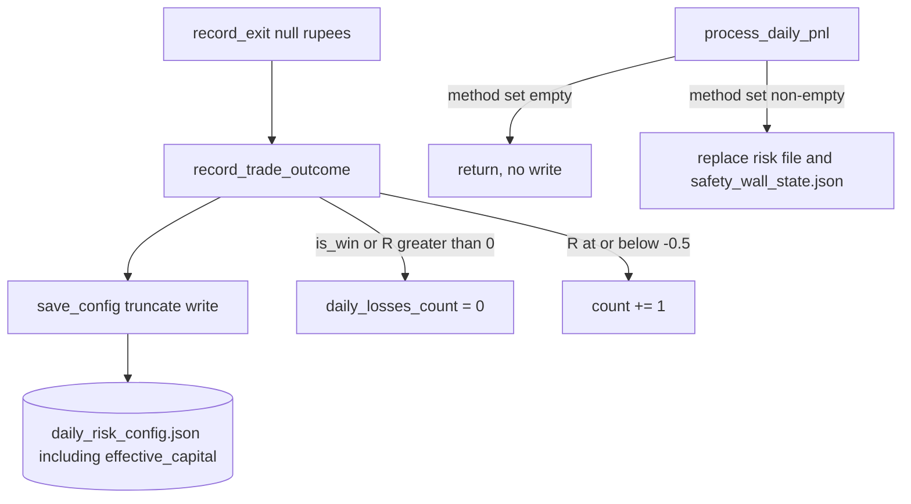
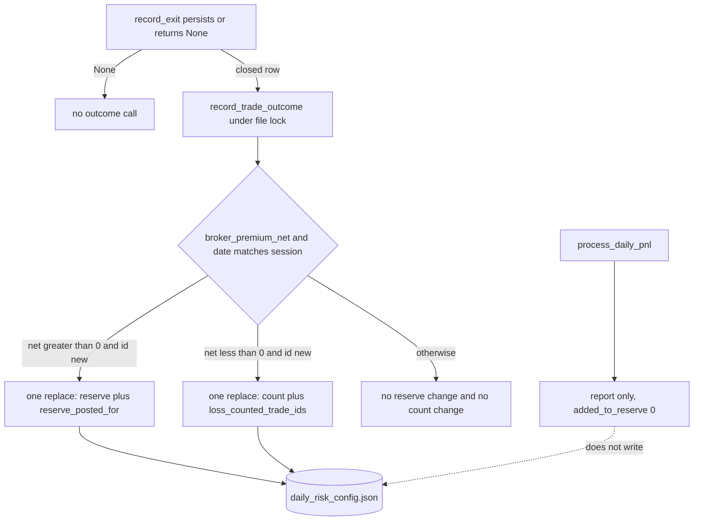

# 06 — Financial integrity assessment

The six Sprint 2 documents agree. The implementation does not. Design text is not a passing test. This audit did not run pytest and did not open the production risk file.

## Document agreement

| Rule | Design | Acceptance | Register | Recency note | Sprint 1 verification | Coverage gaps |
|---|---|---|---|---|---|---|
| Loss count moves only for a broker-confirmed net strictly below zero, once per `trade_id` | Yes | B-26a–c, e, f, o, u | S2-02 | Points at the financial design | Says source does the opposite | Names the missing tests |
| A later win, `is_win`, or `realized_r > 0` does not clear the count | Yes | B-26d | S2-02 test conflict | Same | Supersedes the Sprint 1 assertion | Same |
| Reset only when `begin_session` successfully writes a new `session_date` | Yes | B-26g, h, i, B-04 | S2-04 | Does not edit the test | Source replaces an unreadable file | B-01 missing |
| Marker lists survive the reset | Yes | B-02, B-26g, j | S2-04, S2-07 | Same | Not in source | Not in tests |
| Count and `loss_counted_trade_ids` are one atomic replace | Yes | B-26s, v, w | S2-02 | Same | Not in source | Not in tests |
| Reserve credit is `round(net * 0.50, 2)` once, only for positive `broker_premium_net`, with `reserve_posted_for` | Yes | B-26k–n, q–s | S2-02 | Same | Empty method set, so no credit today | B-26 missing |
| A loss does not change the reserve | Yes | B-26a, o | S2-02 | Same | Source agrees only because the method set is empty | No priced test |
| `process_daily_pnl` does not write either file | Yes | B-05, B-26t | S2-07 | Same | Early return only while the set is empty. Priced branch writes | No B-05 test |
| Failed replace is not success | Yes | B-26q, v | S2-02 | Same | `save_config` does not return a status. `record_trade_outcome` returns `None` | No test |
| Recency cannot move the gate | Yes | R-07, R-14 | S2-V3 | Whole document | No recency module | No R tests |
| 213954.1 is not recomputed | Yes | B-02 | S2-07 | n/a | Source leaves the number if the file loads | Not executed against the real file |

No contradiction between the six documents was found on these rules. The verification note and the coverage note describe **source**. The design, matrix, and register describe **the required change**. They are labeled that way in the files themselves.

`sprint1_independent_verification.md` still calls T-03 PARTIAL. It does not reclassify the source as already matching Sprint 2. That is consistent.

## Source versus the rules

### Daily loss count

`RiskAgent.record_trade_outcome` (`risk_agent.py` 123–146):

- No `trade_id` argument. **MISSING.**
- No `loss_counted_trade_ids`. **MISSING.**
- If `is_win` or `realized_r > 0`, the count is set to 0. **CONFLICT.** Lines 135–136.
- Else if `realized_r <= -0.5` or (`priced` and `pnl_rupees <= -500`), the count increments. **CONFLICT.** Lines 137–138. Unpriced R moves the count. A small broker loss would not, even after a method exists, unless R is at or below −0.5 or rupees are at or below −500.
- `PREMIUM_PNL_METHODS` is empty, so the rupee clause is dead. The R clause is live.
- Every call ends in `save_config()`. A false return does not exist. The function returns `None`.
- `save_config` truncates the destination with `"w"` (L120). No `fcntl` lock. No temp file. No fsync. No `os.replace`.
- `begin_session` zeros the count in memory before the save (L159). A failed save restores memory and sets `session_blocked` (L166–169). A successful save of a new date does reset the count. A same-date call returns true without reset (L151–152). That part matches. The unreadable-file path does not: load sets `session_blocked` but leaves `session_date` unset (L99–101), so the next `begin_session` takes the reset branch and writes a new document whose in-memory reserve is still 0.
- `reset_daily_counters` still exists (L173–179) and saves without setting `session_date`.
- `on_market_tick` ignores the boolean (L192) and still calls `record_trade_outcome` when `record_exit` returns `None` (L356–371).

`test_sprint1_guards.py` `test_ist_session_resets_on_date_change_and_blocks_when_save_fails` expects the win-clear. The design says S2-02 updates that assertion and keeps the date-change, same-date, and failed-save assertions. This audit did not edit the test and did not run it. **VERIFIED** as a documented conflict. The test body was not re-opened in this pass. **PARTIAL** on the exact assertion line numbers inside the test file.

### Safety Wall reserve

| Requirement | Source | Classification |
|---|---|---|
| Sole logical owner is `record_trade_outcome` | Credit code exists there (L132–133) and again in `process_daily_pnl` (L100–114) | DUPLICATE, latent |
| Positive broker net credits 50% once | Credit runs only if the method is in an empty set. No id marker | MISSING idempotency. Formula `round(pnl * 0.50, 2)` is present |
| Balance and `reserve_posted_for` in one replace | Field does not exist. `save_config` payload is L106–117 | MISSING |
| Failed persistence is not success | Exception during `save_config` propagates. In-memory reserve is already increased. No restore in `record_trade_outcome` | CONFLICT |
| `process_daily_pnl` is reporting-only | Unpriced path returns without writing (L85–94). Priced path writes `daily_risk_config.json`, sets `daily_losses_count` to 0, drops `session_date`, `manual_lock`, `reserve_basis`, and `daily_cumulative_r`, and writes `safety_wall_state.json` (L128–139) | CONFLICT with B-05 the moment a method is added |
| State file is not the ledger | It is a second balance, loaded in `_load_state` L58–67 | CONFLICT |
| `effective_capital` omitted | Written every save as `base + reserve` L109 | CONFLICT |
| Paper, simulated, estimated, unpriced do not move the reserve | True today because the set is empty and the journal writes `pnl_method="index_points_not_priced"` and `pnl_rupees=None` (`journal_agent.py` L174–175) | EXISTS for the empty-set behavior. Not a durable guarantee |

`PostMarketManager` builds `SafetyWallAgent` on the daemon’s `trades/` directory. The priced writer is one frozenset edit away from replacing the production risk file and zeroing the loss count in that replacement.

### Ledger, costs, idempotency

| Piece | Status |
|---|---|
| Append-only `executions` on the journal object | MISSING. `record_exit` stores points and null rupees |
| FIFO derivation | MISSING |
| Duplicate execution id ignored | MISSING |
| `broker_premium_net` | MISSING. Not a member of either frozenset |
| `leg_costs` on the close path | Not called by `record_exit`. `app.engine.costs` is the function the design says to reuse. This audit did not re-read `costs.py` line by line. **PARTIAL** on the formula; the sprint design quotes it and Sprint 1 says charges are not a booking path |
| `upsert_trade` | Reads `entry` / `points` / `qty`, not crew keys. `entry_premium` uses `or 0.0` (`trade_store.py` 135–149). `entry_premium` column is `NOT NULL` (L64) | CONFLICT with S2-01 |
| Restart replay | Re-reading JSON does not post the reserve by itself. A second close call would. There is no marker to stop it |
| Atomic reserve | MISSING |

### Acceptance coverage

B-01 through B-26 and R-01 through R-14 are specified and not implemented. The coverage note lists the gaps. This audit did not add tests and did not execute the Sprint 1 files. Existing tests that lock the empty premium set must be updated in the same change as S2-02, or they will forbid the only legal credit. The design already says that.

### What must not be treated as done

- An empty `PREMIUM_PNL_METHODS` is not reserve idempotency.
- `pnl_rupees is None` on exit is not a five-book ledger.
- `frozen_baseline` with `default_lots=3` hides `effective_capital` from the daemon’s lot count. `evaluate_order` still computes `max_loss_rupees` as `risk_points * 0.5 * qty` (L269–276). The milestone walk remains for any `RiskAgent` that is not frozen.

## Accounting diagram — today

## Accounting diagram — required

The required diagram is the Sprint 2 design. It is not the code.
