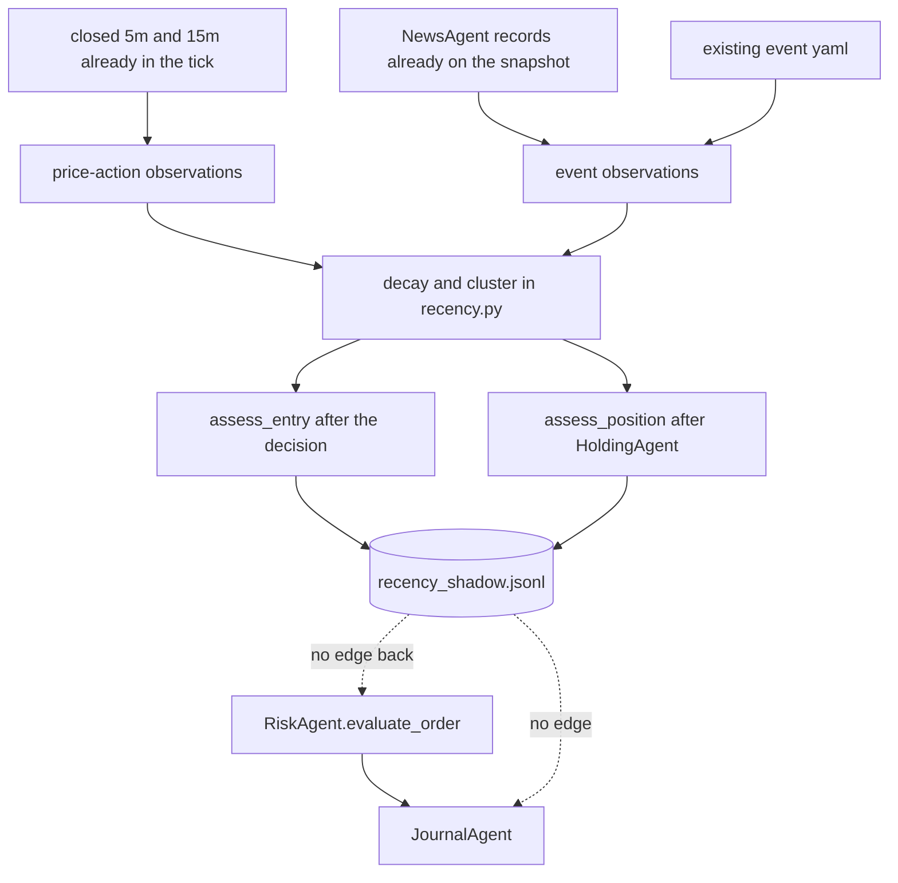

# 07 — Recency intelligence integration

`DocumentsAndDiagrams/phase2_blueprint/sprint2/recency_intelligence_architecture.md` is design. `backend/app/trading/crew/recency.py` does not exist. A search of application code found the word in the sprint documents, not in a module. **VERIFIED** as absent.

The note matches the task register and the acceptance matrix on shadow mode, `insufficient_data`, separate price and event evidence, and S2-V3 as a checklist that does not grant activation. No conflict with the financial rules: the note says it does not own the loss count or the reserve.

## Where a hook can sit without a new agent

| Need | Reuse | Do not build |
|---|---|---|
| Closed 5m bars | Daemon already drops a forming bar in `_drop_forming` (`live_scanner.py` 82–95) and passes `df_5m` | A second feed |
| 15m bars | `df_15m` argument of `on_market_tick` | A second feed |
| VWAP | `compute_session_vwap` in `holding_agent.py` | A new VWAP agent |
| Sweeps and levels | `DetectorAgent` and `LevelsAgent` tags | A new sweep definition |
| Headlines | `NewsAgent.analyze_headlines` and `BULLISH_KEYWORDS` / `BEARISH_KEYWORDS` | A new news agent. `TradeManager` does not construct `NewsAgent` today. The hook must read the snapshot the scanner already built, which means the daemon must pass that sentiment or headline list into the tick. It does not today (`on_market_tick` has no news argument). **VERIFIED** from the signature at `manager.py` 161–177 |
| Calendar | `load_event_yaml` and `NewsAgent.SCHEDULED_HIGH_IMPACT_EVENTS` | A new veto. Do not change `check_event_risk_guard` |
| Entry decision already made | End of the candidate section, after `evaluate_order` and the journal decision | A branch that reads the shadow label |
| Open position | Immediately after `evaluate_holding` returns (`manager.py` 263) | A call to `record_exit` from the classifier |
| Decay math | New pure functions in `recency.py` | An agent class |
| Log | Append-only `trades/recency_shadow.jsonl` | A column on the journal that the gate reads |

`DirectionalThesis` (`entry_agent.py` 28) is a string bundle the manager fills (`manager.py` 777–785). It is not evidence, not a mass, and not a band. Recency must not write those fields.

## Entry

Required sequence, after the manager has already chosen:

1. Strategy and rupee gate run as they do now.
2. `assess_entry` sees only closed bars and events with `first_observed_at` at or before the decision time.
3. Append one JSON object. `strategy_action` is the action already chosen. `orders_sent` is false.
4. `record_entry` does not read `hypothetical_action`.

`WOULD_NO_TRADE` is illegal when data quality is `insufficient_data`. That case is `WOULD_WAIT` as a hypothesis only, and the directional class is `insufficient_data`. The strategy row is unchanged.

## Open positions

After `evaluate_holding`, classify `strengthening`, `stable`, `weakening`, `invalidated`, or `insufficient_data`. `invalidated` does not set `is_fully_closed` and does not call `record_exit`. One opposing observation must not change the exit action (R-09, R-10).

Holding’s existing `PREEMPTIVE_EXIT`, `PREEMPTIVE_PROFIT`, and `FLIP_AND_REVERSE` stay. They are not recency. Sprint 2 says not to extend them. They already differ from a candle-close PDC stop. That is a live-card fact, not a recency feature.

## Checks

| Check | How the design holds it | Code today |
|---|---|---|
| No future bars | Age uses bar close time. `t < 0` is dropped. Daemon already drops a forming 5m bar | 15m frame is fetched without the same `_drop_forming` helper (`live_scanner.py` 301). A hook must apply the same rule to 15m. **PARTIAL** gap |
| No future events | `first_observed_at` required. Missing timestamp → freshness 0, not 1 | News records do not carry that field yet |
| No double-counted cluster | One member per `cluster_id`, the largest absolute product | Keyword score adds repeats. That function stays. Recency dedup is new and must not change the keyword function’s return for the scanner |
| Missing data | `insufficient_data` for data quality, direction, position class, and the exception log | Not implemented |
| Cannot override risk | Gate does not read conviction. Module must not import `BrokerBridgeAgent`, `ExecutionManager`, or `trading.orders` | Nothing to override with |
| Frozen strategy bytes | Shadow does not write signal entry, stop, or target | Nothing writes them from recency because recency is absent |
| Shadow cannot execute | `orders_sent: false`. Exception is caught at the hook | The tick has no hook |

Price-action evidence and event evidence stay separate masses that are summed only inside conviction. They do not become one score with a percentage. The architecture note forbids a percentage field (R-06).

## Failure

The hook catches exceptions. The tick still runs the risk gate. Data quality, direction, and the exception log are `insufficient_data`. A missing age is not `W=1`.

Half-lives in the note are priors. The report must say they are not calibrated. S2-V1 is a research entry point on `engine/sim.py` or a script. It must not write `daily_risk_config.json` or `active_strategy_params.json`.

## Integration diagram

Dotted edges are forbidden. They are drawn so a later implementation can see the absence.

## What not to add

No RecencyAgent. No second market-data client. No journal column that `evaluate_order` reads. No change to PDC rules, sweep thresholds, or holding actions inside the recency tasks.
