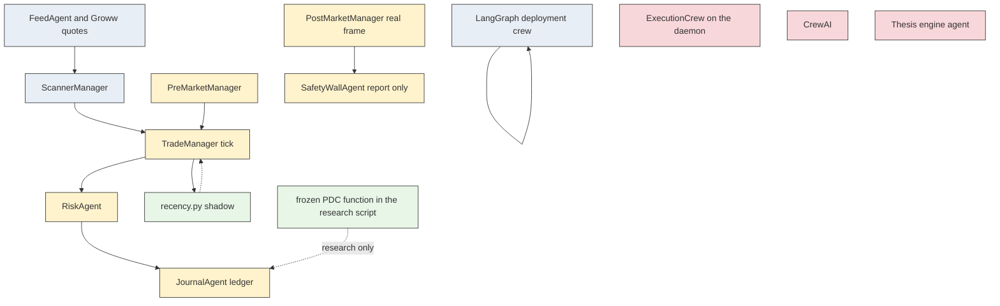

# 08 — Genesis V2 target architecture

The proposed layers were compared with source. “EXISTS” means the behavior is present and matches the proposal. Most names exist as classes and do not match the proposal.

Legend for the diagram: **existing**, **change in place**, **new and justified**, **do not build**.

## Layer verdicts

| Proposed piece | Class | Actual source | Implication |
|---|---|---|---|
| A. Market data | EXISTS — needs improvement | `FeedAgent`, Yahoo `^NSEI` | Keep. Empty frame must not default cmp to 23000 |
| A. Options chain and OI | PARTIALLY EXISTS | `GrowwQuotes` plus `GammaAgent` | Real OI when the chain parses. Otherwise invented walls and OI with `walls_live=False` |
| A. Events and news | PARTIALLY EXISTS | `NewsAgent`, `EventRiskAgent`, `app.market.news`, event YAML | Keyword score and a calendar. No `first_observed_at` |
| A. Data quality | PARTIALLY EXISTS | Stale-bar veto, missing VIX veto, missing walls veto | Missing gift price and missing chain still produce numbers |
| B. PreMarketCrew | EXISTS — needs improvement | `PreMarketManager` | Keep the manager. It is not CrewAI |
| B. GIFT NIFTY | PARTIALLY EXISTS | `GapAgent.evaluate_gap` parameter | Daemon never passes a price. Missing price is `pdc + sentiment * 25`, not `insufficient_data` |
| B. Gap analysis | EXISTS — needs improvement | `GapAgent` | Thresholds 35 and 85 are heuristics |
| B. Event calendar | PARTIALLY EXISTS | `EventRiskAgent`, `NewsAgent.check_event_risk_guard` | Two calendars. Recency must not add a veto |
| B. Gamma and max pain | PARTIALLY EXISTS | `GammaAgent` | Walls can be real. Max pain is ATM rounded to 50. Not a max-pain sum |
| C. ScannerCrew | EXISTS — needs improvement | `ScannerManager` | Keep |
| C. Market structure, VWAP, EMA | PARTIALLY EXISTS | Levels, VWAP helper, trend regime | 15 EMA is computed inside `backtest_pdc_15ema.py`, not as the daemon’s entry rule |
| C. PDH / PDL / opening range | EXISTS — needs improvement | `LevelsAgent` | Daemon post-market call ignores them and passes 23150 / 22950 |
| C. Liquidity and sweeps | EXISTS — needs improvement | `DetectorAgent` | This is the live card |
| C. Setup detection | EXISTS — needs improvement | `DetectorAgent.scan_multi_timeframe_strategies` | No PDC setup |
| D. Recency | MISSING | No `recency.py` | Add pure functions. Not an agent |
| D. Price-action recency | MISSING | Bars exist | New functions over existing frames |
| D. Event recency | MISSING | Headlines exist | New records. Keep the keyword function |
| D. Directional Thesis Engine | NOT REQUIRED | `DirectionalThesis` dataclass | Do not add an engine |
| D. Evidence conflicts | MISSING | News score is one float | Bands in `recency.py` only |
| E. TradeCrew | EXISTS — needs improvement | `TradeManager` | The daemon orchestrator. Not CrewAI |
| E. Existing strategy agents | EXISTS — needs improvement | Entry, trend, order flow, sniper, holding, exit | Live sweep stack. Leave numeric rules alone in this migration |
| E. PDC Zone + 15 EMA V0 | PARTIALLY EXISTS | `backend/scripts/backtest_pdc_15ema.py` only | Not on the daemon. Script already disagrees with the frozen card. See below |
| E. Entry and exit validation | EXISTS — needs improvement | Gates inside `on_market_tick` | Many extra vetoes the V0 card does not have |
| F. Decision orchestration | EXISTS — needs improvement | The same tick, and separately `run_tick` | Do not add a third aggregator |
| F. WAIT / NO TRADE | PARTIALLY EXISTS | Action strings such as `VETO_*`, `CIRCUIT_BREAKER_HALT` | Not a typed decision contract |
| F. Traceability | MISSING | Action dict printed as `SIGNAL:` | No correlation id, no durable decision log |
| G. RiskAgent | EXISTS — needs improvement | `risk_agent.py` | Change in place |
| G. SafetyWallAgent | EXISTS — needs improvement | Report path works only while the method set is empty. Priced path is a writer | Make the writer unreachable |
| G. Capital, premium, planned loss, sizing | PARTIALLY EXISTS | Frozen 3 or 4 lots. `max_loss_rupees` is `points * 0.5 * qty` and is not a gate | S2-05 replaces that formula. Ceiling stays 3 or 4 |
| G. Risk authorization | PARTIALLY EXISTS | `evaluate_order` `approved` | Not a rupee authorization |
| H. ExecutionCrew | DUPLICATE and NOT REQUIRED for this migration | `ExecutionManager` unwired. Deployment uses `OrderManager` | Do not wire the crew. Sprint 2 forbids it |
| H. Smart routing, BrokerBridge, lifecycle | PARTIALLY EXISTS | Bridge rejects live and simulates paper. No partials, no unknown state. Slippage counter is invented | Leave unwired |
| H. Fill reconciliation | PARTIALLY EXISTS | `ReconciliationAgent` on the unwired crew. `_reconcile` on the LangGraph crew | Use the graph’s path for deployments only |
| I. HoldingAgent | EXISTS — needs improvement | Preemptive exits before `ExitAgent` | Do not extend. Do not use it for V0 |
| I. Position thesis monitoring | MISSING | Holding rationale strings | Shadow classifier only |
| I. Stop and target | EXISTS — needs improvement | `ExitAgent`, hop, 2R Telegram text that does not book a partial | Live card, not V0’s 50% at 2R |
| I. TradeManager | EXISTS — needs improvement | `on_market_tick` | Keep |
| J. Canonical ledger | MISSING | Journal object without `executions` | Extend `JournalAgent` |
| J. Broker-confirmed P&L | MISSING | `index_points_not_priced`, rupees null | S2-02 |
| J. Transaction costs | PARTIALLY EXISTS | `app.engine.costs.leg_costs`, `app.paper.order_charges` | Not on the daemon close path |
| J. Atomic reserve | MISSING | Truncating write, no markers | S2-04 and S2-02 |
| J. Idempotency | MISSING for money. PARTIAL for entries | In-memory order hash | Risk markers required |
| J. Crash recovery | PARTIALLY EXISTS | JSON reload. Risk file can be replaced with zeros if it was unreadable | Fail-closed load is the first task |
| K. PostMarketCrew | EXISTS — needs improvement | `PostMarketManager` | Pass the real frame and the snapshot’s PDH/PDL. Stop the reserve write |
| K. Reconciliation | MISSING on this crew | Autopsy is a narrative | Do not pretend the empty-frame call reconciles a broker |
| K. Performance and daily report | PARTIALLY EXISTS | `BriefingAgent`, `compute_metrics` | Null rupees become 0 or raise |
| L. ReviewCrew | DUPLICATE of the name only | `AutopsyAgent` reviews journal rows. `review_crew` reviews strategy documents | Keep both. Do not unify |
| L. Loss analysis | PARTIALLY EXISTS | `app.loss_analyzer` and autopsy | Not re-audited line by line. **PARTIAL** |
| M. StrategyLabCrew | NOT REQUIRED as a new crew | `review_crew`, `engine/sim.py`, research scripts | A script or a flag. Not a crew |
| M. Walk-forward, OOS, robustness | PARTIALLY EXISTS | `hard_stop.py` sweep, improver, simulator | Not the four-config recency harness. That harness is MISSING |

## PDC V0 protection

The permanent benchmark is not what `TradeManager` trades.

| Frozen rule | Research script `scan_pdc_trades` | Daemon |
|---|---|---|
| 5-minute NIFTY and BANKNIFTY | NIFTY path. BANKNIFTY was not found in the function read | NIFTY Yahoo plus a stock side-path. Not this strategy |
| Previous day 15:25 high and low | Looks for `15:25` or `15:20`, else the last bar. Widens a zone narrower than 6 points by ±3 (`find_pdc_zone` L65–84) | Does not compute this zone |
| 15 EMA | `compute_ema(..., 15)` L107–109 | Not the entry condition |
| CE and PE conditions as specified | CE uses a touch, a close above the zone low, a bullish close above EMA. PE uses a close below the zone and EMA. Buffers of 4 points and a 10–65 point risk filter are extra | Sweeps, waterfall, sniper |
| Candle-close stop | Stop is a wick touch (`low <= stop` / `high >= stop`) L154–160 and L235–238 | Index stop plus holding overrides |
| 50% at 2R, then PDH/PDL | Target is `target_rr` default 2.5 or PDH/PDL. No partial | 2R path sends a Telegram instruction and does not book lots (`manager.py` 415–436) |
| Opposite EMA close | Present when `use_ema_exit` | Not this rule |
| 09:20–15:15 | Loop requires `09:25` to `14:45` (L122). Square-off label says 15:15 (L145) | New entries blocked 09:15–09:30 and from 14:30. Exit cutoff constructed as 15:10 |
| No overlapping same-direction position | `in_trade_until` blocks any new signal until the prior exit | A second entry is allowed when the only open trade has `be_locked` (L450–456) |

Any of these architectural moves would change V0 and are rejected:

- Routing V0 through `HoldingAgent`, `SniperAgent`, the VIX band, gamma walls, or the lunch gate.
- Reusing `scan_pdc_trades` as the live card without deleting the buffers, the 09:25/14:45 window, the wick stop, and the 2.5R target.
- Letting recency or `evaluate_order` edit the zone, the EMA length, or the window.
- Treating the daemon’s 2R alert as the 50% partial.

V0 stays a pure function of bars with the frozen predicates, called by the research harness. It is not a new agent. Until that function matches the card, the script is not the benchmark. That gap is a blocker, not a Sprint 2 retune. Sprint 2 already says not to retune the frozen rules. It does not authorize teaching the daemon to trade V0.

## Target diagram

`recency.py` is the only new module this migration needs. The PDC function is a correction of the existing script, and it is not in the Sprint 2 task list. Do not start that correction by editing the daemon.

## Communication contracts

Apply these to new records (`recency` shadow, journal executions, risk save). Do not invent a framework.

| Field | Rule |
|---|---|
| `request_id` | One id per tick, generated by `live_scanner` and passed into the tick |
| `correlation_id` | Same as `request_id` for every record that tick writes |
| `trade_id` | The id `record_entry` already assigns. Outcome and reserve markers use it. No second id |
| `timestamp` | When Genesis wrote the record, timezone-aware |
| `data_timestamp` | Bar close or event `first_observed_at`. Never the arrival time for look-ahead |
| `source_agent` | Module and function. Not a free-form persona |
| `status` | `ok`, `rejected`, `insufficient_data`, `failed` |
| `confidence` | Only `low`, `medium`, `high` where the recency note allows a band. No percentage. Risk approvals have no confidence |
| `evidence` | Ids and ages. Not a blob the gate parses for permission |
| `warnings` | Strings. Not control flags |
| `error_code` | Stable token: `JOURNAL_UNREADABLE`, `CONFIG_UNREADABLE`, `SAVE_FAILED`, `INSUFFICIENT_DATA` |
| `result` | The dataclass fields that already exist, unchanged in meaning |

Validation: reject a broker execution that lacks id, positive price, or positive quantity before it is appended. A shadow record that fails validation is dropped. The trade path continues.

Timeouts: the daemon loop already has a poll interval. Do not add per-agent retries that place a second journal row. A failed risk replace returns false and is retried on the next delivery of the same id, once, under the lock.

Idempotency: `(price_kind, broker_execution_id or execution_id)` on the journal. `trade_id` in `reserve_posted_for` or `loss_counted_trade_ids` on the risk file.

Error propagation: a failed journal load stops the tick. A failed risk load stops entries and stops outcome writes. A failed shadow append is logged and ignored.

State ownership: `JournalAgent` owns the trade object. `RiskAgent` owns the risk document. `SafetyWallAgent` owns neither. `recency.py` owns no file except the shadow log, and a failure there is not a trade failure. LangGraph owns the live database. No function writes both ledgers.

Audit: the risk replace and the journal append are the audit. Telegram is not.

LLM text, where it already exists on the deployment opinion node, stays a recommendation that `normalize` clamps. It is not a broker instruction. The scanner does not need an LLM to complete Sprint 2.

Shared mutable dicts remain the journal row the manager already passes. New code must not add a process-global dict for agents to poke. `HoldingAgent` already writes `stop_loss` on that row. That stays until a later card says otherwise. Recency must not join it.
