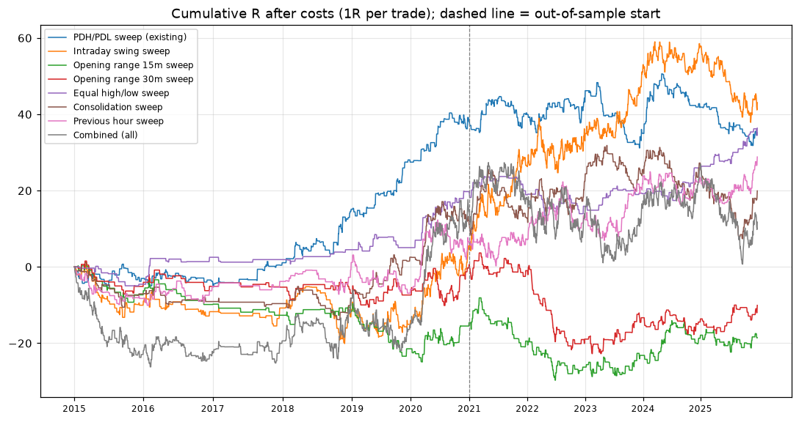
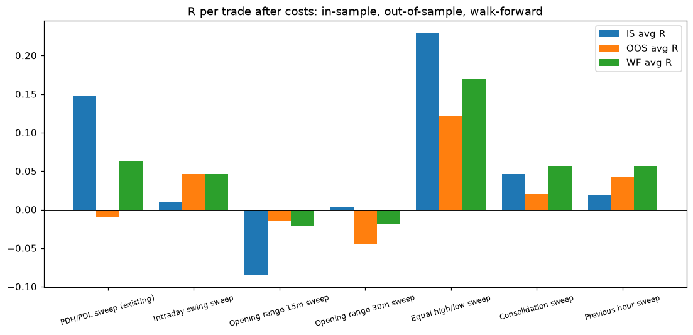
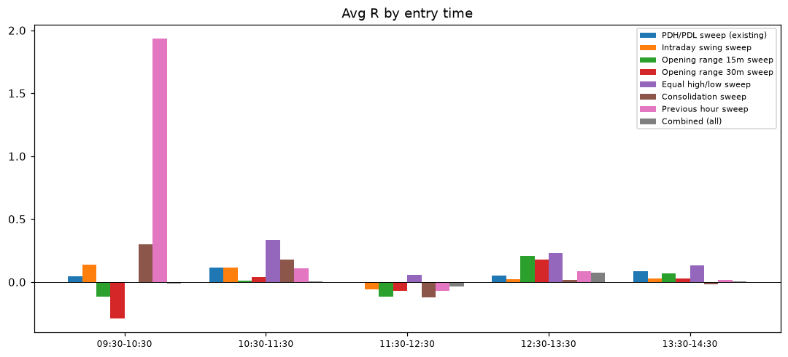
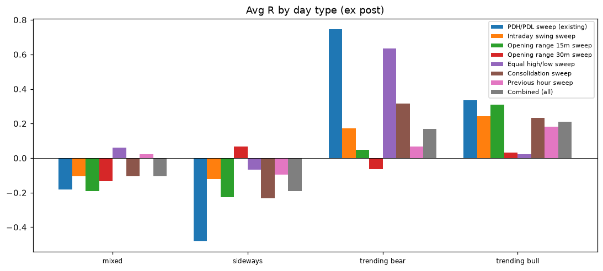
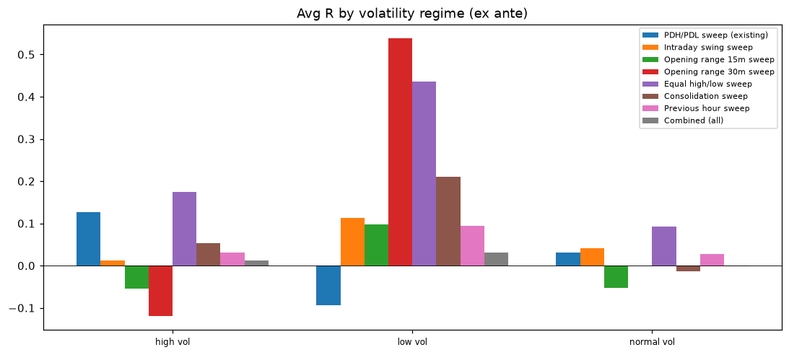

# Backtest results

Data: Kaggle NIFTY 1-minute bars rolled to 5m, 2015-01-02 to 2025-12-24 (2295 sessions; the first session and NIFTY expiry days are skipped for every strategy). VWAP: session time-weighted typical price (index has no volume). In-sample to 2020, out-of-sample 2021 on. Costs: 2 index pts a round trip. Results are index points and R; option P&L is not reported because no historical option prices are available.

| Strategy | Trades | Per year | Win % | PF | Avg R | Total R | Max DD R | Sharpe | Sortino | IS avg R | OOS avg R | WF avg R | Verdict |
|---|---|---|---|---|---|---|---|---|---|---|---|---|---|
| PDH/PDL sweep (existing) | 561 | 61.1 | 41.5 | 1.184 | 0.063 | 35.2 | 18.772 | 0.486 | 0.894 | 0.148 | -0.01 | 0.063 | FAIL |
| Intraday swing sweep | 1310 | 142.7 | 40.3 | 1.078 | 0.033 | 43.1 | 21.141 | 0.391 | 0.614 | 0.01 | 0.046 | 0.046 | CONDITIONAL PASS |
| Opening range 15m sweep | 430 | 46.8 | 37.4 | 0.904 | -0.043 | -18.6 | 30.859 | -0.299 | -0.457 | -0.085 | -0.015 | -0.021 | FAIL |
| Opening range 30m sweep | 400 | 43.6 | 39 | 0.944 | -0.025 | -10.1 | 26.389 | -0.164 | -0.258 | 0.004 | -0.045 | -0.018 | FAIL |
| Equal high/low sweep | 224 | 24.4 | 50.9 | 1.471 | 0.162 | 36.4 | 10.376 | 0.794 | 1.455 | 0.229 | 0.121 | 0.169 | PASS |
| Consolidation sweep | 684 | 74.5 | 37.4 | 1.069 | 0.029 | 19.9 | 24.465 | 0.25 | 0.406 | 0.046 | 0.02 | 0.057 | CONDITIONAL PASS |
| Previous hour sweep | 863 | 94 | 41.6 | 1.084 | 0.033 | 28.8 | 15.376 | 0.344 | 0.556 | 0.019 | 0.043 | 0.057 | CONDITIONAL PASS |
| Combined: all, first per event | 1772 | 193 | 38.6 | 1.016 | 0.007 | 11.7 | 26.642 | 0.088 | 0.135 | 0.02 | -0.002 |  |  |
| Combined: swing, equal, range, hour | 1451 | 158.1 | 39.5 | 1.047 | 0.02 | 29 | 24.133 | 0.241 | 0.374 | 0.019 | 0.021 |  |  |

## PDH/PDL sweep (existing): FAIL

Baseline: 3R target, minimum risk 30 pts, 2 pts cost a trade, 2015-01-02 to 2025-12-24.

| Sample | Trades | Per year | Win % | Avg R | Avg R 95% CI | PF | Total R | Net pts | Max DD R | Sharpe | Sortino | MAE R | MFE R | Hold min |
|---|---|---|---|---|---|---|---|---|---|---|---|---|---|---|
| All | 561 | 61.1 | 41.5 | 0.063 | -0.02 to 0.14 | 1.184 | 35.2 | 2034 | 18.772 | 0.486 | 0.894 | 0.57 | 0.84 | 150 |
| In-sample (to 2020) | 258 | 48.6 | 44.6 | 0.148 | 0.03 to 0.27 | 1.513 | 38.1 | 1814 | 5.961 | 1.051 | 2.109 | 0.51 | 0.85 | 160 |
| Out-of-sample (2021+) | 303 | 78.3 | 38.9 | -0.01 | -0.12 to 0.11 | 0.975 | -2.9 | 220 | 18.772 | -0.083 | -0.143 | 0.62 | 0.82 | 142 |
| Walk-forward 2018+ | 449 | 70.4 | 41.4 | 0.063 | -0.03 to 0.15 | 1.182 | 28.2 | 1509 | 18.772 | 0.523 | 0.949 | 0.59 | 0.86 | 147 |

Walk-forward targets by year: 2018: 1.5, 2019: 3.0, 2020: 3.0, 2021: 3.0, 2022: 2.5, 2023: 3.0, 2024: 3.0, 2025: 3.0

### Long vs short

| Side | Trades | Per year | Win % | Avg R | Avg R 95% CI | PF | Total R | Net pts | Max DD R | Sharpe | Sortino | MAE R | MFE R | Hold min |
|---|---|---|---|---|---|---|---|---|---|---|---|---|---|---|
| Long | 193 | 21 | 51.8 | 0.057 | -0.04 to 0.16 | 1.223 | 11 | 693 | 7.382 | 0.361 | 0.574 | 0.46 | 0.59 | 122 |
| Short | 368 | 40.1 | 36.1 | 0.066 | -0.05 to 0.18 | 1.171 | 24.2 | 1341 | 18.697 | 0.368 | 0.703 | 0.63 | 0.97 | 165 |

### Targets (one at a time, all else baseline)

| Target | Trades | Per year | Win % | Avg R | Avg R 95% CI | PF | Total R | Net pts | Max DD R | Sharpe | Sortino | MAE R | MFE R | Hold min |
|---|---|---|---|---|---|---|---|---|---|---|---|---|---|---|
| 1.0R | 561 | 61.1 | 50.8 | 0.025 | -0.04 to 0.09 | 1.073 | 13.8 | 910 | 19.096 | 0.246 | 0.352 | 0.56 | 0.63 | 128 |
| 1.5R | 561 | 61.1 | 44.2 | 0.034 | -0.04 to 0.11 | 1.099 | 18.8 | 1039 | 24.444 | 0.304 | 0.478 | 0.57 | 0.73 | 139 |
| 2.0R | 561 | 61.1 | 42.1 | 0.037 | -0.04 to 0.11 | 1.109 | 20.7 | 1485 | 20.478 | 0.315 | 0.527 | 0.57 | 0.79 | 146 |
| 2.5R | 561 | 61.1 | 41.5 | 0.054 | -0.03 to 0.13 | 1.158 | 30.2 | 1855 | 18.204 | 0.432 | 0.768 | 0.57 | 0.82 | 149 |
| 3.0R | 561 | 61.1 | 41.5 | 0.063 | -0.02 to 0.14 | 1.184 | 35.2 | 2034 | 18.772 | 0.486 | 0.894 | 0.57 | 0.84 | 150 |
| opposing liquidity (2R if none) | 561 | 61.1 | 42.2 | 0.034 | -0.04 to 0.11 | 1.1 | 19.1 | 1258 | 20.335 | 0.287 | 0.486 | 0.57 | 0.79 | 145 |

### Monte Carlo (1,000 resamples of the baseline trades)

| Total R p5 | Total R p50 | Total R p95 | Max DD R p50 | Max DD R p95 | P(total R <= 0) % |
|---|---|---|---|---|---|
| -5.7 | 35.1 | 75.1 | 16.3 | 31.7 | 7.7 |

## Intraday swing sweep: CONDITIONAL PASS

Baseline: 2R target, minimum risk 30 pts, 2 pts cost a trade, 2015-01-02 to 2025-12-24.

| Sample | Trades | Per year | Win % | Avg R | Avg R 95% CI | PF | Total R | Net pts | Max DD R | Sharpe | Sortino | MAE R | MFE R | Hold min |
|---|---|---|---|---|---|---|---|---|---|---|---|---|---|---|
| All | 1310 | 142.7 | 40.3 | 0.033 | -0.03 to 0.09 | 1.078 | 43.1 | 3469 | 21.141 | 0.391 | 0.614 | 0.68 | 0.89 | 113 |
| In-sample (to 2020) | 471 | 88.7 | 38.6 | 0.01 | -0.09 to 0.11 | 1.023 | 4.5 | 1056 | 20.598 | 0.092 | 0.141 | 0.66 | 0.86 | 107 |
| Out-of-sample (2021+) | 839 | 216.7 | 41.2 | 0.046 | -0.03 to 0.12 | 1.108 | 38.5 | 2413 | 21.141 | 0.667 | 1.06 | 0.7 | 0.9 | 116 |
| Walk-forward 2018+ | 1161 | 182 | 39.2 | 0.046 | -0.02 to 0.11 | 1.109 | 53.2 | 3891 | 21.141 | 0.573 | 0.959 | 0.69 | 0.97 | 120 |

Walk-forward targets by year: 2018: 3.0, 2019: 3.0, 2020: 3.0, 2021: 3.0, 2022: 3.0, 2023: 3.0, 2024: 2.0, 2025: 2.0

### Long vs short

| Side | Trades | Per year | Win % | Avg R | Avg R 95% CI | PF | Total R | Net pts | Max DD R | Sharpe | Sortino | MAE R | MFE R | Hold min |
|---|---|---|---|---|---|---|---|---|---|---|---|---|---|---|
| Long | 669 | 72.9 | 42.5 | 0.034 | -0.04 to 0.11 | 1.082 | 22.9 | 2563 | 25.676 | 0.281 | 0.462 | 0.69 | 0.85 | 116 |
| Short | 641 | 69.8 | 38.1 | 0.032 | -0.05 to 0.12 | 1.073 | 20.2 | 906 | 17.002 | 0.244 | 0.413 | 0.67 | 0.93 | 111 |

### Targets (one at a time, all else baseline)

| Target | Trades | Per year | Win % | Avg R | Avg R 95% CI | PF | Total R | Net pts | Max DD R | Sharpe | Sortino | MAE R | MFE R | Hold min |
|---|---|---|---|---|---|---|---|---|---|---|---|---|---|---|
| 1.0R | 1310 | 142.7 | 49.5 | -0.024 | -0.07 to 0.02 | 0.942 | -31.8 | -30 | 33.076 | -0.352 | -0.467 | 0.68 | 0.69 | 95 |
| 1.5R | 1310 | 142.7 | 42.7 | 0.011 | -0.04 to 0.06 | 1.027 | 15.1 | 1706 | 23.843 | 0.148 | 0.216 | 0.68 | 0.82 | 107 |
| 2.0R | 1310 | 142.7 | 40.3 | 0.033 | -0.03 to 0.09 | 1.078 | 43.1 | 3469 | 21.141 | 0.391 | 0.614 | 0.68 | 0.89 | 113 |
| 2.5R | 1310 | 142.7 | 38.6 | 0.032 | -0.03 to 0.09 | 1.075 | 41.7 | 3551 | 27.554 | 0.36 | 0.59 | 0.69 | 0.93 | 118 |
| 3.0R | 1310 | 142.7 | 38.4 | 0.039 | -0.02 to 0.1 | 1.093 | 51.5 | 3936 | 25.832 | 0.429 | 0.729 | 0.69 | 0.96 | 120 |
| opposing liquidity (2R if none) | 1310 | 142.7 | 41.4 | 0.019 | -0.04 to 0.08 | 1.045 | 25.1 | 2561 | 28.616 | 0.228 | 0.36 | 0.68 | 0.87 | 112 |

### Confirmation and minimum risk (one at a time, all else baseline)

| Variant | Trades | Per year | Win % | Avg R | Avg R 95% CI | PF | Total R | Net pts | Max DD R | Sharpe | Sortino | MAE R | MFE R | Hold min |
|---|---|---|---|---|---|---|---|---|---|---|---|---|---|---|
| base | 1310 | 142.7 | 40.3 | 0.033 | -0.03 to 0.09 | 1.078 | 43.1 | 3469 | 21.141 | 0.391 | 0.614 | 0.68 | 0.89 | 113 |
| min risk 0 | 2318 | 252.5 | 36.5 | -0.007 | -0.05 to 0.04 | 0.985 | -16.6 | 2549 | 74.412 | -0.107 | -0.157 | 0.73 | 0.97 | 103 |
| min risk 10 | 2300 | 250.5 | 36.7 | -0.002 | -0.05 to 0.04 | 0.996 | -4.9 | 2597 | 62.045 | -0.032 | -0.047 | 0.73 | 0.96 | 103 |
| min risk 20 | 1864 | 203.1 | 38.4 | 0.018 | -0.03 to 0.07 | 1.04 | 33.8 | 3266 | 27.902 | 0.25 | 0.385 | 0.71 | 0.93 | 108 |
| no structure shift | 1180 | 128.5 | 37.6 | 0.016 | -0.05 to 0.08 | 1.035 | 19 | 1071 | 26.211 | 0.181 | 0.283 | 0.74 | 0.95 | 105 |
| 15m structure shift | 620 | 67.5 | 42.1 | 0.034 | -0.04 to 0.1 | 1.096 | 21.1 | 1332 | 20.502 | 0.301 | 0.49 | 0.6 | 0.8 | 94 |

### Monte Carlo (1,000 resamples of the baseline trades)

| Total R p5 | Total R p50 | Total R p95 | Max DD R p50 | Max DD R p95 | P(total R <= 0) % |
|---|---|---|---|---|---|
| -17.2 | 44.8 | 110.3 | 29.5 | 57.5 | 10.8 |

## Opening range 15m sweep: FAIL

Baseline: 2R target, minimum risk 30 pts, 2 pts cost a trade, 2015-01-02 to 2025-12-24.

| Sample | Trades | Per year | Win % | Avg R | Avg R 95% CI | PF | Total R | Net pts | Max DD R | Sharpe | Sortino | MAE R | MFE R | Hold min |
|---|---|---|---|---|---|---|---|---|---|---|---|---|---|---|
| All | 430 | 46.8 | 37.4 | -0.043 | -0.14 to 0.05 | 0.904 | -18.6 | -283 | 30.859 | -0.299 | -0.457 | 0.72 | 0.85 | 183 |
| In-sample (to 2020) | 172 | 32.4 | 36 | -0.085 | -0.24 to 0.09 | 0.828 | -14.6 | 158 | 26.065 | -0.465 | -0.695 | 0.78 | 0.84 | 174 |
| Out-of-sample (2021+) | 258 | 66.6 | 38.4 | -0.015 | -0.13 to 0.11 | 0.964 | -4 | -440 | 21.591 | -0.132 | -0.205 | 0.68 | 0.86 | 189 |
| Walk-forward 2018+ | 375 | 58.8 | 36.3 | -0.021 | -0.13 to 0.09 | 0.952 | -7.8 | 508 | 21.968 | -0.154 | -0.252 | 0.71 | 0.92 | 189 |

Walk-forward targets by year: 2018: 3.0, 2019: 1.5, 2020: 3.0, 2021: 3.0, 2022: 3.0, 2023: 3.0, 2024: 3.0, 2025: 2.0

### Long vs short

| Side | Trades | Per year | Win % | Avg R | Avg R 95% CI | PF | Total R | Net pts | Max DD R | Sharpe | Sortino | MAE R | MFE R | Hold min |
|---|---|---|---|---|---|---|---|---|---|---|---|---|---|---|
| Long | 234 | 25.5 | 42.3 | -0.036 | -0.16 to 0.1 | 0.921 | -8.4 | 421 | 22.18 | -0.177 | -0.269 | 0.74 | 0.81 | 189 |
| Short | 196 | 21.4 | 31.6 | -0.052 | -0.2 to 0.09 | 0.883 | -10.2 | -703 | 16.299 | -0.233 | -0.369 | 0.69 | 0.91 | 176 |

### Targets (one at a time, all else baseline)

| Target | Trades | Per year | Win % | Avg R | Avg R 95% CI | PF | Total R | Net pts | Max DD R | Sharpe | Sortino | MAE R | MFE R | Hold min |
|---|---|---|---|---|---|---|---|---|---|---|---|---|---|---|
| 1.0R | 430 | 46.8 | 47.7 | -0.061 | -0.15 to 0.02 | 0.864 | -26.2 | -297 | 37.837 | -0.489 | -0.653 | 0.71 | 0.68 | 156 |
| 1.5R | 430 | 46.8 | 39.5 | -0.059 | -0.15 to 0.03 | 0.868 | -25.5 | -359 | 36.13 | -0.438 | -0.628 | 0.72 | 0.79 | 175 |
| 2.0R | 430 | 46.8 | 37.4 | -0.043 | -0.14 to 0.05 | 0.904 | -18.6 | -283 | 30.859 | -0.299 | -0.457 | 0.72 | 0.85 | 183 |
| 2.5R | 430 | 46.8 | 35.8 | -0.043 | -0.14 to 0.06 | 0.906 | -18.3 | -123 | 33.243 | -0.282 | -0.449 | 0.72 | 0.89 | 188 |
| 3.0R | 430 | 46.8 | 35.6 | -0.031 | -0.14 to 0.08 | 0.932 | -13.2 | 248 | 28.234 | -0.195 | -0.323 | 0.72 | 0.91 | 190 |
| opposing liquidity (2R if none) | 430 | 46.8 | 38.6 | -0.065 | -0.16 to 0.03 | 0.855 | -28 | -639 | 34.357 | -0.469 | -0.692 | 0.72 | 0.83 | 180 |

### Confirmation and minimum risk (one at a time, all else baseline)

| Variant | Trades | Per year | Win % | Avg R | Avg R 95% CI | PF | Total R | Net pts | Max DD R | Sharpe | Sortino | MAE R | MFE R | Hold min |
|---|---|---|---|---|---|---|---|---|---|---|---|---|---|---|
| base | 430 | 46.8 | 37.4 | -0.043 | -0.14 to 0.05 | 0.904 | -18.6 | -283 | 30.859 | -0.299 | -0.457 | 0.72 | 0.85 | 183 |
| min risk 0 | 620 | 67.5 | 36.8 | -0.039 | -0.13 to 0.05 | 0.918 | -24.4 | -495 | 38.088 | -0.31 | -0.48 | 0.74 | 0.91 | 170 |
| min risk 10 | 620 | 67.5 | 36.8 | -0.039 | -0.13 to 0.05 | 0.918 | -24.4 | -495 | 38.088 | -0.31 | -0.48 | 0.74 | 0.91 | 170 |
| min risk 20 | 568 | 61.9 | 36.8 | -0.051 | -0.14 to 0.04 | 0.893 | -29 | -535 | 44.898 | -0.39 | -0.597 | 0.74 | 0.88 | 173 |
| no structure shift | 775 | 84.4 | 32.3 | -0.007 | -0.09 to 0.07 | 0.985 | -5.7 | 122 | 35.605 | -0.062 | -0.1 | 0.73 | 1.01 | 136 |
| 15m structure shift | 16 | 1.7 | 25 | -0.291 | -0.66 to 0.16 | 0.397 | -4.7 | -334 | 6.634 | -0.453 | -0.574 | 0.7 | 0.59 | 131 |

### Monte Carlo (1,000 resamples of the baseline trades)

| Total R p5 | Total R p50 | Total R p95 | Max DD R p50 | Max DD R p95 | P(total R <= 0) % |
|---|---|---|---|---|---|
| -54.2 | -19 | 17.1 | 33.6 | 61.4 | 78.7 |

## Opening range 30m sweep: FAIL

Baseline: 2R target, minimum risk 30 pts, 2 pts cost a trade, 2015-01-02 to 2025-12-24.

| Sample | Trades | Per year | Win % | Avg R | Avg R 95% CI | PF | Total R | Net pts | Max DD R | Sharpe | Sortino | MAE R | MFE R | Hold min |
|---|---|---|---|---|---|---|---|---|---|---|---|---|---|---|
| All | 400 | 43.6 | 39 | -0.025 | -0.12 to 0.07 | 0.944 | -10.1 | -1125 | 26.389 | -0.164 | -0.258 | 0.71 | 0.87 | 165 |
| In-sample (to 2020) | 165 | 31.1 | 39.4 | 0.004 | -0.17 to 0.17 | 1.008 | 0.6 | 551 | 12.065 | 0.019 | 0.031 | 0.74 | 0.89 | 160 |
| Out-of-sample (2021+) | 235 | 60.7 | 38.7 | -0.045 | -0.18 to 0.09 | 0.899 | -10.7 | -1676 | 26.389 | -0.36 | -0.552 | 0.7 | 0.86 | 169 |
| Walk-forward 2018+ | 352 | 55.2 | 38.4 | -0.018 | -0.13 to 0.09 | 0.959 | -6.5 | -844 | 25.592 | -0.129 | -0.211 | 0.71 | 0.92 | 170 |

Walk-forward targets by year: 2018: 3.0, 2019: 1.5, 2020: 3.0, 2021: 3.0, 2022: 3.0, 2023: 3.0, 2024: 2.0, 2025: 2.0

### Long vs short

| Side | Trades | Per year | Win % | Avg R | Avg R 95% CI | PF | Total R | Net pts | Max DD R | Sharpe | Sortino | MAE R | MFE R | Hold min |
|---|---|---|---|---|---|---|---|---|---|---|---|---|---|---|
| Long | 207 | 22.5 | 44 | -0.005 | -0.14 to 0.14 | 0.988 | -1.1 | 112 | 13.434 | -0.025 | -0.039 | 0.74 | 0.82 | 174 |
| Short | 193 | 21 | 33.7 | -0.046 | -0.18 to 0.1 | 0.9 | -8.9 | -1237 | 22.722 | -0.2 | -0.319 | 0.69 | 0.93 | 156 |

### Targets (one at a time, all else baseline)

| Target | Trades | Per year | Win % | Avg R | Avg R 95% CI | PF | Total R | Net pts | Max DD R | Sharpe | Sortino | MAE R | MFE R | Hold min |
|---|---|---|---|---|---|---|---|---|---|---|---|---|---|---|
| 1.0R | 400 | 43.6 | 48.5 | -0.06 | -0.15 to 0.02 | 0.865 | -24.2 | -1504 | 35.582 | -0.468 | -0.629 | 0.71 | 0.68 | 139 |
| 1.5R | 400 | 43.6 | 41.2 | -0.036 | -0.13 to 0.06 | 0.92 | -14.5 | -1300 | 28.116 | -0.251 | -0.37 | 0.71 | 0.8 | 156 |
| 2.0R | 400 | 43.6 | 39 | -0.025 | -0.12 to 0.07 | 0.944 | -10.1 | -1125 | 26.389 | -0.164 | -0.258 | 0.71 | 0.87 | 165 |
| 2.5R | 400 | 43.6 | 37.2 | -0.033 | -0.14 to 0.06 | 0.926 | -13.3 | -1284 | 26.496 | -0.211 | -0.34 | 0.72 | 0.9 | 170 |
| 3.0R | 400 | 43.6 | 36.8 | -0.027 | -0.13 to 0.08 | 0.941 | -10.6 | -1083 | 28.517 | -0.162 | -0.271 | 0.72 | 0.93 | 173 |
| opposing liquidity (2R if none) | 400 | 43.6 | 39.8 | -0.061 | -0.15 to 0.03 | 0.866 | -24.3 | -1845 | 31.235 | -0.419 | -0.623 | 0.71 | 0.81 | 161 |

### Confirmation and minimum risk (one at a time, all else baseline)

| Variant | Trades | Per year | Win % | Avg R | Avg R 95% CI | PF | Total R | Net pts | Max DD R | Sharpe | Sortino | MAE R | MFE R | Hold min |
|---|---|---|---|---|---|---|---|---|---|---|---|---|---|---|
| base | 400 | 43.6 | 39 | -0.025 | -0.12 to 0.07 | 0.944 | -10.1 | -1125 | 26.389 | -0.164 | -0.258 | 0.71 | 0.87 | 165 |
| min risk 0 | 599 | 65.3 | 37.4 | -0.029 | -0.11 to 0.06 | 0.94 | -17.4 | -1350 | 32.871 | -0.22 | -0.346 | 0.74 | 0.93 | 155 |
| min risk 10 | 599 | 65.3 | 37.4 | -0.029 | -0.11 to 0.06 | 0.94 | -17.4 | -1350 | 32.871 | -0.22 | -0.346 | 0.74 | 0.93 | 155 |
| min risk 20 | 534 | 58.2 | 37.5 | -0.031 | -0.12 to 0.06 | 0.935 | -16.4 | -1300 | 33.874 | -0.223 | -0.351 | 0.73 | 0.91 | 158 |
| no structure shift | 613 | 66.8 | 33.9 | -0.045 | -0.13 to 0.04 | 0.908 | -27.7 | -2019 | 41.775 | -0.34 | -0.537 | 0.75 | 0.94 | 141 |
| 15m structure shift | 18 | 2 | 33.3 | -0.239 | -0.57 to 0.14 | 0.443 | -4.3 | -378 | 6.64 | -0.414 | -0.53 | 0.65 | 0.67 | 127 |

### Monte Carlo (1,000 resamples of the baseline trades)

| Total R p5 | Total R p50 | Total R p95 | Max DD R p50 | Max DD R p95 | P(total R <= 0) % |
|---|---|---|---|---|---|
| -46.2 | -10.6 | 22.2 | 28.5 | 54.9 | 70.1 |

## Equal high/low sweep: PASS

Baseline: 2R target, minimum risk 30 pts, 2 pts cost a trade, 2015-01-02 to 2025-12-24.

| Sample | Trades | Per year | Win % | Avg R | Avg R 95% CI | PF | Total R | Net pts | Max DD R | Sharpe | Sortino | MAE R | MFE R | Hold min |
|---|---|---|---|---|---|---|---|---|---|---|---|---|---|---|
| All | 224 | 24.4 | 50.9 | 0.162 | 0.03 to 0.31 | 1.471 | 36.4 | 2338 | 10.376 | 0.794 | 1.455 | 0.65 | 0.93 | 93 |
| In-sample (to 2020) | 86 | 16.2 | 50 | 0.229 | -0.01 to 0.46 | 1.666 | 19.7 | 1153 | 5.116 | 0.846 | 1.665 | 0.66 | 1 | 93 |
| Out-of-sample (2021+) | 138 | 35.6 | 51.4 | 0.121 | -0.04 to 0.29 | 1.35 | 16.6 | 1185 | 10.376 | 0.753 | 1.31 | 0.64 | 0.89 | 93 |
| Walk-forward 2018+ | 199 | 31.2 | 51.8 | 0.169 | 0.04 to 0.32 | 1.5 | 33.7 | 2139 | 10.376 | 0.936 | 1.724 | 0.64 | 0.96 | 91 |

Walk-forward targets by year: 2018: 3.0, 2019: 3.0, 2020: 1.5, 2021: 3.0, 2022: 3.0, 2023: 2.5, 2024: 1.5, 2025: 2.5

### Long vs short

| Side | Trades | Per year | Win % | Avg R | Avg R 95% CI | PF | Total R | Net pts | Max DD R | Sharpe | Sortino | MAE R | MFE R | Hold min |
|---|---|---|---|---|---|---|---|---|---|---|---|---|---|---|
| Long | 95 | 10.3 | 56.8 | 0.219 | 0.03 to 0.4 | 1.802 | 20.8 | 1114 | 4.245 | 0.751 | 1.423 | 0.62 | 0.88 | 94 |
| Short | 129 | 14.1 | 46.5 | 0.121 | -0.06 to 0.31 | 1.304 | 15.6 | 1224 | 14.398 | 0.412 | 0.728 | 0.67 | 0.97 | 92 |

### Targets (one at a time, all else baseline)

| Target | Trades | Per year | Win % | Avg R | Avg R 95% CI | PF | Total R | Net pts | Max DD R | Sharpe | Sortino | MAE R | MFE R | Hold min |
|---|---|---|---|---|---|---|---|---|---|---|---|---|---|---|
| 1.0R | 224 | 24.4 | 58 | 0.088 | -0.02 to 0.2 | 1.258 | 19.7 | 1343 | 10.801 | 0.53 | 0.788 | 0.64 | 0.72 | 77 |
| 1.5R | 224 | 24.4 | 54 | 0.159 | 0.04 to 0.29 | 1.463 | 35.5 | 2112 | 8.639 | 0.827 | 1.422 | 0.64 | 0.86 | 86 |
| 2.0R | 224 | 24.4 | 50.9 | 0.162 | 0.03 to 0.31 | 1.471 | 36.4 | 2338 | 10.376 | 0.794 | 1.455 | 0.65 | 0.93 | 93 |
| 2.5R | 224 | 24.4 | 50.4 | 0.181 | 0.04 to 0.33 | 1.524 | 40.4 | 2548 | 10.376 | 0.838 | 1.618 | 0.65 | 0.98 | 96 |
| 3.0R | 224 | 24.4 | 50 | 0.181 | 0.04 to 0.34 | 1.526 | 40.6 | 2545 | 10.376 | 0.824 | 1.625 | 0.65 | 1 | 97 |
| opposing liquidity (2R if none) | 224 | 24.4 | 52.2 | 0.136 | 0.01 to 0.27 | 1.397 | 30.6 | 1970 | 8.686 | 0.703 | 1.223 | 0.64 | 0.89 | 92 |

### Confirmation and minimum risk (one at a time, all else baseline)

| Variant | Trades | Per year | Win % | Avg R | Avg R 95% CI | PF | Total R | Net pts | Max DD R | Sharpe | Sortino | MAE R | MFE R | Hold min |
|---|---|---|---|---|---|---|---|---|---|---|---|---|---|---|
| base | 224 | 24.4 | 50.9 | 0.162 | 0.03 to 0.31 | 1.471 | 36.4 | 2338 | 10.376 | 0.794 | 1.455 | 0.65 | 0.93 | 93 |
| min risk 0 | 423 | 46.1 | 41.8 | 0.039 | -0.06 to 0.15 | 1.091 | 16.5 | 1856 | 20.72 | 0.252 | 0.411 | 0.7 | 0.96 | 86 |
| min risk 10 | 423 | 46.1 | 41.8 | 0.039 | -0.06 to 0.15 | 1.091 | 16.5 | 1856 | 20.72 | 0.252 | 0.411 | 0.7 | 0.96 | 86 |
| min risk 20 | 347 | 37.8 | 45.2 | 0.064 | -0.04 to 0.17 | 1.159 | 22.3 | 1991 | 16.264 | 0.392 | 0.658 | 0.7 | 0.92 | 90 |
| no structure shift | 199 | 21.7 | 41.7 | 0.025 | -0.11 to 0.18 | 1.058 | 5 | 606 | 22.4 | 0.113 | 0.18 | 0.74 | 0.87 | 86 |
| 15m structure shift | 91 | 9.9 | 51.6 | 0.061 | -0.11 to 0.24 | 1.192 | 5.5 | 466 | 4.676 | 0.226 | 0.359 | 0.54 | 0.79 | 91 |

### Monte Carlo (1,000 resamples of the baseline trades)

| Total R p5 | Total R p50 | Total R p95 | Max DD R p50 | Max DD R p95 | P(total R <= 0) % |
|---|---|---|---|---|---|
| 11.5 | 36.4 | 61.8 | 8.2 | 15.3 | 1.3 |

## Consolidation sweep: CONDITIONAL PASS

Baseline: 2R target, minimum risk 30 pts, 2 pts cost a trade, 2015-01-02 to 2025-12-24.

| Sample | Trades | Per year | Win % | Avg R | Avg R 95% CI | PF | Total R | Net pts | Max DD R | Sharpe | Sortino | MAE R | MFE R | Hold min |
|---|---|---|---|---|---|---|---|---|---|---|---|---|---|---|
| All | 684 | 74.5 | 37.4 | 0.029 | -0.05 to 0.11 | 1.069 | 19.9 | 2387 | 24.465 | 0.25 | 0.406 | 0.69 | 0.91 | 117 |
| In-sample (to 2020) | 242 | 45.6 | 37.6 | 0.046 | -0.09 to 0.18 | 1.108 | 11.1 | 1517 | 13.845 | 0.317 | 0.525 | 0.69 | 0.92 | 113 |
| Out-of-sample (2021+) | 442 | 114.2 | 37.3 | 0.02 | -0.07 to 0.12 | 1.048 | 8.8 | 870 | 24.465 | 0.209 | 0.336 | 0.69 | 0.9 | 119 |
| Walk-forward 2018+ | 617 | 96.7 | 36.5 | 0.057 | -0.03 to 0.15 | 1.138 | 35.3 | 2990 | 27.737 | 0.514 | 0.907 | 0.69 | 1 | 123 |

Walk-forward targets by year: 2018: 3.0, 2019: 3.0, 2020: 3.0, 2021: 3.0, 2022: 3.0, 2023: 3.0, 2024: 2.0, 2025: 3.0

### Long vs short

| Side | Trades | Per year | Win % | Avg R | Avg R 95% CI | PF | Total R | Net pts | Max DD R | Sharpe | Sortino | MAE R | MFE R | Hold min |
|---|---|---|---|---|---|---|---|---|---|---|---|---|---|---|
| Long | 345 | 37.6 | 38 | -0 | -0.11 to 0.11 | 1 | -0 | 347 | 20.983 | -0.001 | -0.001 | 0.71 | 0.84 | 118 |
| Short | 339 | 36.9 | 36.9 | 0.059 | -0.06 to 0.18 | 1.136 | 20 | 2040 | 13.81 | 0.32 | 0.553 | 0.67 | 0.98 | 115 |

### Targets (one at a time, all else baseline)

| Target | Trades | Per year | Win % | Avg R | Avg R 95% CI | PF | Total R | Net pts | Max DD R | Sharpe | Sortino | MAE R | MFE R | Hold min |
|---|---|---|---|---|---|---|---|---|---|---|---|---|---|---|
| 1.0R | 684 | 74.5 | 49.7 | -0.011 | -0.08 to 0.06 | 0.974 | -7.4 | 693 | 27.943 | -0.115 | -0.156 | 0.69 | 0.7 | 97 |
| 1.5R | 684 | 74.5 | 39.8 | 0.003 | -0.07 to 0.08 | 1.007 | 2 | 1302 | 25.927 | 0.028 | 0.042 | 0.69 | 0.83 | 109 |
| 2.0R | 684 | 74.5 | 37.4 | 0.029 | -0.05 to 0.11 | 1.069 | 19.9 | 2387 | 24.465 | 0.25 | 0.406 | 0.69 | 0.91 | 117 |
| 2.5R | 684 | 74.5 | 36.1 | 0.032 | -0.05 to 0.12 | 1.075 | 21.8 | 2403 | 25.157 | 0.262 | 0.443 | 0.69 | 0.95 | 121 |
| 3.0R | 684 | 74.5 | 35.8 | 0.049 | -0.04 to 0.14 | 1.116 | 33.6 | 3048 | 22.657 | 0.383 | 0.682 | 0.69 | 0.98 | 124 |
| opposing liquidity (2R if none) | 684 | 74.5 | 38.3 | 0.022 | -0.06 to 0.1 | 1.053 | 15.2 | 1825 | 25.709 | 0.187 | 0.313 | 0.69 | 0.9 | 116 |

### Confirmation and minimum risk (one at a time, all else baseline)

| Variant | Trades | Per year | Win % | Avg R | Avg R 95% CI | PF | Total R | Net pts | Max DD R | Sharpe | Sortino | MAE R | MFE R | Hold min |
|---|---|---|---|---|---|---|---|---|---|---|---|---|---|---|
| base | 684 | 74.5 | 37.4 | 0.029 | -0.05 to 0.11 | 1.069 | 19.9 | 2387 | 24.465 | 0.25 | 0.406 | 0.69 | 0.91 | 117 |
| min risk 0 | 1339 | 145.9 | 34.4 | 0.004 | -0.05 to 0.07 | 1.009 | 5.6 | 1863 | 37.346 | 0.047 | 0.071 | 0.72 | 1 | 106 |
| min risk 10 | 1328 | 144.7 | 34.4 | 0.002 | -0.06 to 0.07 | 1.004 | 2.7 | 1833 | 36.981 | 0.022 | 0.034 | 0.72 | 0.99 | 107 |
| min risk 20 | 1036 | 112.9 | 35.3 | -0.003 | -0.07 to 0.07 | 0.994 | -3.1 | 1736 | 30.971 | -0.03 | -0.047 | 0.72 | 0.94 | 112 |
| no structure shift | 562 | 61.2 | 35.1 | -0.02 | -0.11 to 0.07 | 0.956 | -11.2 | 137 | 31.685 | -0.153 | -0.239 | 0.75 | 0.92 | 105 |
| 15m structure shift | 294 | 32 | 42.5 | 0.056 | -0.06 to 0.16 | 1.152 | 16.4 | 1690 | 16.066 | 0.326 | 0.544 | 0.61 | 0.86 | 107 |

### Monte Carlo (1,000 resamples of the baseline trades)

| Total R p5 | Total R p50 | Total R p95 | Max DD R p50 | Max DD R p95 | P(total R <= 0) % |
|---|---|---|---|---|---|
| -27.8 | 18.3 | 65.2 | 24.1 | 48.2 | 24.1 |

## Previous hour sweep: CONDITIONAL PASS

Baseline: 2R target, minimum risk 30 pts, 2 pts cost a trade, 2015-01-02 to 2025-12-24.

| Sample | Trades | Per year | Win % | Avg R | Avg R 95% CI | PF | Total R | Net pts | Max DD R | Sharpe | Sortino | MAE R | MFE R | Hold min |
|---|---|---|---|---|---|---|---|---|---|---|---|---|---|---|
| All | 863 | 94 | 41.6 | 0.033 | -0.04 to 0.1 | 1.084 | 28.8 | 1821 | 15.376 | 0.344 | 0.556 | 0.66 | 0.86 | 109 |
| In-sample (to 2020) | 348 | 65.6 | 40.5 | 0.019 | -0.08 to 0.13 | 1.048 | 6.6 | 932 | 10.379 | 0.169 | 0.268 | 0.65 | 0.84 | 104 |
| Out-of-sample (2021+) | 515 | 133 | 42.3 | 0.043 | -0.05 to 0.14 | 1.108 | 22.2 | 889 | 15.376 | 0.518 | 0.847 | 0.67 | 0.87 | 111 |
| Walk-forward 2018+ | 747 | 117.1 | 40.3 | 0.057 | -0.02 to 0.14 | 1.143 | 42.3 | 2461 | 16.399 | 0.602 | 1.044 | 0.67 | 0.92 | 113 |

Walk-forward targets by year: 2018: 3.0, 2019: 3.0, 2020: 3.0, 2021: 3.0, 2022: 3.0, 2023: 3.0, 2024: 2.0, 2025: 2.0

### Long vs short

| Side | Trades | Per year | Win % | Avg R | Avg R 95% CI | PF | Total R | Net pts | Max DD R | Sharpe | Sortino | MAE R | MFE R | Hold min |
|---|---|---|---|---|---|---|---|---|---|---|---|---|---|---|
| Long | 432 | 47.1 | 44.7 | 0.062 | -0.03 to 0.16 | 1.162 | 26.7 | 1256 | 15.292 | 0.425 | 0.709 | 0.67 | 0.83 | 114 |
| Short | 431 | 46.9 | 38.5 | 0.005 | -0.1 to 0.11 | 1.012 | 2.1 | 566 | 34.43 | 0.033 | 0.055 | 0.66 | 0.89 | 103 |

### Targets (one at a time, all else baseline)

| Target | Trades | Per year | Win % | Avg R | Avg R 95% CI | PF | Total R | Net pts | Max DD R | Sharpe | Sortino | MAE R | MFE R | Hold min |
|---|---|---|---|---|---|---|---|---|---|---|---|---|---|---|
| 1.0R | 863 | 94 | 49.8 | -0.014 | -0.07 to 0.04 | 0.965 | -11.9 | -73 | 24.731 | -0.172 | -0.236 | 0.66 | 0.68 | 92 |
| 1.5R | 863 | 94 | 43.1 | 0.011 | -0.05 to 0.08 | 1.027 | 9.2 | 816 | 17.156 | 0.118 | 0.178 | 0.66 | 0.79 | 103 |
| 2.0R | 863 | 94 | 41.6 | 0.033 | -0.04 to 0.1 | 1.084 | 28.8 | 1821 | 15.376 | 0.344 | 0.556 | 0.66 | 0.86 | 109 |
| 2.5R | 863 | 94 | 40.7 | 0.041 | -0.03 to 0.11 | 1.103 | 35.3 | 2185 | 16.899 | 0.403 | 0.68 | 0.66 | 0.89 | 112 |
| 3.0R | 863 | 94 | 40.2 | 0.043 | -0.03 to 0.12 | 1.108 | 37.2 | 2144 | 16.399 | 0.413 | 0.714 | 0.66 | 0.91 | 114 |
| opposing liquidity (2R if none) | 863 | 94 | 42.6 | 0.021 | -0.05 to 0.09 | 1.054 | 18.3 | 1265 | 15.755 | 0.223 | 0.354 | 0.66 | 0.82 | 106 |

### Confirmation and minimum risk (one at a time, all else baseline)

| Variant | Trades | Per year | Win % | Avg R | Avg R 95% CI | PF | Total R | Net pts | Max DD R | Sharpe | Sortino | MAE R | MFE R | Hold min |
|---|---|---|---|---|---|---|---|---|---|---|---|---|---|---|
| base | 863 | 94 | 41.6 | 0.033 | -0.04 to 0.1 | 1.084 | 28.8 | 1821 | 15.376 | 0.344 | 0.556 | 0.66 | 0.86 | 109 |
| min risk 0 | 1398 | 152.3 | 38.1 | -0.01 | -0.07 to 0.04 | 0.977 | -14.2 | 1297 | 55.374 | -0.127 | -0.193 | 0.7 | 0.9 | 102 |
| min risk 10 | 1394 | 151.9 | 38.2 | -0.008 | -0.06 to 0.05 | 0.982 | -11.2 | 1308 | 52.355 | -0.1 | -0.152 | 0.7 | 0.9 | 102 |
| min risk 20 | 1187 | 129.3 | 40.5 | 0.031 | -0.03 to 0.09 | 1.074 | 36.2 | 2125 | 17.836 | 0.36 | 0.574 | 0.68 | 0.89 | 105 |
| no structure shift | 845 | 92 | 36.8 | -0.031 | -0.1 to 0.04 | 0.931 | -26.4 | -917 | 37.132 | -0.31 | -0.478 | 0.73 | 0.88 | 107 |
| 15m structure shift | 308 | 33.6 | 45.5 | 0.034 | -0.06 to 0.13 | 1.107 | 10.5 | 219 | 9.288 | 0.234 | 0.372 | 0.56 | 0.72 | 89 |

### Monte Carlo (1,000 resamples of the baseline trades)

| Total R p5 | Total R p50 | Total R p95 | Max DD R p50 | Max DD R p95 | P(total R <= 0) % |
|---|---|---|---|---|---|
| -18.4 | 28.7 | 75.5 | 24.1 | 46.4 | 17.7 |

## Time of day

| Strategy | tod | Trades | Win % | Avg R | Total R |
|---|---|---|---|---|---|
| PDH/PDL sweep (existing) | 09:30-10:30 | 84 | 35.7 | 0.048 | 4.1 |
| PDH/PDL sweep (existing) | 10:30-11:30 | 135 | 39.3 | 0.117 | 15.8 |
| PDH/PDL sweep (existing) | 11:30-12:30 | 106 | 34.9 | -0.003 | -0.3 |
| PDH/PDL sweep (existing) | 12:30-13:30 | 115 | 43.5 | 0.049 | 5.6 |
| PDH/PDL sweep (existing) | 13:30-14:30 | 121 | 52.1 | 0.083 | 10.1 |
| Intraday swing sweep | 09:30-10:30 | 51 | 41.2 | 0.136 | 6.9 |
| Intraday swing sweep | 10:30-11:30 | 337 | 38.3 | 0.114 | 38.4 |
| Intraday swing sweep | 11:30-12:30 | 291 | 32.6 | -0.06 | -17.5 |
| Intraday swing sweep | 12:30-13:30 | 285 | 41.1 | 0.02 | 5.8 |
| Intraday swing sweep | 13:30-14:30 | 346 | 48 | 0.027 | 9.4 |
| Opening range 15m sweep | 09:30-10:30 | 178 | 34.8 | -0.114 | -20.3 |
| Opening range 15m sweep | 10:30-11:30 | 180 | 39.4 | 0.012 | 2.1 |
| Opening range 15m sweep | 11:30-12:30 | 40 | 30 | -0.116 | -4.7 |
| Opening range 15m sweep | 12:30-13:30 | 15 | 46.7 | 0.205 | 3.1 |
| Opening range 15m sweep | 13:30-14:30 | 17 | 52.9 | 0.068 | 1.2 |
| Opening range 30m sweep | 09:30-10:30 | 70 | 28.6 | -0.288 | -20.2 |
| Opening range 30m sweep | 10:30-11:30 | 234 | 39.7 | 0.038 | 9 |
| Opening range 30m sweep | 11:30-12:30 | 52 | 36.5 | -0.069 | -3.6 |
| Opening range 30m sweep | 12:30-13:30 | 23 | 56.5 | 0.179 | 4.1 |
| Opening range 30m sweep | 13:30-14:30 | 21 | 52.4 | 0.027 | 0.6 |
| Equal high/low sweep | 10:30-11:30 | 11 | 45.5 | 0.334 | 3.7 |
| Equal high/low sweep | 11:30-12:30 | 41 | 41.5 | 0.06 | 2.5 |
| Equal high/low sweep | 12:30-13:30 | 75 | 49.3 | 0.231 | 17.3 |
| Equal high/low sweep | 13:30-14:30 | 97 | 56.7 | 0.133 | 12.9 |
| Consolidation sweep | 09:30-10:30 | 20 | 50 | 0.3 | 6 |
| Consolidation sweep | 10:30-11:30 | 196 | 36.7 | 0.176 | 34.5 |
| Consolidation sweep | 11:30-12:30 | 170 | 30 | -0.123 | -20.9 |
| Consolidation sweep | 12:30-13:30 | 148 | 40.5 | 0.019 | 2.8 |
| Consolidation sweep | 13:30-14:30 | 150 | 42 | -0.017 | -2.5 |
| Previous hour sweep | 09:30-10:30 | 1 | 100 | 1.936 | 1.9 |
| Previous hour sweep | 10:30-11:30 | 163 | 38 | 0.109 | 17.8 |
| Previous hour sweep | 11:30-12:30 | 210 | 36.2 | -0.073 | -15.2 |
| Previous hour sweep | 12:30-13:30 | 215 | 43.3 | 0.089 | 19.1 |
| Previous hour sweep | 13:30-14:30 | 274 | 46.4 | 0.019 | 5.2 |

## Regimes
Trend and failed-opening-break labels use the whole day (ex post) and describe where a setup worked; they are not tradeable filters. Volatility and opening momentum are known by the entry.

| Regime | Strategy | Trades | Win % | Avg R | Total R |
|---|---|---|---|---|---|
| mixed | PDH/PDL sweep (existing) | 183 | 33.3 | -0.182 | -33.4 |
| sideways | PDH/PDL sweep (existing) | 145 | 13.1 | -0.482 | -69.8 |
| trending bear | PDH/PDL sweep (existing) | 147 | 61.2 | 0.746 | 109.6 |
| trending bull | PDH/PDL sweep (existing) | 86 | 73.3 | 0.334 | 28.8 |
| mixed | Intraday swing sweep | 384 | 36.2 | -0.104 | -39.9 |
| sideways | Intraday swing sweep | 324 | 34.9 | -0.121 | -39.2 |
| trending bear | Intraday swing sweep | 331 | 43.2 | 0.171 | 56.5 |
| trending bull | Intraday swing sweep | 271 | 49.1 | 0.242 | 65.7 |
| mixed | Opening range 15m sweep | 132 | 31.1 | -0.192 | -25.3 |
| sideways | Opening range 15m sweep | 113 | 28.3 | -0.225 | -25.5 |
| trending bear | Opening range 15m sweep | 96 | 41.7 | 0.049 | 4.7 |
| trending bull | Opening range 15m sweep | 89 | 53.9 | 0.309 | 27.5 |
| mixed | Opening range 30m sweep | 119 | 35.3 | -0.135 | -16.1 |
| sideways | Opening range 30m sweep | 124 | 42.7 | 0.066 | 8.2 |
| trending bear | Opening range 30m sweep | 77 | 37.7 | -0.062 | -4.8 |
| trending bull | Opening range 30m sweep | 80 | 40 | 0.032 | 2.6 |
| mixed | Equal high/low sweep | 76 | 46.1 | 0.06 | 4.6 |
| sideways | Equal high/low sweep | 51 | 45.1 | -0.068 | -3.5 |
| trending bear | Equal high/low sweep | 54 | 64.8 | 0.634 | 34.2 |
| trending bull | Equal high/low sweep | 43 | 48.8 | 0.023 | 1 |
| mixed | Consolidation sweep | 201 | 33.8 | -0.105 | -21 |
| sideways | Consolidation sweep | 182 | 28 | -0.233 | -42.3 |
| trending bear | Consolidation sweep | 158 | 44.9 | 0.316 | 50 |
| trending bull | Consolidation sweep | 143 | 46.2 | 0.233 | 33.3 |
| mixed | Previous hour sweep | 255 | 40.8 | 0.022 | 5.7 |
| sideways | Previous hour sweep | 222 | 35.1 | -0.097 | -21.6 |
| trending bear | Previous hour sweep | 220 | 42.7 | 0.067 | 14.7 |
| trending bull | Previous hour sweep | 166 | 50 | 0.18 | 30 |
| high vol | PDH/PDL sweep (existing) | 234 | 42.3 | 0.127 | 29.8 |
| low vol | PDH/PDL sweep (existing) | 40 | 40 | -0.093 | -3.7 |
| normal vol | PDH/PDL sweep (existing) | 287 | 41.1 | 0.032 | 9.1 |
| high vol | Intraday swing sweep | 581 | 38.7 | 0.012 | 6.7 |
| low vol | Intraday swing sweep | 86 | 44.2 | 0.114 | 9.8 |
| normal vol | Intraday swing sweep | 643 | 41.2 | 0.041 | 26.6 |
| high vol | Opening range 15m sweep | 186 | 34.9 | -0.054 | -10.1 |
| low vol | Opening range 15m sweep | 29 | 34.5 | 0.097 | 2.8 |
| normal vol | Opening range 15m sweep | 215 | 40 | -0.053 | -11.3 |
| high vol | Opening range 30m sweep | 176 | 33 | -0.119 | -21 |
| low vol | Opening range 30m sweep | 20 | 50 | 0.538 | 10.8 |
| normal vol | Opening range 30m sweep | 204 | 43.1 | 0.001 | 0.2 |
| high vol | Equal high/low sweep | 102 | 48 | 0.175 | 17.8 |
| low vol | Equal high/low sweep | 21 | 66.7 | 0.435 | 9.1 |
| normal vol | Equal high/low sweep | 101 | 50.5 | 0.093 | 9.4 |
| high vol | Consolidation sweep | 294 | 37.4 | 0.053 | 15.6 |
| low vol | Consolidation sweep | 43 | 48.8 | 0.21 | 9 |
| normal vol | Consolidation sweep | 347 | 36 | -0.013 | -4.7 |
| high vol | Previous hour sweep | 372 | 39.2 | 0.03 | 11.2 |
| low vol | Previous hour sweep | 61 | 42.6 | 0.095 | 5.8 |
| normal vol | Previous hour sweep | 430 | 43.5 | 0.028 | 11.8 |
| normal open | PDH/PDL sweep (existing) | 426 | 41.5 | 0.087 | 37.3 |
| strong open | PDH/PDL sweep (existing) | 135 | 41.5 | -0.015 | -2.1 |
| normal open | Intraday swing sweep | 1000 | 39.7 | 0.025 | 24.8 |
| strong open | Intraday swing sweep | 310 | 42.3 | 0.059 | 18.3 |
| normal open | Opening range 15m sweep | 374 | 38 | -0.026 | -9.9 |
| strong open | Opening range 15m sweep | 56 | 33.9 | -0.156 | -8.7 |
| normal open | Opening range 30m sweep | 335 | 37.3 | -0.051 | -16.9 |
| strong open | Opening range 30m sweep | 65 | 47.7 | 0.106 | 6.9 |
| normal open | Equal high/low sweep | 177 | 51.4 | 0.184 | 32.5 |
| strong open | Equal high/low sweep | 47 | 48.9 | 0.082 | 3.9 |
| normal open | Consolidation sweep | 528 | 37.7 | 0.04 | 21 |
| strong open | Consolidation sweep | 156 | 36.5 | -0.007 | -1.1 |
| normal open | Previous hour sweep | 668 | 41.2 | 0.04 | 26.9 |
| strong open | Previous hour sweep | 195 | 43.1 | 0.01 | 1.9 |
| OR break held | PDH/PDL sweep (existing) | 79 | 43 | 0.283 | 22.3 |
| failed OR break | PDH/PDL sweep (existing) | 441 | 40.8 | 0.039 | 17 |
| no OR break | PDH/PDL sweep (existing) | 41 | 46.3 | -0.102 | -4.2 |
| OR break held | Intraday swing sweep | 201 | 41.3 | 0.121 | 24.4 |
| failed OR break | Intraday swing sweep | 1020 | 40.2 | 0.028 | 28.4 |
| no OR break | Intraday swing sweep | 89 | 39.3 | -0.11 | -9.8 |
| OR break held | Opening range 15m sweep | 28 | 60.7 | 0.444 | 12.4 |
| failed OR break | Opening range 15m sweep | 354 | 37 | -0.045 | -16 |
| no OR break | Opening range 15m sweep | 48 | 27.1 | -0.313 | -15 |
| OR break held | Opening range 30m sweep | 1 | 0 | -1.042 | -1 |
| failed OR break | Opening range 30m sweep | 386 | 38.1 | -0.025 | -9.7 |
| no OR break | Opening range 30m sweep | 13 | 69.2 | 0.055 | 0.7 |
| OR break held | Equal high/low sweep | 31 | 35.5 | -0.071 | -2.2 |
| failed OR break | Equal high/low sweep | 168 | 54.2 | 0.255 | 42.8 |
| no OR break | Equal high/low sweep | 25 | 48 | -0.17 | -4.3 |
| OR break held | Consolidation sweep | 99 | 33.3 | -0.058 | -5.7 |
| failed OR break | Consolidation sweep | 546 | 37.7 | 0.044 | 23.8 |
| no OR break | Consolidation sweep | 39 | 43.6 | 0.047 | 1.8 |
| OR break held | Previous hour sweep | 119 | 40.3 | 0.001 | 0.1 |
| failed OR break | Previous hour sweep | 691 | 41.1 | 0.045 | 31.4 |
| no OR break | Previous hour sweep | 53 | 50.9 | -0.05 | -2.7 |
