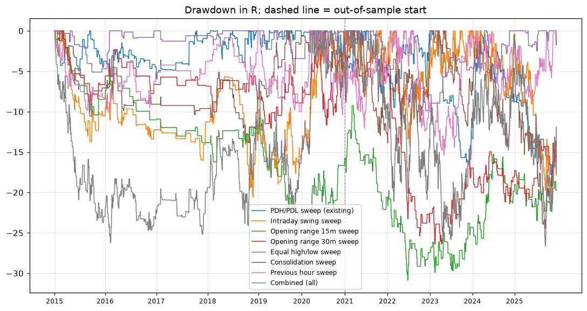

# Risk analysis

Data: Kaggle NIFTY 1-minute bars rolled to 5m, 2015-01-02 to 2025-12-24 (2295 sessions; the first session and NIFTY expiry days are skipped for every strategy). VWAP: session time-weighted typical price (index has no volume). In-sample to 2020, out-of-sample 2021 on. Costs: 2 index pts a round trip. Results are index points and R; option P&L is not reported because no historical option prices are available.

| Strategy | Stop pts p10 | Stop pts median | Stop pts p90 | Max DD R | MC max DD R p95 | Longest losing streak | MAE R | MFE R |
|---|---|---|---|---|---|---|---|---|
| PDH/PDL sweep (existing) | 34.69 | 56.75 | 137.75 | 18.772 | 31.7 | 11 | 0.57 | 0.84 |
| Intraday swing sweep | 32.25 | 45.5 | 86.04 | 21.141 | 57.5 | 9 | 0.68 | 0.89 |
| Opening range 15m sweep | 33.25 | 54.35 | 108.75 | 30.859 | 61.4 | 10 | 0.72 | 0.85 |
| Opening range 30m sweep | 32.75 | 51.7 | 106.6 | 26.389 | 54.9 | 13 | 0.71 | 0.87 |
| Equal high/low sweep | 32.8 | 43.85 | 77.79 | 10.376 | 15.3 | 8 | 0.65 | 0.93 |
| Consolidation sweep | 32.4 | 44.2 | 82.71 | 24.465 | 48.2 | 12 | 0.69 | 0.91 |
| Previous hour sweep | 32.15 | 45.6 | 84.47 | 15.376 | 46.4 | 9 | 0.66 | 0.86 |

MAE/MFE: average worst/best excursion of a trade while open, in R. MC: 1,000 resamples of the trades.

## Minimum-risk filter on intraday setups

| Strategy | Min risk | Trades | Avg R | Total R | Max DD R |
|---|---|---|---|---|---|
| Intraday swing sweep | base | 1310 | 0.033 | 43.1 | 21.141 |
| Intraday swing sweep | min risk 0 | 2318 | -0.007 | -16.6 | 74.412 |
| Intraday swing sweep | min risk 10 | 2300 | -0.002 | -4.9 | 62.045 |
| Intraday swing sweep | min risk 20 | 1864 | 0.018 | 33.8 | 27.902 |
| Opening range 15m sweep | base | 430 | -0.043 | -18.6 | 30.859 |
| Opening range 15m sweep | min risk 0 | 620 | -0.039 | -24.4 | 38.088 |
| Opening range 15m sweep | min risk 10 | 620 | -0.039 | -24.4 | 38.088 |
| Opening range 15m sweep | min risk 20 | 568 | -0.051 | -29 | 44.898 |
| Opening range 30m sweep | base | 400 | -0.025 | -10.1 | 26.389 |
| Opening range 30m sweep | min risk 0 | 599 | -0.029 | -17.4 | 32.871 |
| Opening range 30m sweep | min risk 10 | 599 | -0.029 | -17.4 | 32.871 |
| Opening range 30m sweep | min risk 20 | 534 | -0.031 | -16.4 | 33.874 |
| Equal high/low sweep | base | 224 | 0.162 | 36.4 | 10.376 |
| Equal high/low sweep | min risk 0 | 423 | 0.039 | 16.5 | 20.72 |
| Equal high/low sweep | min risk 10 | 423 | 0.039 | 16.5 | 20.72 |
| Equal high/low sweep | min risk 20 | 347 | 0.064 | 22.3 | 16.264 |
| Consolidation sweep | base | 684 | 0.029 | 19.9 | 24.465 |
| Consolidation sweep | min risk 0 | 1339 | 0.004 | 5.6 | 37.346 |
| Consolidation sweep | min risk 10 | 1328 | 0.002 | 2.7 | 36.981 |
| Consolidation sweep | min risk 20 | 1036 | -0.003 | -3.1 | 30.971 |
| Previous hour sweep | base | 863 | 0.033 | 28.8 | 15.376 |
| Previous hour sweep | min risk 0 | 1398 | -0.01 | -14.2 | 55.374 |
| Previous hour sweep | min risk 10 | 1394 | -0.008 | -11.2 | 52.355 |
| Previous hour sweep | min risk 20 | 1187 | 0.031 | 36.2 | 17.836 |

(base = 30 pts)

## Not modelled
Slippage beyond the flat cost, option IV changes and theta, gaps inside a 5m bar, real VWAP.
