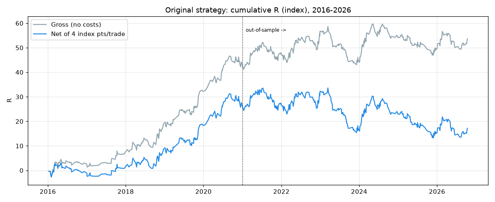
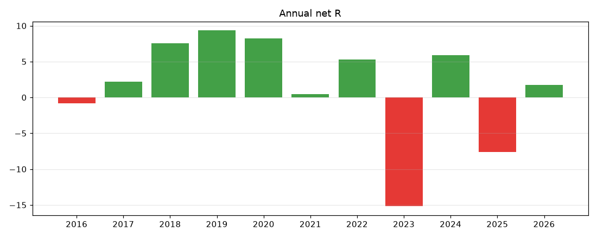

# Executive summary: NIFTY PDH/PDL liquidity sweep reversal audit

## Verdict: **FAIL** (no demonstrated edge; not ready for live capital)

Over 10.8 years (2016-01-01 to 2026-10-13, 544 trades, every signal taken), the strategy as specified earns **+0.032R per trade after costs, 95% CI [-0.048, +0.114]**. Out-of-sample (2021-2026) it earns **-0.028R**. No variant out of 55 tested survives a multiple-testing correction. The rupee results in the existing 10-year workbooks (+112% / +373%) come from contaminated data, a capital filter that skipped about half the signals, and a constant-IV option model. They are not evidence of an edge.

The sample is large enough to rule out the edge the original research suggested (+0.52R per trade on 17 trades) and anything above about +0.15R. It is too small to rule out a small edge of about +0.03R, which would need about 3,500 trades to confirm. Two questions are **INSUFFICIENT DATA**: a futures-VWAP version, and option P&L with real intraday premiums.

The code is sound. Production signals are reproduced exactly, with no look-ahead or repainting. The problems are the edge, the data feeding the old backtests, live timing, and sizing.

## Measured headline numbers

| | Value |
|---|---|
| Trades | 544 (50.6 per year) |
| Win rate / avg win / avg loss | 45.2% / +0.88R / -0.67R |
| Expectancy net (gross) | +0.032R (+0.099R) |
| Profit factor net | 1.09 |
| Max drawdown | 20.3R; Monte Carlo P95 28.9R |
| IS 2016-2020 / OOS 2021-2026 | +0.125R / -0.028R |
| Long (PDL) / short (PDH) | +0.077R (184) / +0.008R (360) |
| Cost breakeven | about 6 index pts round trip (4 assumed) |
| P(total < 0) over 10 years, bootstrap | 21.8% |




## What this audit changed

| Change | Why | Rule impact |
|---|---|---|
| `kaggle_5m` drops 149 synthetic holiday sessions | They created fake narrow PDH/PDL days: 44 signals, +14.33R in the workbooks | Data fix |
| Alert text: "Max 1 trade per side (so at most 2 a day)" | The old "stop after 2 losses" was never enforced and could never bind | None |
| New research harness `backend/scripts/audit_liquidity.py`, 6 tests | Reproducible audit | None |

No entry, exit or risk rule was changed. Nothing was deployed. No orders were sent, and live trading was not enabled.

**Note:** during the audit another session changed the uncommitted production file to a 3R target, breakeven at +1R and 2 OTM strikes, and regenerated the 10-year workbook. This audit treats the specified 2R/ATM version as the baseline and reports the change separately as "v3": +0.058R, OOS +0.001R, not significant, chosen after seeing results.

## Answers to the final questions

1. **Does the strategy have a statistically significant edge?** No. Net +0.032R, t = 0.77, CI includes zero; OOS negative.
2. **Is the implementation faithful to the specification?** Yes. 0 signal mismatches and 0 exit mismatches against an independent replica. Deviations that are part of the code, not bugs: non-strict pivots, a long structure break that can use a pre-sweep swing high, and a too-tight first setup ending that side for the day.
3. **Is there look-ahead bias or repainting?** Not in the backtest (0 of 568 signals change on truncated data). Live there is a repaint risk, because Yahoo's last bar may still be forming (`main` L427-428).
4. **Is the 15m-long / 5m-short asymmetry justified?** Not shown either way: A, B (both 15m) and D (no rejection) are statistically identical. Moving the long side to 5m (C) is clearly harmful (long side -0.154R, CI excludes zero).
5. **Is the long or the short side better?** Longs (+0.077R, PF 1.32) beat shorts (+0.008R), but neither is significant, and longs rarely reach 2R (2.7%). Their profit comes from the 15:10 time exit.
6. **Which swing definition is best?** 2-left / 2-right as implemented. Strict vs non-strict is immaterial (3 trades differ).
7. **Is the NIFTYBEES VWAP proxy acceptable?** For signal generation, mostly yes: it matched index TWAP on 16 of 17 signal days. The VWAP filter adds almost nothing once the day-open filter applies. A futures VWAP is untested (INSUFFICIENT DATA).
8. **Does sweep depth matter?** Yes at the extremes. 1-2 pt sweeps: 6 trades, all losers. Sweeps deeper than 20 pts close back inside the level only about 32% of the time. A 2-pt minimum is the one change recommended for the forward test. ATR-normalised depth adds nothing out-of-sample.
9. **Are the stops sensible?** The swing stops beat sweep-extreme stops (+0.032 vs +0.010R). The short fallback (+15) is 10 pts wider than the long (-5): asymmetric and undocumented.
10. **What is the best exit?** Wider targets and later time exits are slightly better (3R +0.056R; 15:20 +0.043R), and walk-forward picks 3R every year. Nothing is significant. Structure exits are the worst (-0.019R).
11. **Do the filters help?** The day-open filter helps most (about 0.03R). The 3/3 cooldown cut drawdown from 29.9R to 20.3R. The expiry-day skip does **not** help (+0.049R with expiry days included). MIN_RISK = 30 was chosen in-sample; walk-forward drifts to 50.
12. **Are the option estimates reliable?** No, not for rupee P&L. Black-76 at VIX has a P90 error of 29-65% against real NSE closes. A 10% IV change at exit swings option expectancy from -0.24R to +0.41R. No intraday option history exists.
13. **ATM or OTM?** No measurable difference in option R (+0.087 ATM vs +0.087 2 OTM at 2R). The working tree's OTM switch is justified by more trades fitting a 5% capital rule, which is a sizing artifact.
14. **What position size is defensible?** At most 1% of capital at risk, 0.5% while forward testing. The current 5% gives a modelled 57-58% max drawdown and a 65% chance of a 50% drawdown.
15. **Is it ready for live trading, and what would change that?** No. It needs the live-timing fixes, 1% risk, and a pre-registered paper forward test of at least 25 trades with real option fills (`LIVE_TRADING_READINESS.md`). Passing shows the system behaves as backtested. It still will not prove an edge.

## Report index

| Report | Content |
|---|---|
| `EXISTING_STRATEGY_SPECIFICATION.md` | Frozen baseline, line by line |
| `CODE_IMPLEMENTATION_AUDIT.md` | Pipeline trace, 18 findings |
| `SWING_AND_STRUCTURE_AUDIT.md` | Pivots, structure, asymmetry |
| `SIGNAL_SEQUENCE_AUDIT.md` | State machine, timing, look-ahead |
| `VWAP_AND_DATA_QUALITY_AUDIT.md` | Data sources, holiday-session bug, VWAP proxy |
| `OPTIONS_PRICING_AND_EXECUTION_AUDIT.md` | Black-76 vs NSE closes, option R, sizing |
| `HISTORICAL_BACKTEST_AUDIT.md` | Workbook review, baseline metrics, breakdowns |
| `FILTER_AND_PARAMETER_RESEARCH.md` | Exits, filters, sweep depth, 10 hypotheses |
| `RISK_AND_DRAWDOWN_ANALYSIS.md` | Drawdowns, ruin, stress, the 2-loss rule |
| `STATISTICAL_VALIDATION.md` | IS/OOS, walk-forward, Monte Carlo, sample size |
| `STRATEGY_VARIANT_COMPARISON.md` | Configurations A-G ranked |
| `BUGS_AND_RECOMMENDATIONS.md` | Fixed and open issues |
| `IMPLEMENTATION_ROADMAP.md` | Phased plan, no live trading |
| `LIVE_TRADING_READINESS.md` | Checklist, forward-test criteria |
| `RESULTS.md`, `results.json`, `charts/` | Generated output |

## Reproduce

```bash
cd backend
MPLCONFIGDIR=/tmp/mpl uv run python scripts/audit_liquidity.py          # uses the frozen snapshot (gitignored)
MPLCONFIGDIR=/tmp/mpl uv run python scripts/audit_liquidity.py --refresh  # rebuild the snapshot (network)
uv run pytest tests/test_liquidity_audit.py -q
```

## Assumptions

- Costs: 4 index pts per round trip; option slippage Rs 0.5 per side plus dated NSE charges.
- Option model: Black-76, previous-day India VIX as IV, forward = spot, IV constant through the trade.
- VWAP: index TWAP for the 10-year history (index has no volume); NIFTYBEES VWAP live.
- IS 2016-2020, OOS 2021-2026-10-13. The design parameters predate the audit and saw part of the OOS data.
- Losses for the cooldown: net index R < 0.
- Expiry calendar: monthly before 2019-02-11, weekly Thursday to 2025-08-31, weekly Tuesday after.
