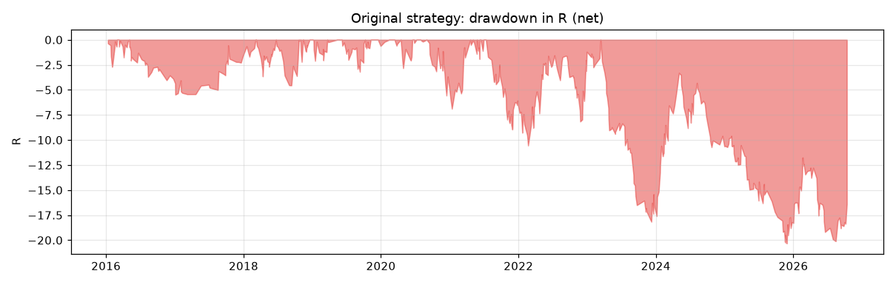
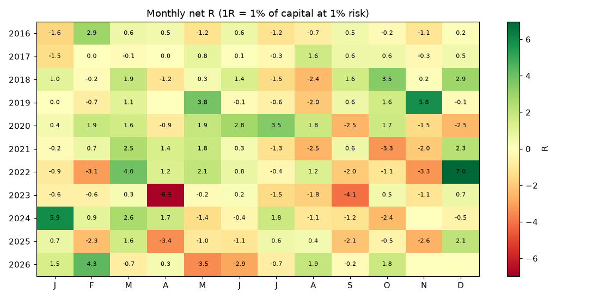
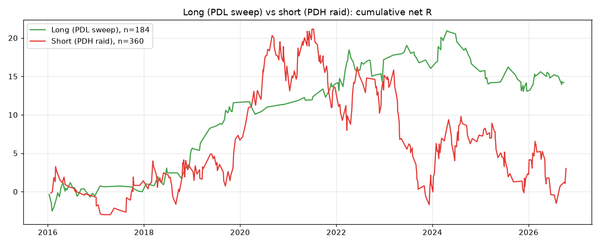
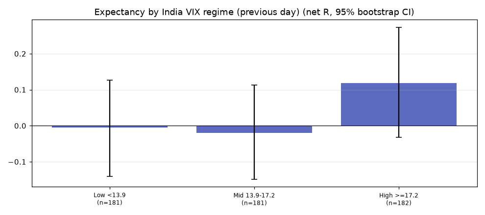
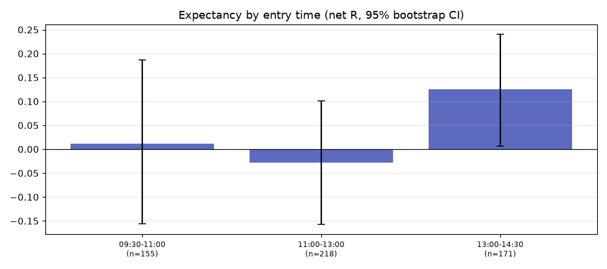
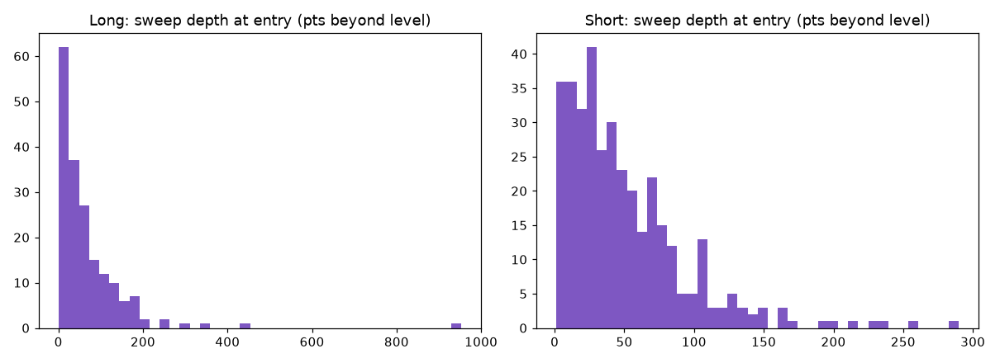
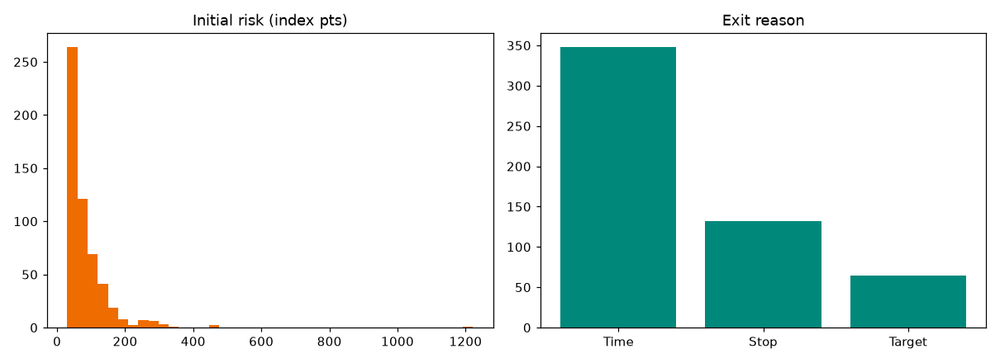
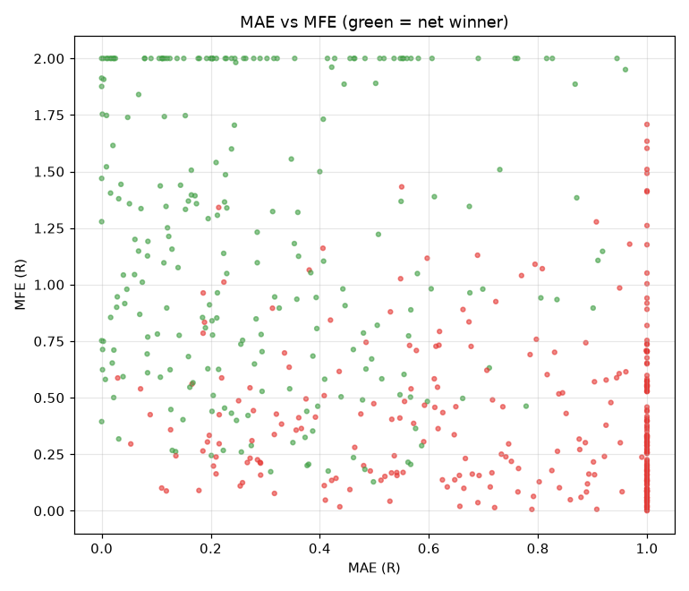

# Historical backtest audit

## 1. Existing research (spreadsheets in `DocumentsAndDiagrams/`)

| Workbook | What it claims | Audit finding |
|---|---|---|
| `NIFTY_Liquidity_Plan_2026-10-13.xlsx`, sheet "Trigger Backtest" | 17 trades in 59 sessions, 65% win rate, +0.52R per trade, PF 3.49 | 17 trades cannot distinguish +0.5R from 0. The sheet's own caveat says the filter was chosen **after seeing the losers**, so it is in-sample by construction. |
| Same, "Intraday Backtest" | A generic 5m sweep rule | -0.03R at 2R: no edge. This is consistent with this audit. |
| Same, "Improved Strategy v2" | The specification; 1% risk; "stop after 2 losses" | The code uses 5% risk. The 2-loss stop is not in the code (alert text now fixed). |
| `NIFTY_Liquidity_Backtest_2026-10-14.xlsx` (60 days, Yahoo, 2 lots) | 17 trades, +44.8%, PF 4.51 | Same window the strategy was designed on: not out-of-sample. |
| `NIFTY_Liquidity_Backtest_10y_2026-10-14.xlsx`, first version (2R, ATM) | 548 signals, 265 taken, +112.5%, CAGR 7.83%, PF 1.37, max DD 40.7% | 263 signals skipped by the 5% capital rule (selection). 2025: 0 trades taken. Contaminated by fake holiday sessions. |
| Same file, regenerated during the audit by another session (3R, breakeven, 2 OTM) | 433 taken, 101 skipped, +372.7%, CAGR 16.81%, PF 1.73, max DD 37.96%, 66.13R | Same selection and contamination problems. The 3R/BE/OTM change was made after seeing the 10-year results. |

Contamination in both 10-year versions: 44 signals on the day after a synthetic Kaggle session, 35 of them taken (+14.33R, Rs 45,250). Older audit documents (`DocumentsAndDiagrams/audit/GENESIS_*.md`) cover other parts of the platform and were not used.

## 2. Audit backtest method

- Engine: `audit_liquidity.run()` L314. The production-identical `scan_v` produces entries, and `run_exit` produces exits (stop first on same-bar ties, then target, then 15:10).
- Period: 2016-01-01 to 2026-10-13. 2015 serves only as warm-up for ATR, SMA50 and VIX.
- Filters as specified: expiry days skipped (`expiry_for`), and 3 losses in a row (net R < 0) give 3 trading days off (`cooldown` L297).
- **Every signal is taken.** No capital filter, so the sample is the strategy, not a sizing artifact.
- Results are in R: net R = (points - 4) / risk. Deterministic: same snapshot, same output (bootstrap seed 7).

## 3. Baseline results (measured)

| Metric | Net (4 pts cost) | Gross |
|---|---|---|
| Trades | 544 (50.6/yr) | 544 |
| Win rate | 45.2% | 49.1% |
| Avg win / avg loss | 0.884R / -0.672R | 0.878R / -0.652R |
| **Expectancy** | **+0.032R** | +0.099R |
| CI95 (bootstrap) | **[-0.048, +0.114]** | [+0.019, +0.181] |
| t-stat | 0.77 | 2.40 |
| Total | 17.2R | 53.6R |
| Profit factor | 1.086 | 1.297 |
| Max drawdown | 20.3R | 15.6R |
| Recovery factor | 0.85 | 3.44 |
| Max consecutive losses / wins | 9 / 6 | 9 / 6 |
| Sharpe / Sortino (daily, annualised) | 0.23 / 0.39 | 0.73 / 1.31 |
| Avg hold | 151 min | |
| Avg MFE / MAE | 0.78R / 0.55R | |
| Reached 1R / 2R | 30% / 11.8% | |
| Exit reasons | 132 stops (-1.08R avg), 64 targets (+1.92R), 348 time exits (+0.105R) | |

Without the cooldown: 568 trades, +0.015R, max DD 29.9R. The cooldown helps (it cut the 2023 drawdown) but was not designed out-of-sample either.

Charts:  

## 4. Breakdowns (measured)

**By year**: positive in 2017-2020 and 2022, 2024, 2026; negative in 2016, 2023 (**-0.323R, CI excludes 0, -15.2R**) and 2025 (-0.139R). See  

| Split | Trades | Expectancy | CI95 | PF |
|---|---|---|---|---|
| IS 2016-2020 | 213 | +0.125 | [0.007, 0.246] | 1.41 |
| **OOS 2021-2026** | 331 | **-0.028** | [-0.133, 0.075] | 0.93 |

**By side**: long (PDL sweep) 184 trades, +0.077R, PF 1.32; short (PDH raid) 360 trades, +0.008R, PF 1.02. 

**By trend regime** (previous close vs SMA50 and its slope): Bull +0.028, Bear +0.032, Sideways +0.039. No regime effect.

**By India VIX** (terciles): low -0.005, mid -0.020, **high (>= 17.2) +0.119** (CI [-0.03, 0.27]). 

**By entry time**: 13:00-14:30 +0.126 (CI [0.007, 0.241]); earlier windows about 0. 

**Expiry-adjacent**: day before expiry +0.133 (126 trades); day after -0.024; other days +0.012.

**Sweep depth** (all sweep days, not only trades): sweeps deeper than 20 pts close back inside the level only about 32% of the time. Shallow sweeps (under 10 pts) close back inside 92-100% of the time. Most trades (397 of 544) follow sweeps deeper than 20 pts, where the "liquidity grab and reversal" premise usually fails by the close. Trades after a 1-2 pt sweep: 6, all losers. 

**Stops, targets, MAE/MFE**:  

Only 11.8% of trades reach 2R, and 64% end at 15:10. The strategy is in practice a "hold to the afternoon" trade with a 1R stop.

**Rolling 50-trade expectancy**: 

## 5. Biases checked

| Bias | Status |
|---|---|
| Look-ahead / repaint | None found (0 of 568 signals change on truncated data) |
| Survivorship | Not applicable (a single index) |
| Data snooping | **Present in the design.** MIN_RISK = 30, the 3/3 cooldown, the open filter and 15m-vs-5m were all chosen on data overlapping this sample. The 2021-2026 OOS split is only partly out-of-sample for those choices. |
| Selection by capital | Removed here (every signal taken); present in the workbooks |
| Fake data | Fixed (holiday sessions) |
| Option prices | Modelled only, clearly labelled |
| Execution | 4 index pts per trade assumed. Breakeven cost is about 6 pts. |
