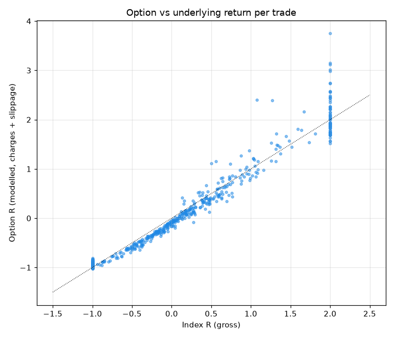

# Liquidity strategy audit: generated results

Generated by `backend/scripts/audit_liquidity.py` from the frozen snapshot `backend/data/intraday/audit_snapshot.json.gz` (data to 2026-10-13). Net R = (index points - 4) / initial risk. IS = 2016-2020, OOS = 2021-2026. Bootstrap CIs: 4,000 resamples, seed 7.
## Data quality
Sessions 2015-01-01 to 2026-10-13, 217,552 5m bars.
| Year | Sessions |
|---|---|
| 2015 | 244 |
| 2016 | 246 |
| 2017 | 247 |
| 2018 | 245 |
| 2019 | 244 |
| 2020 | 250 |
| 2021 | 247 |
| 2022 | 247 |
| 2023 | 245 |
| 2024 | 245 |
| 2025 | 248 |
| 2026 | 193 |

Sessions with fewer than 75 5m bars: 24: [('2026-08-03', 74), ('2026-08-04', 74), ('2026-08-05', 74), ('2026-08-06', 74), ('2026-08-07', 74), ('2026-08-10', 74), ('2026-08-11', 74), ('2026-08-12', 74), ('2026-08-13', 74), ('2026-08-14', 74), ('2026-08-17', 74), ('2026-08-18', 74), ('2026-08-19', 74), ('2026-08-20', 74), ('2026-08-21', 74), ('2026-08-24', 74), ('2026-08-25', 74), ('2026-08-26', 74), ('2026-08-27', 74), ('2026-08-28', 74), ('2026-08-31', 74), ('2026-09-02', 74), ('2026-09-03', 74), ('2026-09-04', 74)]

Weekend sessions: ['2026-02-01']

5m-derived daily bars vs NSE EOD index bars (2019 - Dec 2025):
| Field | Days | Mean diff | Median abs diff | P99 abs diff | Days with abs diff > 5 pts |
|---|---|---|---|---|---|
| high | 1722 | 0.03 | 0 | 3.01 | 11 |
| low | 1722 | 0.14 | 0 | 2.1 | 7 |
| close | 1722 | 0.18 | 0 | 47.63 | 462 |

NSE EOD dates missing from the intraday data: ['2019-10-27', '2020-02-01', '2020-11-14', '2021-11-04', '2022-10-24', '2023-11-12', '2024-01-20', '2024-05-18', '2024-11-01', '2025-02-01']

Intraday dates absent from NSE EOD: []

Kaggle vs Groww on the same 5m bars (last 45 days of the Kaggle file):
| Field | Bars | Median abs diff | Max abs diff |
|---|---|---|---|
| open | 2100 | 0 | 2.4 |
| high | 2100 | 0 | 10.75 |
| low | 2100 | 0 | 4.2 |
| close | 2100 | 0.05 | 8.9 |

## Reproduction and look-ahead checks
Production `scan()` signals on non-expiry days 2016-01-01-2026-10-13: 568. Days where `scan_v` defaults differ from `scan()`: 0. Exits where `run_exit` differs from the specified exit (2R, 15:10): 0; from the working tree's `exit_of()` (3R, stop to entry at +1R): 0. Signals that change when re-scanned with bars only up to the entry bar (repaint): 0. Signals already present one bar earlier: 0.

## Baseline (original strategy: expiry filter, 3-loss/3-day cooldown, 2R, 15:10)
| Trades | Trades/yr | Win % | Avg win R | Avg loss R | Gross profit R | Gross loss R | Expectancy R | CI95 low | CI95 high | t-stat | Total R | PF | Max DD R | Recovery factor | Max consec losses | Max consec wins | Sharpe (daily, ann.) | Sortino (ann.) | Avg hold min | Avg MFE R | Avg MAE R | Reached 1R % | Reached 2R % | Stopped % | 1R then stopped % |
|---|---|---|---|---|---|---|---|---|---|---|---|---|---|---|---|---|---|---|---|---|---|---|---|---|---|
| 544 | 50.6 | 45.2 | 0.884 | -0.672 | 217.4 | -200.2 | 0.0316 | -0.0483 | 0.1138 | 0.77 | 17.17 | 1.086 | 20.32 | 0.85 | 9 | 6 | 0.23 | 0.39 | 151 | 0.78 | 0.55 | 30 | 11.8 | 24.3 | 2 |

Gross (no costs):
| Trades | Trades/yr | Win % | Avg win R | Avg loss R | Gross profit R | Gross loss R | Expectancy R | CI95 low | CI95 high | t-stat | Total R | PF | Max DD R | Recovery factor | Max consec losses | Max consec wins | Sharpe (daily, ann.) | Sortino (ann.) | Avg hold min | Avg MFE R | Avg MAE R | Reached 1R % | Reached 2R % | Stopped % | 1R then stopped % |
|---|---|---|---|---|---|---|---|---|---|---|---|---|---|---|---|---|---|---|---|---|---|---|---|---|---|
| 544 | 50.6 | 49.1 | 0.878 | -0.652 | 234.3 | -180.7 | 0.0985 | 0.0188 | 0.1811 | 2.4 | 53.6 | 1.297 | 15.58 | 3.44 | 9 | 6 | 0.73 | 1.31 | 151 | 0.78 | 0.55 | 30 | 11.8 | 24.3 | 2 |

Without the cooldown:
| Trades | Trades/yr | Win % | Avg win R | Avg loss R | Gross profit R | Gross loss R | Expectancy R | CI95 low | CI95 high | t-stat | Total R | PF | Max DD R | Recovery factor | Max consec losses | Max consec wins | Sharpe (daily, ann.) | Sortino (ann.) | Avg hold min | Avg MFE R | Avg MAE R | Reached 1R % | Reached 2R % | Stopped % | 1R then stopped % |
|---|---|---|---|---|---|---|---|---|---|---|---|---|---|---|---|---|---|---|---|---|---|---|---|---|---|
| 568 | 52.8 | 44.7 | 0.871 | -0.678 | 221.3 | -212.8 | 0.0149 | -0.0625 | 0.0946 | 0.37 | 8.48 | 1.04 | 29.94 | 0.28 | 10 | 6 | 0.11 | 0.18 | 150 | 0.77 | 0.55 | 29.2 | 11.3 | 24.8 | 2.1 |

### In-sample / out-of-sample
| Config | Trades | Trades/yr | Win % | Expectancy R | CI95 low | CI95 high | t-stat | Total R | PF | Max DD R | Max consec losses |
|---|---|---|---|---|---|---|---|---|---|---|---|
| IS 2016-2020 | 213 | 42.9 | 46.9 | 0.1246 | 0.0071 | 0.246 | 1.96 | 26.54 | 1.41 | 5.57 | 6 |
| OOS 2021-2026 | 331 | 57.4 | 44.1 | -0.0283 | -0.1328 | 0.0745 | -0.53 | -9.37 | 0.931 | 20.32 | 9 |

### By side (long = PDL sweep, short = PDH raid)
| Config | Trades | Trades/yr | Win % | Avg win R | Avg loss R | Gross profit R | Gross loss R | Expectancy R | CI95 low | CI95 high | t-stat | Total R | PF | Max DD R | Recovery factor | Max consec losses | Max consec wins | Sharpe (daily, ann.) | Sortino (ann.) | Avg hold min | Avg MFE R | Avg MAE R | Reached 1R % | Reached 2R % | Stopped % | 1R then stopped % |
|---|---|---|---|---|---|---|---|---|---|---|---|---|---|---|---|---|---|---|---|---|---|---|---|---|---|---|
| Long | 184 | 17.2 | 52.7 | 0.604 | -0.51 | 58.57 | -44.41 | 0.077 | -0.0237 | 0.1858 | 1.45 | 14.17 | 1.319 | 7.89 | 1.8 | 5 | 6 | 0.44 | 0.73 | 123 | 0.6 | 0.41 | 19.6 | 2.7 | 12.5 | 0.5 |
| Short | 360 | 33.6 | 41.4 | 1.066 | -0.738 | 158.8 | -155.8 | 0.0084 | -0.0989 | 0.1196 | 0.15 | 3.01 | 1.019 | 22.86 | 0.13 | 9 | 5 | 0.05 | 0.08 | 166 | 0.87 | 0.61 | 35.3 | 16.4 | 30.3 | 2.8 |

### By year
| Year | Trades | Trades/yr | Win % | Expectancy R | CI95 low | CI95 high | t-stat | Total R | PF | Max DD R | Max consec losses |
|---|---|---|---|---|---|---|---|---|---|---|---|
| 2016 | 41 | 43.2 | 43.9 | -0.02 | -0.2508 | 0.222 | -0.17 | -0.82 | 0.937 | 4.04 | 4 |
| 2017 | 27 | 27.5 | 37 | 0.0815 | -0.1927 | 0.38 | 0.55 | 2.2 | 1.367 | 1.73 | 6 |
| 2018 | 52 | 55.4 | 46.2 | 0.1453 | -0.0889 | 0.4016 | 1.13 | 7.56 | 1.474 | 4.56 | 5 |
| 2019 | 49 | 49.7 | 55.1 | 0.1908 | -0.0682 | 0.4517 | 1.45 | 9.35 | 1.696 | 3.2 | 3 |
| 2020 | 44 | 46.7 | 47.7 | 0.1877 | -0.1479 | 0.5357 | 1.08 | 8.26 | 1.503 | 5.57 | 5 |
| 2021 | 61 | 62.1 | 47.5 | 0.0074 | -0.2383 | 0.2575 | 0.06 | 0.45 | 1.018 | 8.96 | 7 |
| 2022 | 64 | 65.5 | 50 | 0.0831 | -0.1777 | 0.3426 | 0.61 | 5.32 | 1.203 | 6.61 | 4 |
| 2023 | 47 | 51.6 | 34 | -0.3231 | -0.5598 | -0.0741 | -2.57 | -15.18 | 0.418 | 18.16 | 9 |
| 2024 | 56 | 56.7 | 41.1 | 0.1052 | -0.1666 | 0.4008 | 0.72 | 5.89 | 1.27 | 7.43 | 7 |
| 2025 | 55 | 58.6 | 41.8 | -0.1387 | -0.3521 | 0.0888 | -1.24 | -7.63 | 0.648 | 10.73 | 6 |
| 2026 | 48 | 61.7 | 47.9 | 0.0371 | -0.2039 | 0.3011 | 0.29 | 1.78 | 1.12 | 8.35 | 5 |

### By trend regime (previous close vs SMA50 and its 20-day slope)
| Bucket | Trades | Trades/yr | Win % | Expectancy R | CI95 low | CI95 high | t-stat | Total R | PF | Max DD R | Max consec losses |
|---|---|---|---|---|---|---|---|---|---|---|---|
| Bull | 291 | 28.1 | 42.6 | 0.028 | -0.0784 | 0.1362 | 0.5 | 8.15 | 1.076 | 14.71 | 9 |
| Bear | 133 | 12.4 | 48.1 | 0.0323 | -0.1246 | 0.1998 | 0.39 | 4.3 | 1.091 | 8.81 | 6 |
| Sideways | 120 | 11.4 | 48.3 | 0.0394 | -0.1314 | 0.2156 | 0.44 | 4.73 | 1.103 | 9.07 | 6 |

### By India VIX (previous day, tercile cuts 13.90 / 17.17)
| Bucket | Trades | Trades/yr | Win % | Expectancy R | CI95 low | CI95 high | t-stat | Total R | PF | Max DD R | Max consec losses |
|---|---|---|---|---|---|---|---|---|---|---|---|
| Low <13.9 | 181 | 17.9 | 43.6 | -0.0051 | -0.1404 | 0.1267 | -0.07 | -0.93 | 0.986 | 16.94 | 9 |
| Mid 13.9-17.2 | 181 | 17.2 | 42 | -0.0196 | -0.1484 | 0.1131 | -0.3 | -3.55 | 0.946 | 13.61 | 6 |
| High >=17.2 | 182 | 17.6 | 50 | 0.1189 | -0.0322 | 0.2737 | 1.52 | 21.65 | 1.316 | 9.87 | 5 |

### By entry time
| Bucket | Trades | Trades/yr | Win % | Expectancy R | CI95 low | CI95 high | t-stat | Total R | PF | Max DD R | Max consec losses |
|---|---|---|---|---|---|---|---|---|---|---|---|
| 09:30-11:00 | 155 | 14.6 | 40 | 0.0119 | -0.1557 | 0.1868 | 0.13 | 1.84 | 1.026 | 14.98 | 10 |
| 11:00-13:00 | 218 | 20.5 | 43.1 | -0.0285 | -0.1576 | 0.1016 | -0.43 | -6.2 | 0.93 | 20.53 | 13 |
| 13:00-14:30 | 171 | 16 | 52.6 | 0.1259 | 0.0068 | 0.2411 | 2.08 | 21.53 | 1.543 | 8.94 | 5 |

### Expiry-adjacent sessions
| Bucket | Trades | Trades/yr | Win % | Expectancy R | CI95 low | CI95 high | t-stat | Total R | PF | Max DD R | Max consec losses |
|---|---|---|---|---|---|---|---|---|---|---|---|
| Day before expiry | 126 | 11.8 | 46.8 | 0.1325 | -0.0428 | 0.3177 | 1.42 | 16.7 | 1.366 | 10.04 | 6 |
| Day after expiry | 122 | 11.5 | 46.7 | -0.0242 | -0.2036 | 0.1479 | -0.27 | -2.95 | 0.941 | 10.89 | 5 |
| Other days | 296 | 27.7 | 43.9 | 0.0116 | -0.0882 | 0.1133 | 0.22 | 3.43 | 1.033 | 15.04 | 8 |

### By exit reason
| Exit | Trades | Avg R |
|---|---|---|
| Stop | 132 | -1.078 |
| Target | 64 | 1.92 |
| Time | 348 | 0.105 |

### Monthly net R
| Month | R |
|---|---|
| 2016-01 | -1.64 |
| 2016-02 | 2.9 |
| 2016-03 | 0.63 |
| 2016-04 | 0.48 |
| 2016-05 | -1.24 |
| 2016-06 | 0.63 |
| 2016-07 | -1.21 |
| 2016-08 | -0.71 |
| 2016-09 | 0.53 |
| 2016-10 | -0.23 |
| 2016-11 | -1.1 |
| 2016-12 | 0.15 |
| 2017-01 | -1.45 |
| 2017-02 | 0.04 |
| 2017-03 | -0.14 |
| 2017-04 | 0.01 |
| 2017-05 | 0.85 |
| 2017-06 | 0.1 |
| 2017-07 | -0.3 |
| 2017-08 | 1.65 |
| 2017-09 | 0.62 |
| 2017-10 | 0.62 |
| 2017-11 | -0.32 |
| 2017-12 | 0.53 |
| 2018-01 | 1.03 |
| 2018-02 | -0.18 |
| 2018-03 | 1.93 |
| 2018-04 | -1.15 |
| 2018-05 | 0.34 |
| 2018-06 | 1.38 |
| 2018-07 | -1.5 |
| 2018-08 | -2.43 |
| 2018-09 | 1.6 |
| 2018-10 | 3.46 |
| 2018-11 | 0.16 |
| 2018-12 | 2.91 |
| 2019-01 | 0.02 |
| 2019-02 | -0.73 |
| 2019-03 | 1.06 |
| 2019-05 | 3.82 |
| 2019-06 | -0.11 |
| 2019-07 | -0.61 |
| 2019-08 | -2.02 |
| 2019-09 | 0.62 |
| 2019-10 | 1.61 |
| 2019-11 | 5.81 |
| 2019-12 | -0.12 |
| 2020-01 | 0.41 |
| 2020-02 | 1.9 |
| 2020-03 | 1.6 |
| 2020-04 | -0.88 |
| 2020-05 | 1.91 |
| 2020-06 | 2.77 |
| 2020-07 | 3.52 |
| 2020-08 | 1.78 |
| 2020-09 | -2.52 |
| 2020-10 | 1.72 |
| 2020-11 | -1.47 |
| 2020-12 | -2.5 |
| 2021-01 | -0.19 |
| 2021-02 | 0.66 |
| 2021-03 | 2.51 |
| 2021-04 | 1.38 |
| 2021-05 | 1.85 |
| 2021-06 | 0.34 |
| 2021-07 | -1.3 |
| 2021-08 | -2.51 |
| 2021-09 | 0.62 |
| 2021-10 | -3.29 |
| 2021-11 | -1.96 |
| 2021-12 | 2.34 |
| 2022-01 | -0.9 |
| 2022-02 | -3.14 |
| 2022-03 | 3.96 |
| 2022-04 | 1.2 |
| 2022-05 | 2.06 |
| 2022-06 | 0.76 |
| 2022-07 | -0.36 |
| 2022-08 | 1.21 |
| 2022-09 | -2 |
| 2022-10 | -1.13 |
| 2022-11 | -3.31 |
| 2022-12 | 6.96 |
| 2023-01 | -0.63 |
| 2023-02 | -0.6 |
| 2023-03 | 0.32 |
| 2023-04 | -6.85 |
| 2023-05 | -0.17 |
| 2023-06 | 0.18 |
| 2023-07 | -1.51 |
| 2023-08 | -1.85 |
| 2023-09 | -4.11 |
| 2023-10 | 0.45 |
| 2023-11 | -1.1 |
| 2023-12 | 0.69 |
| 2024-01 | 5.89 |
| 2024-02 | 0.93 |
| 2024-03 | 2.65 |
| 2024-04 | 1.74 |
| 2024-05 | -1.42 |
| 2024-06 | -0.42 |
| 2024-07 | 1.79 |
| 2024-08 | -1.05 |
| 2024-09 | -1.24 |
| 2024-10 | -2.44 |
| 2024-12 | -0.53 |
| 2025-01 | 0.73 |
| 2025-02 | -2.29 |
| 2025-03 | 1.61 |
| 2025-04 | -3.45 |
| 2025-05 | -0.99 |
| 2025-06 | -1.1 |
| 2025-07 | 0.59 |
| 2025-08 | 0.43 |
| 2025-09 | -2.13 |
| 2025-10 | -0.52 |
| 2025-11 | -2.63 |
| 2025-12 | 2.12 |
| 2026-01 | 1.45 |
| 2026-02 | 4.35 |
| 2026-03 | -0.71 |
| 2026-04 | 0.33 |
| 2026-05 | -3.51 |
| 2026-06 | -2.91 |
| 2026-07 | -0.73 |
| 2026-08 | 1.92 |
| 2026-09 | -0.2 |
| 2026-10 | 1.78 |

## Sweep depth

All sweep days (not only trades): close back inside the level or beyond it.
| Setup | Depth pts | Days | Closed back inside % |
|---|---|---|---|
| PDL sweep (long setup) | 1-2 | 12 | 100 |
| PDL sweep (long setup) | 2-5 | 24 | 100 |
| PDL sweep (long setup) | 5-10 | 38 | 92.1 |
| PDL sweep (long setup) | 10-20 | 131 | 87.8 |
| PDL sweep (long setup) | >20 | 999 | 32.3 |
| PDH raid (short setup) | 1-2 | 14 | 100 |
| PDH raid (short setup) | 2-5 | 34 | 100 |
| PDH raid (short setup) | 5-10 | 52 | 96.2 |
| PDH raid (short setup) | 10-20 | 141 | 76.6 |
| PDH raid (short setup) | >20 | 1208 | 31.4 |

Baseline trades by sweep depth at entry:
| Config | Trades | Trades/yr | Win % | Expectancy R | CI95 low | CI95 high | t-stat | Total R | PF | Max DD R | Max consec losses |
|---|---|---|---|---|---|---|---|---|---|---|---|
| Long 1-2 | 2 | 0.4 | 0 | -1.08 | -1.096 | -1.064 | -67.33 | -2.16 | 0 | 2.16 | 2 |
| Long 2-5 | 6 | 0.7 | 50 | -0.0633 | -0.4757 | 0.3364 | -0.28 | -0.38 | 0.751 | 0.97 | 2 |
| Long 5-10 | 9 | 0.9 | 44.4 | 0.1508 | -0.4375 | 0.7998 | 0.44 | 1.36 | 1.46 | 1.88 | 2 |
| Long 10-20 | 35 | 3.4 | 54.3 | 0.2817 | 0.0372 | 0.5346 | 2.19 | 9.86 | 2.758 | 1.8 | 2 |
| Long >20 | 132 | 12.3 | 53.8 | 0.0416 | -0.0771 | 0.1638 | 0.7 | 5.49 | 1.171 | 7.32 | 5 |
| Short 1-2 | 4 | 0.8 | 0 | -1.089 | -1.117 | -1.067 | -74.04 | -4.36 | 0 | 4.36 | 4 |
| Short 2-5 | 22 | 2.2 | 50 | 0.1088 | -0.3722 | 0.608 | 0.43 | 2.39 | 1.236 | 5.04 | 6 |
| Short 5-10 | 19 | 1.9 | 26.3 | -0.4517 | -0.7702 | -0.1003 | -2.57 | -8.58 | 0.278 | 8.97 | 7 |
| Short 10-20 | 50 | 4.7 | 46 | 0.2068 | -0.0972 | 0.534 | 1.3 | 10.34 | 1.556 | 6.37 | 4 |
| Short >20 | 265 | 24.7 | 41.5 | 0.0121 | -0.107 | 0.1369 | 0.19 | 3.21 | 1.029 | 19.65 | 8 |

## Variants (one change at a time vs the original)
| Config | Trades | Trades/yr | Win % | Expectancy R | CI95 low | CI95 high | t-stat | Total R | PF | Max DD R | Max consec losses | IS exp R | OOS exp R | OOS trades |
|---|---|---|---|---|---|---|---|---|---|---|---|---|---|---|
| A Original | 544 | 50.6 | 45.2 | 0.0316 | -0.0483 | 0.1138 | 0.77 | 17.17 | 1.086 | 20.32 | 9 | 0.1246 | -0.0283 | 331 |
| B Both 15m structure | 464 | 43.2 | 47.4 | 0.0181 | -0.0513 | 0.0872 | 0.51 | 8.38 | 1.063 | 16.63 | 7 | 0.0402 | 0.0001 | 256 |
| C Both 5m structure | 589 | 54.7 | 39.7 | -0.0662 | -0.1473 | 0.019 | -1.59 | -39.02 | 0.854 | 57.52 | 11 | 0.053 | -0.1358 | 372 |
| D Long 15m / short 5m, no short rejection | 562 | 52.3 | 46.4 | 0.0362 | -0.0422 | 0.1129 | 0.92 | 20.32 | 1.102 | 23.66 | 9 | 0.1307 | -0.0246 | 342 |
| Long reclaim of PDL | 534 | 49.7 | 44.9 | 0.0274 | -0.0543 | 0.1099 | 0.66 | 14.64 | 1.074 | 21.32 | 9 | 0.1254 | -0.0346 | 327 |
| Long reclaim + displacement 0.1 ATR | 431 | 40.1 | 45.7 | 0.0616 | -0.0258 | 0.1515 | 1.37 | 26.55 | 1.181 | 17.79 | 11 | 0.1265 | 0.0105 | 241 |
| Displacement 0.1 ATR (both) | 452 | 42 | 46 | 0.0569 | -0.0269 | 0.1438 | 1.31 | 25.73 | 1.168 | 17.72 | 8 | 0.1196 | 0.0081 | 254 |
| Displacement 0.2 ATR (both) | 180 | 16.8 | 46.1 | 0.0485 | -0.0632 | 0.1648 | 0.81 | 8.72 | 1.174 | 8.29 | 10 | 0.0842 | 0.0157 | 94 |
| Strict pivots (unique extreme) | 541 | 50.3 | 45.3 | 0.0322 | -0.0493 | 0.113 | 0.78 | 17.41 | 1.088 | 20.32 | 9 | 0.1161 | -0.0219 | 329 |
| Sweep > 2 pts | 540 | 50.2 | 45.7 | 0.0442 | -0.0362 | 0.1236 | 1.08 | 23.88 | 1.123 | 19.26 | 9 | 0.1375 | -0.0161 | 328 |
| Sweep > 5 pts | 516 | 48 | 45.5 | 0.0434 | -0.036 | 0.1268 | 1.04 | 22.37 | 1.121 | 23.23 | 9 | 0.1717 | -0.0372 | 317 |
| Sweep > 10 pts | 483 | 44.9 | 45.5 | 0.0432 | -0.0386 | 0.1313 | 1 | 20.89 | 1.122 | 20.09 | 9 | 0.1578 | -0.0224 | 307 |
| Sweep > 20 pts | 390 | 36.3 | 44.9 | 0.0003 | -0.0898 | 0.0928 | 0.01 | 0.13 | 1.001 | 25.92 | 10 | 0.0617 | -0.0296 | 262 |
| Sweep > 0.01 x ATR | 539 | 50.1 | 45.5 | 0.0356 | -0.0447 | 0.1195 | 0.87 | 19.21 | 1.098 | 19.23 | 9 | 0.1246 | -0.0225 | 326 |
| Sweep > 0.025 x ATR | 526 | 48.9 | 45.6 | 0.044 | -0.0337 | 0.1234 | 1.06 | 23.15 | 1.124 | 21.22 | 9 | 0.1556 | -0.0307 | 315 |
| Sweep > 0.05 x ATR | 502 | 46.7 | 46 | 0.0462 | -0.0383 | 0.1298 | 1.1 | 23.2 | 1.131 | 22.68 | 9 | 0.1581 | -0.0291 | 300 |
| Sweep > 0.1 x ATR | 421 | 39.2 | 46.6 | 0.0513 | -0.0355 | 0.1416 | 1.13 | 21.62 | 1.149 | 23.91 | 10 | 0.1755 | -0.0271 | 258 |
| VWAP only (no open filter) | 626 | 58.2 | 43.8 | -0.002 | -0.0802 | 0.0733 | -0.05 | -1.28 | 0.995 | 22.46 | 10 | 0.0442 | -0.0308 | 386 |
| Open only (no VWAP) | 546 | 50.8 | 45.4 | 0.0342 | -0.0457 | 0.1146 | 0.84 | 18.7 | 1.094 | 20.26 | 9 | 0.1246 | -0.0236 | 333 |
| Neither VWAP nor open | 641 | 59.6 | 43.1 | -0.0175 | -0.092 | 0.0602 | -0.46 | -11.21 | 0.957 | 26.5 | 10 | 0.0198 | -0.0411 | 392 |
| Min risk 0 | 671 | 62.3 | 43.4 | -0.0224 | -0.0961 | 0.0514 | -0.58 | -15.04 | 0.947 | 28.17 | 9 | -0.0017 | -0.0422 | 343 |
| Min risk 20 | 633 | 58.8 | 43.8 | -0.0115 | -0.0891 | 0.0668 | -0.3 | -7.3 | 0.972 | 26.52 | 9 | 0.0247 | -0.0422 | 343 |
| Min risk 40 | 445 | 41.4 | 44.5 | 0.0272 | -0.0565 | 0.1131 | 0.63 | 12.11 | 1.079 | 18.45 | 8 | 0.1388 | -0.0307 | 293 |
| Min risk 50 | 365 | 33.9 | 45.5 | 0.038 | -0.0518 | 0.1276 | 0.83 | 13.88 | 1.12 | 18.39 | 8 | 0.1006 | 0.011 | 255 |
| Sweep-extreme stop | 653 | 60.7 | 45.6 | 0.0104 | -0.047 | 0.0695 | 0.35 | 6.81 | 1.037 | 16.89 | 9 | 0.0202 | 0.0017 | 345 |
| Target 1.0R | 545 | 50.7 | 49.7 | 0.0043 | -0.0604 | 0.0668 | 0.13 | 2.34 | 1.013 | 22.31 | 8 | 0.0882 | -0.0495 | 332 |
| Target 1.5R | 544 | 50.6 | 46 | 0.0119 | -0.0602 | 0.088 | 0.32 | 6.49 | 1.033 | 26.72 | 9 | 0.1146 | -0.0542 | 331 |
| Target 2.5R | 544 | 50.6 | 44.7 | 0.0434 | -0.0402 | 0.1306 | 1 | 23.59 | 1.117 | 20.5 | 9 | 0.1322 | -0.0138 | 331 |
| Target 3.0R | 544 | 50.6 | 44.7 | 0.0557 | -0.03 | 0.1472 | 1.23 | 30.28 | 1.15 | 21.07 | 9 | 0.1364 | 0.0037 | 331 |
| Exit: liquidity | 547 | 50.9 | 46.3 | 0.0313 | -0.0485 | 0.1116 | 0.77 | 17.12 | 1.087 | 23.58 | 9 | 0.125 | -0.0284 | 334 |
| Exit: be | 545 | 50.7 | 41.7 | 0.0307 | -0.0444 | 0.1071 | 0.78 | 16.72 | 1.09 | 18.82 | 9 | 0.1285 | -0.032 | 332 |
| Exit: trail | 545 | 50.7 | 48.1 | 0.0329 | -0.0407 | 0.1078 | 0.85 | 17.9 | 1.098 | 22.89 | 8 | 0.1547 | -0.0453 | 332 |
| Exit: partial | 545 | 50.7 | 49.7 | 0.0173 | -0.0504 | 0.0844 | 0.49 | 9.45 | 1.052 | 20.38 | 8 | 0.1088 | -0.0413 | 332 |
| Exit: structure | 527 | 49 | 36.1 | -0.0186 | -0.0869 | 0.0559 | -0.51 | -9.8 | 0.935 | 34.49 | 13 | 0.0561 | -0.0685 | 316 |
| Time exit 14:45 | 543 | 50.5 | 45.9 | 0.0041 | -0.0727 | 0.0793 | 0.11 | 2.24 | 1.012 | 32.96 | 12 | 0.1214 | -0.0716 | 330 |
| Time exit 15:00 | 538 | 50 | 43.5 | -0.0029 | -0.0763 | 0.0733 | -0.07 | -1.55 | 0.992 | 37.2 | 12 | 0.1309 | -0.0913 | 324 |
| Time exit 15:20 | 546 | 50.8 | 46.7 | 0.0428 | -0.0384 | 0.1226 | 1.03 | 23.36 | 1.116 | 20.18 | 9 | 0.1293 | -0.0125 | 333 |
| Expiry days included | 658 | 61.2 | 45.7 | 0.0492 | -0.0239 | 0.1204 | 1.31 | 32.35 | 1.135 | 23.34 | 9 | 0.1219 | 0.0079 | 420 |
| Expiry days only | 128 | 12 | 45.3 | 0.06 | -0.121 | 0.2365 | 0.66 | 7.68 | 1.15 | 17.78 | 8 | -0.0193 | 0.0843 | 98 |
| Also skip day before expiry | 422 | 39.4 | 44.5 | -0.0065 | -0.0917 | 0.0766 | -0.15 | -2.76 | 0.982 | 21.04 | 8 | 0.0737 | -0.0657 | 243 |
| No cooldown | 568 | 52.8 | 44.7 | 0.0149 | -0.0625 | 0.0946 | 0.37 | 8.48 | 1.04 | 29.94 | 10 | 0.1279 | -0.0549 | 351 |
| Cooldown 2 losses / 3 days | 514 | 47.8 | 44.2 | 0.0054 | -0.0754 | 0.0857 | 0.13 | 2.76 | 1.015 | 30.87 | 7 | 0.12 | -0.067 | 315 |
| Cooldown 3 losses / 1 days | 561 | 52.2 | 44.9 | 0.0202 | -0.0602 | 0.0983 | 0.5 | 11.34 | 1.054 | 27.28 | 10 | 0.1279 | -0.0477 | 344 |
| Cooldown 3 losses / 5 days | 527 | 49 | 45.7 | 0.0459 | -0.0337 | 0.1266 | 1.09 | 24.18 | 1.126 | 16.94 | 8 | 0.137 | -0.014 | 318 |
| Cooldown 4 losses / 3 days | 554 | 51.5 | 45.1 | 0.0254 | -0.0524 | 0.1078 | 0.63 | 14.05 | 1.069 | 25.37 | 9 | 0.1324 | -0.042 | 340 |
| HTF trend: with SMA50 only | 234 | 21.8 | 48.3 | 0.0199 | -0.09 | 0.1325 | 0.34 | 4.65 | 1.058 | 21.3 | 9 | 0.1845 | -0.0887 | 141 |
| HTF trend: against SMA50 only | 318 | 29.7 | 42.1 | 0.0022 | -0.1044 | 0.1135 | 0.04 | 0.71 | 1.006 | 18.96 | 7 | 0.0366 | -0.0178 | 201 |
| Skip gap > 0.5 ATR | 455 | 42.5 | 44 | 0.0036 | -0.0838 | 0.0933 | 0.08 | 1.65 | 1.009 | 23.69 | 8 | 0.0981 | -0.0593 | 273 |
| Skip high-VIX tercile (IS cut) | 392 | 36.5 | 43.1 | -0.0115 | -0.1018 | 0.0782 | -0.25 | -4.51 | 0.969 | 23.97 | 9 | 0.0844 | -0.066 | 250 |
| Skip low-VIX tercile (IS cut) | 296 | 28.4 | 44.9 | 0.0357 | -0.0745 | 0.1505 | 0.62 | 10.58 | 1.093 | 15.82 | 7 | 0.1321 | -0.0531 | 154 |
| Room to opposite level >= 2R | 184 | 17.2 | 40.2 | -0.0381 | -0.1987 | 0.1196 | -0.48 | -7.01 | 0.919 | 23.4 | 8 | 0.1716 | -0.1229 | 131 |
| Entries before 13:00 only | 374 | 34.9 | 42 | -0.0105 | -0.1102 | 0.0953 | -0.2 | -3.92 | 0.975 | 26.11 | 9 | 0.0707 | -0.0602 | 232 |
| Dynamic target: opposite level clamped 1-3R | 547 | 50.9 | 46.3 | 0.0336 | -0.0444 | 0.1126 | 0.84 | 18.36 | 1.093 | 24.63 | 9 | 0.1401 | -0.0344 | 334 |
| Working tree v3: 3R + stop to entry at 1R | 545 | 50.7 | 41.1 | 0.058 | -0.0261 | 0.1428 | 1.33 | 31.63 | 1.169 | 17.52 | 9 | 0.1475 | 0.0006 | 332 |

### Long side only
| Config | Trades | Trades/yr | Win % | Expectancy R | CI95 low | CI95 high | t-stat | Total R | PF | Max DD R | Max consec losses |
|---|---|---|---|---|---|---|---|---|---|---|---|
| A Original | 184 | 17.2 | 52.7 | 0.077 | -0.0237 | 0.1858 | 1.45 | 14.17 | 1.319 | 7.89 | 5 |
| Long reclaim of PDL | 175 | 16.3 | 52.6 | 0.0687 | -0.0376 | 0.1786 | 1.26 | 12.03 | 1.286 | 7.02 | 6 |
| Long reclaim + displacement 0.1 ATR | 138 | 12.9 | 49.3 | 0.0589 | -0.0609 | 0.1753 | 0.99 | 8.13 | 1.255 | 5.51 | 7 |
| C Both 5m structure | 234 | 21.8 | 38.5 | -0.1541 | -0.2718 | -0.0364 | -2.51 | -36.06 | 0.681 | 36.06 | 12 |

### Short side only
| Config | Trades | Trades/yr | Win % | Expectancy R | CI95 low | CI95 high | t-stat | Total R | PF | Max DD R | Max consec losses |
|---|---|---|---|---|---|---|---|---|---|---|---|
| A Original | 360 | 33.6 | 41.4 | 0.0084 | -0.0989 | 0.1196 | 0.15 | 3.01 | 1.019 | 22.86 | 9 |
| B Both 15m structure | 277 | 25.9 | 44.4 | -0.0104 | -0.1058 | 0.0814 | -0.22 | -2.89 | 0.966 | 14.08 | 8 |
| D Long 15m / short 5m, no short rejection | 378 | 35.3 | 43.7 | 0.0208 | -0.0805 | 0.126 | 0.39 | 7.85 | 1.051 | 20.92 | 9 |

### Exits
| Config | Trades | Win % | Expectancy R | PF | Max DD R | Avg hold min | Reached 1R % | Reached 2R % | Stopped % | 1R then stopped % |
|---|---|---|---|---|---|---|---|---|---|---|
| Target 1.0R | 545 | 49.7 | 0.0043 | 1.013 | 22.31 | 128 | 19.3 | 0 | 22.2 | 0 |
| Target 1.5R | 544 | 46 | 0.0119 | 1.033 | 26.72 | 143 | 30 | 0 | 23.5 | 1.3 |
| A Original | 544 | 45.2 | 0.0316 | 1.086 | 20.32 | 151 | 30 | 11.8 | 24.3 | 2 |
| Target 2.5R | 544 | 44.7 | 0.0434 | 1.117 | 20.5 | 155 | 30 | 11.8 | 24.6 | 2.4 |
| Target 3.0R | 544 | 44.7 | 0.0557 | 1.15 | 21.07 | 156 | 30 | 11.8 | 24.6 | 2.4 |
| Exit: liquidity | 547 | 46.3 | 0.0313 | 1.087 | 23.58 | 144 | 27.1 | 5.5 | 23.6 | 1.5 |
| Exit: be | 545 | 41.7 | 0.0307 | 1.09 | 18.82 | 146 | 29.7 | 10.8 | 22.2 | 8.1 |
| Exit: trail | 545 | 48.1 | 0.0329 | 1.098 | 22.89 | 142 | 29.7 | 9.5 | 22.2 | 12.3 |
| Exit: partial | 545 | 49.7 | 0.0173 | 1.052 | 20.38 | 146 | 29.7 | 10.8 | 22.2 | 8.1 |
| Exit: structure | 527 | 36.1 | -0.0186 | 0.935 | 34.49 | 93 | 21.1 | 6.3 | 6.8 | 0.2 |
| Time exit 14:45 | 543 | 45.9 | 0.0041 | 1.012 | 32.96 | 134 | 25.6 | 8.7 | 21 | 1.7 |
| Time exit 15:00 | 538 | 43.5 | -0.0029 | 0.992 | 37.2 | 145 | 27.7 | 9.7 | 22.9 | 1.9 |
| Time exit 15:20 | 546 | 46.7 | 0.0428 | 1.116 | 20.18 | 158 | 31.9 | 11.9 | 25.5 | 2.2 |

### Cost sensitivity (original)
| Cost index pts/trade | Expectancy R | Total R | CI95 |
|---|---|---|---|
| 0 | 0.0985 | 53.6 | [0.019, 0.181] |
| 2 | 0.065 | 35.4 | [-0.014, 0.147] |
| 4 | 0.0316 | 17.2 | [-0.048, 0.114] |
| 6 | -0.0019 | -1 | [-0.081, 0.081] |
| 8 | -0.0354 | -19.2 | [-0.115, 0.047] |
| 10 | -0.0689 | -37.5 | [-0.149, 0.014] |

## Final comparison

G = every candidate whose IS expectancy beat the original by > 0.02R, combined: ['Sweep > 0.025 x ATR', 'HTF trend: with SMA50 only', 'Room to opposite level >= 2R']
| Config | Trades | Trades/yr | Win % | Expectancy R | CI95 low | CI95 high | PF | Max DD R | IS exp R | OOS exp R | OOS CI95 | OOS PF |
|---|---|---|---|---|---|---|---|---|---|---|---|---|
| A Original | 544 | 50.6 | 45.2 | 0.0316 | -0.0483 | 0.1138 | 1.086 | 20.32 | 0.1246 | -0.0283 | [-0.1328, 0.0745] | 0.931 |
| B Symmetric structure (both 15m) | 464 | 43.2 | 47.4 | 0.0181 | -0.0513 | 0.0872 | 1.063 | 16.63 | 0.0402 | 0.0001 | [-0.0918, 0.0939] | 1 |
| C Long PDL reclaim | 534 | 49.7 | 44.9 | 0.0274 | -0.0543 | 0.1099 | 1.074 | 21.32 | 0.1254 | -0.0346 | [-0.1393, 0.0702] | 0.916 |
| D Displacement 0.1 ATR | 452 | 42 | 46 | 0.0569 | -0.0269 | 0.1438 | 1.168 | 17.72 | 0.1196 | 0.0081 | [-0.1046, 0.12] | 1.022 |
| F ATR sweep > 0.025 ATR | 526 | 48.9 | 45.6 | 0.044 | -0.0337 | 0.1234 | 1.124 | 21.22 | 0.1556 | -0.0307 | [-0.1361, 0.0712] | 0.923 |
| G IS-selected combination | 74 | 6.9 | 37.8 | -0.1572 | -0.3775 | 0.0725 | 0.685 | 20.4 | 0.1525 | -0.28 | [-0.5247, -0.0188] | 0.501 |
| Working tree v3 (3R + BE at 1R) | 545 | 50.7 | 41.1 | 0.058 | -0.0261 | 0.1428 | 1.169 | 17.52 | 0.1475 | 0.0006 | [-0.1057, 0.1119] | 1.002 |

## Walk-forward (anchored, yearly re-selection from 2019)

### wf_minrisk
| Year | Min risk | IS expectancy R |
|---|---|---|
| 2019 | 30 | 0.074 |
| 2020 | 30 | 0.108 |
| 2021 | 40 | 0.139 |
| 2022 | 30 | 0.099 |
| 2023 | 50 | 0.1 |
| 2024 | 50 | 0.061 |
| 2025 | 50 | 0.093 |
| 2026 | 50 | 0.047 |

| Run | Trades | Trades/yr | Win % | Expectancy R | CI95 low | CI95 high | t-stat | Total R | PF | Max DD R | Max consec losses |
|---|---|---|---|---|---|---|---|---|---|---|---|
| Walk-forward | 371 | 47.7 | 46.6 | 0.0406 | -0.0586 | 0.1419 | 0.81 | 15.06 | 1.112 | 18.39 | 6 |
| Original (fixed) | 424 | 54.6 | 45.8 | 0.0194 | -0.0775 | 0.1166 | 0.4 | 8.24 | 1.05 | 20.32 | 9 |

### wf_target
| Year | Target R | IS expectancy R |
|---|---|---|
| 2019 | 3 | 0.083 |
| 2020 | 3 | 0.112 |
| 2021 | 3 | 0.136 |
| 2022 | 3 | 0.119 |
| 2023 | 3 | 0.119 |
| 2024 | 3 | 0.073 |
| 2025 | 3 | 0.082 |
| 2026 | 3 | 0.055 |

| Run | Trades | Trades/yr | Win % | Expectancy R | CI95 low | CI95 high | t-stat | Total R | PF | Max DD R | Max consec losses |
|---|---|---|---|---|---|---|---|---|---|---|---|
| Walk-forward | 424 | 54.6 | 45.3 | 0.0479 | -0.0547 | 0.1517 | 0.9 | 20.32 | 1.122 | 21.07 | 9 |
| Original (fixed) | 424 | 54.6 | 45.8 | 0.0194 | -0.0775 | 0.1166 | 0.4 | 8.24 | 1.05 | 20.32 | 9 |

## Monte Carlo and sample size
Trade order shuffled 10,000x: max drawdown median 18.5R, 95th pct 28.9R, 99th pct 34.4R; 95th pct longest losing streak 14. Bootstrap total R: 5th pct -18.8, median 17.1, P(total < 0) 21.8%.

Per-trade SD 0.958R, mean 0.0316R: trades needed for a 95% CI excluding zero at this mean: 3539; to resolve +-0.1R: 353. Configurations tested: 55 (Bonferroni 5% => per-test p < 0.0009, |t| > 3.32).

## Options

Expiry calendar: `expiry_for()` vs NSE's nearest listed expiry (2020 on): 8 mismatching days
| Date | expiry_for() | NSE nearest listed |
|---|---|---|
| 2023-06-23 | 2023-06-28 | 2023-06-29 |
| 2023-06-26 | 2023-06-28 | 2023-06-29 |
| 2023-06-27 | 2023-06-28 | 2023-06-29 |
| 2025-10-15 | 2025-10-21 | 2025-10-20 |
| 2025-10-16 | 2025-10-21 | 2025-10-20 |
| 2025-10-17 | 2025-10-21 | 2025-10-20 |
| 2025-10-20 | 2025-10-21 | 2025-10-20 |
| 2025-10-21 | 2025-10-21 | 2025-10-28 |

Black-76 vs real NSE closes, nearest-expiry ATM, 1318 days. Parity forward basis F - spot: median 8.5 pts (P10 -12.9, P90 37.9). Skew: 2% OTM put IV - ATM IV median 3.68 vol pts; 2% OTM call 0.45.
| Type | Days to expiry | Days | Median err % (prev-day VIX, F=spot) | Mean abs err % (prev-day VIX) | P90 abs err % (prev-day VIX) | Median err % (same-day VIX, F=spot) | Median err % (same-day VIX, parity F) | Median contract IV / VIX |
|---|---|---|---|---|---|---|---|---|
| CE | 1 | 333 | -5.3 | 18.6 | 34.5 | -5.7 | -1.2 | 1.01 |
| CE | 2-3 | 551 | -3.3 | 13.7 | 28.9 | -2.4 | 1.5 | 0.98 |
| CE | 4-7 | 434 | 10.3 | 16.4 | 33.2 | 9 | 16.7 | 0.85 |
| PE | 1 | 333 | 1.2 | 18 | 36.5 | 2.5 | -1.1 | 1.01 |
| PE | 2-3 | 551 | 3.6 | 17.2 | 38.5 | 4.9 | 1.9 | 0.98 |
| PE | 4-7 | 434 | 28.2 | 33.1 | 64.7 | 26.4 | 19.8 | 0.85 |

Option R per trade (1 lot ATM, previous-day VIX Black-76, charges, slippage per side):
| Model | Value |
|---|---|
| index_R_gross | 0.0985 |
| n | 544 |
| slip 0.0 | {'mean': 0.123, 'ci': '[0.037, 0.212]', 'total': 66.9} |
| slip 0.5 | {'mean': 0.0868, 'ci': '[0.003, 0.173]', 'total': 47.2} |
| slip 1.0 | {'mean': 0.0531, 'ci': '[-0.029, 0.136]', 'total': 28.9} |
| slip 2.0 | {'mean': -0.0077, 'ci': '[-0.085, 0.070]', 'total': -4.2} |
| IV x0.9 at exit | -0.2356 |
| IV x1.1 at exit | 0.4109 |
| 2 strikes OTM (working tree), slip 0.5 | {'mean': 0.0874, 'ci': '[-0.004, 0.181]'} |
| Working tree v3 exits, 0 OTM, slip 0.5 | {'mean': 0.1204, 'ci': '[0.030, 0.213]'} |
| Working tree v3 exits, 2 OTM, slip 0.5 | {'mean': 0.127, 'ci': '[0.028, 0.232]'} |
| at_target | (2.11, 1.52, 3.75) |
| at_stop | (-0.95, -1.02, -0.81) |

Contract-IV check (2020 on, previous-day IV of the traded strike/expiry + parity forward): {'n': 374, 'vix_mean': 0.047498781525869394, 'contract_mean': 0.06389870196723929, 'prem_ratio_median': 0.909277138437899}

## Position sizing (whole lots, compounding, modelled option P&L)
| Capital Rs | Risk % | Taken | Skipped (0 lots) | End Rs | CAGR % | Max DD % | Longest DD days | Worst day % | Max premium outlay % of equity |
|---|---|---|---|---|---|---|---|---|---|
| 100,000 | 0.5 | 0 | 544 | 100000 | 0 | 0 | 0 | 0 | 0 |
| 100,000 | 1 | 21 | 523 | 93966 | -0.6 | 6.9 | 1914 | -0.9 | 8.2 |
| 100,000 | 2 | 371 | 173 | 148108 | 3.7 | 20.4 | 887 | -2 | 16.2 |
| 100,000 | 3 | 526 | 18 | 242102 | 8.6 | 38.3 | 887 | -3 | 26.1 |
| 100,000 | 5 | 542 | 2 | 429553 | 14.5 | 57.1 | 1305 | -5 | 57.4 |
| 500,000 | 0.5 | 400 | 144 | 567349 | 1.2 | 6.1 | 1305 | -0.5 | 3.7 |
| 500,000 | 1 | 534 | 10 | 699129 | 3.2 | 14.6 | 794 | -1 | 11.9 |
| 500,000 | 2 | 544 | 0 | 1087970 | 7.5 | 28.3 | 887 | -2 | 24 |
| 500,000 | 3 | 544 | 0 | 1569161 | 11.2 | 40.1 | 887 | -3 | 36.5 |
| 500,000 | 5 | 544 | 0 | 2596853 | 16.6 | 58.3 | 887 | -5.1 | 59.9 |

Risk of ruin (bootstrap of per-trade option R, fractional sizing):
| Risk % | P(DD>=20%) | P(DD>=30%) | P(DD>=50%) | Median DD % | P95 DD % | P(end below start) |
|---|---|---|---|---|---|---|
| 0.5 | 0 | 0 | 0 | 6.9 | 12.4 | 2.4 |
| 1 | 11.6 | 0.6 | 0 | 13.4 | 23.5 | 2.8 |
| 2 | 80.3 | 29.1 | 1.07 | 25.5 | 42.4 | 3.5 |
| 3 | 99.2 | 76.3 | 12.53 | 36.4 | 57.2 | 4.6 |
| 5 | 100 | 99.7 | 64.75 | 54.6 | 77.5 | 7.1 |

## VWAP study (last 60 days)
| bars | days | agree_all | near_bars | agree_near | agree_bees_twap | index_bars_without_bees_vwap |
|---|---|---|---|---|---|---|
| 4442 | 60 | 91.6 | 2299 | 84.5 | 95.9 | 56 |

Signals: {'NIFTYBEES VWAP (live)': 17, 'Index TWAP (10y backtest)': 17}

Only with NIFTYBEES VWAP: [('2026-09-01', 'Short', '13:15', 24050.2)]

Only with index TWAP: [('2026-09-01', 'Short', '13:10', 24074.95)]

All NIFTYBEES-VWAP signals: [('2026-07-28', 'Short', '10:10', 23970.7), ('2026-07-30', 'Short', '10:15', 24243.5), ('2026-08-05', 'Short', '09:55', 24591.2), ('2026-08-14', 'Long', '13:50', 24383.7), ('2026-08-24', 'Short', '10:00', 24268.2), ('2026-08-26', 'Short', '11:55', 24285.15), ('2026-09-01', 'Short', '13:15', 24050.2), ('2026-09-03', 'Short', '12:35', 23909.25), ('2026-09-10', 'Long', '12:15', 23458.45), ('2026-09-11', 'Long', '14:00', 23386.15), ('2026-09-15', 'Short', '10:30', 23362.65), ('2026-09-22', 'Short', '10:25', 23444.1), ('2026-09-25', 'Long', '14:15', 23116.3), ('2026-09-30', 'Short', '14:25', 22664.85), ('2026-10-05', 'Short', '10:25', 22504.85), ('2026-10-12', 'Short', '10:30', 22466.8), ('2026-10-13', 'Long', '12:30', 22537.8)]

## Charts
- 
- 
- 
- 
- 
- 
- 
- 
- 
- 
- 
- 
- 
- 
