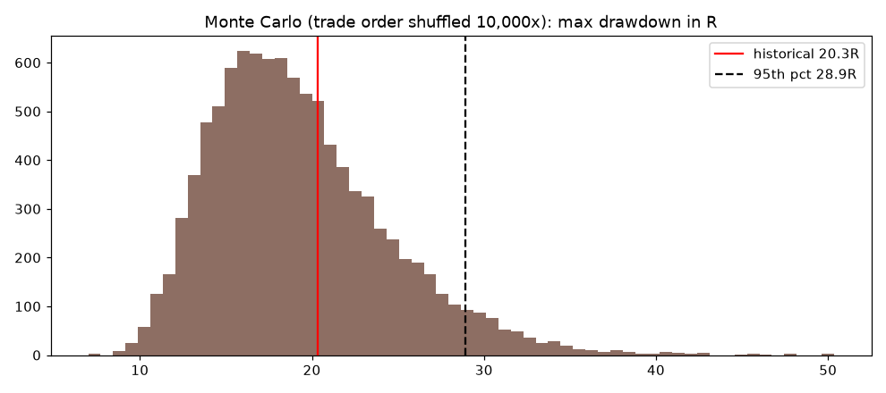
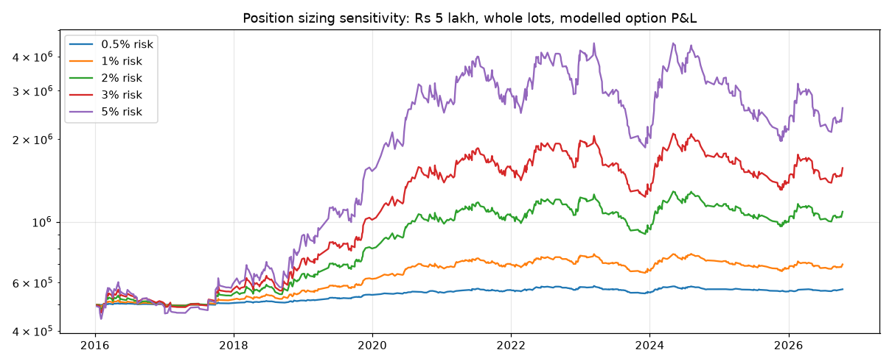

# Risk and drawdown analysis (Parts 5 and 8)

## Index-level risk (544 baseline trades, net R)

| Metric | Value |
|---|---|
| Max drawdown (historical order) | 20.3R |
| Max consecutive losses | 9 |
| Worst year | 2023: -15.2R (47 trades, -0.323R each) |
| Longest bad stretch | 2023-04 to 2023-09: -14.3R, of which April 2023 alone was -6.85R |
| Monte Carlo max DD (10,000 shuffles) | median 18.5R, P95 28.9R, P99 34.4R |
| Monte Carlo longest losing streak, P95 | 14 |
| Bootstrap total R | P5 -18.8R, median +17.1R; **P(total < 0) = 21.8%** |

The historical 20.3R drawdown is close to the Monte Carlo median, so the history was not unusually unlucky. Over 10 years an account should expect a drawdown of about 29R about 1 time in 20.

## Account-level risk (modelled option P&L, whole lots, compounding)

| Capital | Risk % | Taken | Skipped | End Rs | CAGR | Max DD | Longest DD (days) | Max premium outlay |
|---|---|---|---|---|---|---|---|---|
| 1,00,000 | 0.5 | 0 | 544 | 1,00,000 | 0% | 0% | 0 | 0% |
| 1,00,000 | 1 | 21 | 523 | 93,966 | -0.6% | 6.9% | 1,914 | 8.2% |
| 1,00,000 | 2 | 371 | 173 | 1,48,108 | 3.7% | 20.4% | 887 | 16.2% |
| 1,00,000 | 3 | 526 | 18 | 2,42,102 | 8.6% | 38.3% | 887 | 26.1% |
| 1,00,000 | 5 | 542 | 2 | 4,29,553 | 14.5% | 57.1% | 1,305 | 57.4% |
| 5,00,000 | 0.5 | 400 | 144 | 5,67,349 | 1.2% | 6.1% | 1,305 | 3.7% |
| 5,00,000 | 1 | 534 | 10 | 6,99,129 | 3.2% | 14.6% | 794 | 11.9% |
| 5,00,000 | 2 | 544 | 0 | 10,87,970 | 7.5% | 28.3% | 887 | 24.0% |
| 5,00,000 | 3 | 544 | 0 | 15,69,161 | 11.2% | 40.1% | 887 | 36.5% |
| 5,00,000 | 5 | 544 | 0 | 25,96,853 | 16.6% | 58.3% | 887 | 59.9% |

These rupee results inherit every option-model assumption (constant IV, VIX as IV, Rs 0.5 slippage). With IV x0.9 at exit, the per-trade option expectancy is negative and every row loses money. Treat the CAGR column as an upper-bound illustration, not an expectation.

### Risk of ruin (bootstrap of per-trade option R, fractional sizing, 4,000 paths)

| Risk per trade | P(DD >= 20%) | P(DD >= 30%) | P(DD >= 50%) | Median DD | P95 DD | P(end below start) |
|---|---|---|---|---|---|---|
| 0.5% | 0% | 0% | 0% | 6.9% | 12.4% | 2.4% |
| 1% | 11.6% | 0.6% | 0% | 13.4% | 23.5% | 2.8% |
| 2% | 80.3% | 29.1% | 1.1% | 25.5% | 42.4% | 3.5% |
| 3% | 99.2% | 76.3% | 12.5% | 36.4% | 57.2% | 4.6% |
| **5% (current)** | **100%** | **99.7%** | **64.8%** | 54.6% | 77.5% | 7.1% |

"P(end below start)" is low only because the bootstrap resamples a **positive** modelled option mean (+0.087R). With the out-of-sample index expectancy (-0.028R) every row would end below start more often than not.

**Sizing recommendation:** at most 1% of capital at risk per trade; 0.5% while forward testing. The 5% rule in `RISK_PCT` (L52) gives a 2-in-3 chance of halving the account over 10 years, even under the favourable model.

## Stress and failure scenarios (Part 8)

| Scenario | Measured / reasoned impact |
|---|---|
| Costs 2 pts higher than assumed (6 pts round trip) | Net expectancy about 0 (-0.002R) |
| Slippage Rs 2 per option side | Option expectancy -0.008R |
| IV falls 10% between entry and exit | Option expectancy -0.236R per trade |
| A 2023-like year | -15R: about 15 x risk per trade. At 5% risk that is roughly half the account (0.95^15 = 0.46) |
| 14-loss streak (Monte Carlo P95) | At 5% risk: 0.95^14 = 51% of capital left |
| Gap through the stop | Index stops assume a fill at the stop price. Intraday gaps are rare, but event spikes (RBI, budget, global shocks) can skip 20-50 pts in a 5m bar. Not modelled. |
| Yahoo outage or delay | `main` retries; signals older than 15 min are dropped. Missed trades are not a loss, but a partial bar can create a false signal (repaint risk, `main` L427-428). |
| NIFTYBEES VWAP missing | Entry blocked on that bar (56 bars in 60 days) |
| Option chain unavailable | Falls back to Black-76 at VIX: P90 premium error 29-65%. The alert says so. |
| Expiry calendar change | `weekly_expiry` hard-codes Tuesday. An NSE change would make the expiry filter wrong without warning. |
| Holiday file gaps | `holidays()` covers 2020 onward. A missing holiday shifts the expiry and the cooldown count. |
| Overlapping long and short | Both sides can be open at once (independent passes). Combined risk is then 2 x per-trade risk. |
| Cooldown divergence | Live counts index losses before costs and as if every signal was taken. The backtest counts only taken trades. They can disagree on when a break starts. |

## 2-loss alert inconsistency: resolved

The alert claimed "stop for the day after 2 losses". With at most one long and one short per day, a 2-loss daily stop can only trigger after the second (last possible) trade, so it never prevents a trade. The rule is redundant, not missing. The text was corrected to "Max 1 trade per side (so at most 2 a day)" (`message` L214). The real loss control (3 losses in a row means 3 days off) is unchanged and still printed (L215). Guarded by `test_alert_text_matches_rules`.
