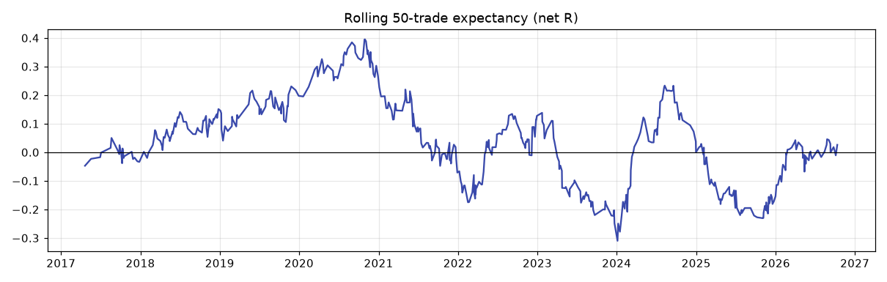

# Statistical validation (Part 9)

All numbers are from `backend/scripts/audit_liquidity.py` on the frozen snapshot. Bootstrap: 4,000 resamples of trades, seed 7. Net R includes 4 index pts per trade.

## 1. Is the baseline expectancy different from zero?

| Test | Result |
|---|---|
| Mean net R | +0.0316 |
| Per-trade SD | 0.958R |
| t-stat (544 trades) | 0.77 (p of about 0.44) |
| Bootstrap CI95 | [-0.048, +0.114] |
| Gross (no costs) | +0.0985, CI [0.019, 0.181], t 2.40 |

**No.** Net of realistic costs, the expectancy is not distinguishable from zero. Before costs there is a small positive effect (about 0.1R) that costs mostly consume.

## 2. In-sample vs out-of-sample

| | Trades | Expectancy | CI95 | PF | Max DD R |
|---|---|---|---|---|---|
| IS 2016-2020 | 213 | +0.125 | [0.007, 0.246] | 1.41 | 5.6 |
| OOS 2021-2026-10-13 | 331 | **-0.028** | [-0.133, 0.075] | 0.93 | 20.3 |

The edge decays out-of-sample. The IS period itself is not clean: parameters such as MIN_RISK = 30 were chosen on 2016-2026 data in earlier work.

## 3. Walk-forward (anchored, yearly re-selection, 2019 onward)

| Parameter re-selected | Choices | WF expectancy | Fixed original, same years |
|---|---|---|---|
| Min risk {0, 20, 30, 40, 50} | 30, 30, 40, 30, 50, 50, 50, 50 | +0.041 (CI [-0.059, 0.142]) | +0.019 |
| Target {1, 1.5, 2, 2.5, 3}R | 3R every year | +0.048 (CI [-0.055, 0.152]) | +0.019 |

Walk-forward selection does slightly better than the fixed original, but no walk-forward result has a CI excluding zero.

## 4. Rolling stability

The rolling 50-trade expectancy (chart 14) peaks near +0.4R in late 2020, then swings between about -0.3R (early 2024) and +0.23R (mid 2024) and crosses zero repeatedly. A steadily positive 2017-2020 block is followed by an oscillating, net-flat 2021-2026 block.

## 5. Monte Carlo and bootstrap

- Trade-order shuffle (10,000 runs): max DD median 18.5R, P95 28.9R, P99 34.4R; P95 longest losing streak 14.
- Bootstrap of the total: P5 -18.8R, median +17.1R, **P(total < 0) = 21.8%**. About 1 time in 5, the same strategy over the same number of trades would have lost money.

## 6. Sensitivity (smooth or spiky?)

Results move smoothly with each parameter. There is no isolated spike that would indicate a fragile optimum:

- Target 1 to 3R: +0.004, +0.012, +0.032, +0.043, +0.056.
- Min risk 0 to 50: -0.022, -0.012, +0.032, +0.027, +0.038.
- Sweep threshold 1 to 10 pts: +0.032, +0.044, +0.043, +0.043; 20 pts: +0.000.
- Time exit 14:45 to 15:20: +0.004, -0.003, +0.032, +0.043.

Smooth but small. Every value is within one standard error of zero.

## 7. Cost sensitivity

| Cost (index pts per round trip) | Expectancy | CI95 |
|---|---|---|
| 0 | +0.099 | [0.019, 0.181] |
| 2 | +0.065 | [-0.014, 0.147] |
| **4 (assumed)** | **+0.032** | [-0.048, 0.114] |
| 6 | -0.002 | [-0.081, 0.081] |
| 8 | -0.035 | [-0.115, 0.047] |
| 10 | -0.069 | [-0.149, 0.014] |

Breakeven cost is about 6 index pts per round trip, roughly Rs 3 of ATM premium at delta 0.5. NSE charges plus a 1-tick-wide spread fit inside that; slippage from delayed alerts and manual entry may not.

## 8. Sample size

- At the measured mean (+0.032R) and SD (0.958R), about **3,539 trades** are needed for a 95% CI that excludes zero. At about 51 trades a year that is about **70 years** of data.
- To measure expectancy to within +/-0.1R needs 353 trades (about 7 years). The audit has 544, so it can rule out an edge of about +0.15R or more with reasonable confidence, but not a small edge.

## 9. Multiple testing

55 configurations were evaluated. A Bonferroni 5% threshold needs p < 0.0009 (|t| > 3.32). The best variant t-stat is 1.37. **Nothing survives.** The IS-selected combination G went from IS +0.153 to OOS -0.280 (CI [-0.525, -0.019]). That is the clearest sign in the audit that further filter search would fit noise.

## 10. Biases

| Bias | Handled? |
|---|---|
| Look-ahead | Tested: 0 repaints, 0 early signals, swings confirmed after two right bars |
| Data errors | Fake holiday sessions found and removed; data cross-checked against NSE EOD |
| Selection | Every signal taken (no capital filter); expiry calendar per period |
| Snooping | IS/OOS split, walk-forward and Bonferroni reported. Design choices made before this audit could not be undone. |
| Model risk (options) | Black-76 errors measured against real EOD closes; sensitivity to IV and slippage reported |
| Time-of-day / regime cherry-picking | Bucket results shown, not used as rules (except as rejected hypotheses) |

## Conclusion

The strategy's net expectancy is statistically indistinguishable from zero over 10.8 years and negative out-of-sample. Its gross edge of about +0.1R is real enough to survive a bootstrap, but costs remove most of it. No variant or filter is statistically better than the original after correcting for the number of tests.
