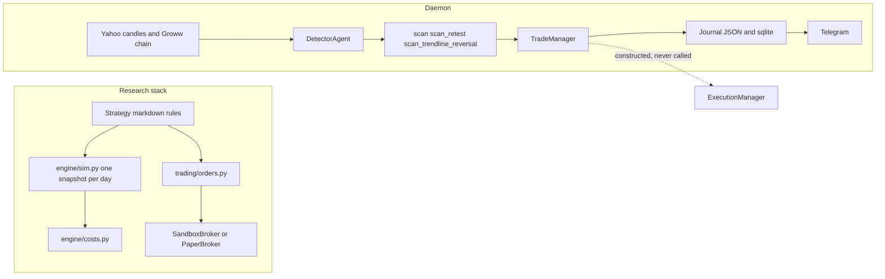

# Current architecture assessment

Date: 4 Nov 2026. Verified by reading callers, not by trusting module banners.

## What it does today

One operator, one machine. Two stacks that do not share an order or a P&L.

## Intended versus actual

| Intended, from banners and the architecture note | Actual |
|---|---|
| Five crews place and reconcile broker orders | Daemon journals and notifies. Execution crew is unused |
| Safety wall is protected capital | A float incremented by half of F-02 |
| Walk-forward updates tomorrow's edge | Canned sentences written into JSON (F-09) |
| One liquidity strategy | Same functions, different arguments, target replaced (F-05) |
| ₹50,000 account | Scanner file says that. Research settings default to ₹5,00,000 |

## End-to-end daemon flow

`scripts/live_scanner.py` `main`:

1. Build scanner, `TradeManager(is_paper_trading=True)`, `ExecutionManager(is_live_broker=False)`, pre-market and post-market managers.
2. If `trades/active_strategy_params.json` exists, copy `otm_steps` onto the detector and the entry agent, and `micro_wick_stop_buffer` onto the entry agent.
3. Outside 09:15–15:30 local clock, after 15:31, call `run_daily_review(empty frame, pdh=23150, pdl=22950)`. Clock is `datetime.now()`, not a named `Asia/Kolkata` zone.
4. Inside the session, every 10 seconds by default: Groww chain, drop the forming 5-minute bar, stamp quote age, `produce_scan_snapshot`, `on_market_tick`. No `df_1m`.
5. Print each returned action as "Trade Action Executed".

`on_market_tick`: exit open JSON trades on spot; if flat, or one trade is breakeven-locked, consider one new candidate; gates for 09:30, lunch (with name overrides), 14:30, VIX, stale bar, walls; replace target; risk-approve fixed lots; journal; Telegram if a Groww LTP exists.

## Dependency map (money path)

`ExitAgent` → spot points → `JournalAgent.record_exit` → `pnl_rupees` → `RiskAgent.record_trade_outcome` → `trades/daily_risk_config.json`.

`engine/costs.py` is not on this path. It is on `trading/orders.py` and the daily simulator.

## Dependency map (signal path)

`DetectorAgent` → `liquidity_signals.scan` / `scan_retest` / `scan_trendline_reversal` → `CandidateSetup` → `TradeManager` (new target, new gates) → journal.

`backtest()` → the same three functions with other arguments → Black-76 columns. It does not call `TradeManager`.

## What is incomplete

| Piece | State |
|---|---|
| Broker send on the daemon | Not implemented. The live branch pretends it is |
| Option fill ledger | Not implemented on the daemon |
| IST day reset | Function exists, unused |
| Shared arguments for research and live | Not implemented |
| Historical bid/ask | Not in the tree |
| CI | Absent |
| Kill switch for scanner JSON trades | The research `live/kill_switch.py` does not see scanner rows |

## What is complete enough to keep

Daily simulator, cost schedule, research order manager, sandbox tests, `scan()` as a function, stale-bar and missing-VIX vetoes, Groww marked as quotes only in its own module doc.
