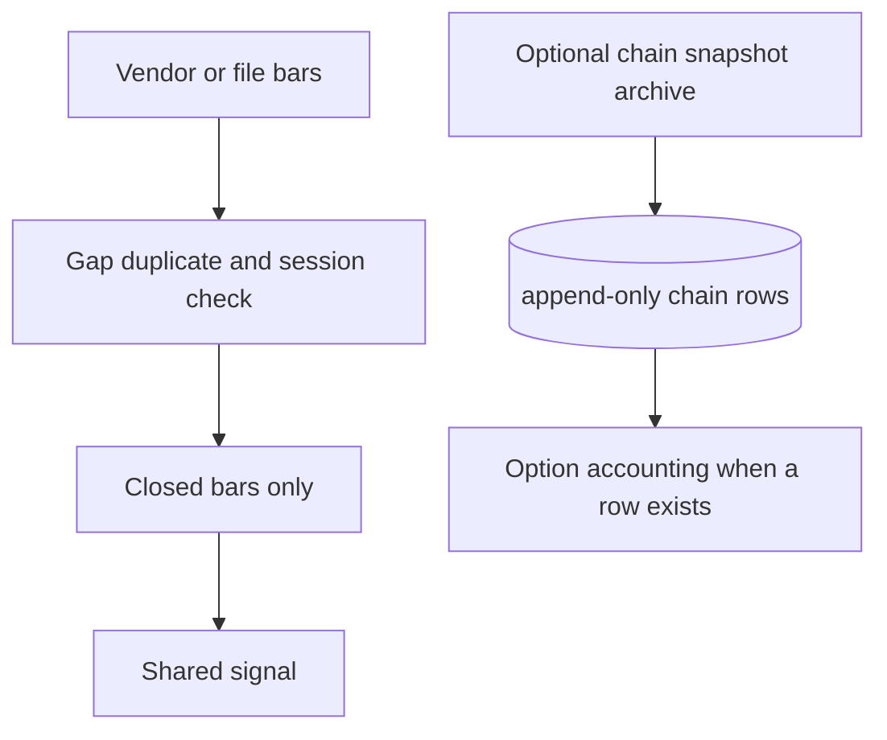

# Market data architecture

Date: 4 Nov 2026. Assessment of what exists. The target is the smallest store that can support the accounting spec, not a new vendor stack.

## What is in the tree

| Series | Where it comes from | Who reads it | Gap |
|---|---|---|---|
| NIFTY 5-minute, short window | Yahoo via `app.api.market._chart` | Default liquidity backtest, scanner feed | Last bar can be forming. Daemon drops a bar whose start is under 5 minutes old (`_drop_forming`) and vetoes a closed bar older than 300 seconds |
| NIFTY 1-minute history | Kaggle CSV, Groww chart top-up | `backtest_liquidity.py --history` | October audit found synthetic holiday sessions. Not re-scanned today |
| VWAP input | Yahoo path: NIFTYBEES. History path: session TWAP. Detector: typical price on the bars in hand | `scan` filter `above_vwap` | Three definitions. Parity test must pin one |
| India VIX | Yahoo `^INDIAVIX` | Backtest IV input; live gate 11.5–22, hard veto if missing | A 30-day index, not the IV of the option bought |
| Live chain | Groww HTML `__NEXT_DATA__` | Walls, LTP, delta if present, lot if present | Last trade. No bid, no ask. Page layout can change (`groww.py` says so) |
| Historical option premiums | Not stored | Black-76 fills the hole | Cannot claim executable option P&L for past years |
| Lot size by date | `market/nse.py` and `lot_sizes/nse.yaml` | Liquidity ledger | Fallback 75 in the ledger if the table misses a date. Scanner `RiskAgent` is constructed with 65 and the journal default is 65 |
| Events calendar | `market_eod.db` | Research blackouts | October found zero event rows. Not recounted |

## Clocks

Daemon session bounds use `datetime.now()` with no zone. A laptop not set to IST will open and close the session wrong, and will stamp the risk file's "day" wrong once a reset exists. Research snapshots use the feed's date string.

No job reports missing or duplicate candles. A hole becomes a false swing or a missed signal and is indistinguishable from "no setup".

## Lineage

A backtest result does not store a hash of the CSV, the git revision, or the argument set. The October workbook is a file with a date in the name. That is the best lineage the repo has, and it is manual.

## Survivorship

The index series is not a stock universe, so constituent survivorship is not the issue. Invented option strikes are. Black-76 will price a contract that did not trade. That must be labelled model, not fill.

## Target data path

Chain archive columns, started from the Groww page you already fetch, append-only: `fetched_at`, `expiry`, `strike`, `ce_ltp`, `pe_ltp`, `ce_oi`, `pe_oi`, `delta` if present, `lot`, `spot`. No bid/ask until a broker quote exists. Do not backfill 2016 with a formula and call it this table.

Until that table has the entry and exit timestamps of a trade, option rupees for that trade stay null.

## Validation rules worth adding later

- Reject a 5-minute bar that is not closed.
- Reject a session with a hole larger than one bar, or flag it on the signal.
- One VWAP function, named, used by `backtest()` and the detector.
- Do not trade a lot size that is only the config default when the chain returned `marketLot`.

Not in scope: a tick store, a second data vendor, corporate-action adjustment of NIFTY beyond the lot table.
