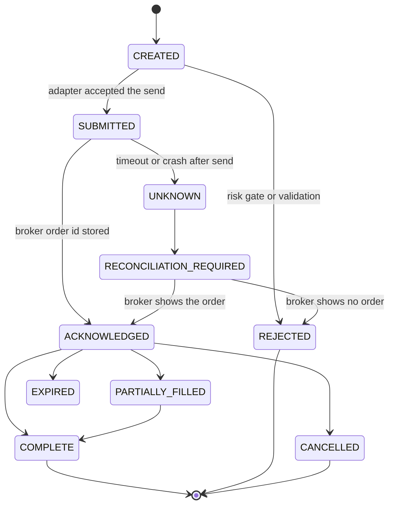

# Order management architecture

Date: 4 Nov 2026. No broker execution is to be implemented with this blueprint.

## Three modes

| Mode | Fill source | Status that means "we got the contracts" |
|---|---|---|
| `research_sim` | Snapshot or Black-76, labelled | `MODEL` |
| `paper_human` | A person types the premium and quantity | `HUMAN_FILL` |
| `broker` | `BrokerAdapter` ack and later updates | `COMPLETE` only when the adapter says so |

`FILLED` without an adapter is forbidden. Today's `SIMULATED_FILLED` from `BrokerBridgeAgent` must not be shown as a broker fill. Prefer deleting that agent from the daemon over extending it.

## Lifecycle

The research manager already persists orders and polls until `COMPLETE`, `REJECTED`, or `CANCELLED` (`brokers/base.py`). Extend that vocabulary. Do not invent a parallel state machine in the execution crew.

`trading/orders.py` `_send` calls `place_order` and only then inserts the row. A crash in between is October G-10, still a real window. The blueprint requires the row `CREATED` **before** the send, with a client order id. If the process dies, restart sees `CREATED` or `SUBMITTED` and reconciles. It does not send a second order with a new id.

Unknown status: no retry until reconciliation returns. Reconciliation is `adapter.orders()` or the broker's order-book call matched on client order id. The scanner has no such call today.

## Idempotency

Client order id is the idempotency key, stored in `LiveStore`, not a hash set on `TradeManager`. The current hash of date, strategy, direction, strike, minute, and rounded price is a journal dedupe only. It dies with the process for closed trades. Keep it only as a signal-level dedupe after it is written to the day file and kept after the trade closes.

## Restart

1. Load orders in `CREATED`, `SUBMITTED`, `ACKNOWLEDGED`, `UNKNOWN`.
2. Ask the broker. Paper and research modes have nothing to ask: `CREATED` that never left the process becomes `REJECTED` with reason `not_sent`.
3. Compare positions to the sum of fills.
4. Mismatch → `RECONCILIATION_REQUIRED` and no new entries.

## Kill switch

Research path: `live/kill_switch.py` already aims at a deployment. Scanner path: it must set "no new entries" on the risk file and, in `broker` mode, send reduce-only exits through the same order manager, then wait for `COMPLETE`. A JSON status `CLOSED` is not a flatten. In `paper_human` mode the switch pages the operator and marks the book "flatten required". It does not invent a fill.

## Partial fills, rejects, freezes

`orders.py` already splits on freeze quantity and caps order value. The scanner does not use it. A future broker path uses that split. Quantity must be a multiple of the lot on the intent. A reject leaves the position unchanged and records the reason.

## What not to build

A second router (30% market, 70% chase). One limit order is enough for one lot. `ExecutionManager.execute_entry` adds a constant "1.0 slippage point saved" with no measurement. Remove that from any report.

## Daemon until a broker exists

`live_scanner.py` stops constructing `ExecutionManager`. Entries are journal signals. The log line says `SIGNAL`, not "Trade Action Executed".
