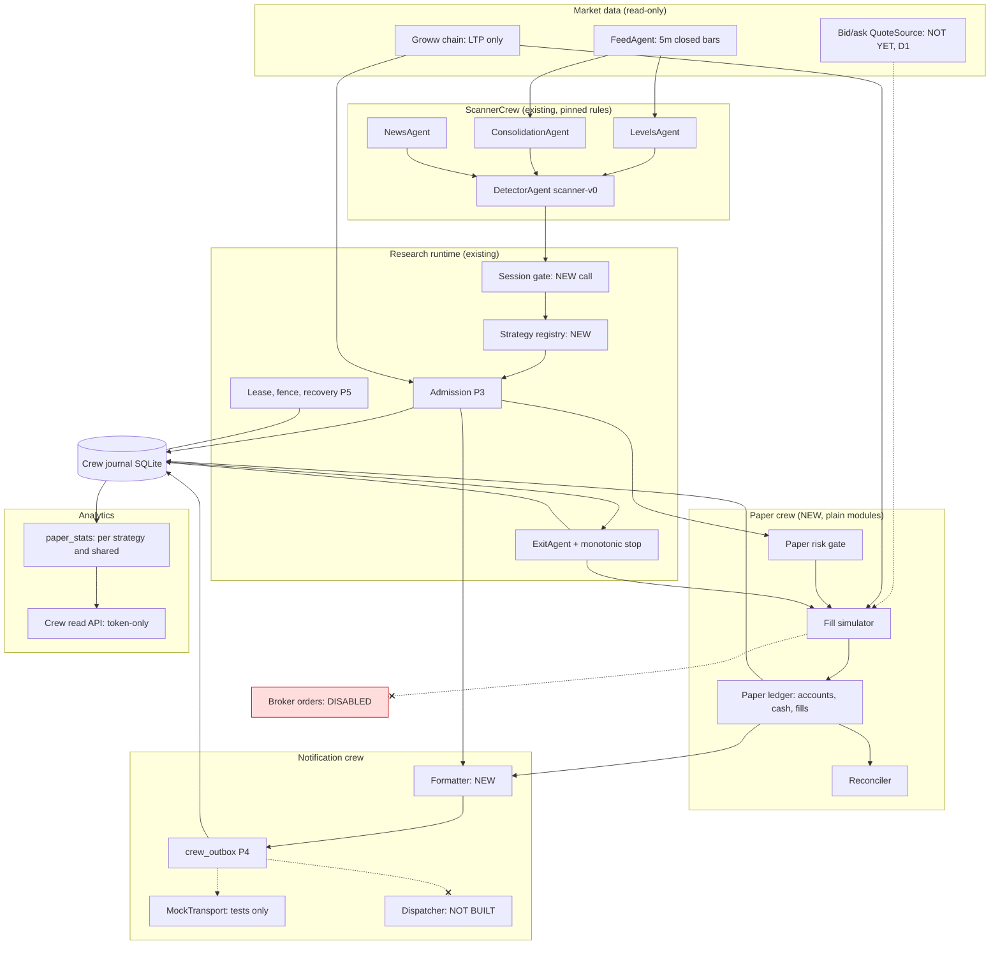

# Genesis: multi-strategy paper trading V1 and Telegram notifications. Forensic audit and plan

Date: 6 Nov 2026, IST. Baseline: `ebeaaca`. Method: read-only. I used graphify, read the code, and checked the configuration, LaunchAgent state and holiday file without changing them. No application code, test, configuration or database was changed. Nothing was started, sent or pushed. This document is the only file written.

**Verdict:** GO for isolated implementation of phases 1 to 5 (section 10), on a branch, with synthetic fixtures and mock senders only. NO-GO for running paper trading on live data, for Telegram delivery, for the PDC V0 implementation and for BANKNIFTY. Five decisions are needed first (section 0.2).

---

## 0. Executive findings

### 0.1 What the code actually contains

1. **There are not five independent strategies.** Liquidity sweep, retest and trendline are functions in one file, `backend/app/liquidity_signals.py`. `DetectorAgent` (scanner-v0) wraps them, and so do two disabled daemons, each with **different parameters**. The liquidity sweep is implemented **four separate ways** (section 1).
2. **Priced paper P&L is impossible with today's data.** The only option feed is Groww's public chain page. It has **no bid, no ask and no quote timestamp** (`brokers/groww.py:20`). `quote_decision` can therefore never grade a quote `executable`. Under the "never invent a premium" rule, **every paper trade would be UNPRICED**. No other quote source is registered.
3. **Capital is split between ₹50,000 and ₹500,000.** `.env` sets `DEFAULT_CAPITAL_INR=50000`, but `config.py:40` defaults to `500_000`. `env_file=".env"` is resolved relative to the working directory, so a process started outside `backend/` (or the repo root) **silently gets ₹500,000**. Five modules fall back to that default: `engine/sim.py`, `review_crew/hard_stop.py`, `trading/decisions.py`, `live/approvals.py` and `live/equity.py`.
4. **The existing outbox cannot carry paper messages as-is.** `RECOMMENDATION` and `MONITORING` need an `ACTIONABLE` trade (trigger `crew_outbox_insert`), and the admission layer can never return `ACTIONABLE`. `crew_events` also forbids rupee keys (`_FORBIDDEN_KEYS`). Paper money therefore needs its own `crew_paper_*` tables.
5. **There is no card-faithful PDC V0 function, and the full card text is not in the repo.** Only the summary table in `audit/genesis_v2/08…` exists. `backtest_pdc_15ema.py` differs from that table on 7 rules.
6. **There is no session gate in the research runtime.** There is no market-hours, weekend or holiday check. `backend/data/holidays/nse.yaml` ends at 2026-12-25, so a missing date counts as a trading day.
7. **1-minute and 15-minute scanner frames can include a forming bar.** `research_runtime._closed_bars` trims only the 5-minute frame. `ScannerManager.produce_scan_snapshot` fetches 1m and 15m raw (`scanner_manager.py:78-82`). It also falls back to a **fabricated `cmp = 23000.0`** when 5-minute bars are empty (line 87).
8. **BANKNIFTY has no strategy path.** Lot sizes and the Groww page exist. No scanner, level or admission path runs BANKNIFTY (`_underlying` defaults to NIFTY).
9. **Containment holds.** `com.genesis.equal-signals` and `com.genesis.liquidity-signals` are `disabled` in launchd. `research_runtime` imports no outbox, Telegram or broker code. The five rule sources are pinned by SHA-256 in `tests/test_research_runtime.py:621`.

### 0.2 Decisions needed before code

| # | Decision | Recommendation |
|---|---|---|
| D1 | How to price paper trades when the feed has no bid/ask | Strict: UNPRICED. Build the engine now and add a read-only bid/ask quote source as a separately authorised task. Do not substitute LTP for a fill |
| D2 | Granularity of the independent ₹50,000 accounts | One account per strategy family (5 scanner-v0 families), with timeframe as an analytics dimension |
| D3 | Timeframes in V1 | 5m only. 1m and 15m setups are recorded as `SIGNAL_REJECTED` with reason `TIMEFRAME_NOT_CLOSED_BAR_SAFE` until the closed-bar fix is approved |
| D4 | Paper risk policy (paper sizing, not strategy rules) | Max premium at risk ₹10,000 per trade, daily loss limit ₹5,000, max 3 lots, concurrency 1 per independent account and 2 for the shared account |
| D5 | PDC V0 | Keep it `DISABLED` in the registry until the full card text is supplied and a card-faithful pure function is separately approved |

---

## 1. Existing strategy inventory

"Rule source" is the file whose numbers decide entries and exits. Every item below is NIFTY index options, long premium only (CE for CALL, PE for PUT), unless noted.

### 1.1 Frozen PDC Zone + 15 EMA V0

| Field | Finding |
|---|---|
| ID / version | No runtime id. The card is in `audit/genesis_v2/08_genesis_v2_target_architecture.md` §PDC V0 protection (summary table only) |
| Source / entry point | `backend/scripts/backtest_pdc_15ema.py` (`scan_pdc_trades`, `find_pdc_zone`), a standalone backtest. Pinned hash `62230eec…` |
| Market / timeframe | Card: NIFTY and BANKNIFTY, 5m. Script: NIFTY only |
| Indicators | Previous-day 15:25 candle high/low zone, 15 EMA |
| Entry (card) | CE: zone test with a bullish close above the zone and the EMA. PE: close below the zone and the EMA. Window 09:20–15:15. No overlapping same-direction position |
| Exit (card) | Candle-close stop. 50% at 2R, the rest at PDH/PDL. Exit on an opposite close of the EMA |
| Script drift | 15:20 fallback and ±3 zone widening, 4-pt buffers, 10–65 pt risk filter, wick stop, 2.5R target with no partial, 09:25–14:45 window |
| Sizing | Script: Black-76 premium with VIX, full charges |
| Signal path | None. Not imported by any runtime |
| Backtest / paper / Telegram | Backtest yes (modelled premiums). Paper no. Telegram no |
| Status | **Benchmark only, not implemented.** Must not be changed or relabelled |
| Missing | Full card text; a card-faithful pure function; BANKNIFTY; a regression fixture set |

### 1.2 Scanner-v0 (`DetectorAgent.scan_multi_timeframe_strategies`)

This is one composite card, not one strategy. It is what the S1 research runtime admits.

| Field | Finding |
|---|---|
| ID / version | `strategy_id` = the setup's display name (e.g. `Liquidity Sweep [5M]`), `strategy_version = scanner-v0`, `execution_policy = research-exec-v1-monotonic-stop` |
| Source | `trading/scanner_crew/detector_agent.py` (pinned) calls `liquidity_signals.scan`, `scan_retest` and `scan_trendline_reversal` (pinned), plus inline EQH/EQL logic |
| Entry point | `research_runtime.scanner_feed` → `ScannerManager.produce_scan_snapshot` → `DetectorAgent` → `admission.evaluate` → `open_research_trade` |
| Timeframes | 1m, 5m, 15m (sweeps and EQH/EQL on 5m and 15m only) |
| Dependencies | `LevelsAgent` (PDH/PDL, OR-30, EQH/EQL, key levels), session VWAP, `ConsolidationAgent` veto, `NewsAgent` blackout (a non-deterministic input) |
| Risk filter | 10–55 pts after each function's own `min_risk` (30 by default; trendline 15 on 1m) |
| Strike | Rounded to 50 plus `otm_steps=2` OTM. `live_scanner.py` can override this from a params file; the runtime does not |
| Targets | 3R, or the next opposing spot level (`dynamic_targets=True`) |
| Exits (runtime) | `ExitAgent` (pinned) on the 5m close: stop, target, liquidity hop (partial `lots//2`), 15:10 cutoff. Stop to breakeven at 0.7R, lock 0.8R at 2R. The stop never loosens |
| Sizing | `MODEL_LOTS = 3` (hypothetical) |
| Backtest | `scripts/resimulate_since_oct15.py` and `diagnose_trades.py` call the detector (points only) |
| Paper / Telegram | Model trades in points and R only (`finalized_results`). No Telegram |
| Status | Implemented and tested (P1–P7). Not running |
| Missing | Rupee pricing, capital, accounts, notifications, a session gate, closed 1m/15m bars |

Setups emitted by scanner-v0 (strategy families for D2):

| Family | Display ids | Rule function |
|---|---|---|
| `LIQ_SWEEP_PDHL` | `Liquidity Sweep [5M]`, `[15M]` | `liquidity_signals.scan`: PDH/PDL sweep ≥2 pts, 15m CHoCH, VWAP/open filter |
| `RETEST_PD` | `Breakout & Retest (PD) [1M/5M/15M]` | `scan_retest`: break ≥2 pts, retest within 25 pts, close past level, VWAP, open |
| `RETEST_OR30` | `Breakout & Retest (OR-30) [..]` | `scan_retest` with `include_orh_orl`, after 10:00 |
| `TRENDLINE_CHOCH` | `Trendline Reversal (1M/5M/15M)` | `scan_trendline_reversal` with `require_choch`, slope ≥0.5, max risk 55 |
| `EQHL_SWEEP_INLINE` | `Equal Highs Sweep [..]`, `Equal Lows Sweep [..]` | Inline in the detector: wick ≥ max(3, 0.6 × body), sweep ≤18 pts, fixed 3R |

The display ids are not uniform (`(5M)` versus `[5M]`). They are already part of the signal identity, so they must not be renamed. The registry maps them to families instead.

### 1.3 Liquidity sweep: four different implementations

| # | Implementation | Where | Parameters | Runs today |
|---|---|---|---|---|
| a | v2 "Improved Strategy" daemon | `liquidity_signals.main` (`scan`) | MIN_RISK 30, 3R, BE at +1R, 09:30–14:30, one per side per day, skips expiry days, 3-loss break, VIX 11.5–22, OTM 0, RISK_PCT 5 | No (LaunchAgent disabled). Legacy Telegram |
| b | Scanner-v0 `Liquidity Sweep [TF]` | `DetectorAgent` → `scan` | dynamic targets, conditional lunch, 10–55 band | Research runtime only |
| c | Legacy `EntryAgent.evaluate_sweep` | `trading/crew/entry_agent.py` | micro-wick rejection, gamma walls, 25–35 pt stops | Legacy `TradeManager` only (LaunchAgent path, disabled) |
| d | Equal high/low forward test | `equal_signals.py` + `intraday_liquidity.py` | 2R, 30-pt min risk, 5m MSS, 09:30–14:30, skips expiry days | No (LaunchAgent disabled). Legacy Telegram |

(b) and (d) both call themselves "equal high/low sweep", but they have different rules.

### 1.4 Trendline logic

| Piece | Role |
|---|---|
| `liquidity_signals.scan_trendline_reversal` | Entry rule used by scanner-v0 |
| `liquidity_signals.detect_dual_trendline_squeeze` | Used by legacy `TradeManager` as a filter |
| `market/chart_analytics.Trendline` | Display and analytics only |

Trendline is a scanner-v0 family. It has no standalone runtime and no independent backtest card (the Excel `Trendline_*` workbooks come from `backtest_liquidity.py` variants).

### 1.5 Retest logic

`scan_retest` exists only as scanner-v0 families `RETEST_PD` and `RETEST_OR30`. Its `allow_reentry=True` permits a second attempt after a stop-out, so two signals can share a family and a day. Their signal ids differ by candle, so this is not a duplicate.

### 1.6 Other implemented strategies (not in V1 scope)

| Strategy | Where | Why excluded |
|---|---|---|
| Midday waterfall | `EntryAgent.evaluate_waterfall` (TradeManager) | Depends on legacy process state and the risk file; P6 already excluded it |
| Sniper 1m micro-wick | `SniperAgent` (TradeManager) | Same |
| Stock flag | `trading/stock_flag.py` (TradeManager fallback, 10 stocks) | Equities, not index options |
| LangGraph deployment crew | `agents/trade_crew/graph.py` | A separate system for user-authored multi-leg strategies with its own ledger, `PaperBroker` and order path. Never mixed |
| TradingAgents | `vendor/TradingAgents` | LLM equity research, not a signal source |

---

## 2. Current versus proposed architecture

### 2.1 Current (S1, P7)

`scanner_feed` (Groww chain + FeedAgent bars) → `ScannerManager` / `DetectorAgent` → `admission.evaluate` (REJECTED or RESEARCH_ONLY; never ACTIONABLE) → crew journal (`crew_admissions`, `crew_trades`, `crew_events`; points and R only) → `finalized_results` / crew read API. The outbox (`crew_outbox`) exists but nothing enqueues to it. The lease, fencing, recovery and UNKNOWN handling are built and tested.

### 2.2 Proposed (V1). Every new piece is a plain module; there is no new framework

| Stage | Component | New or reuse |
|---|---|---|
| Market data | `scanner_feed`, plus a `QuoteSource` with bid/ask once approved (D1) | Reuse; quote source later |
| Feature engine | `ScannerManager` (levels, VWAP, compression, news) | Reuse unchanged |
| Session gate | `market/hours.market_status` + holiday file, called before admission | Reuse the function; add the call and a "calendar covers this year" startup check |
| Strategy registry | `trading/paper_registry.py`: a static mapping of display id → family, version, status, allowed timeframes, sizing policy id, pinned source hashes. Its content hash is stored on each paper trade | New, small |
| Signal engines | `DetectorAgent` (pinned) | Reuse |
| Signal validation | `admission.evaluate` / `persist` | Reuse unchanged |
| Research journal | Crew journal, `crew_*` tables | Reuse; schema v4 adds `crew_paper_*` tables |
| Paper execution | `trading/paper_exec.py`: pure fill, sizing and charge functions over `quote_decision`, `long_premium_risk` and `leg_costs` | New |
| Paper ledger and risk | `db/paper_ledger.py`: accounts, cash, trades, fills, decisions, fenced by the existing lease | New |
| Analytics | `trading/paper_stats.py`, read-only | New |
| Notifications | `trading/paper_notify.py` (formatter) + `crew_outbox` (kind `OPS`) + a `crew_paper_notifications` link table | Formatter new; outbox reused |
| Transport | `MockTransport` in tests only. The dispatcher is not built in V1 | Test-only |

Separation guarantees:
- Admission class stays `RESEARCH_ONLY`. Virtual capital is not verified real capital, so `ACTIONABLE` stays impossible.
- `crew_trades.execution_state` keeps `CHECK = 'NONE'`.
- Paper modules import no `app.brokers`, `app.trading.orders` or `telegram_transport.TelegramTransport`. A test enforces this.
- Paper "fills" live only in `crew_paper_fills`. They never use `OrderRequest`, `broker_order_id` or `PaperBroker` (which belongs to the deployment order path).

### 2.3 Diagram: crews and agents



---

## 3. Paper-trading data model (crew journal schema v4, additive)

All tables use the `crew_` prefix, because `_check_journal_path` refuses any non-`crew_` table. Money is stored as a decimal `TEXT` (the same convention as admission's `Decimal`). Each table is append-only, or versioned with an event row, exactly like `crew_trades`/`crew_events`. Every write goes through `cj._fenced(lease)`.

```sql
crew_paper_accounts(
  account_id TEXT PK,                -- 'SHARED' | 'IND:<family>'
  mode TEXT CHECK (mode IN ('SHARED','INDEPENDENT')),
  strategy_family TEXT,              -- NULL iff SHARED
  capital_inr TEXT NOT NULL,         -- the approved figure, '50000'
  capital_source TEXT NOT NULL,      -- e.g. 'operator-approval:2026-11-06'
  risk_policy_id TEXT NOT NULL, opened_at TEXT NOT NULL)

crew_paper_cash(                     -- append-only cash journal
  id INTEGER PK, account_id, seq, kind CHECK IN ('DEPOSIT','RESERVE','RELEASE','REALIZED','CHARGE'),
  amount_inr TEXT, paper_trade_id NULL, at, idempotency_key UNIQUE, UNIQUE(account_id, seq))

crew_paper_decisions(                -- one per (account, signal): feeds accepted/rejected/unpriced counts
  account_id, signal_id, admission_id, strategy_id, strategy_family, strategy_version, registry_hash,
  outcome CHECK IN ('OPENED','REJECTED','UNPRICED'), reasons JSON array, decided_at,
  PRIMARY KEY(account_id, signal_id))

crew_paper_trades(
  paper_trade_id TEXT PK,            -- 'P_' || yyyymmdd || '_' || sha256(account_id|signal_id)[:12]
  account_id, signal_id, admission_id, model_trade_id NULL REFERENCES crew_trades,
  strategy_id, strategy_family, strategy_version, registry_hash, execution_policy,
  underlying, direction CHECK IN ('CALL','PUT'), contract_symbol, expiry, strike, option_type CHECK IN ('CE','PE'),
  lot_size, lots_initial, lots_open, qty_initial,
  underlying_entry, underlying_stop_initial, underlying_targets JSON, signal_candle,
  capital_committed_inr, max_loss_inr,
  state CHECK IN ('OPEN','PARTIALLY_EXITED','CLOSED','EXIT_UNPRICED','EXPIRED_UNRESOLVED','CANCELLED'),
  version, opened_at, closed_at,
  UNIQUE(account_id, signal_id))     -- no duplicate paper entry per account

crew_paper_fills(                    -- append-only; the evidence for every rupee
  fill_id PK, paper_trade_id, seq, side CHECK IN ('BUY','SELL'), lots, qty,
  price_inr,                         -- simulated fill
  bid, ask, ltp, mid, quote_time, fetched_at, quote_age_s, quote_source, grade,
  slippage_ticks, slippage_inr,      -- versus mid
  charges JSON,                      -- CostBreakdown fields
  charges_inr, reason, decided_at, filled_at, idempotency_key UNIQUE)

crew_paper_events(                   -- state machine, mirrors crew_events triggers
  event_id PK, paper_trade_id, seq, event_type CHECK IN ('PAPER_ENTRY','PAPER_LEVELS_UPDATED',
  'PAPER_PARTIAL_EXIT','PAPER_EXIT','PAPER_EXIT_UNPRICED','PAPER_CANCELLED','PAPER_EXPIRED_UNRESOLVED'),
  from_state, to_state, idempotency_key UNIQUE, session_id, occurred_at, payload JSON, UNIQUE(paper_trade_id, seq))

crew_paper_notifications(            -- typed identity for OPS outbox rows
  publication_id PK REFERENCES crew_outbox, notification_type, account_id NULL,
  strategy_id, strategy_version, signal_id NULL, paper_trade_id NULL, market_day)
```

Triggers to add, copied from the existing patterns:
- No update or delete on the append-only tables.
- A trade update must match the next event row.
- Terminal states are immutable.
- `lots_open` only decreases.
- `SUM(fills.qty BUY) − SUM(fills.qty SELL) = lots_open × lot_size`.
- `crew_paper_cash` `RESERVE` requires an `OPENED` decision.

The `crew_events` forbidden-rupee-key trigger stays untouched. Rupees never enter the model journal.

---

## 4. Options paper execution model

Every rule below is a pure function in `paper_exec.py`. Each takes the quote, settings, policy and time, and none reads a clock or the network.

| Step | Rule |
|---|---|
| Contract | From the admission's stored `contract` (chain `marketLot`, expiry, strike, CE/PE). Never from config lot sizes and never 65 |
| Quote grade | `quote_decision`. `executable` needs bid and ask >0, no inversion, spread ≤ `MAX_SPREAD_PCT` (5%), `quote_time` present and ≤10 s old, and a trading symbol |
| Entry price | **Ask** + `paper_slippage_ticks` × ₹0.05 (default 1 tick). LTP is never a fill |
| Exit price | **Bid** − slippage ticks, from the first executable quote at or after the exit decision, within `EXIT_PRICING_WINDOW` (default 60 s). Record the actual quote time |
| Unpriced entry | No paper trade. A decision row `UNPRICED` with the reason (`QUOTE_MISSING`, `QUOTE_STALE`, `NO_BID_ASK`, `SPREAD_WIDE`, …). Counted in "unpriced", excluded from P&L |
| Unpriced exit | State `EXIT_UNPRICED`. The underlying exit is recorded, the premium is not. **Capital stays reserved** for the rest of the day, and the trade is excluded from priced P&L and listed |
| Charges | `leg_costs` with the dated STT and exchange schedules from `Settings` (STT 0.1% on sell premium since 2024-10-01). Brokerage ₹20 per order, GST 18%, SEBI, stamp duty on buys. Slippage is reported separately, never twice |
| Quantity | `long_premium_risk(lots_ceiling=policy.max_lots, risk_ceiling=policy.max_premium_at_risk, funds=account.available_cash)`. 0 lots → `REJECTED: INSUFFICIENT_CAPITAL` |
| Capital committed | `ask_fill × qty + entry charges` |
| Max estimated loss | Committed + estimated exit charges at a zero exit premium (a long option's real maximum) |
| Stop-model estimate | Optional, only when the chain gives a delta: `|delta| × index risk × qty`. Labelled `ESTIMATE`; not used by any limit |
| Partial exit | The model hop sells `lots // 2` of the model's 3 lots. Paper sells `floor(paper_lots × 1/2)`. With 1 paper lot: `PARTIAL_SKIPPED_SINGLE_LOT`, recorded and notified |
| Stop / target | Decided only by the existing `ExitAgent` on the underlying 5m close. The option is priced at that decision. There is no intrabar option path |
| Gross / net | Gross = Σ(sell − buy) × qty at fill prices. Net = gross − all charges. Slippage cost versus mid is reported |

Points are never converted to rupees. Model points and R stay in `crew_events`. Rupees exist only where a `crew_paper_fills` pair exists.

---

## 5. ₹50,000 portfolio accounting

**One capital source.** A new required setting `PAPER_CAPITAL_INR` has **no default**. At account creation the runtime checks it equals the approved figure (50000) and writes it into `crew_paper_accounts.capital_inr`. From then on every calculation reads the **account row**, never `Settings.default_capital_inr`. A test asserts that the paper modules never reference `default_capital_inr`. Fixing the `.env`/₹500,000 split in the legacy modules is listed separately (B-12) and is not required for paper.

**Accounts.** `SHARED` plus one `IND:<family>` for each enabled family (D2). Every signal is evaluated once for each account it is eligible for (its own independent account and SHARED). The decisions are independent: SHARED may reject a trade that the independent account opened.

**Cash identities**, checked after every write and at startup. On failure the runtime refuses to continue, as the crew consistency check already does.
- `available = deposits + Σ realized − Σ open reserved − Σ charges not yet in realized`
- `reserved = Σ capital_committed of OPEN, PARTIALLY_EXITED and EXIT_UNPRICED trades` (pro rata for partials)
- `equity_realized = deposits + Σ net P&L of CLOSED trades`

**Risk gate** (versioned `risk_policy_id`; the values are D4 proposals):

| Control | Rule | Reject reason |
|---|---|---|
| Per-trade risk | max loss ≤ ₹10,000 | `RISK_LIMIT` |
| Capital | committed ≤ available | `INSUFFICIENT_CAPITAL` |
| Daily loss | realized net today + worst case of open trades (full max loss) > −₹5,000 blocks new entries | `DAILY_LOSS_LIMIT` |
| Concurrency | independent 1, shared 2 | `MAX_POSITIONS` |
| Duplicate exposure | Same underlying, direction and expiry already open in the account | `DUPLICATE_EXPOSURE` |
| Conflicting exposure | CE and PE on the same underlying at once (that would be a hedge, which is out of scope) | `CONFLICTING_EXPOSURE` |
| Correlation | NIFTY and BANKNIFTY same direction count as one exposure group (future) | `CORRELATED_EXPOSURE` |
| Session | Outside 09:15–15:30 IST, weekend, NSE holiday, or no calendar for the year | `MARKET_CLOSED` / `CALENDAR_MISSING` |
| Late signal | Lookout window expired (existing) or admission is replayed after a restart | `ENTRY_MISSED_AFTER_RESTART` |

**Shared-account ordering.** Within a tick, candidates are processed in `(signal_candle, registry priority, strategy_id, direction, setup_id)` order. That is deterministic, so a replay gives the same winners.

**End of day.** The 15:10 model cutoff exits every trade, and the paper engine prices those exits. At startup the next day, any paper trade still open, or `EXIT_UNPRICED`, becomes `EXPIRED_UNRESOLVED`. Its reserved capital is listed for operator reconciliation and never silently released as P&L. Nothing carries overnight.

---

## 6. Telegram notification design

**Transport.** Only `MockTransport` (tests). No dispatcher is built or started. `TelegramTransport` is not imported by any paper module. The destination `chat_id` is the fixed sentinel `mock:paper` in V1. The real chat ids in `.env` and the compromised token are never read.

**Storage.** Each notification is an outbox row of kind `OPS` (no ACTIONABLE gate and no change to the outbox DDL), plus a `crew_paper_notifications` row carrying its typed identity. Both are written **in the same transaction as the paper event that causes them**, so a message exists exactly when its event does. Delivery outcomes only touch `crew_outbox`; they can never change paper tables.

**Identity and deduplication.** `purpose = "<TYPE>|<account_id>|<paper_trade_id or signal_id>|<event seq or market_day>"`. `publication_id = sha256(kind, purpose)` already exists, so a replay is a no-op, and a different body for the same purpose raises. The existing rules hold: UNKNOWN is never resent, SENDING at startup becomes UNKNOWN, there are at most 3 attempts, and an operator resolves UNKNOWN with channel evidence.

This needs one refactor: `enqueue_publication`'s inner `op(conn)` must be callable inside the caller's fenced transaction. It is a small change in non-frozen `crew_outbox.py`.

| Type | Trigger | Required identifiers and fields |
|---|---|---|
| SIGNAL_DETECTED | Admission recorded (RESEARCH_ONLY) | strategy_id/family/version, signal_id, admission_id, instrument, direction, signal candle (IST), index entry/stop/target, quote grade |
| SIGNAL_REJECTED | Admission REJECTED, or paper decision REJECTED/UNPRICED | the above + account_id + reasons |
| PAPER_ENTRY_FILLED | `PAPER_ENTRY` | + paper_trade_id, account_id, contract, expiry, strike, CE/PE, lots, qty, bid/ask/LTP + quote time + age, fill price, slippage, charges, committed, max loss |
| PAPER_PARTIAL_EXIT | `PAPER_PARTIAL_EXIT` | + lots sold/remaining, exit bid/fill, realized net on the sold part, reason |
| PAPER_STOP_LOSS | `PAPER_EXIT` with a stop reason | + exit index level, fill, gross/net P&L, holding time |
| PAPER_TARGET_HIT | `PAPER_EXIT` with a target reason | same |
| PAPER_FINAL_EXIT | `PAPER_EXIT` with another reason (cutoff, hop final) | same |
| PAPER_TRADE_CANCELLED | `PAPER_CANCELLED`, `PAPER_EXIT_UNPRICED`, `EXPIRED_UNRESOLVED` | + reason; P&L shown as "not priced" |
| DAILY_STRATEGY_SUMMARY | After the EOD cutoff, once per account per day | account_id, day, section 7 metrics for the day |
| SYSTEM_WARNING | Feed stale, calendar missing, reconciliation failure, unpriced exit, UNKNOWN publication | code, market_day, affected ids |

Formatting rules:
- Every value comes from a stored row. A missing value prints `not priced (<reason>)` or `n/a`; never a number.
- Times are IST, `YYYY-MM-DD HH:MM:SS IST`. Rupees are `₹1,234.50` from the decimal text.
- The fixed footer is `Mode: PAPER ONLY` / `No real broker order placed.`
- The existing `redact()` check rejects any body containing a token-like string.
- The body is limited to 4,096 characters.

Entry example. The values come from a synthetic fixture and are not market data:

```
GENESIS — PAPER TRADE
Strategy: Liquidity Sweep [5M] (LIQ_SWEEP_PDHL, scanner-v0)
Account: IND:LIQ_SWEEP_PDHL
Market: NIFTY   Direction: BUY CE   Signal: Confirmed (RESEARCH_ONLY)
Index Entry: {entry_spot}   Index Stop: {stop_spot}   Index Target: {target_spot}
Option: {contract_symbol} ({expiry}, {strike} CE, lot {lot_size})
Quote: bid {bid} / ask {ask} / last {ltp} at {quote_time} ({age}s)
Entry Premium: {fill} (ask + {ticks} tick)   Quantity: {lots} lots = {qty}
Charges: {charges}   Capital Committed: {committed}   Max Loss: {max_loss}
Signal ID: {signal_id[:12]}   Paper Trade ID: {paper_trade_id}
Time: {filled_at IST}
Mode: PAPER ONLY
No real broker order placed.
```

---

## 7. Per-strategy performance model (`paper_stats.py`, read-only)

Statistics are computed for each independent account (that is, each strategy family) and, separately, for the SHARED account. Independent accounts are **never summed** into one return. The legacy `data/trades.db` and JSON/Excel ledgers are never read. Points and R from `finalized_results` are reported next to the rupee figures, never merged with them.

| Metric | Definition |
|---|---|
| Signals | Admissions for the family (by `strategy_version` and `execution_policy`) |
| Accepted / rejected | `crew_paper_decisions.outcome` OPENED versus REJECTED, with reasons |
| Priced / unpriced | OPENED with an entry fill versus UNPRICED decisions plus `EXIT_UNPRICED` trades |
| Completed | CLOSED with both fills |
| Win rate | net > 0 / completed |
| Average win / loss | Mean net of winners / losers |
| Expectancy | Mean net per completed trade (₹) and per ₹ of max loss |
| Profit factor | Σ winning net / |Σ losing net|; `n/a` with no losses |
| Net P&L | Σ net (₹) |
| Max drawdown | On the realized equity curve in close-time order (₹ and % of ₹50,000). Mark-to-market drawdown is not in V1 |
| Average holding | Mean (exit fill time − entry fill time) |
| Transaction costs | Σ charges, broken down |
| Slippage | Σ (fill − mid) × qty, entry and exit |
| By regime | Label fixed at signal time, versioned `regime-v1`: trend (5m close versus session VWAP and the 20-bar slope sign) × volatility (India VIX bucket, or `UNKNOWN` if not available) |
| By time of day | 09:15–10:00, 10:00–11:30, 11:30–13:00, 13:00–14:30, 14:30–15:30, by signal candle |
| By timeframe | 1m / 5m / 15m (D2/D3) |
| Sample warning | Any group with under 30 completed trades is flagged `INSUFFICIENT_SAMPLE` |

---

## 8. Implementation backlog

Priority: P0 = needed for a correct paper ledger, P1 = needed for the stated V1, P2 = later or separately authorised.

| ID | Pri | Item | Touches | Frozen-safe |
|---|---|---|---|---|
| B-01 | P0 | Strategy registry (display id → family, version, status, timeframes, policy ids, pinned hashes, priority) and its hash | new `paper_registry.py` | Yes |
| B-02 | P0 | Session gate before admission, plus a startup refusal when the holiday file lacks the current year | `research_runtime.py` (call `market_status`) | Yes (runtime is not pinned) |
| B-03 | P0 | `PAPER_CAPITAL_INR` required, no default; account creation checks the approved value | `config.py`, ledger | Yes |
| B-04 | P0 | Schema v4: `crew_paper_*` tables and triggers; `migrate()` stays additive and idempotent | `crew_journal.py` | Yes |
| B-05 | P0 | Fill simulator, sizing, charges and unpriced reasons (pure) | new `paper_exec.py` | Yes |
| B-06 | P0 | Paper ledger and risk gate (fenced writes, cash journal, identities) | new `db/paper_ledger.py` | Yes |
| B-07 | P0 | Runtime integration: a paper step after each admission, model exit and partial; restart reconciliation (`ENTRY_MISSED_AFTER_RESTART`, `EXPIRED_UNRESOLVED`) | `research_runtime.py` | Yes |
| B-08 | P0 | 5m-only filter in the registry (D3); 1m/15m become `SIGNAL_REJECTED` | registry | Yes |
| B-09 | P1 | Formatter and atomic enqueue (OPS + link row); refactor `enqueue_publication` to work inside the caller's transaction | new `paper_notify.py`, `crew_outbox.py` | Yes |
| B-10 | P1 | Analytics and a token-gated read API (`/api/live/crew/paper/*`) | new `paper_stats.py`, `api/crew.py` | Yes |
| B-11 | P1 | Test suite in section 9 | `tests/test_paper_*.py` | Yes |
| B-12 | P1 | Resolve `.env` by absolute path (`backend/.env`), and refuse to start a financial module on the ₹500,000 code default | `config.py` | Separate approval: affects legacy modules |
| B-13 | P2 | Read-only bid/ask `QuoteSource` (broker market-data API). Without it every result is UNPRICED | new adapter | Needs credentials: **separate authorisation** |
| B-14 | P2 | Closed-bar 1m/15m frames for the scanner (changes scanner-v0 inputs → new version `scanner-v0.1`) | `research_runtime.scanner_feed` | Needs a version bump decision |
| B-15 | P2 | Remove the fabricated `cmp = 23000.0` fallback | `scanner_manager.py` | Not pinned, but scanner behaviour |
| B-16 | P2 | 2027 NSE holiday dates | `backend/data/holidays/nse.yaml` | Data only |
| B-17 | P2 | Register liquidity-v2 daemon card and equal-H/L card as families (own feeds) | registry, feeds | Rules unchanged |
| B-18 | P2 | Card-faithful PDC V0 pure function (NIFTY + BANKNIFTY), as a new file; the existing script stays as-is | new module | Needs the full card text and **separate authorisation** |
| B-19 | P2 | BANKNIFTY levels/scanner path; BANKNIFTY has only a monthly expiry, so contract selection must come from the chain | many | Later |
| B-20 | P2 | Dispatcher with a real transport and a new bot token | — | **Blocked** by P8 and credential rotation |

---

## 9. Test and acceptance matrix

All tests use synthetic bars and chain fixtures, a temporary journal under `tmp_path`, a fixed clock, and `MockTransport`. None of them uses the network, `.env` secrets, or a production database.

| # | Requirement | Test | Pass condition |
|---|---|---|---|
| T-01 | Multiple simultaneous strategies | Two families signal on the same candle | Each independent account opens its own trade; SHARED follows the deterministic order; attribution ids are correct |
| T-02 | Duplicate signals | The same setup on 3 ticks, plus a replayed admission | One decision and one trade per account; the replay is a no-op |
| T-03 | Missing option quote | Chain without the strike | `UNPRICED: QUOTE_MISSING`; no cash movement; SIGNAL_REJECTED queued |
| T-04 | Stale quote | `quote_time` 11 s old | `UNPRICED: QUOTE_STALE` |
| T-05 | LTP only (today's Groww) | bid/ask absent | `UNPRICED: NO_BID_ASK`; LTP never used as a fill |
| T-06 | Insufficient capital | Ask × lot > available | `REJECTED: INSUFFICIENT_CAPITAL`; lots reduced first when 1 lot fits |
| T-07 | Partial exit | Model hop with 3 and with 1 paper lot | 1 lot sold at bid − tick / `PARTIAL_SKIPPED_SINGLE_LOT`; quantities reconcile |
| T-08 | Stop-loss | Bar closes past the stop | Exit at bid; PAPER_STOP_LOSS; net = hand-computed value |
| T-09 | Target | Target hit | PAPER_TARGET_HIT; net matches |
| T-10 | Unpriced exit | No executable quote within 60 s | `EXIT_UNPRICED`; capital stays reserved; excluded from stats; SYSTEM_WARNING |
| T-11 | Trading holiday / weekend | Clock on 2026-11-10 and on a Sunday | No admission; `MARKET_CLOSED` |
| T-12 | Calendar missing | Clock in 2027 with the current file | Startup refused: `CALENDAR_MISSING` |
| T-13 | Session boundaries | 09:14:59, 09:15, 15:10 cutoff, 15:30 | Correct gating; every position exits by the cutoff |
| T-14 | Process crash | Kill between admission and paper entry, and between paper event and enqueue (injected exception) | Atomic: either both rows or neither; restart → `ENTRY_MISSED_AFTER_RESTART`, never a late fill |
| T-15 | Restart recovery | Restart with OPEN paper trades the same day and the next day | Same day: managed by the owner session only. Next day: `EXPIRED_UNRESOLVED`; cash identities hold |
| T-16 | Duplicate outbox events | Same event processed twice | One publication; a different body for the same purpose raises |
| T-17 | UNKNOWN delivery | MockTransport raises a timeout | UNKNOWN; never reclaimed; operator resolve works; **paper tables byte-identical before and after** |
| T-18 | Wrong attribution | Signal from family A | Never touches `IND:B`; registry hash and version are stored |
| T-19 | Transaction charges | A known fill pair on dates before and after 2024-10-01 | Charges equal the hand-computed STT, exchange, GST, SEBI, stamp and brokerage |
| T-20 | Capital reconciliation | Random fixture sequence of 200 events | The cash identities hold after every step; a corrupted row → startup refusal |
| T-21 | P&L accuracy | Golden fixtures | Gross, net, slippage and drawdown match to the paisa |
| T-22 | Capital source | Settings default ₹500,000, env var missing | Paper refuses to start; no module reads `default_capital_inr` |
| T-23 | Isolation | Import scan | Paper modules import no `app.brokers`, `orders` or `TelegramTransport`; ACTIONABLE stays impossible |
| T-24 | Frozen sources | Existing test 19a | The pinned hashes are unchanged; the PDC script hash is `62230eec…` |
| T-25 | No fabricated values | Formatter given rows with NULL premiums | The message says "not priced"; no digits appear in place of missing values |
| T-26 | Independent versus shared | Stats over a fixture | There is no combined total of independent accounts; SHARED is reported on its own |

Acceptance for V1 means all of the following:
- T-01 to T-26 pass, and the existing suite stays green (888 passed; the one known `NewsAgent` failure is accepted).
- The protected-file manifest is unchanged, except for the new source files.
- `git diff` on the five pinned sources is empty.
- No process or LaunchAgent is started.
- No network call is made during tests (enforced with a socket guard fixture).

---

## 10. GO / NO-GO

| Scope | Decision | Why |
|---|---|---|
| Implement B-01 to B-11 on a local branch, tests with fixtures only | **GO** after D1–D5 | Builds on tested P2–P6 primitives; no frozen file changes; nothing runs |
| Run the paper runtime on live market data | **NO-GO** | P8 blockers are open (network exposure, fail-open auth, leaked token, legacy ledger); no bid/ask source, so the result would be 100% UNPRICED; there is no supervisor |
| Any Telegram delivery | **NO-GO** | The token is not rotated; the dispatcher is out of scope |
| PDC V0 paper trading | **NO-GO** | No card-faithful function; the full card text is missing |
| BANKNIFTY | **NO-GO** | No signal path |
| Live / automated orders | **NO-GO** | Out of scope. Future eligibility needs: separate written authorisation; a minimum evidence bar (for example, at least 100 priced, completed trades per family over at least 3 months, with positive expectancy at the lower confidence bound); slippage calibrated against real fills; durable order recovery with an UNKNOWN order state; a kill switch; and broker reconciliation. Promotion is never automatic. Paper results do not prove live profitability |

## 11. Integration risks

1. **Identity drift.** Any change to scanner inputs (closed bars, `cmp` fallback, `otm_steps`) changes signals under the same `scanner-v0` id. Mitigation: registry hash + version bump rule, and test 19a.
2. **NewsAgent non-determinism.** A news blackout can suppress every setup, so a replay can differ. Mitigation: record the sentiment and event flags on SIGNAL_DETECTED; mark news-gated ticks.
3. **Outbox overload of `OPS`.** Paper rows share the `OPS` kind with ops messages. Mitigation: the link table, and every query filters through it.
4. **Single-lot partials.** At ₹50,000 most trades will be 1–2 lots, so the model's half-exit often cannot be mirrored. Paper results will differ from model R. This is reported, not hidden.
5. **Capital realism.** A 3-lot NIFTY position at a ₹100 premium commits about ₹19,500, which is 39% of the account. The concurrency and risk caps will reject many signals. That is the intended behaviour, not a bug.
6. **SQLite contention.** More writes per tick under the same lease. These are short `BEGIN IMMEDIATE` transactions, already WAL with a 30 s busy timeout.
7. **Charge rates.** The defaults must be re-verified against current NSE/SEBI circulars before any figure is reported.
