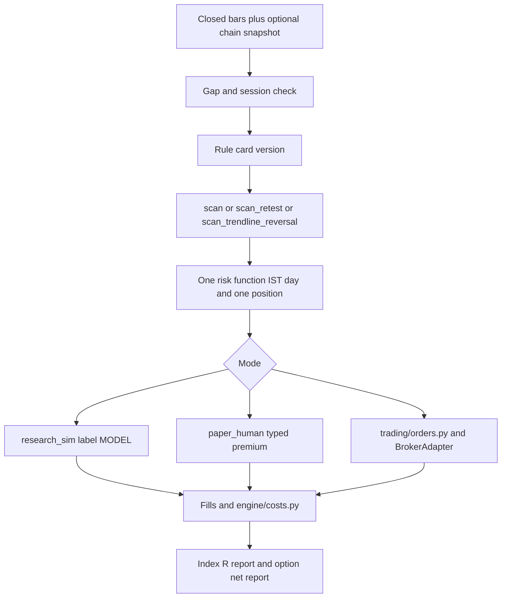

# Target architecture

Date: 4 Nov 2026. Smallest shape that makes a signal, a risk decision, and a rupee checkable. No new framework.

## Why this and not a new bus

The failures are a lying status, a wrong P&L formula, two argument lists, and a config writer. A message bus does not fix a formula. `trading/orders.py` and `engine/costs.py` already exist.

## Alternatives considered

| Alternative | Why it loses |
|---|---|
| Finish `BrokerBridgeAgent` with real HTTP | Second order machine beside `orders.py`. The current one returns success with no I/O. Delete that path instead |
| Keep 0.5 delta as "estimate" next to real P&L | It already leaked into the safety wall and the daily audit. Estimates belong in a column named `model`, never in `pnl_rupees` |
| Force the daemon onto October's exact `scan()` arguments immediately | That is a strategy change. Do it as a version bump on the card, on paper, with the diff written down. Do not mix it with the accounting fix |
| Build a tick backtester before any of the above | Does not fix false fills or false rupees. Optional and later |
| Portfolio optimizer | One underlying, one position, no measured option edge. Not useful |

## Mode rules

Research and live import the signal functions. They do not import each other's fills. A research `MODEL` row cannot update `safety_wall_reserve`. A broker `COMPLETE` can. A human fill can, and is tagged `HUMAN_FILL` so it is not mistaken for an exchange.

## What is removed from the hot path

- Construction of `ExecutionManager` in `live_scanner.py`
- `save_calibrated_parameters` from the post-market daemon call
- Target overwrite in `TradeManager` unless the card's version includes it and the backtest does too
- Catalog performance literals

## What stays experimental and off the order path

News sentiment, gamma walls as a hard veto, LLM opinions, video ingest. A wall veto that is not in the backtest must be on the card as live-only or it must go. Today a missing Groww page blocks entries. That is an availability coupling. The card should say so.

## Scale this design accepts

One person. NIFTY first. One open option. Five-minute decisions if that is the card. ₹50,000 scanner capital means one lot, not three, once premium risk is enforced. The banners that say 3–4 lots are larger than that account once a real premium and a daily loss limit exist. The design says one lot until a forward sample of priced trades exists. That is a capital limit, not a missing module.
