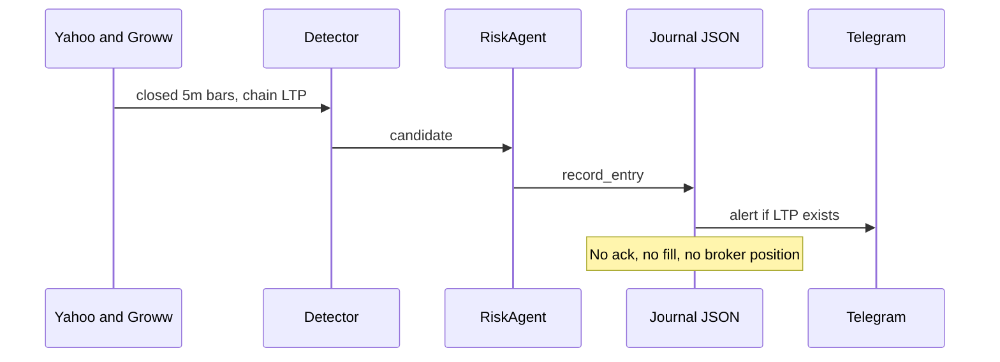

# Live execution audit

Audit date: 4 Nov 2026. No order was sent. Live trading should stay off.

## Lifecycle that the daemon implements

`ExecutionManager` is created with `is_live_broker=False` and then ignored (V2-02). Flipping that flag would not send an order either.

## Lifecycle the execution crew pretends to implement

`BrokerBridgeAgent.place_order`:

- Paper branch: status `SIMULATED_FILLED`, price equal to the requested price, latency equal to the time spent building a UUID.
- Live branch: the same, status `FILLED`, inside `try` with no API call. The `except` is unreachable unless UUID or logging throws (V2-01).

`execute_entry` always adds 1.0 "slippage point saved." `execute_exit` adds 0.5. The limit price is whatever the router computed; the fill price is the bridge's echo of that price. There is no partial, no reject, no timeout, no unknown state.

Smart routing's banner (30% market, 70% chase) is not a broker schedule. This session did not line-audit `smart_routing_agent.py` beyond the execution manager calling `plan_routing` and then placing **one** limit for the full quantity. The receipt's `execution_mode` is the plan's label. One order is what gets "sent," and it is not sent.

## The other order manager (research deployments)

`trading/orders.py` is a real state machine against `BrokerAdapter`: place, wait, cancel, reprice. October G-01 (reprice while a cancel can still fill) was marked verified with a test. October G-10 (place before the row is durable) was left open. This session did not re-run `test_live_plumbing.py`. Do not confuse that stack with the daemon. `LIVE_TRADING_ENABLED` defaults false. `LIVE_ALLOWED_STRUCTURES` does not include the scanner's free-form single-leg alerts, because the scanner never creates a deployment order.

Groww's adapter is `GrowwQuotes`. Its module docstring: read-only, not a broker. There is no Kite or Dhan order adapter in `backend/app/brokers/` (files: `base.py`, `credentials.py`, `groww.py`, `paper.py`, `registry.py`, `sandbox.py`).

## Failure modes

| Failure | Daemon behaviour | Safe? |
|---|---|---|
| HTTP error on the chain | Warning, `nifty_chain` None, no new trade if walls are required | Yes for entries. Open paper trades keep using spot |
| Yahoo candle failure | Exception in the loop, log, sleep 5 seconds | Missed exits for 5 seconds or more. No flatten |
| Process kill | Active JSON remains. In-memory signatures gone | Re-entry possible after a close. No broker residue, because there was no broker order |
| Duplicate polls of the same bar | Idempotency hash if the process stayed up | Only inside one process |
| `is_live_broker=True` | Reports a fill, writes nothing to an exchange, journal may still record a position the broker does not have — or, if someone later wires the journal to that receipt, a position the broker does not have while the UI says filled | **Unsafe.** The stub must refuse, not fill |
| Restart during `record_entry` | Active file is the recovery copy. Sqlite may have missed it | Operator can have Telegram without a DB row, or the reverse if the alert was skipped for a missing quote |
| Wrong symbol | Strike text is not an exchange token | Would reject at a real broker. The stub would "fill" it |
| Quantity | `lots * 65` unless the path check supplied `market_lot` | Lot size is a setting default of 65. NSE has changed NIFTY lot size before. A stale 65 is a wrong order if this is ever wired. The chain's `marketLot` is read in `contract_quote` and not clearly forced into `RiskAgent.lot_qty` (the agent is constructed with 65) |
| Partial fill | Not represented | |
| Stale LTP | Age check is on the 5-minute **spot** bar, not on the option LTP | An option quote can be old while the bar looks fresh |

## Idempotency (V2-13)

The hash is not an exchange `tag`. It is not stored in a table that outlives the process except by accident, as a field on an **open** trade. After exit, the active file no longer has it. A second start of the daemon can journal the same setup again if the detector emits it again.

`load_active_trades` on a corrupt file logs and returns `{}`. `record_entry` then saves a dict that contains only the new trade, which replaces the file. A parse error drops the open book from disk. That is the worst bug on this path if anyone is hand-following those trades.

## Recovery standard that is not met

After a crash, a restart, a timeout, or a duplicate packet, the system must be able to answer: what does the broker hold, what does the journal hold, and which orders are unknown. Unknown must not be retried as a new order. The daemon can answer only what the JSON file holds, and only if the file parses.

## Decision

Automated live trading is not permitted by this audit. The research deployment path is closer to an order lifecycle and still defaults to off; it was not re-certified today. The scanner path must not be pointed at a broker until V2-01 is a hard refusal and the journal is an order ledger rather than a signal diary.
