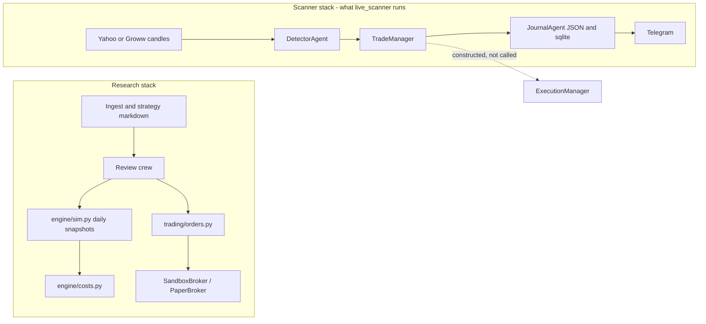

# Project architecture audit

Audit date: 4 Nov 2026. Evidence is the current tree. Status words mean what the code does when the daemon or the API is run, not what the module banner claims.

## What the repository is

Genesis is a single-operator research and alerting platform for NIFTY (and, in the research engine, other NSE index option structures). It is a FastAPI app plus a Next.js UI, plus a scanner daemon. It is not one trading system.

## Component status

| Area | Path | Status | Tested? |
|---|---|---|---|
| Daily option simulator | `backend/app/engine/sim.py`, `engine/costs.py`, `engine/metrics.py` | Implemented for end-of-day snapshots | Yes, research tests exist. Not a proof of intraday options. |
| Review crew | `backend/app/agents/review_crew/` | Implemented | Partial |
| Strategy ingest | `backend/app/ingest/`, `extract/`, `strategies/` | Implemented | Partial |
| Trade-crew order graph | `backend/app/agents/trade_crew/graph.py`, `trading/orders.py` | Implemented against sandbox/paper adapters | `test_live_plumbing.py` |
| Kill switch | `backend/app/live/kill_switch.py` | Implemented for deployments | Plumbing tests |
| Groww quotes | `backend/app/brokers/groww.py` | Implemented, read-only, page scrape | Fragile by the file's own comment |
| Scanner daemon | `scripts/live_scanner.py` | Implemented, paper journal | Crew unit tests; not a broker test |
| Execution crew | `backend/app/trading/execution_crew/` | Simulated. Live branch is a stub (V2-01, V2-02) | Tests only the simulated branch |
| Pre-market crew | `backend/app/trading/pre_market_crew/` | Implemented as a plan file and Telegram | Unit tests |
| Post-market crew | `backend/app/trading/post_market_crew/` | Runs, but the daemon calls it with an empty frame (V2-07) | Unit tests of the agent, not of that call |
| Liquidity research backtest | `backend/scripts/backtest_liquidity.py`, `audit_liquidity.py` | Implemented for `scan()` | October study. Not re-run here |
| Historical option tape | — | Not implemented | — |
| Portfolio optimizer | — | Not implemented | — |
| CI | `.github/` absent | Not implemented (V2-17) | — |
| Vendor `TradingAgents` | `vendor/TradingAgents/` | Third-party research graph, not the live book | Its own tests |

## Execution flow that actually runs

`scripts/live_scanner.py` `main`:

1. Build scanner, trade manager (`is_paper_trading=True`), execution manager (`is_live_broker=False`), pre-market and post-market managers.
2. Load `trades/active_strategy_params.json` into OTM steps and the micro-wick stop buffer.
3. Outside 09:15–15:30 local time, after 15:31, call `run_daily_review` with `pd.DataFrame()`, PDH 23150, PDL 22950 (V2-07). `datetime.now()` is local clock, not a named `Asia/Kolkata` zone.
4. Inside the session, every `interval` seconds (default 10): fetch a Groww chain, drop the forming 5-minute bar, stamp quote age, run `ScannerManager`, then `TradeManager.on_market_tick`.
5. Print each action as "Trade Action Executed". The action is a journal or veto record.

`TradeManager.on_market_tick`:

1. Mark and maybe close open JSON trades via `ExitAgent` / `HoldingAgent`.
2. If there are zero open trades, or one trade that is breakeven-locked, consider a new entry (V2-12).
3. Apply VIX, stale-bar, wall, lunch, and 14:30 gates.
4. Take the first scanner candidate that survives trend, sniper, risk, and path checks.
5. Write `JournalAgent.record_entry` and, if a Groww LTP exists, Telegram. No order object is created.

## Dependency map (scanner)

`live_scanner` → `ScannerManager` → feed, levels, news, consolidation, `DetectorAgent`.

`ScannerManager` → `DetectorAgent` → `liquidity_signals.scan`, `scan_retest`, `scan_trendline_reversal` (plus an equal-high/low check in the detector itself).

`TradeManager` → `TrendAgent`, `OrderFlowAgent`, `GammaAgent`, `RiskAgent`, `SniperAgent`, `EntryAgent`, `ExitAgent`, `HoldingAgent`, `AlertAgent`, `JournalAgent`, `odds.path_check`. The trend agent replaces the signal's target. The sniper is built and, on the daemon path, not fed 1-minute bars.

`RiskAgent` → `trades/daily_risk_config.json`. It does not call `engine/costs.py` or `trading/orders.py`.

`JournalAgent` → `trades/.active_trades_YYYY-MM-DD.json`, `trades/live_executed_trades.json`, `app.db.trade_store`.

Research APIs (`/api/review`, `/api/ingest`, paper orders) do not go through `TradeManager`.

## Documentation versus code (V2-20)

| Document or banner | Code |
|---|---|
| `backtest_liquidity.py` docstring: entries are `scan()`, "the code the live alerts run" | The detector does call `scan`, `scan_retest`, and `scan_trendline_reversal`. It does so with dynamic targets, a 10–55 point band, opening-range retests, re-entry, and extra timeframes. `TradeManager` then replaces the target. `EntryAgent` is a fallback the daemon does not hit, because it always passes a candidate list |
| `BrokerBridgeAgent` banner: Zerodha, Groww, Dhan, Angel One, under 15 ms | `place_order` returns a UUID. Groww module says it does not place orders |
| `ExecutionManager` banner: master controller for live broker execution | No call to `execute_entry` or `execute_exit` in `live_scanner.py` |
| `ParameterAgent` banner: walk-forward, overfitting defense | Three canned recommendations. See V2-06 |
| `ExitAgent` banner: 15:15 cutoff | Constructed with `intraday_cutoff_time="15:10"` |
| `CURRENT_SYSTEM_ARCHITECTURE_ANALYSIS.md`: idempotent guard prevents duplicate fills | Guard is a process-local set plus the active JSON file (V2-13). There is no fill |
| Architecture doc: tomorrow's lot size from the scaling law | `RiskAgent` is constructed with `frozen_baseline=True`, `default_lots=3`, `max_super_lots=4` |
| Daily audit 3 Nov: "7 lots" and a healthy system | Risk file read this session still has `default_lots: 3`. The audit's lot line is the post-market agent's text, not the sizer |

## What is simulated versus real

| Claim in a log or Telegram line | Reality |
|---|---|
| Entry opened | A JSON row and maybe a message |
| Slippage saved (execution crew) | A constant 1.0 or 0.5 points added in `execute_entry` / `execute_exit`, and that method is not on the daemon path |
| Safety wall balance | A running sum of half of V2-03 profits |
| Post-market "errors logged: 2, healthy" | Produced by `CodeQualityAgent` from whatever logs it saw; the price frame passed in was empty |

## Databases

| Store | Role |
|---|---|
| `data/genesis.db` (research) | Strategies, reports, sims |
| `data/genesis_live.db` | Deployments, orders for the research live stack |
| `data/market_eod.db` | NSE end-of-day reference. October audit G-13: `market_events` was empty. Not re-counted today |
| `data/trades.db` and `trades/trades.db` | Scanner journal. Two files exist in the tree; the daemon passes `data/trades.db` |

SQLite errors in `record_entry` / `record_exit` are logged at debug and ignored. The JSON file is the copy the next tick reads. A crash between the two stores splits them.
