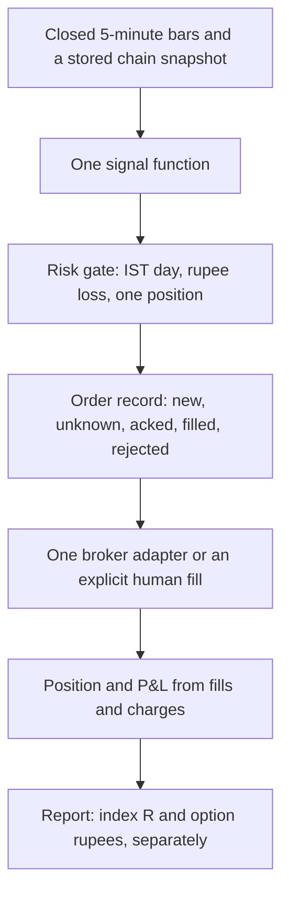

# Recommended future architecture

Audit date: 4 Nov 2026. This is the smallest shape that can support a true or false claim about a NIFTY option strategy. It reuses `engine/costs.py`, `engine/metrics.py`, `trading/orders.py`, and one signal module. It does not add a bus, a new database engine, or another crew.

## Target path

Research and the daemon call `sig`. If they cannot, the report names the function that ran.

## Pieces

**Data.** Keep Yahoo or the Kaggle file for spot research, with a hash in the result file. For anything labelled option P&L, read a row you stored: time, strike, expiry, bid, ask, last. Until bid and ask exist, store last and mark the P&L "last-trade, no spread". Starting the archive now is more useful than a better formula for 2016.

**Signal.** One function of completed bars and known levels (prior day, opening range after it has closed). It returns entry, stop, target, and reason, or nothing. Exits for research use completed bar extremes. Live may exit intrabar only if the backtest is also allowed to see the same path; otherwise you are testing two strategies. Pick one and write it on the rule card.

**Risk.** A pure function: capital, premium at risk, realized rupees today, open rupees, IST date. Defaults that are off must show up on the report. One position in the underlying. No safety wall until the rupees are fills. The wall, if you still want it, is a transfer you record in a ledger, not a side effect of a delta guess.

**Orders.** The research `OrderManager` already has the states that matter. The daemon should create those rows or create none. Human execution is a valid adapter: the operator types the fill. A typed fill beats a synthetic `FILLED`.

**Identity.** Tradingsymbol from the exchange, lot from the chain on that day, product MIS or NRML chosen once. The string `NIFTY 26100 CE` is a display name.

**Report.** Two tables. Index points and R, so you can see if the signal has a pulse. Option fills and charges, so you can see if the pulse survives the contract. Sharpe on the second table only. No blended "₹ P&L" that is half the spot move.

**What stays experimental.** Ingest from video, LLM opinions, news sentiment, gamma walls as a veto. They can annotate. They cannot change size or block a fill unless that veto is part of the frozen card and was in the backtest.

**What can go.** The execution crew's success path, the parameter writer's file update, the second copy of the sweep rules once you have chosen, and catalog literals. Deleting them is the architecture.

## Operating limits this design accepts

One underlying. One position. Five-minute decisions. No market-impact model. No SPAN margin until you sell premium. A personal capital of about ₹50,000 cannot hold the 3-lot and 4-lot sizes the crew banners describe once premium and a loss limit are real; the design should say 1 lot until the forward sample exists. That is a feature of the capital, not a missing module.

## Proof required before an automated order

1. The signal test and the backtest import the same function, and a truncation test shows no look-ahead.
2. A costed index study on a period you did not use to pick thresholds, with the interval written down.
3. At least as many forward trades as the study needed to be informative, with stored option prices at entry and exit. October's result says a few dozen trades will not prove a small edge. Use them to prove the **plumbing** and to falsify a large, obvious gap versus the twin backtest. Do not use them to claim a Sharpe.
4. Chaos test: kill the process after the ack and before the fill is saved; restart; end with one position, not two.
5. Kill switch flattens that position at the broker, or the mode is human-only and the switch only pages you.

If any item fails, the architecture is still a signal diary, and the diary should say so on the first line of the daily note.
