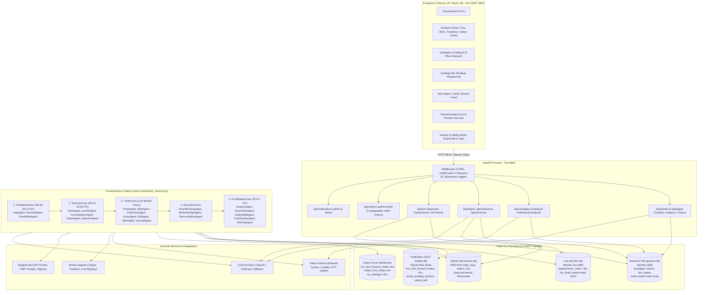
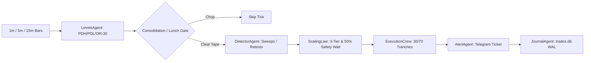

# Genesis: Institutional Trading & Strategy Intelligence Platform

[](https://www.python.org/)
[](https://fastapi.tiangolo.com/)
[](https://nextjs.org/)
[](https://react.dev/)
[](https://langchain-ai.github.io/langgraph/)
[](https://www.sqlite.org/wal.html)
[](#)

> **Genesis** is an institutional-grade algorithmic trading, strategy research, and automated execution platform engineered specifically for Indian equity derivatives (NSE NIFTY & BANKNIFTY index options). 
> 
> The platform unifies **5 Autonomous Specialized Crews** operating continuously across the trading session, a deterministic **Review Crew** backtesting engine with realistic Indian options cost schedules, a real-time **Non-Repainting Market Structure Engine**, a mathematical **3-Tier Sizing & 50% Capital Safety Wall** risk system, and an immutable **SQLite WAL Single Source of Truth (SSOT)** synchronized with Excel journals.

---

## 📑 Table of Contents

- [Core Platform Capabilities](#-core-platform-capabilities)
- [System Architecture](#-system-architecture)
- [The 5 Specialized Autonomous Crews](#-the-5-specialized-autonomous-crews)
- [Live Scanner Daemon & Multi-Timeframe Pipeline](#-live-scanner-daemon--multi-timeframe-pipeline)
- [Quantitative Risk & Execution Framework](#-quantitative-risk--execution-framework)
- [Single Source of Truth & Excel Journaling](#-single-source-of-truth--excel-journaling)
- [Quick Start Guide](#-quick-start-guide)
  - [Prerequisites & Configuration](#1-prerequisites--configuration)
  - [One-Command Platform Launcher (`genesis.sh`)](#2-one-command-platform-launcher-genesissh)
  - [Manual Component Runbook](#3-manual-component-runbook)
- [Strategy Catalog](#-strategy-catalog)
- [Frontend Navigation Map](#-frontend-navigation-map)
- [Database & Ledger Architecture](#-database--ledger-architecture)
- [Invariants & Security Guardrails](#-invariants--security-guardrails)
- [Comprehensive Documentation Index](#-comprehensive-documentation-index)

---

## 🌟 Core Platform Capabilities

- 🤖 **5 Autonomous Specialized Trading Crews**: PreMarketCrew (08:30 IST preparation), ScannerCrew (1m/2m/5m/15m multi-timeframe detection), TradeCrew (live risk, micro-wicks & exits), ExecutionCrew (30/70 tranche routing & broker bridge), and PostMarketCrew (15:31 IST forensic autopsy, 50% safety wall, daily digest).
- 🛡️ **Institutional 3-Tier Sizing & 50% Safety Wall**:
  - **Tier 1 (Standard)**: 3 Lots 1-OTM (high delta momentum).
  - **Tier 2 (Super-Trend)**: 4 Lots 2-OTM (convex gamma expansion runner).
  - **Tier 3 (Scalp Mode)**: 2 Lots ATM (rapid absorption trigger).
  - **Capital Safety Wall**: Permanently locks 50% of cumulative net profits into the capital floor, guaranteeing zero give-back of realized gains.
- 📐 **Non-Repainting Market Structure Engine**: Mathematical swing pivot detection (HH, HL, LH, LL, EQH, EQL), Market Structure Break (`BOS`), Change of Character (`CHoCH`), Fair Value Gaps (`FVG`), dynamic trendlines, and robust session VWAP proxy.
- 🔬 **Strategy Lab & Ingest Engine**: Ingests unstructured strategies from YouTube, Instagram, web documents (HTML), NotebookLM, or Markdown; extracts executable `rules:` blocks, detects gaps, and conducts interactive author clarifications.
- 🧪 **Deterministic Review Crew**: 7-step LangGraph StateGraph backtesting and forward-testing engine applying Indian options statutory charges (brokerage, STT, exchange fees, GST, SEBI, stamp duty, slippage) with capital stop sweeps (2% to 5%).
- ⚡ **Live Multi-Timeframe Scanner Daemon**: Autonomous background daemon continuously monitoring 1m, 2m, 5m, 15m, and 30m candles, screening midday chop (Lunch Lull 11:30-13:00) and event catalysts, while dispatching instant Telegram trade tickets with CMP heartbeat threads.
- 💾 **SQLite WAL Single Source of Truth (SSOT)**: Atomic, crash-resilient ACID transactions via `trades.db` with concurrent multi-process access, automatically synchronized with executive Excel workbooks in `trades/`.
- 🔒 **Cryptographic Provenance & Dual Hash Chains**: Immutably freezes strategy `content_sha256` and `rules_sha256` on deployment; every state mutation extends dual SHA-256 hash chains (`audit_events` and `live_audit_events`), verifiable via `GET /api/audit/verify`.

---

## 🏛️ System Architecture



---

## 🤖 The 5 Specialized Autonomous Crews

Genesis decouples trading into 5 distinct specialized crews executing sequentially across the daily market cycle:

```
08:30 IST               09:15 IST                     15:30 IST    15:31 IST
───┬───────────────────────┬─────────────────────────────┬────────────┬──────────►
   │  1. PreMarketCrew     │  2. ScannerCrew & TradeCrew │ 4. Close   │ 5. PostMarketCrew
   │  - Gap & Gamma Walls  │  - 1m/5m/15m Pattern Scans  │    Session │  - Forensic Autopsy
   │  - 09:05 Battleplan   │  - 3-Tier Execution         │            │  - 50% Safety Wall Lock
   │  - Telegram Gameplan  │  - Smart Routing & Alerts   │            │  - Telegram Digest
```

### 1. PreMarketCrew (`backend/app/trading/pre_market_crew/`)
- **Execution Window**: 08:30 – 09:14 IST daily.
- **PreMarketManager**: Orchestrates pre-session preparation.
- **GapAgent**: Compares GIFT NIFTY against Previous Day Close (PDC) to establish opening bias and flag exhaustion trap odds.
- **GammaAgent**: Analyzes the option chain to locate dealer Call/Put resistance walls, computes Put-Call Ratio (PCR), and identifies Max Pain pinning levels.
- **EventRiskAgent**: Evaluates high-impact macro catalysts (RBI MPC, CPI, FED, heavyweight earnings) to enforce event blackout windows.
- **Artifacts**: Writes `trades/pre_market_plan.json` and dispatches the 09:05 IST Morning Battleplan to Telegram.

### 2. ScannerCrew (`backend/app/trading/scanner_crew/`)
- **Execution Window**: 09:15 – 15:30 IST continuously across 1m, 2m, 5m, 15m, and 30m timeframes.
- **ScannerManager**: Coordinates market feeds, level projections, and pattern detectors.
- **FeedAgent**: High-speed delta polling fetching multi-timeframe OHLCV candles and computing real-time ETF session VWAP.
- **LevelsAgent**: Pins Previous Day High (PDH), Low (PDL), Close (PDC), Opening Range (OR-30: 09:15–09:45), and 50/100-pt psychological strikes.
- **ConsolidationAgent**: Computes compression boxes and ATR deadbands, suppressing false breakouts during the 11:30–13:00 Lunch Lull.
- **NewsAgent**: Live headline sentiment and catalyst risk screening.
- **DetectorAgent**: Mathematical pattern recognition for:
  - *Breakout & Retest* (OR-30 and PDH/PDL reclaims)
  - *Trendline Reversal* (3-point touch, false breakout, micro-wick reclaim)
  - *Liquidity Sweep* (PDH/PDL raid, 15m MSS, VWAP reclaim)
- **Artifacts**: Emits verified `ScanSnapshot` and `CandidateSetup` objects.

### 3. TradeCrew (`backend/app/trading/crew/`)
- **Execution Window**: Real-time intraday decision loop.
- **TradeManager**: Master live orchestrator.
- **TrendAgent**: Determines macro regime slope and aligns dynamic R:R targets (+1.8R to +4.5R).
- **RiskAgent**: Enforces daily risk circuit breakers, capital floors, and maximum loss limits.
- **OrderFlowAgent**: Detects institutional whale absorption climaxes and issues pre-entry vetoes.
- **EntryAgent**: Triggers micro-wick entries with strictly Out-of-the-Money (OTM) options contracts.
- **ExitAgent**: Manages multi-target lifecycle: Target 1 (+1.8R book 50% & SL to Cost), Target 2 (+2.5R book 25% & trail 5M swings), Target 3 (+3.5R to +4.5R unconditional full exit), and opposing sweep auto-flip.
- **AlertAgent**: Dispatches interactive Telegram tickets and threads real-time CMP updates.
- **JournalAgent**: Commits ACID records to the `trades.db` SQLite SSOT.

### 4. ExecutionCrew (`backend/app/trading/execution_crew/`)
- **SmartRoutingAgent**: Slices orders into 30% immediate market execution + 70% limit-chasing tranches, saving slippage points.
- **BrokerBridgeAgent**: Pluggable adapter bridge for Paper and Live broker execution.
- **ReconciliationAgent**: Zero-drift position reconciliation ensuring database state matches broker holdings.

### 5. PostMarketCrew (`backend/app/trading/post_market_crew/`)
- **Execution Window**: 15:31+ IST daily.
- **PostMarketManager**: Coordinates daily audit, walk-forward testing, and briefing.
- **AutopsyAgent**: Reconstructs intraday tape, audits execution against hypothetical perfection, and catalogs missed setups.
- **ParameterAgent**: Performs walk-forward edge testing and parameter tuning for tomorrow's session.
- **SafetyWallAgent**: Sweeps net realized profits and locks 50% permanently into the protected Capital Floor.
- **CodeQualityAgent**: Audits application logs, system warnings, and latency bottlenecks.
- **BriefingAgent**: Writes `reports/daily_audit_YYYY-MM-DD.md` and dispatches the Executive Digest to Telegram.

---

## ⚡ Live Scanner Daemon & Multi-Timeframe Pipeline

The live scanner daemon (`scripts/live_scanner.py`) executes continuously throughout the trading day:

```bash
# Run live multi-timeframe scanner (1m, 5m, 15m)
python scripts/live_scanner.py

# Custom timeframes and base capital
python scripts/live_scanner.py --timeframes 1m,5m --capital 100000

# Single scan test run across all timeframes (dry-run without Telegram)
python scripts/live_scanner.py --once --no-telegram
```

Visual flow of the scanner pipeline:



---

## 🛡️ Quantitative Risk & Execution Framework

### 1. The 3-Tier Execution Framework
Genesis uses a dynamic 3-Tier lot and strike sizing architecture:

| Tier | Category | Strike Selection | Lots | Purpose |
| :--- | :--- | :--- | :---: | :--- |
| **Tier 1** | **Standard Momentum** | Strictly 1-OTM (50-100 pts away) | **3 Lots** (195 shares) | Captures high delta expansion during verified momentum breaks while minimizing theta decay. |
| **Tier 2** | **Super-Trend Expansion** | 2-OTM | **4 Lots** (260 shares) | High convex gamma upside during multi-timeframe aligned institutional trends. |
| **Tier 3** | **Scalp / Counter-Trend** | At-the-Money (ATM) | **2 Lots** (130 shares) | Fast delta-heavy absorption setups with tight spot invalidation stops. |

### 2. Institutional 50% Capital Safety Wall
To prevent give-back of trading profits, Genesis enforces the **Capital Safety Wall**:

$$\text{Safety Wall Reserve} = 0.50 \times \max(0, \text{Cumulative Net Realized Profits})$$
$$\text{Tradeable Risk Capital} = \text{Base Capital} + 0.50 \times \text{Cumulative Net Realized Profits}$$

- **50% of all accumulated profits are permanently locked into the capital floor.**
- Drawdowns are calculated strictly against the tradeable surplus. If the floor is touched, trading is automatically halted.

### 3. Exit Discipline & Dynamic R:R
- **Target 1 (+1.8R)**: Partial book 50% of position; instantly move stop loss to entry price (breakeven).
- **Target 2 (+2.5R)**: Book 25% of position; trail remaining runner using 5M swing structure pivots.
- **Target 3 (+3.5R to +4.5R)**: Unconditional 100% full exit; zero runner exposure carried beyond Target 3.
- **Auto-Flip Reversal**: If an opposing structural sweep forms while holding, position is closed immediately at market.

---

## 💾 Single Source of Truth & Excel Journaling

Genesis provides an ACID-compliant, high-concurrency database store for all live and forward-tested trades:

- **Database**: `data/trades.db` (SQLite in WAL mode).
- **Concurrency**: Simultaneous non-blocking writes and reads by the Scanner Daemon, FastAPI API, and Excel Synchronizer.
- **Synchronizer**: `scripts/maintain_trades_excel.py` automatically updates institutional Excel workbooks under `trades/`:
  - [`trades/live_and_forward_trades.xlsx`](file:///Users/skoust/Documents/MyProjects/genesis/trades/live_and_forward_trades.xlsx): Dedicated live and forward-testing ledger with executive dashboard.
  - [`trades/todays_live_trades.xlsx`](file:///Users/skoust/Documents/MyProjects/genesis/trades/todays_live_trades.xlsx): Isolated intraday session trade ledger.
  - [`trades/by_strategy/`](file:///Users/skoust/Documents/MyProjects/genesis/trades/by_strategy): Strategy-specific workbooks (`trendline_reversal.xlsx`, `breakout_and_retest.xlsx`, `liquidity_sweep.xlsx`).

To synchronize or rebuild Excel journals at any time:
```bash
python scripts/maintain_trades_excel.py --days 60
```

---

## 🚀 Quick Start Guide

### 1. Prerequisites & Configuration
- Python 3.11+
- Node.js 18+ & npm
- `uv` package manager (`curl -LsSf https://astral.sh/uv/install.sh | sh`)

```bash
# Clone and enter the repository
cd genesis

# Copy environment configuration
cp .env.example .env

# Configure API keys and settings in .env
# - LLM_PROVIDER=openai (OPENAI_API_KEY) or anthropic (ANTHROPIC_API_KEY)
# - TELEGRAM_BOT_TOKEN and TELEGRAM_CHAT_ID (for instant trade tickets & digests)
# - DEFAULT_CAPITAL_INR=50000
```

### 2. One-Command Platform Launcher (`genesis.sh`)
Genesis includes a unified platform manager CLI to start, inspect, and manage all services:

```bash
# Start Backend (8841), Frontend (3000), and Live Scanner Daemon in background
./scripts/genesis.sh start

# Check service health and running process PIDs
./scripts/genesis.sh status

# Tail unified logs
./scripts/genesis.sh logs backend
./scripts/genesis.sh logs scanner
./scripts/genesis.sh logs frontend

# Stop or restart all services
./scripts/genesis.sh restart
./scripts/genesis.sh stop
```

### 3. Manual Component Runbook

#### A. Backend (FastAPI - Port 8841)
```bash
cd backend
uv sync
uv run alembic upgrade head
uv run alembic -n live upgrade head
uv run uvicorn app.main:app --host 0.0.0.0 --port 8841 --reload
```

#### B. Frontend (Next.js - Port 3000 / 8842)
```bash
cd frontend
npm install
npm run dev -p 3000
```
Open [http://localhost:3000](http://localhost:3000) (or [http://127.0.0.1:8842](http://127.0.0.1:8842)).

#### C. Live Scanner Daemon
```bash
python scripts/live_scanner.py --timeframes 1m,5m,15m
```

#### D. Post-Market Daily Audit (Run at 15:31 IST)
```bash
python scripts/run_post_market_audit.py
```

---

## 📈 Strategy Catalog

Genesis currently runs three primary institutional strategies:

1. **Breakout & Retest (OR-30 and Previous Day High/Low)**:
   - Identifies clean closes outside the 30-minute Opening Range or Previous Day levels.
   - Requires a retest wick rejecting the broken level before entry.
   - Sizing: Tier 1 (3 Lots 1-OTM).
2. **Trendline Reversal (3-Point Touch Exhaustion)**:
   - Detects ascending or descending dynamic trendlines with 3 validated touches.
   - Enters on 3rd-point false breakout traps or micro-wick reclaims.
   - Sizing: Tier 2 (4 Lots 2-OTM Super-Trend).
3. **Liquidity Sweep (PDH / PDL Turtle Soup Raid)**:
   - Identifies stop-hunts above Previous Day High or below Previous Day Low.
   - Triggers on immediate 5m/15m Market Structure Shift (MSS) with Session VWAP reclaim.
   - Sizing: Tier 1 (3 Lots 1-OTM) or Tier 3 (2 Lots ATM).

---

## 🗺️ Frontend Navigation Map

| Route | View Name | Key Features & Responsibilities |
| :--- | :--- | :--- |
| **`/`** | **Dashboard** | Real-time index quotes, paper positions, live PnL, quick order execution, and account equity curves. |
| **`/markets`** | **Markets & Chart Analytics** | Interactive lightweight candlestick charts, non-repainting BOS/CHoCH markers, FVG zones, dynamic trendlines, live option chain, and manual paper orders with Indian charges. |
| **`/strategies`** | **Strategies & Analyzer** | Strategies catalog evaluated against the 5 Institutional Pillars (Edge, Risk-Reward, Feasibility, Capital Floor, Execution Risk). |
| **`/strategy-lab`** | **Strategy Research Lab** | Interactive strategy builder, scenario testing, parameter sweeps, and forward-test simulations. |
| **`/lab`** | **Lab Ingestion & Review** | Ingest strategies from YouTube/Instagram/HTML/Markdown, answer clarifying questions, run Review Crew backtests, and inspect simulated trades. |
| **`/forward-tested`** | **Forward-Tested Journal** | Executive live & forward-tested trade ledger with win rates, total R-multiples, and strategy breakdowns. |
| **`/deploy`** | **Deploy Strategy** | Configure policy rules, backtest against broker accounts, set capital floors, and approve frozen snapshots. |
| **`/deployments`** | **Live Deployments Control** | Live deployment monitoring, pause/resume, stop, odds gates, and token-gated emergency kill switch (flatten positions). |
| **`/login`** | **Authentication** | Operator authentication and Bearer API token management. |

---

## 🗄️ Database & Ledger Architecture

```
                                  Genesis Persistence Tier
 ┌────────────────────────────────────────────────────────────────────────────────────────┐
 │                                                                                        │
 │   ┌───────────────────────┐   ┌───────────────────────┐   ┌────────────────────────┐   │
 │   │      Research DB      │   │        Live DB        │   │    TradeStore SSOT     │   │
 │   │     (genesis.db)      │   │       (live.db)       │   │    (data/trades.db)    │   │
 │   ├───────────────────────┤   ├───────────────────────┤   ├────────────────────────┤   │
 │   │ • strategies          │   │ • deployed_strategies │   │ • live_and_fwd_trades  │   │
 │   │ • strategy_versions   │   │ • deployments         │   │ • active_params cache  │   │
 │   │ • ingest_runs         │   │ • orders & fills      │   │ • daily_risk_config    │   │
 │   │ • reports & sim_runs  │   │ • live_trades         │   │ • safety_wall_state    │   │
 │   │ • sim_trades & reviews│   │ • credentials (Fernet)│   │ • SQLite WAL ACID mode │   │
 │   │ • paper_orders        │   │ • live_audit_events   │   │ • Syncs with Excel     │   │
 │   │ • notifications       │   │   (SHA-256 Chain)     │   │                        │   │
 │   │ • audit_events        │   │                       │   │                        │   │
 │   │   (SHA-256 Chain)     │   │                       │   │                        │   │
 │   └───────────────────────┘   └───────────────────────┘   └────────────────────────┘   │
 │                                                                                        │
 │   ┌───────────────────────┐   ┌────────────────────────────────────────────────────┐   │
 │   │       Market DB       │   │               trades/ Excel Workbooks              │   │
 │   │      (market.db)      │   │                                                    │   │
 │   ├───────────────────────┤   ├────────────────────────────────────────────────────┤   │
 │   │ • index_bars          │   │ • live_and_forward_trades.xlsx (Master Ledger)     │   │
 │   │ • option_eod          │   │ • todays_live_trades.xlsx (Intraday Ledger)        │   │
 │   │ • market_events       │   │ • by_strategy/*.xlsx (Strategy-Specific Workbooks) │   │
 │   │ • news_items          │   │                                                    │   │
 │   └───────────────────────┘   └────────────────────────────────────────────────────┘   │
 └────────────────────────────────────────────────────────────────────────────────────────┘
```

---

## 🔒 Invariants & Security Guardrails

1. **Zero LLM Trade Execution Authority**: 
   - All trade entries, sizing calculations, protective stops, and exit orders are strictly computed and executed by deterministic Python algorithms.
   - LLMs are utilized solely for unstructured strategy extraction, forensic autopsy narrative commentary, and optional evidence-backed vetoes (which may only skip or shrink an already code-approved order).
2. **Cryptographic Deployment Provenance**:
   - Approved strategies freeze exact `content_sha256` and `rules_sha256` hashes into `deployed_strategies`.
   - The execution engine validates these hashes prior to every tick; any tampering or discrepancy halts trading instantly.
3. **Dual Cryptographic Hash Chains**:
   - State mutations in the Research DB append to `audit_events`.
   - State mutations in the Live DB append to `live_audit_events`.
   - Each audit row contains `hash = sha256(prev_hash + canonical_json_payload)`, allowing mathematical verification via `GET /api/audit/verify` and `GET /api/live/audit/verify`.
4. **Emergency Token-Gated Kill Switch**:
   - Deployments can be stopped and flattened via `POST /api/live/deployments/{id}/stop?flatten=true`.
   - Requires explicit Bearer authentication; cancels working orders, flattens open positions, and logs cryptographic audit records.

---

## 📚 Comprehensive Documentation Index

All detailed specifications, academic reports, and visual diagrams are organized in [`DocumentsAndDiagrams/`](file:///Users/skoust/Documents/MyProjects/genesis/DocumentsAndDiagrams):

### Technical Specifications
- [**Current Architecture & Agent Flows**](file:///Users/skoust/Documents/MyProjects/genesis/DocumentsAndDiagrams/CURRENT_ARCHITECTURE_AND_AGENT_FLOWS.md): Exhaustive breakdown of the 5 Specialized Crews, operational lifecycles, and Mermaid sequence flows.
- [**System Architecture Analysis**](file:///Users/skoust/Documents/MyProjects/genesis/DocumentsAndDiagrams/CURRENT_SYSTEM_ARCHITECTURE_ANALYSIS.md): Component-level technical audit, endpoint inventory, and middleware stacks.
- [**Database Architecture**](file:///Users/skoust/Documents/MyProjects/genesis/DocumentsAndDiagrams/CURRENT_DATABASE_ARCHITECTURE.md): Full schema definitions, SQL column types, indices, and constraints.
- [**Database Table Reference**](file:///Users/skoust/Documents/MyProjects/genesis/DocumentsAndDiagrams/DATABASE_TABLE_REFERENCE.md): Table-by-table reference detailing read/write access patterns.
- [**Institutional Scaling Law & Safety Wall**](file:///Users/skoust/Documents/MyProjects/genesis/DocumentsAndDiagrams/INSTITUTIONAL_SCALING_LAW_AND_SAFETY_WALL.md): Mathematical formulations and proofs for the 3-Tier sizing model and 50% Capital Safety Wall.
- [**Libraries & Dependencies**](file:///Users/skoust/Documents/MyProjects/genesis/DocumentsAndDiagrams/LIBRARIES_AND_DEPENDENCIES.md): Comprehensive inventory of imported libraries across backend and frontend.
- [**Final Engineering Report**](file:///Users/skoust/Documents/MyProjects/genesis/DocumentsAndDiagrams/FINAL_REPORT.md): Formal engineering report conforming to NIIT academic guidelines.

### Visual Architecture Diagrams
- [**Full Platform Architecture**](file:///Users/skoust/Documents/MyProjects/genesis/DocumentsAndDiagrams/diagrams/architecture.svg) ([PNG](file:///Users/skoust/Documents/MyProjects/genesis/DocumentsAndDiagrams/diagrams/architecture.png))
- [**5 Autonomous Crews Ecosystem**](file:///Users/skoust/Documents/MyProjects/genesis/DocumentsAndDiagrams/diagrams/crew-architecture.svg) ([PNG](file:///Users/skoust/Documents/MyProjects/genesis/DocumentsAndDiagrams/diagrams/crew-architecture.png))
- [**Live Scanner & Execution Pipeline**](file:///Users/skoust/Documents/MyProjects/genesis/DocumentsAndDiagrams/diagrams/live-scanner-flow.svg) ([PNG](file:///Users/skoust/Documents/MyProjects/genesis/DocumentsAndDiagrams/diagrams/live-scanner-flow.png))
- [**Review Crew & Trade Crew Workflow**](file:///Users/skoust/Documents/MyProjects/genesis/DocumentsAndDiagrams/diagrams/workflow.svg) ([PNG](file:///Users/skoust/Documents/MyProjects/genesis/DocumentsAndDiagrams/diagrams/workflow.png))
- [**Database Architecture Diagram**](file:///Users/skoust/Documents/MyProjects/genesis/DocumentsAndDiagrams/diagrams/database.svg) ([PNG](file:///Users/skoust/Documents/MyProjects/genesis/DocumentsAndDiagrams/diagrams/database.png))

To regenerate all diagrams, HTML, DOCX, and PDF copies, run:
```bash
python3 DocumentsAndDiagrams/export_docs.py
```
